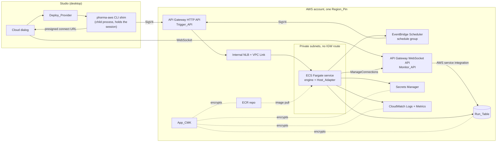
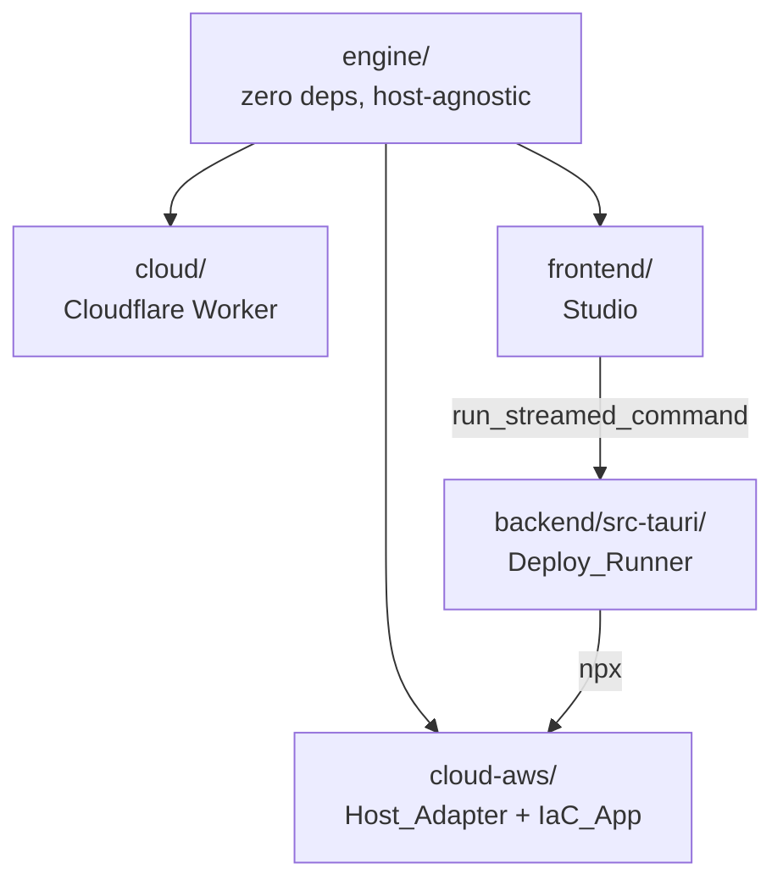
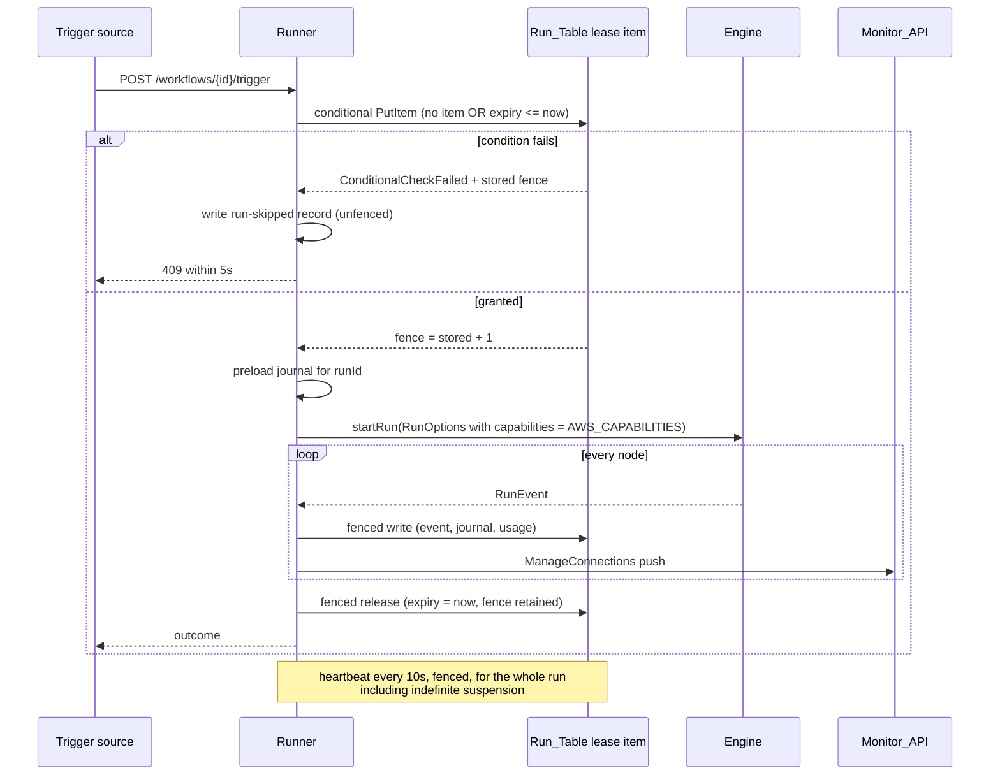
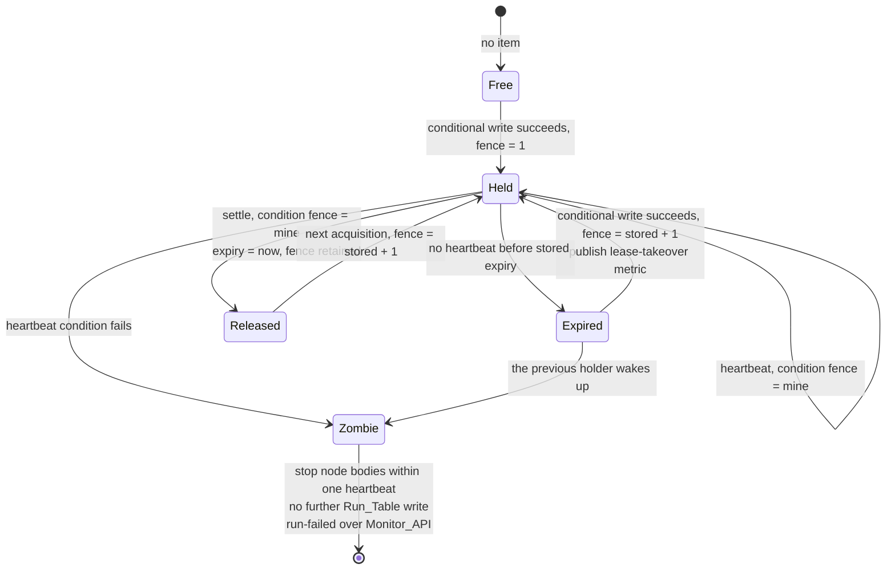

# Design Document

## Overview

Phase 2 adds AWS as a second deploy target beside the Cloudflare Worker. It adds **no engine
subsystem**: `engine/` already exposes every host capability through `RunOptions`, so the work is a
second host adapter, the infrastructure that runs it, the identity and network model around it, and
the Studio seam that lets one dialog drive either target.

Four deliverables:

| # | Deliverable | Where |
| --- | --- | --- |
| 1 | AWS_Host: one container running `@phorma/engine` plus the Host_Adapter on ECS Fargate | `cloud-aws/src/` |
| 2 | IaC_App: the CDK application that creates every resource and fails synthesis on a policy violation | `cloud-aws/src/infra/` |
| 3 | Studio Deploy_Provider: `aws` as a first-class target, plan-then-deploy, zero credentials held | `frontend/src/app/core/deploy/` |
| 4 | Deploy_Guide plus the `aws-host` steering file | `docs/deploy-aws.md`, `.kiro/steering/aws-host.md` |

Plus three small engine additions that are declarations, not behaviour: `AWS_CAPABILITIES`,
`awsSecretName`, and the egress allow-list derivation.

### The correctness core

A Durable Object *is* single-flight per workflow id, guaranteed by the platform. AWS has no free
equivalent, so it is built: a DynamoDB conditional-write **Execution_Lease** carrying a strictly
increasing **Fencing_Token**, heartbeated while a run holds it, and stamped on every Run_Table write
the Runner makes. Everything else in this design is ordinary plumbing. This is not.

The failure this prevents is concrete: a cron firing while a previous run is still walking the graph,
or two tasks alive during a rolling deploy, means the same `http-request` POST or `sql-query` write
applied twice to a customer's system of record.

### Decisions already resolved, and what each costs the design

| Decision | Resolution | Design consequence |
| --- | --- | --- |
| IaC tool | AWS CDK in TypeScript | Reuses the allow-listed `npx` rail in `process.rs` unchanged. No Rust change in this spec. |
| Persistence | DynamoDB single table | Every access pattern is `(workflowId, sortKey)`. Two GSIs, both partitioned by workflow id, cover the two ordered reads. No Scan on any path. |
| Monitor transport | API Gateway WebSocket API | The existing `ControlFrame` union survives byte for byte, so `RunControllerService.apply` needs no host branch. |
| Tenancy | Single estate, BYO only | No tenant prefix today, but every partition key derives from the workflow id, so adding one is a key-prefix change with no migration. |
| Compute | Fargate only | A run is one long-lived in-process graph walk that can suspend indefinitely on an approval; Lambda's 15 minute ceiling fights that. |

### What this design deliberately does not add

No Lambda function, no RDS, no Step Functions, no SQS, no App Runner, no SNS topic of its own (the
notification target is an operator-supplied ARN), and no second IaC surface. Each omission is load
bearing for the permission model: every one of those would widen the Deployment_Identity action list
a platform team has to approve.

### Requirement conflicts found while designing, and the criteria that resolve them

Four acceptance criteria could not all hold as written. All four resolutions were accepted and are
folded into the requirements, so each row below cites the criteria that now carry it rather than a
proposal. Each is also worked through in the design section that owns it; the list stays here so it
is reviewable in one place rather than buried.

| # | Conflict | Resolved in the requirements by |
| --- | --- | --- |
| C1 | Req 15.3 forbade the Runtime_Identity every `iam` action, but Req 6.1 makes the Host_Adapter create Scheduler schedules, and `scheduler:CreateSchedule` requires `iam:PassRole` on the schedule's target role. | Req 15.2 grants exactly one `iam:PassRole` statement whose single resource is the Scheduler_Invoke_Identity role ARN and whose condition requires `iam:PassedToService = scheduler.amazonaws.com`. Req 15.3 names that statement as the sole `iam` exception. Req 15.12 asserts its exact shape against the synthesized template, so a second statement, a second resource or an absent condition fails the check. |
| C2 | Req 15.1 named three roles; the Scheduler target role is a fourth. | Req 15.1 declares four distinct roles. Req 15.6 keeps the Deployment_Identity `iam:PassRole` at two roles, the Runtime_Identity and the Task_Execution_Identity, and states that Scheduler_Invoke_Identity is passed by the Runtime_Identity alone. Req 15.13 gives the fourth role its single action, Req 15.14 its trust policy, and Req 15.15 the check-command assertion over both. |
| C3 | Req 13.8 requires `cloud-aws` check to pass with no AWS credentials, but Req 10.11 and 11.9 required synthesis to fail when a supplied VPC, subnet or key ARN *does not exist* in the region. Existence is not knowable without credentials. | Req 10.11 and 11.9 now cover shape, region match and declared subnet-to-VPC membership, reached credential-free. Req 10.13 and 10.14 put the `ec2:Describe*` existence preflight on the Plan_Command; Req 11.13 and 11.14 do the same with `kms:DescribeKey` for a supplied App_CMK ARN. Each reports the same message its credential-free twin states. No permission amendment was needed: Req 15.5 already grants EC2 describe and Req 11.8 already grants `kms:DescribeKey`. |
| C4 | Req 1.2 required zero AWS references in `engine/src`, but Req 8.3 puts `aws-secrets-manager` in `ConnectionSecretScheme`, Req 16.1 puts `aws-fargate` in `capabilities.ts`, and Req 8.2 puts `awsSecretName` in `connections.ts`. | Req 1.2 is rewritten. The AWS SDK import and coupling prohibition is absolute, covering value imports, type-only imports and dynamic import expressions, and the identifier allow-list names the full declared set of six: `aws-sigv4`, `bedrock`, `aws-secrets-manager`, `aws-fargate`, `awsSecretName`, `AWS_CAPABILITIES`. |

`RunRecordStatus` gaining a `skipped` member is likewise stated outright now rather than left implied:
Req 4.14 declares the member in both structural twins and requires the run history route of Req 4.3 to
serve a skipped run as an ordinary `RunRecordSummary`, Req 4.15 requires all three status switch sites
to render it with no fallback default branch, and Req 4.16 states that a skipped run writes zero usage
ledger entries. See [Data Models](#skipped-runs).

---

## Architecture

### Deployed topology



Two ingress paths, both authenticated, neither reaching the task directly:

- **Trigger_API** is an HTTP API with a private integration through a VPC Link to an **internal**
  NLB in the same private subnets as the tasks. Every route carries `AWS_IAM` authorization, so
  SigV4 and the 300 second signing skew (Req 9.1) are enforced by API Gateway rather than by our
  code.
- **Monitor_API** is a WebSocket API whose `$connect`, `$disconnect` and `$default` routes use an
  **AWS service integration to DynamoDB**, not a Lambda. WebSocket APIs support AWS service
  integrations directly ([Overview of WebSocket APIs in API Gateway](https://docs.aws.amazon.com/apigateway/latest/developerguide/apigateway-websocket-api-overview.html)),
  so a connection record and every inbound ControlFrame land as Run_Table items and the Runner
  drains them. Content rephrased for compliance with licensing restrictions.

Rejected alternative: a Lambda for the WebSocket routes. It is the documented common shape and would
be simpler to write, but it adds a function, a fifth role, `lambda:*` to the Deployment_Identity, and
a second compute surface to the security review. The permission model in Req 15 has room for none of
those. The cost we pay instead is control-frame latency: the Runner polls the frame inbox on a 1
second tick while a run is in flight or suspended, so an approval click lands in at most ~1 second
rather than immediately.

### Package layout and dependency direction



`cloud-aws/` depends on `engine/` through the `@phorma/engine` path alias only, and on nothing else
in the repo (Req 13.1). The Studio never imports from `cloud-aws/`; it reaches it only as a working
directory handed to `npx`. That is what keeps browser parity intact: under plain `ng serve` the AWS
target still produces design-time capability findings (pure engine code) and simply reports that
deploying needs the desktop app.

### Inside `cloud-aws/`

```
cloud-aws/
├─ package.json           # exact CDK pin, shared repo version, check + test scripts
├─ cdk.json               # app entry point, bootstrap qualifier from config
├─ bin/phorma-aws.mjs     # the CLI shim the Studio invokes through npx
├─ src/
│  ├─ core/               # PURE. No AWS SDK import, no I/O. Property-tested.
│  │   ├─ host-contract.ts   # the 10 Runtime_Host_Contract interfaces
│  │   ├─ keys.ts            # Run_Table key derivation
│  │   ├─ lease.ts           # Execution_Lease decisions and fencing
│  │   ├─ journal-codec.ts   # JournalEntry encode/decode + size cap
│  │   ├─ events.ts          # sequence stamping, redaction order, truncation
│  │   ├─ retention.ts       # ttl computation and read-time exclusion
│  │   ├─ schedule-name.ts   # deterministic schedule naming
│  │   ├─ frames.ts          # ControlFrame parsing and routing decisions
│  │   ├─ retry.ts           # attempt budgets and failure classification
│  │   └─ config.ts          # deployment configuration parse + validate
│  ├─ aws/                # SDK adapters. One file per service, thin.
│  │   ├─ run-table.ts       # DynamoDB: implements 8 of the 10 capabilities
│  │   ├─ secrets.ts         # Secrets Manager: ConnectionStore + provider keys
│  │   ├─ scheduler.ts       # EventBridge Scheduler
│  │   ├─ monitor.ts         # ManageConnections push
│  │   └─ telemetry.ts       # structured logs + metric data points
│  ├─ server/
│  │   ├─ runner.ts          # one run: lease, RunOptions, engine, settle
│  │   ├─ trigger-routes.ts  # Trigger_API handlers behind the NLB
│  │   └─ startup.ts         # contract completeness assertion (Req 1.9)
│  └─ infra/              # CDK constructs + synth-time Aspects
├─ test/                 # *.e2e.mts scenario scripts (tsx), mirroring engine/
└─ scripts/check-*.mjs   # no-scan, engine-alias, IAM deny-list checks
```

The `core/` and `aws/` split is the whole testing strategy in one decision. Every rule that has to
hold for all inputs lives in `core/`, which runs in plain vitest with no AWS present; `aws/`
contains only the translation of a decision into an SDK call.

### The Runtime_Host_Contract

Exactly ten capabilities, one interface each, no eleventh member (Req 1.1). Eight are served by
Run_Table.

| # | Capability | Interface | Origin | AWS implementation |
| --- | --- | --- | --- | --- |
| 1 | Spec storage | `SpecStore` | new | Run_Table item `sk = spec` |
| 2 | RunJournal | `JournalStore` wrapping engine `RunJournal` | engine | Run_Table `sk = journal#…`, preloaded per run |
| 3 | Run history | `RunHistoryStore` | new | Run_Table `sk = run#…` + GSI1 |
| 4 | Run events | `RunEventStore` | new | Run_Table `sk = event#…` |
| 5 | Usage ledger | `UsageLedgerStore` | new | Run_Table `sk = usage#…` + GSI2 |
| 6 | Workflow state | engine `WorkflowStateStore` | engine | Run_Table `sk = state#…` |
| 7 | Connections | engine `ConnectionStore` | engine | Secrets Manager + spec-pushed metadata |
| 8 | Scheduled runs | `ScheduleStore` | new | EventBridge Scheduler schedule group |
| 9 | Live monitor | `MonitorGateway` | new | Monitor_API push + Run_Table frame inbox |
| 10 | Execution_Lease | `LeaseStore` | new | Run_Table item `sk = lease` |

`startup.ts` holds a frozen array of those ten keys and asserts at boot that the composed adapter
provides a live implementation for every capability `AWS_CAPABILITIES` declares present. A missing
one fails startup before the NLB target passes its first health check, so no trigger request is ever
accepted (Req 1.9). The array is also what makes an eleventh member a deliberate act.

### One trigger, end to end



### Execution_Lease state machine



Three properties do the work, and each is a single conditional write, never a read followed by a
write (Req 2.13):

- **Acquire**: condition is `attribute_not_exists(pk) OR expiresAtMs <= :now`, and the same
  expression sets `fence = if_not_exists(fence, :zero) + 1`. One round trip establishes both
  exclusivity and the token (Req 2.1, 2.2).
- **Heartbeat and release**: condition is `fence = :mine`. Release sets `expiresAtMs = :now` and
  keeps `fence`, so the highest token ever issued is never forgotten (Req 2.4).
- **Every other write**: condition is `fence = :mine` on the lease item, expressed as a
  `TransactWriteItems` with a `ConditionCheck` on the lease plus the data write. A zombie's write
  fails the check, changes nothing, and is never retried (Req 2.5, 2.6).

Heartbeat interval is fixed at **10 seconds**; expiry is always `now + 60s`. That satisfies "at
least 3 heartbeat intervals, at most 300 seconds" (Req 2.9) with room for two missed beats, and it
bounds takeover latency after a task dies at one minute.

### Studio to AWS: no credential ever enters the webview

The Studio must sign Trigger_API requests with the operator's ambient session (Req 9.8) while
holding no key, secret or session token anywhere (Req 14.7). The webview cannot do both, so it does
neither: every AWS call goes through **`phorma-aws`**, a CLI shim shipped inside `cloud-aws`,
invoked as `npx phorma-aws <verb>` with `cwd` set to the configured `cloud-aws` directory. It
inherits the ambient profile or SSO session exactly like `wrangler` does today, and the studio sets
no AWS environment variable on it (Req 14.8).

| Verb | Purpose | Output |
| --- | --- | --- |
| `plan` | the Plan_Command: `cdk diff` plus the deploy-time existence preflight (Req 10.13, 11.13) | streamed lines |
| `deploy` | `cdk deploy` | streamed lines |
| `request` | one SigV4-signed HTTPS call to Trigger_API, body on **stdin** | sentinel envelope on stdout |
| `monitor-url` | presign a Monitor_API `$connect` URL from the ambient session | sentinel envelope |
| `doctor` | session validity and `cloud-aws` entry-point checks | exit code |

Three existing rails make this cheap and are reused rather than extended:

- `run_streamed_command` already allow-lists `npx` (`ALLOWED_PROGRAMS` in `process.rs`), so **no
  Rust change is needed** in this spec.
- Its `stdin_data` parameter already exists for `wrangler secret put`, so a Connection secret value
  travels webview to child process on stdin, never in argv and never into the console (Req 8.9).
- Its line-by-line `process-output-event` stream is already wired to the console, so `plan` and
  `deploy` streaming is the Deploy_Runner behaviour the Cloudflare target has today (Req 14.4,
  14.6).

`request` responses come back as sentinel-prefixed stdout lines (`__phorma__:{seq}:{chunk}`) that
the Studio reassembles and never prints. This is only viable because every Trigger_API read is
capped and paginated - 100 summaries or 1000 events per response with a continuation token
(Req 4.3, 4.5) - which bounds an envelope at a few hundred kilobytes.

The monitor is a real browser `WebSocket` opened on a presigned `$connect` URL, which is a SigV4
signature produced from the caller's session (Req 7.11) and is not a credential the Studio can reuse
for anything else.

Rejected alternative: a loopback signing proxy (`phorma-aws proxy`) that the webview calls over
plain `fetch`. It is cleaner to consume and would remove the envelope reassembly, but it puts an
HTTP listener holding live AWS credentials on the operator's machine for the lifetime of the
session. In a feature whose entire premise is "no configuration of this host can leave an open
door", that is the wrong trade even bound to `127.0.0.1` behind a one-time token.

### Where AWS knowledge is allowed to live

| Layer | May know about AWS | Enforced by |
| --- | --- | --- |
| `engine/src` | Only the declared identifiers: `aws-sigv4`, `bedrock`, `aws-secrets-manager`, `aws-fargate`, `awsSecretName`, `AWS_CAPABILITIES` | `scripts/check-engine-purity.mjs`, an allow-listed grep (Req 1.2, resolves C4) |
| `cloud-aws/src/core` | Names and shapes, no SDK | no `@aws-sdk/*` import permitted in the folder |
| `cloud-aws/src/aws` | Everything | - |
| `frontend` | Target ids, command lines, URL shapes, region and account validation | `DEPLOY_TARGETS` registry is the only place |

`cloud-aws` also fails its build if engine source resolves from anything but the `@phorma/engine`
alias (Req 1.7): `check-engine-alias.mjs` asserts the tsconfig path exists and that no file imports
a relative path crossing into `../engine`.

---

## Components and Interfaces

### 1. Engine additions (declarations only)

Three changes, all pure, all shared with the Studio.

**`AWS_CAPABILITIES` in `engine/src/capabilities.ts`** (Req 16.1, 16.2, 6.8, 10.7, 10.8, 8.3):

```ts
export const AWS_CAPABILITIES: HostCapabilities = {
  id: 'aws-fargate',
  label: 'AWS (ECS Fargate)',
  // Every kind. AWS_Host is the only deployed host that can reach a private
  // network, so nothing is excluded for reachability; stdio MCP is excluded by
  // `features`, not by kind, exactly as on the worker.
  nodeKinds: [...ALL_NODE_KINDS],
  sqlDrivers: ['postgres', 'mysql', 'mssql', 'sqlite'],
  connectionTypes: [...ALL_CONNECTION_TYPES],
  connectionSecretScheme: 'aws-secrets-manager',
  features: {
    cron: true,
    durableState: true,
    fixtures: true,
    privateNetworkEgress: true,
    stdioMcp: false,
    // An OAuth session never leaves the device that signed in.
    mcpOAuth: false,
  },
};
```

`HOST_CAPABILITIES` gains it, making four records (Req 16.7). `mssql` is then declared by the
desktop host and AWS_Host only, which is the whole reason this spec exists.

`ConnectionSecretScheme` in `engine/src/data-host.ts` gains `'aws-secrets-manager'`, and
`secretRemedy` in `capabilities.ts` gains a case naming the exact Secrets Manager entry to create -
the same treatment `cloudflare-worker-env` gets today, so a missing-secret finding stays actionable
on the new host.

**`awsSecretName` in `engine/src/connections.ts`** (Req 8.2), beside `connectionSecretName` and
`workerSecretName`:

```ts
/**
 * Secrets Manager entry name for one connection field, under the prefix the
 * IaC_App owns. Deterministic, injective over (connectionId, secretKey), and
 * capped at 512 characters. Secrets Manager permits `/_+=.@-` in names, so the
 * connection id (already `^conn-[A-Za-z0-9_-]{1,64}$`) needs no escaping and
 * only the secret key is normalised.
 */
export function awsSecretName(prefix: string, connectionId: string, secretKey: string): string;
```

Injectivity is the property that matters: two different `(connectionId, secretKey)` pairs must never
collide, or one connection reads another's credential. The design keeps the separator (`/`) out of
the normalised character class so a key containing the separator cannot forge a different pair.

**`deriveEgressAllowList` in a new `engine/src/egress.ts`** (Req 10.4, 10.5, 10.12). It builds on
the existing `inspectAgainstCapabilities`, which already collects statically determinable hosts and
already warns about interpolated urls, and adds the provider hostnames. Provider endpoints already
live in `engine/src/model.ts`, so this stays host-agnostic:

```ts
export interface EgressAllowList {
  /** Distinct hostnames, lower-cased, alphabetical, capped at 200. */
  hosts: string[];
  /** Nodes whose outbound host is not statically determinable. */
  undeterminable: { nodeId?: string; nodeName?: string; message: string }[];
  /** True when the 200 cap dropped entries. */
  capped: boolean;
}

export function deriveEgressAllowList(input: {
  specs: readonly CapabilityValidationTarget[];
  connections: readonly ConnectionSummary[];
  providers: readonly ModelProviderId[];
}): EgressAllowList;
```

### 2. `cloud-aws/src/core` - the pure layer

**`host-contract.ts`** declares the ten interfaces and the frozen capability-name array. The four
engine-owned ones are re-exported types, not redeclarations, so drift is impossible.

```ts
export const RUNTIME_HOST_CAPABILITIES = [
  'spec', 'journal', 'runHistory', 'runEvents', 'usageLedger',
  'workflowState', 'connections', 'schedules', 'monitor', 'lease',
] as const;              // exactly 10, Req 1.1

export interface SpecStore {
  read(workflowId: string): Promise<StoredSpec | undefined>;
  write(workflowId: string, spec: StoredSpec): Promise<void>;
  delete(workflowId: string): Promise<void>;
}

export interface JournalStore {
  /** Every entry for one run, paginated, for at least 1000 entries (Req 3.3). */
  preload(workflowId: string, runId: string): Promise<Map<string, JournalEntry>>;
  record(workflowId: string, runId: string, key: string, entry: JournalEntry): Promise<void>;
  deleteRun(workflowId: string, runId: string): Promise<void>;
  deleteOtherRuns(workflowId: string, keepRunId: string): Promise<void>;
}

export interface LeaseStore {
  acquire(workflowId: string, runnerId: string, nowMs: number): Promise<LeaseOutcome>;
  heartbeat(lease: HeldLease, nowMs: number): Promise<boolean>;
  release(lease: HeldLease, nowMs: number): Promise<boolean>;
}
```

`preload` exists because the engine's `RunJournal.lookup` is **synchronous**. The Runner reads every
entry for the run id before the engine executes its first node and hands the engine a
`RunJournal` closed over that map. Req 3.2's "hold no journal entry in process memory beyond that
resolution" is read as forbidding a write-behind cache of *recorded* entries, not the replay map the
engine's sync contract requires - a distinction worth stating because a literal reading makes the
requirement unimplementable.

**`lease.ts`** is the decision layer, and it is pure: it takes the current stored item and a clock
and returns the write to attempt plus the classification of a failure.

```ts
export const HEARTBEAT_MS = 10_000;
export const LEASE_TTL_MS = 60_000;

export function nextFence(stored: LeaseItem | undefined): number;         // 1, or stored + 1
export function expiryFor(nowMs: number): number;                          // now + LEASE_TTL_MS
export function acquireWrite(workflowId: string, runnerId: string, nowMs: number): ConditionalWrite;
export function fencedWrite(lease: HeldLease, item: RunTableItem): TransactWrite;
export function classify(error: unknown): 'condition' | 'transient' | 'fatal';
export function isZombie(lease: HeldLease, stored: LeaseItem | undefined): boolean;
```

`classify` is what keeps Req 2.7 and Req 2.16 distinguishable: a condition failure means another
Runner holds the lease and answers 409; a transient failure means the lease state is unknown and
answers a different error after at most 3 attempts in 5 seconds. Conflating them would tell an
operator "already running" when the truth is "DynamoDB throttled us".

**`keys.ts`** owns every Run_Table key. One module, so Req 18.2 and Req 18.3 are checkable by
reading one file, and a future tenant prefix is one function change.

**`events.ts`** holds the persistence pipeline for one RunEvent, in a fixed order that the
properties depend on: stamp sequence, apply the node's payload-persistence setting, apply the
Redactor, measure UTF-8 bytes, truncate to 300 KB and flag, then emit the item. Redaction before
measurement is deliberate: measuring first would let a redacted payload land under the cap and a raw
one over it, making truncation depend on secret length.

**`frames.ts`** parses an inbound ControlFrame and returns a routing decision (`resolve-approval`,
`resolve-question`, `resolve-wait`, `buffer-event`, `start-run`, `stop`, `ignore`). It never touches
state, which is what makes Req 7.15's "ignore and leave everything unchanged" testable.

**`retry.ts`** wraps the per-category attempt budgets the requirements state separately
(lease 3/5s, journal 3/10s, audit 3, secret 3/10s, metric 3) into one table, so a budget cannot
drift per call site.

### 3. `cloud-aws/src/aws` - the SDK layer

`run-table.ts` implements capabilities 1-6 and 10 plus the frame inbox against one
`DynamoDBDocumentClient`. Every method takes a partition key and issues `GetItem`, `PutItem`,
`UpdateItem`, `DeleteItem`, `Query`, `BatchWriteItem` or `TransactWriteItems`. There is no `Scan`
import in the file, and `check-no-scan.mjs` asserts that for the whole package (Req 18.6).

`secrets.ts` implements the engine `ConnectionStore`. Order of operations is fixed by Req 8.1 and
8.10: `assertConnectionId` first, then resolve each name in `secretKeys` declaration order, stopping
at the first absent one with a message naming the Connection and that key, then seed the Redactor
with every resolved value of 8 characters or more (Req 8.11) before any of them can reach a run
event, a log line or a metric dimension.

`scheduler.ts` implements `ScheduleStore`. A spec push is delete-all-then-create-all, in that order,
with every deletion confirmed before the first create (Req 6.2), and a create failure rolls back
every schedule created during that push (Req 6.10). Validation runs before any mutation, so an
invalid cron or a 51st `schedule-trigger` node leaves the previous deployment untouched (Req 6.9).

`monitor.ts` pushes with `PostToConnection` and treats `GoneException` as "discard this connection
id and continue" (Req 7.13). It holds `execute-api:ManageConnections` and nothing else against
Monitor_API (Req 7.12).

`telemetry.ts` writes single-line JSON logs carrying workflow id, level, ISO timestamp and, while a
run is in flight, the run id (Req 12.1), and publishes the six metric names (Req 12.2). Both go
through the same Redactor instance the ConnectionStore seeded, so Req 12.8 is a wiring fact rather
than a discipline.

### 4. `cloud-aws/src/server`

**`runner.ts`** is one run's lifecycle: acquire, preload, compose `RunOptions`, start the engine,
fan events out to Run_Table and Monitor_API, drain the frame inbox on a 1 second tick, heartbeat on
a 10 second tick, settle, release, delete the journal.

`RunOptions` composition is where Req 1.5 and Req 1.6 meet. `capabilities` is always
`AWS_CAPABILITIES` and the adapter declares no capability value of its own. For any capability the
record declares absent the adapter leaves the corresponding `RunOptions` member **absent**, so the
engine's existing missing-capability failure names AWS_Host - no new error path, and the message an
operator sees is the one the other hosts already produce.

**`trigger-routes.ts`** serves the Trigger_API surface behind the NLB:

| Route | Purpose | Portal-eligible |
| --- | --- | --- |
| `POST /workflows/{id}/spec` | spec + Connection metadata push | no (Req 9.7) |
| `POST /workflows/{id}/trigger` | manual, webhook and scheduled runs | yes |
| `DELETE /workflows/{id}` | purge | no |
| `GET /workflows/{id}/runs` | run history summaries | no |
| `GET /workflows/{id}/runs/{runId}` | run detail | no |
| `GET /workflows/{id}/usage` | usage ledger | no |
| `GET /workflows/{id}/connections` | Connection inventory (`ConnectionSummary`) | no |
| `PUT /connections/{connId}/secrets/{key}` | Secret_Store write | no |

Authentication is the API's, not ours. Existence checks run only after authorization succeeds, so an
unauthenticated caller cannot enumerate workflow ids (Req 9.9).

**`startup.ts`** runs the contract completeness assertion, then reports healthy to the NLB.

### 5. `cloud-aws/src/infra` - the IaC_App

One stack, `PhormaAwsHostStack`, composed of constructs so a reviewer reads it by concern:
`NetworkConstruct`, `DataConstruct`, `SecretsConstruct`, `ComputeConstruct`, `TriggerApiConstruct`,
`MonitorApiConstruct`, `ScheduleConstruct`, `IdentityConstruct`, `ObservabilityConstruct`. Every
resource name and the stack name carry the configured prefix (Req 13.7), and the bootstrap qualifier
is applied through `DefaultStackSynthesizer` (Req 13.3).

Policies are **managed policies with derived names**, never inline (Req 13.6), which is what lets a
platform team review by name.

Six CDK **Aspects** turn a policy violation into a synthesis failure rather than a review finding:

| Aspect | Fails synthesis when | Req |
| --- | --- | --- |
| `PermissionsBoundaryAspect` | any `CfnRole` lacks the configured boundary, or no boundary is configured | 13.4, 13.5 |
| `CustomerKeyAspect` | Run_Table, a secret, a log group or the ECR repo synthesizes without App_CMK | 11.1 |
| `AuthorizerAspect` | a Trigger_API or Monitor_API route has no authorizer and no portal opt-in | 9.5, 9.11 |
| `NoIamUserAspect` | the template declares an IAM user or an access key | 15.8 |
| `AlarmTargetAspect` | an alarm has no notification target | 12.5 |
| `TagAspect` | the cost-allocation tag set is missing or any tag value is empty | 12.6, 12.7 |

Config validation (region shape, App_CMK ARN shape and region match, VPC and subnet id shape,
declared subnet-to-VPC membership) runs in `core/config.ts` before any construct is created, so
`SHALL create no resource` holds by construction. Existence checks are the Plan_Command's job
(Req 10.13, 10.14, 11.13, 11.14), using `Vpc.fromVpcAttributes` rather than `Vpc.fromLookup` so
synthesis needs no credentials (Req 13.8), and the credential-free check command of Req 13.8 makes no
existence call of its own.

### 6. Identities

Four roles, as Req 15.1 declares. The fourth exists because IAM requires it (C1, C2).

| Role | Holds | Notably does not hold |
| --- | --- | --- |
| Deployment_Identity | CloudFormation, asset staging, IAM role creation under a path prefix with the boundary condition, ECS, DynamoDB create, Secrets Manager create, Scheduler, API Gateway, `kms:CreateGrant`/`DescribeKey`, `ec2:Describe*`; `iam:PassRole` limited to the Runtime_Identity and the Task_Execution_Identity (Req 15.6) | `secretsmanager:GetSecretValue`, `dynamodb:GetItem`/`Query`/`Scan`, `kms:Decrypt` |
| Runtime_Identity | Run_Table item actions on the table and its indexes, `secretsmanager:GetSecretValue` on the app prefix, `kms:Decrypt` on App_CMK with a `ViaService` condition naming DynamoDB, Secrets Manager and CloudWatch Logs, `execute-api:ManageConnections` on the Monitor_API stage, log stream and log event writes, metric publication in the app namespace, Scheduler create/delete/read on the app group, **one** `iam:PassRole` on Scheduler_Invoke_Identity, and Bedrock invocation on configured model ARNs where that provider is configured | every other `iam` action, all `ecs`, all `ecr`, all `s3`, `dynamodb:Scan`, every `secretsmanager` action but `GetSecretValue` |
| Task_Execution_Identity | image pull on the app repo, log stream creation, the App_CMK permissions the pull path needs | any Run_Table action, any `secretsmanager` action |
| Scheduler_Invoke_Identity | `execute-api:Invoke` on the single scheduled-run route | everything else |

Scheduler_Invoke_Identity holds the one action Req 15.13 states and is trusted only by
`scheduler.amazonaws.com` with the `aws:SourceArn` condition Req 15.14 scopes to the schedule group,
and the Runtime_Identity's single `iam:PassRole` statement is conditioned on
`iam:PassedToService = scheduler.amazonaws.com` and that one role ARN (Req 15.2, 15.3). The check in
Req 15.12 asserts the Runtime policy grants nothing Req 15.3 excludes **and** that this statement
matches that exact shape, and the check in Req 15.15 asserts the fourth role's action set and trust
policy, so widening either fails the check. Req 15.6 leaves the Deployment_Identity passing only the
Runtime_Identity and the Task_Execution_Identity.

Rejected alternative for C1: make schedules an IaC concern so the Deployment_Identity passes the
role and the Runtime holds no `iam` action at all. It works, and it means every spec push needs a
`cdk deploy` - which contradicts Req 6.1, 6.2 and the whole "push a workflow" flow.

### 7. Studio: Deploy_Provider

`core/deploy/deploy-targets.ts` is a **leaf module**: pure data and functions, no `inject`, no
service dependency. That placement is deliberate. The known DI hazard in this repo is the
`RunControllerService -> ModelTransportService -> PhormaCloudService -> CloudService` chain, and
`CloudService` legitimately injects `RunControllerService`; a registry that injected `CloudService`
to read a URL would close it. This module follows `core/phorma-cloud-url.ts`.

```ts
export type DeployTargetId = 'phorma' | 'cloudflare' | 'aws';

export interface DeployCommand {
  program: 'npx';            // already allow-listed in process.rs
  args: string[];
  cwd: string;
}

export interface DeployTarget {
  id: DeployTargetId;
  label: string;
  /** The record design-time and push-time validation runs against (Req 16.3). */
  capabilities: HostCapabilities;
  connectionSecretScheme: ConnectionSecretScheme;
  desktopOnly: boolean;
  /** Absent for targets with no plan step; present for `aws`, where it is the Plan_Command (Req 14.4). */
  planCommand?(ctx: DeployContext): DeployCommand | null;
  deployCommand(ctx: DeployContext): DeployCommand | null;
  /** The ONLY place a deployed-instance URL is shaped (Req 14.3). */
  instanceUrl(base: string, workflowId: string): string;
}

export const DEPLOY_TARGETS: Readonly<Record<DeployTargetId, DeployTarget>>;
```

`instanceUrl` is what retires the assumption that every deployed workflow lives at
`/agents/workflow-agent/{id}`: that shape becomes the Cloudflare and Phorma entry, and `aws` returns
`{base}/workflows/{id}`. `CloudService` and the Cloud dialog read behaviour from the record and carry
no `if (target === 'aws')` branch (Req 14.2).

`SettingsService.CloudProviderChoice` gains `'aws'`; the existing `phorma.layout.cloudProvider`
persistence carries it with no migration (Req 14.1).

Two new services, both narrow:

- **`AwsDeployConfigService`** mirrors `DeployConfigService`: signals for account id, region, name
  prefix, permissions boundary ARN, VPC and subnet ids, App_CMK ARN, tag set, retention days,
  notification target, bootstrap qualifier and the `cloud-aws` directory; `computed` validators for
  each (Req 14.13); and `buildConfigFile()` producing a **gitignored** `cdk.context.phorma.json`
  beside `cdk.json` with the same generated-file header the wrangler override uses (Req 14.12).
- **`AwsCliService`** owns the `phorma-aws` invocations: at most one command per target at a time
  with a cancel affordance (Req 14.14), the Plan_Command before deploy with an explicit
  `ConfirmDialogService` confirmation that is never offered when the Plan_Command exited non-zero
  (Req 14.5, 10.14, 11.14), and exit-code mapping that appends the `aws sso login` next step on an authentication
  failure (Req 14.9, 9.13). It injects `TauriService`, `TerminalOutputService`, `ToastService` and
  `ConfirmDialogService` - never `CloudService`.

Capability findings need no new surface: `CapabilityFindingsService` already computes
`deployFindings` against `CLOUDFLARE_CAPABILITIES` and forces them to `warning` with
`deployOnly: true`. It changes to read `DEPLOY_TARGETS[target].capabilities`, so selecting `aws`
re-derives the findings into the same Problems console (Req 16.3), and the deployOnly findings stay
warnings so they never block a local run.

---

## Data Models

### Run_Table

One table, `{prefix}-run-table`, on-demand capacity, encrypted with App_CMK, TTL attribute `ttl`
(epoch **seconds**), point-in-time recovery on.

| Attribute | Type | Notes |
| --- | --- | --- |
| `pk` | S | Always `wf#{workflowId}` (Req 18.2, 2.12) |
| `sk` | S | Item discriminant, below |
| `fence` | N | The writing Runner's Fencing_Token, on every run-scoped item |
| `ttl` | N | Epoch seconds, on events, runs, usage, state and frames |
| `gsi1pk` / `gsi1sk` | S | Run history index |
| `gsi2pk` / `gsi2sk` | S | Usage ledger index |

Sort keys, one row per capability:

| `sk` | Item | Written by | Retention |
| --- | --- | --- | --- |
| `spec` | Pushed `WorkflowSpec` + Connection metadata + settings | spec push | until purge |
| `lease` | Execution_Lease: `fence`, `expiresAtMs`, `runId`, `runnerId` | Runner | until purge |
| `run#{runId}` | `RunRecord` summary + graph snapshot | Runner | retention days |
| `journal#{runId}#{journalKey}` | `JournalEntry` | Runner | deleted on settle |
| `event#{runId}#{seq:012d}` | one `RunLogEvent` | Runner | retention days |
| `usage#{runId}#{nodeId}` | `UsageLedgerEntry` slice | Runner | retention days |
| `state#{scopedKey}` | `StateEntry` | engine via adapter | per-entry TTL |
| `frame#{arrivedAtMs}#{connectionId}#{n}` | inbound ControlFrame | Monitor_API integration | 1 hour |
| `conn#{connectionId}` | monitor connection record | Monitor_API integration | 2 hours |
| `skip#{atMs}#{runId}` | skipped-run record | Runner, **unfenced** | retention days |

`seq` is zero-padded to 12 digits so lexicographic sort key order equals numeric sequence order -
the read path then needs no in-memory sort and Req 4.2's ordering is a property of the key, not of
the query.

Two indexes, both partitioned by workflow id so no read is ever cross-partition:

| Index | pk | sk | Serves |
| --- | --- | --- | --- |
| GSI1 | `wf#{workflowId}#runs` | `{startedAt:013d}#{runId}` | run history, descending, 100 per page (Req 4.3) |
| GSI2 | `wf#{workflowId}#usage` | `{startedAt:013d}#{runId}#{nodeId}` | usage `since`, ascending, 1000 per page (Req 4.5) |

Why 300 kilobytes appears twice in the requirements: DynamoDB caps an item at 400 KB. A 300 KB
payload leaves headroom for keys, sequence numbers, scope arrays and the fence attribute, so a
journal entry that fits the cap always fits the item. A journal entry over the cap **fails the run**
(Req 3.10) because a truncated journal entry would replay wrong output as if it were correct; a run
event over the cap is **truncated and flagged** (Req 4.7) because an event is a record of what
happened, not an input to anything.

### Execution_Lease

```ts
interface LeaseItem {
  pk: string;            // wf#{workflowId}
  sk: 'lease';
  fence: number;         // strictly increasing, never reset, never deleted
  expiresAtMs: number;   // absolute UTC epoch milliseconds (Req 2.1)
  runId: string | null;
  runnerId: string;      // task id + process start, for the takeover metric
  acquiredAtMs: number;
}

interface HeldLease {
  workflowId: string;
  runId: string;
  fence: number;
  runnerId: string;
}
```

Every timestamp on this item is absolute epoch milliseconds, compared numerically. No duration, no
local clock offset, no ISO string: a lease decided by string comparison or by a relative TTL is a
lease that can be wrong across a task restart.

### Skipped runs

`RunRecordStatus` gains a fourth member, as Req 4.14 states:

```ts
export type RunRecordStatus = 'running' | 'completed' | 'failed' | 'stopped' | 'skipped';
```

This is a **structural twin change**: `engine/src/types.ts` re-exports through `run-record.ts`, and
`frontend/src/app/core/workflow.model.ts` carries the twin, so both change or neither compiles.
Req 4.15 names the three status switch sites that need a case and forbids reaching the member through
a fallback default branch at any of them: `runs-panel.statusIcon`, `portal-panel.runStatusIcon`, and
the usage analytics status facet - which sees no skipped rows, because Req 4.16 requires a skipped run
to write zero usage ledger entries. It consumed nothing. The run history route of Req 4.3 serves a
skip as an ordinary `RunRecordSummary`.

The alternative was to record a skip as `failed`. It is rejected: Req 6.4 requires a skipped
scheduled run to publish the *skipped* metric and leave the schedule enabled, while Req 6.7 and
Req 12.3 alarm on *failed* scheduled runs. Overloading the status would page an operator every time
single-flight did its job.

A skip record carries `status: 'skipped'`, the trigger source, the holding Fencing_Token, and, for a
scheduled skip, the schedule name (Req 2.7, 6.4). It is the one item exempt from the fencing
condition, because by definition its writer holds no lease (Req 2.5).

### Secret_Store

One entry per `(connectionId, secretKey)` pair plus one per configured model provider, all under the
prefix the IaC_App owns:

```
{prefix}/conn/{connectionId}/{normalisedSecretKey}
{prefix}/provider/{providerId}
```

Names are produced only by `awsSecretName`. Purge deliberately preserves every entry (Req 4.10): a
Connection secret is shared across workflows, and deleting it with one workflow would break the
others.

### Deployment configuration

`cdk.context.phorma.json`, generated by the Studio, gitignored, regenerated on every deploy:

```ts
interface AwsDeployConfig {
  accountId: string;              // exactly 12 digits
  region: string;                 // Region_Pin, syntactically valid
  namePrefix: string;             // 1-32 chars of [a-z0-9-]
  permissionsBoundaryArn: string; // required; absent fails synthesis (Req 13.5)
  bootstrapQualifier: string;
  appCmkArn?: string;             // absent = create a CMK in the Region_Pin
  vpc?: { id: string; subnetIds: string[] };  // absent = create a VPC
  dataSourceSecurityGroupId?: string;
  egressAllowList: string[];      // derived by the Studio, reviewed by the operator
  costAllocationTags: Record<string, string>; // non-empty values required
  retentionDays: number;          // 1-366, default 30
  alarmNotificationArn: string;   // required; absent fails synthesis (Req 12.5)
}
```

Every field is validated twice: in the Studio before any command runs (Req 14.13) and in
`core/config.ts` at synthesis. The duplication is intentional - the Studio's copy gives a fast,
per-field message in the dialog, and the synthesis copy is what protects an operator running `npx
cdk deploy` by hand.

---

## Correctness Properties

*A property is a characteristic or behavior that should hold true across all valid executions of a
system - essentially, a formal statement about what the system should do. Properties serve as the
bridge between human-readable specifications and machine-verifiable correctness guarantees.*

These are property tested because the load-bearing logic of this feature is pure: the
Execution_Lease decisions, key derivation, journal codec, event pipeline, frame routing, schedule
naming, secret naming and egress derivation are all functions from inputs to decisions, with an
in-memory `FakeRunTable` reproducing DynamoDB's conditional-write semantics. The CDK template, the
IAM action lists, the API Gateway authorizers and the guide are **not** property tested; they are
covered by template assertions, deny-lists, docs checks and one deployed-account verify pass -
see [Testing Strategy](#testing-strategy).

### Property 1: Lease grant is exclusive and fencing tokens strictly increase

*For any* stored Execution_Lease state and *any* number of Runners between 2 and 100 attempting to
acquire it concurrently, at most one attempt succeeds; the granted Fencing_Token is 1 when no item
existed and the stored token plus 1 otherwise, is strictly greater than every token previously issued
for that workflow id across any history of acquisitions, expiries and releases, and is established by
the same single conditional write that granted the lease; every failed attempt reports the granted
token.

**Validates: Requirements 2.1, 2.2, 2.10, 2.14**

### Property 2: Every Runner write is fenced, and a Zombie_Runner changes nothing

*For any* run and *any* point in that run at which the stored Fencing_Token is superseded, every
Run_Table write the superseded Runner attempts is rejected, leaves the stored item byte-identical, is
never retried, and is followed by no further Run_Table write for that run; the Runner starts no
further node body within one heartbeat interval and reports exactly one `run-failed` RunEvent naming
lease loss. Every write a lease-holding Runner makes carries the Fencing_Token condition, with the
single exception of a run-skipped record written by a Runner holding no lease.

**Validates: Requirements 2.5, 2.6, 2.15**

### Property 3: Lease expiry stays inside its bounds across the whole lifecycle

*For any* clock value, the expiry an acquisition or a heartbeat writes is at least three heartbeat
intervals and at most 300 seconds after that clock value; *for any* held lease, a heartbeat succeeds
exactly when the stored token equals the Runner's; a release sets the expiry to the release time and
leaves the stored token in place, so the next acquisition observes the highest token ever issued; and
*for any* suspension duration, heartbeats continue at the interval with no suspension-specific
timeout applied.

**Validates: Requirements 2.3, 2.4, 2.9, 2.11**

### Property 4: The lease key is a function of the workflow id alone

*For any* two run contexts that differ only in run id, trigger source, task id or process id, the
Execution_Lease partition key is identical; *for any* two distinct workflow ids it differs. The same
holds for every other Run_Table partition key builder, so two runs of one workflow contend for one
item and runs of different workflows contend for none.

**Validates: Requirements 2.12, 18.2**

### Property 5: A contended trigger starts no run and records exactly one skip

*For any* trigger source and *any* unexpired Execution_Lease, the trigger starts no run, writes
exactly one run-skipped record carrying the workflow id, the trigger source, the holding
Fencing_Token and - for a scheduled fire - the schedule name, answers an HTTP caller 409 within 5
seconds or a monitor caller with one synthetic `run-failed` naming that token, publishes the skipped
metric for a scheduled fire, leaves the in-flight run unaffected, leaves the schedule enabled, and
writes zero usage ledger entries for that run id.

**Validates: Requirements 2.7, 4.16, 6.4, 7.8**

### Property 6: The lease write is the first Run_Table operation of every trigger

*For any* trigger source, including a schedule fire, a webhook, a manual call and a monitor `trigger`
frame, the first Run_Table request the Host_Adapter issues is the Execution_Lease conditional write,
and whether the run starts is decided from that write's outcome alone with no preceding read.

**Validates: Requirements 2.13, 7.7**

### Property 7: Journal entries round-trip, and an unreadable entry reads as absent

*For any* `JournalEntry`, decoding its encoded form yields a deep-equal entry whose serialized object
carries no field the engine does not read; *for any* stored value that is not a decodable
`JournalEntry`, lookup reports that key absent, the node executes normally, the run continues, and
recording overwrites that key.

**Validates: Requirements 3.7, 3.8**

### Property 8: Resume replays completed work without repeating a side effect

*For any* spec and *any* point at which the Runner is replaced, restarting the run with the same run
id and trigger input replays every journaled node - performing no model call, tool call, HTTP request
or SQL statement for it - and resumes real execution at the first un-journaled node; the preload
returns every persisted entry for that run id across as many pages as the entry count requires; a
start that is not a resume first deletes every entry belonging to a different run id; and journal
deletion on settle happens only after the run record and every run event are persisted.

**Validates: Requirements 3.1, 3.3, 3.4, 3.5, 3.6**

### Property 9: Run events are contiguously sequenced and read back in emission order

*For any* run, the persisted RunEvents carry sequence numbers exactly 1 through N in emission order
with no gap and no repeat, and every read serves them ordered by ascending sequence.

**Validates: Requirements 4.2**

### Property 10: Nothing persisted, logged or measured contains a resolved secret

*For any* set of Connection secret values, every value of 8 or more characters is absent - as a whole
value and as a substring - from every run event, journal entry, run record, usage ledger entry,
CloudWatch log line, metric dimension and Trigger_API or Monitor_API response body the run produces;
no unredacted copy of any of those is written; a node whose payload-persistence setting is off
persists no payload at all; and a Redactor failure persists the event with no payload, marked as
withheld.

**Validates: Requirements 4.6, 8.11, 11.6, 11.11, 12.8**

### Property 11: An over-cap event payload is truncated and flagged; an over-cap journal entry fails the run

*For any* run event whose payload exceeds 300 kilobytes measured as UTF-8 bytes after redaction, the
persisted payload is at most 300 kilobytes, the event is marked truncated, every non-payload field is
byte-identical to the emitted event, and the event is persisted. *For any* journal entry whose
serialized payload exceeds 300 kilobytes, no entry is recorded, nothing is truncated, and the run
fails naming the node and the limit.

**Validates: Requirements 3.10, 4.7**

### Property 12: Run history and the usage ledger are upserted, ordered and paginated

*For any* number of runs, events and `node-usage` emissions, Run_Table holds exactly one `RunRecord`
per run id - written within 5 seconds of the run's first event with the fields the shared recorder
produces, and updated in place on settle with the outcome, end timestamp and optional sync summary -
and exactly one usage ledger entry per (workflow id, run id, node id), so a resumed run's re-emission
replaces rather than duplicates. History reads serve `RunRecordSummary` descending by start time
capped at 100, detail reads cap at 1000 events, and usage reads serve entries at or after a valid
`since` ascending capped at 1000, with a skipped run served as an ordinary summary; following the
continuation tokens yields every item exactly once.

**Validates: Requirements 4.1, 4.3, 4.4, 4.5, 4.11, 4.14**

### Property 13: Retention excludes an expired item from every read

*For any* configured retention period between 1 and 366 days and *any* item age, the stored
time-to-live equals the write time plus the retention in effect when the item was written, and no
read serves an item whose expiry has passed even while the item is still physically present.

**Validates: Requirements 4.8, 11.5, 11.10**

### Property 14: Purge is complete, itemised and idempotent, and never touches a secret

*For any* seeded Run_Table state, purging a workflow id leaves no spec, journal entry, run record,
run event, usage ledger entry, workflow state entry, skip record or Execution_Lease for that id and no
Scheduler schedule; the answer arrives only after every deletion has been confirmed or has failed and
carries a per-category count naming any category that failed; repeating the purge deletes any
remainder and answers with zero counts once nothing remains; and the Secret_Store is byte-identical
before and after.

**Validates: Requirements 4.9, 4.10**

### Property 15: compareAndSet has exactly one winner and no effect when it loses

*For any* key and *any* number of callers between 2 and 100 invoking `compareAndSet` concurrently with
the same `expected` value, exactly one resolves true and the stored value equals that caller's value;
every call that resolves false issued a single conditional write and left the stored value and
`updatedAt` byte-identical.

**Validates: Requirements 5.2, 5.3**

### Property 16: The state store honours its bounds, scoping and expiry semantics

*For any* key set, prefix, limit and value: `list` returns only entries whose key begins with the
prefix, never more than 1000 entries, applies 1000 when no limit is given and clamps any supplied
limit into 1 to 1000; no `get`, `list` or `compareAndSet` under one workflow id observes an entry
written under another; a value over 32,768 UTF-8 bytes is rejected naming the key and the limit with
nothing written and any existing entry untouched; a resolved expiry is stored as epoch seconds equal
to the write time plus the time-to-live returned by the shared resolution function in
`engine/src/state.ts`, and an entry whose expiry has passed reads as absent from `get`, from `list`
and from the `expected` comparison of `compareAndSet`; a successful `set` or true `compareAndSet`
stores the value byte-identically with `updatedAt` equal to that write's time.

**Validates: Requirements 5.1, 5.4, 5.5, 5.6, 5.7, 5.9**

### Property 17: The deployed schedule set equals the pushed spec's derived set

*For any* spec, the Scheduler schedules that exist for its workflow id after a push are exactly those
derived from its `schedule-trigger` nodes carrying a non-blank `cron`, capped at 50, each in the
IaC-owned group, in the Region_Pin, with a UTC time zone; every name is a deterministic function of
(workflow id, node id), at most 64 characters, and distinct for distinct pairs; every deletion of a
previously created schedule is confirmed before the first create; and *for any* fired schedule the
Host_Adapter attempts exactly one run within 60 seconds with an empty input and the source
`schedule`.

**Validates: Requirements 6.1, 6.2, 6.3, 6.5, 6.6**

### Property 18: A schedule push is all-or-nothing

*For any* spec whose `cron` fields include an invalid expression, or which carries more than 50
schedule-trigger nodes with a non-blank cron, no Scheduler schedule is created or deleted, the
previously deployed spec and its schedules are unchanged, and the answer names the workflow id and the
first rejected node id. *For any* position at which a Scheduler call fails past its attempt budget,
every schedule created during that push is deleted, none remains for that workflow id, and the answer
names the failing node id.

**Validates: Requirements 6.9, 6.10**

### Property 19: Secret entry names are deterministic, injective and bounded

*For any* pair of `(connectionId, secretKey)` values, the derived Secret_Store entry name is the same
on every call, is at most 512 characters, begins with the prefix the IaC_App owns, and is distinct for
every distinct pair - including pairs constructed so that one field's characters could be mistaken for
the separator.

**Validates: Requirements 8.2**

### Property 20: Connection resolution is validated, ordered, complete-or-refusing, and secret-free

*For any* Connection carrying 0 to 32 secret key names, resolution validates the connection id before
reading any entry, resolves each name to exactly one entry, and settles within 10 seconds; *for any*
subset of those names absent from the store, resolution is refused with a message naming the
Connection and the **first** absent name in declaration order, attempts no further read, and the
engine sends no outbound request for that node; *for any* Connection metadata the Studio pushes, the
body carries exactly the nine permitted fields and no secret value in any position, and a value
planted where a secret name belongs is rejected with no spec stored and no entry written; and no
Trigger_API response or Monitor_API frame response carries a stored secret value.

**Validates: Requirements 8.1, 8.4, 8.5, 8.8, 8.10, 8.13**

### Property 21: Control frames resolve exactly what they address, and nothing else

*For any* set of pending approvals, questions and waits and *any* inbound ControlFrame: an `approval`
or `question` frame resolves the suspension whose `requestId` matches and leaves every other pending
suspension unchanged; an `event` frame resolves a registered waiter for its `correlationKey`, or, when
none is registered, is buffered for the remainder of the run and resolves the first waiter that later
registers for that key, exactly once; a `stop` frame on a suspended run resolves that suspension so
the engine re-enters its gate and settles the run stopped; and a frame that does not parse as a member
of the union, or names an identifier with no pending suspension and no buffering rule, changes nothing
and leaves the connection open.

**Validates: Requirements 7.3, 7.4, 7.5, 7.6, 7.15**

### Property 22: Monitor delivery reaches every connection of that workflow exactly once and no other

*For any* set of authenticated monitor connections across several workflow ids and *any* RunEvent
stream, each event is pushed exactly once to every connection of its own workflow id, in emission
order, and to no connection of another; a connection reported stale is discarded and never pushed to
again; the run continues to its settled outcome regardless, including when zero connections are open;
and the number of persisted run events is invariant in the number of open connections.

**Validates: Requirements 7.2, 7.13, 7.14, 7.16**

### Property 23: The forwarded event sequence matches the host-independent reference

*For any* spec and trigger input, the sequence of `(RunEvent kind, node id)` pairs the Host_Adapter
forwards equals the sequence the same spec and input produce against the in-memory reference host,
differing only in run id, timestamps and host identity fields, and adding no event kind that
`RunControllerService.apply` does not already accept.

**Validates: Requirements 1.3, 1.8**

### Property 24: RunOptions carry the declared capability record and nothing more

*For any* spec, the `RunOptions` the Host_Adapter composes carry `capabilities` identically equal to
`AWS_CAPABILITIES` and declare no capability value of the adapter's own; for every capability that
record declares absent the corresponding `RunOptions` member is absent, so a node requiring it fails
through the engine's existing missing-capability path with a run settled failed and no side-effect
call recorded on any host fake for that node.

**Validates: Requirements 1.5, 1.6**

### Property 25: Startup refuses to serve an incomplete contract

*For any* subset of the ten Runtime_Host_Contract capabilities left unimplemented while
`AWS_CAPABILITIES` declares them present, startup fails before any trigger request is accepted, no run
is started, and the reported error names every unimplemented capability.

**Validates: Requirements 1.9**

### Property 26: Every Run_Table request names one partition key and never scans

*For any* sequence of Host_Adapter operations, every request issued to Run_Table names exactly one
partition key value, resolves that value from the workflow id alone, and is never a table scan.

**Validates: Requirements 18.3**

### Property 27: The egress allow-list is deduped, ordered, capped and honest about what it cannot derive

*For any* set of specs, connections and configured providers, the derived Egress_Allow_List contains
one entry per distinct hostname compared without regard to letter case, ordered alphabetically, and at
most 200 entries; the console block's leading count equals the number of entries and an empty list
renders the explicit no-hostname line; and every node whose outbound hostname is not a literal value
is omitted from the list and named by exactly one console line, without failing the deploy.

**Validates: Requirements 10.4, 10.5, 10.12**

### Property 28: Retry budgets are bounded, and a condition failure is never retried

*For any* sequence of transient failures against the lease, a journal write, an audit write, a
Secret_Store read or a metric publication, the Host_Adapter makes at most 3 attempts inside that
category's time budget and then takes that category's stated terminal action - refusing the trigger
with a response distinct from lease contention, failing the run naming the node, continuing the run
with a dropped-audit-write metric, failing the node naming Secret_Store unavailability, or continuing
the run with a log line naming the metric. A conditional-check failure is never retried and is never
reported as a transient failure, and a transient store failure is never surfaced as a false
`compareAndSet` result.

**Validates: Requirements 2.16, 3.2, 3.9, 4.13, 5.8, 8.14, 12.10**

### Property 29: Synthesis fails on any policy violation it can see, and the Plan_Command catches every non-existence

*For any* generated construct tree and configuration, synthesis fails, names the offending element and
produces no resource when: a role lacks the configured Permissions_Boundary or no boundary is
configured; the table, a secret, a log group or the image repository lacks App_CMK; a Trigger_API or
Monitor_API route has no authorizer and no portal opt-in, or a portal opt-in names an ineligible route;
an alarm has no notification target; the cost-allocation tag set is absent or any tag value is empty;
the template declares an IAM user or a long-lived access key; the region, App_CMK ARN, VPC id or subnet
set is malformed, in the wrong region, or declares a subnet outside the supplied VPC. Otherwise every
taggable resource carries the full tag set, every managed policy and resource name carries the
configured prefix, and no role carries an inline policy.

*For any* configuration whose identifiers are well formed and *any* set of describe responses, the
Plan_Command issues an `ec2:Describe*` call in the Region_Pin for every configured VPC, subnet and
security group id and a `kms:DescribeKey` call for a supplied App_CMK ARN, completes both before any
`cdk deploy` invocation, and exits non-zero naming the offending identifier with the same message the
credential-free criterion states for it whenever a response reports that identifier absent, reports a
configured subnet outside the configured VPC, or reports the key as not existing or not enabled - so
existence checking lives in the Plan_Command and never in synthesis.

**Validates: Requirements 9.5, 9.7, 9.11, 10.3, 10.11, 10.13, 10.14, 11.1, 11.2, 11.3, 11.9, 11.13, 11.14, 12.5, 12.6, 12.7, 13.4, 13.6, 13.7, 15.8**

### Property 30: Structured telemetry is complete and run-scoped

*For any* sequence of log calls and measured events, every log entry is a single-line JSON object
carrying the workflow id, a level and an ISO 8601 UTC timestamp, carries the run id exactly when a run
is in flight, and is written to the configured log group so that filtering by run id partitions the
entries of concurrent runs exactly; and each of the six measures publishes one data point per
occurrence within 60 seconds, carrying the workflow id as a dimension.

**Validates: Requirements 12.1, 12.2, 12.9**

### Property 31: The Deploy_Provider is total, and command construction never carries a credential

*For any* deploy target id, every member of its `DeployTarget` record resolves, the derived
instance URL matches that target's shape with the `/agents/workflow-agent/{id}` shape produced for
Cloudflare targets only, and the constructed command sets no AWS credential environment variable.
*For any* AWS deploy configuration with an arbitrary subset of fields malformed, no command runs and
the reported message names exactly that subset.

**Validates: Requirements 14.2, 14.3, 14.8, 14.13**

### Property 32: Capability findings gate a push identically on both sides

*For any* spec and Connection inventory, the Studio's design-time findings equal
`validateAgainstCapabilities(spec, AWS_CAPABILITIES, inventory)` apart from the `deployOnly` tagging;
the Studio sends the spec exactly when no finding has severity `error`, and writes every finding to
the Problems console either way; the Host_Adapter re-runs the same validation and rejects exactly when
a finding has severity `error`, leaving the stored spec and the schedule set unchanged; a spec whose
only findings are warnings deploys; and when the two sides disagree the Host_Adapter's findings are
the ones displayed.

**Validates: Requirements 16.3, 16.4, 16.5, 16.6, 16.8**

### Property 33: A run on AWS_Host is accounted as bring-your-own

*For any* run on the `aws` target, no tier limit, monthly run count or credit accounting is applied,
and every usage ledger entry records the real provider name with the bring-your-own cost field set and
the Phorma Cloud cost field absent.

**Validates: Requirements 18.4, 18.5**

### Property 34: Roles stay disjoint and the deploy trust policy accepts every supported shape

*For any* synthesized template, no action-and-resource pair granted to one of the four roles is
granted to another beyond the documented Scheduler `PassRole` exception; the Scheduler_Invoke_Identity
policy grants exactly one action, `execute-api:Invoke` on the single Trigger_API scheduled-run route,
and nothing else on any resource, and its trust policy names `scheduler.amazonaws.com` as its only
principal under an `aws:SourceArn` condition scoped to the schedule group the IaC_App owns, so that a
template widening either fails; and *for any* of the three supported Deployment_Identity trust
configurations - an Identity Center permission set, a GitHub OIDC provider with repository, branch and
environment conditions, or both - the synthesized trust policy names the expected principals and
conditions, while an empty configuration fails synthesis.

**Validates: Requirements 15.1, 15.7, 15.13, 15.14, 15.15**

---

## Error Handling

The governing rule: **a failure whose cause is ambiguous must never be reported as a cause the
operator can act on.** Most of the error handling below exists to keep two similar-looking failures
distinguishable.

### Lease and concurrency

| Situation | Behaviour | Requirement |
| --- | --- | --- |
| Another Runner holds an unexpired lease | HTTP 409 within 5s, one skip record naming the holding token, no run | 2.7 |
| Lease state cannot be determined (throttle, transport) | At most 3 attempts in 5s, then an error explicitly distinct from 409, no run | 2.16 |
| Lease stolen mid-run | Node bodies stop within one heartbeat, no further write, one `run-failed` naming lease loss | 2.6 |
| Takeover of an expired lease | Run proceeds; one lease-takeover metric within 60s carrying both tokens; the alarm fires because this usually means a task died mid-run | 2.8, 12.4 |

### Journal and resume

A journal write that will not land is fatal to the run: the engine's replay contract assumes a
recorded entry means the side effect happened, so continuing past an unrecorded node would let a
restart repeat it. Hence Req 3.9 fails the run rather than continuing, and Req 3.10 refuses to
truncate an over-cap entry - a clipped `output` replays as if it were the node's real result.

An entry that will not parse is the opposite case and is deliberately tolerant: treat the key as
absent, execute the node, overwrite the key (Req 3.8). The cost is one repeated side effect for that
node; the alternative is a run that can never resume.

Restart looping is bounded at three replacements per run id (Req 3.11), which is what stops a node
that reliably kills the task from re-executing forever.

### Audit writes

Run records, run events and usage ledger entries are the one category where a write failure does
**not** stop the run: at most 3 attempts, then continue and publish a dropped-audit-write metric
naming workflow, run and category (Req 4.13). The reasoning is that losing an audit row is
recoverable and stopping a data sync mid-write is not. A fence condition failure is excluded from
this leniency - that is a zombie, and Property 2 governs it.

### Secrets

Absence and unavailability must not look alike, because they have different fixes:

- **Absent**: refuse resolution, name the Connection and the first absent key in declaration order,
  read nothing further, send no outbound request. The operator's action is to create that entry
  (Req 8.10).
- **Unavailable**: at most 3 attempts in 10s, then fail the node naming Secret_Store unavailability.
  The operator's action is to check the VPC endpoint or the key policy (Req 8.14).

A provider key absent from Secret_Store fails the node naming the provider with no request sent
(Req 8.12) - never a request carrying the literal `{{API_KEY}}` placeholder.

### Egress

A refused or unanswered outbound request within 10 seconds fails the node with a message naming the
target hostname and stating that it may not be in the Egress_Allow_List (Req 10.6). This is the
single most likely first-deploy failure in a locked-down estate, and a generic timeout would send an
operator hunting the wrong thing. The Deploy_Guide's troubleshooting section quotes this message, and
a docs check asserts the quoted string still exists in the source.

### Authentication and authorization

| Situation | Response | Note |
| --- | --- | --- |
| No valid credential | 403, no handler invoked, no item created | Discloses neither the configured mode nor the issuer or audience (Req 9.3) |
| Right credential, wrong mode | 403 | Same body as above (Req 9.10) |
| Authenticated, unknown workflow id | 404, no item created | Checked only after authentication, so ids cannot be enumerated (Req 9.9) |
| Monitor connect unauthenticated | Refused at the handshake, no event forwarded, no connection item written | API Gateway answers 403 at the handshake; the Studio surfaces it as a failed attach (Req 9.4, 7.10) |
| Portal route over its limit | Rate-limit rejection, no handler invoked | Traffic within the limit keeps flowing (Req 9.12) |
| Expired SSO session | No request sent; console names `aws sso login` | Detected by the shim's exit code, never by parsing a message (Req 9.13, 14.9) |

### Synthesis and deploy

Every configuration error fails **before** a resource exists, which is the property that makes
`SHALL create no resource` meaningful. `core/config.ts` validates shape, region agreement and
subnet-to-VPC membership; the Aspects catch boundary, key, authorizer, alarm, tag and IAM-user
violations; the Plan_Command catches non-existence with `ec2:Describe*` and `kms:DescribeKey` before
`cdk deploy` runs (Req 10.13, 10.14, 11.13, 11.14). A Plan_Command that exits non-zero offers no
confirmation, so a broken plan cannot be deployed past (Req 14.5).

### Monitor

A stale connection is discarded silently and the run continues (Req 7.13); zero open connections is a
normal state, not an error (Req 7.14); an unparseable or unaddressed frame is ignored with the
connection left open (Req 7.15). A monitor frame has no HTTP response channel, so a `trigger` frame
that cannot start a run reports through a synthetic `run-failed` event instead (Req 7.8) - the same
device the worker already uses.

---

## Testing Strategy

Five layers, each matched to what it can actually prove. Nothing in this strategy requires an AWS
account except the final layer, which is a documented manual pass.

### 1. Property tests - `cloud-aws/src/core/**/*.spec.ts` and `engine/src/**/*.spec.ts`

vitest 4 plus **fast-check 4**, matching the versions `engine/` already pins, so generators and idioms
transfer. Each of the 34 correctness properties above is implemented as **exactly one** property
test, configured for a **minimum of 100 iterations**, and tagged:

```ts
// Feature: aws-deployment-target, Property 1: Lease grant is exclusive and fencing tokens strictly increase
it('grants to exactly one runner and never reissues a fencing token', () => {
  fc.assert(fc.property(leaseHistoryArb(), (history) => { /* ... */ }), { numRuns: 200 });
});
```

Placement, because it decides which runner executes each one:

- **`engine/`** (vitest + fast-check): Property 19 (secret naming), Property 27 (egress derivation),
  and the validation half of Property 32 (the validator's own output for `AWS_CAPABILITIES`).
- **`cloud-aws/`** (vitest + fast-check): every remaining property.
- **`frontend/`** (karma + jasmine, where fast-check is not available): Property 31 and the Studio
  half of Property 32 are verified by **exhaustive enumeration** instead of sampling - the target set
  has three members and the malformed-field subsets number sixteen, so enumerating all of them is a
  stronger claim than 100 random draws and needs no new test dependency. The property statement is
  unchanged; only the quantifier's implementation differs.

Two shared fixtures do the heavy lifting:

- **`FakeRunTable`** reproduces DynamoDB's conditional-write semantics exactly - `PutItem` and
  `UpdateItem` with condition expressions, `TransactWriteItems` all-or-nothing, `Query` with a page
  size, `BatchWriteItem`, per-request failure injection, and a recorded request log. It is both the
  test double and the model for Properties 1, 2, 15, 26 and 28. Every request it records is
  inspectable, which is what makes "one partition key, never a scan" and "the lease write came first"
  assertions possible at all.
- **`referenceHost`** is the in-memory host the engine's own tests already use, which makes Property
  23 a model-based comparison rather than a snapshot.

Generators go in `cloud-aws/src/test/generators.ts` and deliberately include the edge cases the
prework classified as EDGE_CASE, so they are covered by the surrounding property rather than by extra
tests: payload sizes straddling 300 KB and 64 KB, state values straddling 32,768 **bytes** with
astral-plane characters, `ttlSec` values that are zero, negative, fractional and out of range,
retention days of 0, 367 and 30.5, blank and invalid cron expressions, 51 schedule-trigger nodes, and
0 and 32 secret keys.

### 2. Unit tests - specific behaviour, deliberately few

Property tests cover input space; unit tests cover the fixed declarations and the single-branch flows.
Keeping this layer small is intentional.

- `engine/src/capabilities.spec.ts`: `AWS_CAPABILITIES` field by field, `HOST_CAPABILITIES` holding
  exactly four records with distinct ids, `mssql` declared by desktop and AWS only, `features.cron`,
  `privateNetworkEgress`, `stdioMcp`, `mcpOAuth`, and the new `secretRemedy` case naming a Secrets
  Manager entry (Req 6.8, 8.3, 10.7, 10.8, 16.1, 16.2, 16.7).
- `cloud-aws/src/core/frames.spec.ts`: the ControlFrame union accepts exactly the five types and no
  field was removed (Req 7.1).
- Frontend specs (karma + jasmine, no fast-check available there): target persistence across a reload
  (14.1), plan-then-confirm-then-deploy ordering and the non-zero-plan branch (14.4-14.6), the
  authentication-failure message (14.9), the missing-directory and missing-entry-point branches
  (14.10), the browser-preview refusal (14.11), the gitignored generated file and its header (14.12),
  the concurrent-command guard and cancel affordance (14.14), the Region_Pin display in both
  states (11.4), and a `skipped` status rendering at each of the three switch sites with no fallback
  default branch (4.15).

### 3. Template and static checks - `cd cloud-aws; npm run check`

This is the command Req 13.8 defines and the guide names as the pre-deploy step. It runs with AWS
credential variables cleared and exits non-zero if any step fails:

1. `tsc --noEmit`
2. `cdk synth` with no context lookups (`fromVpcAttributes`, never `fromLookup`)
3. `aws-cdk-lib/assertions` `Template` suite over the synthesized output: the resource inventory
   (13.2), one table / one HTTP API / one WebSocket API (18.1), VPC endpoints and private DNS (10.2),
   `AssignPublicIp: DISABLED` (10.1), App_CMK on the four encrypted resources and log retention
   (11.1, 11.12), `kms:Decrypt` with its `ViaService` condition (11.7), every route's authorizer and
   portal throttle (9.1, 9.5, 9.6, 9.12), `execute-api:ManageConnections` scoped to the stage and
   nothing else against Monitor_API (7.12), both alarms (12.3, 12.4), and the bootstrap qualifier
   (13.3)
4. **IAM deny-list assertions**: the Runtime policy grants nothing Req 15.3 excludes, and its single
   `iam:PassRole` statement matches the exact expected shape, so widening it fails here rather than in
   a review (15.2, 15.3, 15.12, C1); the Scheduler_Invoke_Identity grants exactly its one action and
   carries the stated trust principal and `aws:SourceArn` condition (15.13, 15.14, 15.15, C2); the
   Task_Execution and Deployment policies get the same treatment (8.6, 8.7, 11.8, 15.4, 15.5, 15.6)
5. `check-no-scan.mjs`: no DynamoDB scan operation anywhere in the package (18.6)
6. `check-engine-purity.mjs`: no AWS SDK import, no `cloud-aws` import and no AWS service name in
   `engine/src` outside the declared allow-list (1.2, C4)
7. `check-engine-alias.mjs`: engine source resolves only through `@phorma/engine` (1.7)
8. `check-docs.mjs`: the guide's section order and content correspondences, with the resource list and
   the troubleshooting symptom strings **derived** from the template and the source rather than
   duplicated, so drift fails the check (10.9, 13.11, 15.9, 15.10, 15.11, 17.1-17.10)
9. `check-versions.mjs`: five packages, one version, exact CDK pin (13.9, 13.10)

The Aspects are the exception to "template assertions are not property tests": they are pure
functions over a construct tree, so Property 29 exercises them against generated trees, and the
template suite then only needs to confirm they are wired into the app. Property 29's second half is
pure for the same reason: the Plan_Command's preflight decision is a function of the configuration and
the describe responses, so it runs against fake responses with no AWS present.

### 4. Scenario scripts - `cloud-aws/test/*.e2e.mts`

Run with `npx -y tsx cloud-aws/test/<name>.e2e.mts`, mirroring the engine convention because it is
orders of magnitude faster than anything containerised. Each drives the real `runner.ts` against
`FakeRunTable` and fake AWS adapters and asserts on the collected RunEvent list:

| Script | Proves |
| --- | --- |
| `lease-contention.e2e.mts` | Two Runners, one workflow, one winner, one skip record, 409 |
| `resume.e2e.mts` | Kill mid-run, restart, no repeated side effect, run completes |
| `zombie-fencing.e2e.mts` | Steal the lease mid-run; every subsequent write refused; one `run-failed` |
| `monitor-frames.e2e.mts` | Approve, answer, early event, stop, and a contended trigger frame |
| `purge.e2e.mts` | Full teardown, per-category counts, idempotent repeat, secrets intact |
| `capability-refusal.e2e.mts` | A stdio MCP node and an unsupported driver refused at push and at run |

The `tsx` hazard the engine steering documents applies here too: awaiting a run whose `waitForEvent`
never resolves hangs the process on an unsettled top-level await. Abandon the run and synchronise on a
side-channel promise instead.

### 5. Deployed-account verification - the guide's verify section

Some claims are only true of a real account and are dishonest to assert in CI: SigV4 signing skew
(9.1), OIDC token validation by the JWT authorizer (9.2, 9.10), the WebSocket handshake refusal
(7.9-7.11), route throttling (9.12), and the real describe responses behind the Plan_Command existence
preflight, which Property 29 exercises against fake responses only (10.13, 10.14, 11.13, 11.14). These are
the five first-deploy checks Req 17.9 requires the guide to name - spec push, manual trigger, monitor
attach, run history read, scheduled fire - each with its observable result. Following Req 15.9, every
IAM action list the guide prints is labelled `verified against a deployed account` or `indicative,
pending account validation`, with the CDK version and region any verification used, and Req 15.10
names IAM Access Analyzer policy generation from CloudTrail as the method for trimming the Runtime
policy once the adapter is feature complete.

### Verification loop for this feature

```powershell
cd frontend;          npm run build     # budgets; the only thing that checks them
cd engine;            npm test          # new capability, secret-name and egress properties
cd cloud;             npm run check     # unchanged, but the twin change touches shared types
cd cloud-aws;         npm run check     # tsc + synth + template + static checks
cd cloud-aws;         npm test          # core property suites
cd backend/src-tauri; cargo check       # unchanged: no Rust change in this spec
```

`cloud/npm run check` is in the loop despite `cloud/` not being touched, because
`RunRecordStatus` gaining `skipped` is a structural twin change and the worker compiles against the
same engine types.
