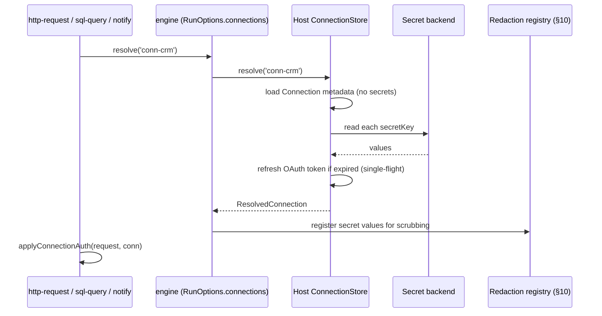

# Design Document: Deterministic Data Path (Phase 1)

## Overview

Phase 1 adds a deterministic data path to the studio: eight new flow-node kinds (`http-request`,
`sql-query`, `transform`, `aggregate`, `assert`, `state-get`, `state-set`, `notify`), a first-class
`Connection` credential entity stored outside the spec, an engine-native expression evaluator, and a
per-host capability matrix — so a scheduled workflow can read from HTTP/SQL sources, reshape and
aggregate the result, guard it, and write it to a target system with no language model anywhere in the
data path.

Every new capability lands as a narrow interface on `RunOptions` (`engine/src/engine.ts`), exactly as
`ToolHost` (`engine/src/tools.ts`) and `RunJournal` do today, so `engine/` stays dependency-free and
the three hosts (Tauri desktop, browser preview, Cloudflare Worker) supply the drivers.

---

## Scope

| Item | Covered by | Notes |
| --- | --- | --- |
| P1-1 Connections | §2, §7 | `Connection` entity + `ConnectionStore` host capability |
| P1-2 `http-request` node | §2.3, §3, §5.1 | Real flow step, not a tool |
| P1-3 Rate-limit-aware retry | §6 | Generalised `NodeRetryPolicy` for any node kind |
| P1-4 `transform` node | §4, §5.2 | Expression-driven reshaping |
| P1-5 `aggregate` node | §5.3 | group / join / pivot |
| P1-6 `sql-query` node | §5.4 | One kind, `driver` discriminator, parameters only |
| P1-7 Pagination + batching | §5.1.3, §5.5 | Mode on `http-request`; batch mode on `for-each` |
| P1-8 Workflow state store | §8 | `WorkflowStateStore` capability + `state-get`/`state-set` |
| P1-9 `assert` node | §5.6 | Guard before the write step |
| P1-10 Run-outcome notifications | §5.7 | `notify` node + workflow-level notification settings |
| P1-11 Sync audit record | §9 | `RunRecordSummary.sync` extension |
| P1-12 Redaction + retention | §10 | Redaction pipeline in front of `createRunRecorder` |
| P1-13 Mock / replay | §11 | `FixtureStore` capability, record/replay on the two I/O nodes |
| P2-10 Capability matrix + push validation | §12 | Shared with Phase 1, per the source doc |
| **P1-14 Connector packaging** | **Out of scope** | Deliberately deferred (source doc: "premature until P1-1 → P1-8 are real") |
| **Phase 2 (AWS host)** | **Out of scope** | Separate spec. No AWS host work here. |

### Design principles this document is written against

1. **Deterministic by default.** No new node kind may call `RunOptions.model`. The `runNodeBody`
   switch in `engine/src/engine.ts` gains branches that never touch `ModelClient`.
2. **Specs stay portable, secrets never travel.** Node data holds `connectionId: string` only. Nothing
   in `WorkflowSpec` (frontend/src/app/core/workflow.model.ts) ever holds a secret value.
3. **Local-to-cloud parity, honestly declared.** §12's capability matrix is the single source of truth,
   consulted by the palette, the properties panel, and push-time validation.
4. **Everything auditable.** Eleven new `RunEvent` variants (§2.6) plus the sync summary (§9).
5. **Idempotent writes.** Delta hashes, idempotency keys and watermarks are state-store primitives
   (§8), not per-workflow inventions.

### Open decisions resolved here (source doc §8)

| # | Decision | Resolution |
| --- | --- | --- |
| 8.1 | Expression language | **Engine-native minimal grammar** (`engine/src/expr.ts`, zero deps, §4). Confirmed with the user. Byte-identical on all three hosts by construction; a library injected per host would be three copies free to drift. |
| 8.5 | Where connection secrets live for local runs | **Extend the existing keychain service.** `backend/src-tauri/src/llm.rs` already chunks long values (`store_secret_value`) and namespaces keys (`validate_secret_key`, `MCP_SECRET_PREFIX = "mcp:"`). Add a second prefix `conn:` and reuse everything else. No second encrypted store. |
| 8.7 | Can data nodes ever be agent tools? | **Not in Phase 1.** Data nodes are `category: 'flow'` with `message-in`/`message-out` ports only, and are rejected by `tool-link` validation. §2.1 defines the forward-compatible seam (a `tools`-role port could be added later without changing executor semantics) so the decision is not foreclosed. |
| 8.2, 8.3, 8.4, 8.6 | IaC tool, AWS persistence, monitor transport, multi-tenancy | Phase 2. Untouched. |

---

## Architecture

### 1. Main workflow

The reference shape (source doc Appendix A) end to end. `schedule-trigger`, `for-each`, `RunJournal`,
run history and the live monitor already exist and need no work.

```mermaid
sequenceDiagram
    participant Sched as schedule-trigger (exists)
    participant Http as http-request (P1-2)
    participant Agg as aggregate (P1-5)
    participant Tf as transform (P1-4)
    participant As as assert (P1-9)
    participant St as state-get/set (P1-8)
    participant Loop as for-each (batch mode, P1-7)
    participant Out as http-request upsert (P1-2)
    participant Host as Host capabilities (RunOptions)

    Sched->>Http: payload {}
    Http->>Host: resolveConnection('conn-src')
    Host-->>Http: {config, secrets}
    Http->>Host: dataFetch(request)  %% paginated loop
    Host-->>Http: {status, body, headers}
    Http->>Agg: {rows: [...]}
    Agg->>Tf: {groups: [...]}
    Tf->>As: {records: [...]}
    As->>As: evaluate guard expression
    As->>St: {records}
    St->>Host: stateGet('delta:*') / stateSet(...)
    Host-->>St: previous hashes
    St->>Loop: {changed: [...]}
    Loop->>Out: batch of 100 records
    Out->>Host: dataFetch(upsert, idempotencyKey)
    Host-->>Out: 200
    Out-->>Sched: sync summary -> RunRecordSummary.sync
```

---

## Components and Interfaces

### 2.1 Node kinds and the port model

`WorkflowNodeKind` in `frontend/src/app/core/workflow.model.ts` gains eight members. All are
`category: 'flow'` (sky accent, per `NODE_CATEGORY_COLORS`) — **not** `'tool'`.

```ts
// frontend/src/app/core/workflow.model.ts
export type WorkflowNodeKind =
  | 'agent'
  // … existing kinds unchanged …
  | 'error-handler'
  // ── Phase 1: deterministic data path ────────────────────────────────────
  | 'http-request'   // P1-2  flow step (distinct from the existing 'http-tool')
  | 'sql-query'      // P1-6
  | 'transform'      // P1-4
  | 'aggregate'      // P1-5
  | 'assert'         // P1-9
  | 'state-get'      // P1-8
  | 'state-set'      // P1-8
  | 'notify';        // P1-10

/**
 * Kinds that execute in the graph walk AND perform external I/O. Used by
 * capability validation (§12), the redaction pipeline (§10) and fixtures (§11).
 */
export const DATA_NODE_KINDS: readonly WorkflowNodeKind[] = [
  'http-request', 'sql-query', 'transform', 'aggregate',
  'assert', 'state-get', 'state-set', 'notify',
] as const;

/** Data nodes that reach outside the run (fixtures + egress declaration). */
export const DATA_IO_KINDS: readonly WorkflowNodeKind[] = ['http-request', 'sql-query', 'notify'] as const;
```

Port contract, enforced in the canvas connection validator and re-asserted at push time:

```ts
/**
 * A data node exposes message ports only. `tool-link` edges to a data node are
 * rejected — determinism depends on the graph walk owning these steps, never a
 * model's choice (source doc: "Data nodes are not tools").
 *
 * Forward-compatible seam for open decision 8.7: exposing a CONFIGURED data
 * node to an agent later means adding a `tools`-role port and a ToolHost
 * adapter that calls the SAME executor function. Executor signatures in §5 are
 * therefore written as pure `(node, payload, ctx) => Promise<string>` and never
 * read graph topology.
 */
export function isDataNode(node: WorkflowNode): boolean {
  return (DATA_NODE_KINDS as readonly string[]).includes(node.kind);
}

/** True when a `tool-link` edge is illegal for this endpoint. */
export function rejectsToolLink(node: WorkflowNode): boolean {
  return isDataNode(node);
}
```

Ports per kind (the `NodeCatalogEntry.ports` blueprint in `frontend/src/app/core/node-catalog.ts`):

| Kind | `message-in` | `message-out` |
| --- | --- | --- |
| `http-request` | `In` | `Response`, `On error` |
| `sql-query` | `In` | `Rows`, `On error` |
| `transform` | `In` | `Out` |
| `aggregate` | `In` | `Out` |
| `assert` | `In` | `Passed`, `Failed` |
| `state-get` | `In` | `Out` |
| `state-set` | `In` | `Out` |
| `notify` | `In` | `Sent`, `On error` |

The `On error` / `Failed` ports reuse the existing mechanism verbatim: `errorPortId` on node data plus
`WorkflowRun.errorRoutePortId()` in `engine/src/engine.ts`, which already requires the port to be
`message-out` **and** actually wired before it suppresses fail-fast.

### 2.2 Connection: the credential entity (P1-1)

Lives in the engine so all three hosts share one shape. **Never** part of `WorkflowSpec`.

```ts
// engine/src/connections.ts  (new file, exported from engine/src/index.ts)

export type ConnectionType = 'http' | 'oauth2' | 'sql' | 'aws-sigv4' | 'smtp';

/** SQL driver families. Host support is declared in the capability matrix (§12). */
export type SqlDriver = 'postgres' | 'mysql' | 'mssql' | 'sqlite';

/**
 * A named, typed credential bundle stored OUTSIDE the spec. Nodes reference it
 * by `id` only, which is what keeps specs safe to export, diff, version and
 * push (design principle 2).
 */
export interface Connection {
  /** Referenced from `node.data.connectionId`. Stable, `conn-` prefixed. */
  id: string;
  name: string;
  type: ConnectionType;
  /** Non-secret config: baseUrl, host, port, database, tokenUrl, region, driver. */
  config: Record<string, string>;
  /** Secret field NAMES only. Values live in the host's secret store. */
  secretKeys: string[];
  /** How auth is applied to an outbound request. Never templated by the user. */
  auth: ConnectionAuth;
  /**
   * Writes are opt-in ON THE CONNECTION, so a read-only credential cannot be
   * misused by any workflow that references it (P1-6's key guardrail).
   */
  allowWrites?: boolean;
  /** SQL only: statement timeout, row and byte caps applied by the host. */
  limits?: SqlLimits;
  createdAt: string;
  updatedAt: string;
}

export type ConnectionAuth =
  | { mode: 'none' }
  | { mode: 'bearer'; secretKey: string }
  | { mode: 'basic'; userSecretKey: string; passwordSecretKey: string }
  | { mode: 'header'; header: string; secretKey: string; prefix?: string }
  | { mode: 'query'; param: string; secretKey: string }
  | { mode: 'oauth2-client-credentials'; tokenUrl: string; clientIdSecretKey: string;
      clientSecretKey: string; scope?: string }
  | { mode: 'oauth2-refresh'; tokenUrl: string; clientIdSecretKey: string;
      clientSecretKey: string; refreshTokenSecretKey: string }
  | { mode: 'aws-sigv4'; service: string; region: string;
      accessKeySecretKey: string; secretKeySecretKey: string };

export interface SqlLimits {
  statementTimeoutMs?: number;   // default 30_000
  maxRows?: number;              // default 10_000
  maxResultBytes?: number;       // default 4 * 1024 * 1024
}

/**
 * A connection with its secret values resolved. Produced by the HOST at
 * execution time and NEVER serialised, logged, journaled, or emitted.
 */
export interface ResolvedConnection {
  id: string;
  type: ConnectionType;
  config: Readonly<Record<string, string>>;
  /** secretKey -> value. Redaction (§10) is seeded from these values. */
  secrets: Readonly<Record<string, string>>;
  auth: ConnectionAuth;
  allowWrites: boolean;
  limits?: SqlLimits;
}

/** The non-secret projection safe for the palette, pickers and validation. */
export type ConnectionSummary = Omit<Connection, 'secretKeys'> & {
  secretKeys: string[];        // names only, already secret-free
  /** Number of secretKeys actually present in the host's store. */
  secretsPresent: number;
  usedByWorkflowIds?: string[];
};
```

Naming convention for the underlying secret entries, so every host is predictable:

```ts
/** Host-agnostic secret entry name for one connection field. */
export function connectionSecretName(connectionId: string, secretKey: string): string {
  return `conn:${connectionId}:${secretKey}`;          // desktop keychain (§7.1)
}

/** Cloudflare `wrangler secret` name (uppercase, `[A-Z][A-Z0-9_]*`). */
export function workerSecretName(connectionId: string, secretKey: string): string {
  const norm = (s: string) => s.replace(/[^A-Za-z0-9]/g, '_').toUpperCase();
  return `CONN_${norm(connectionId)}_${norm(secretKey)}`;
}
```

`workerSecretName` is deliberately shaped to satisfy the existing validation in
`CloudService.putWorkerSecret` (`frontend/src/app/core/cloud.service.ts`), which rejects anything not
matching `/^[A-Z][A-Z0-9_]*$/`.

## Data Models

### 2.3 Node data interfaces

```ts
// frontend/src/app/core/workflow.model.ts  (additions)

/** Anything that reads a `{{path}}`-interpolated template against the payload. */
export type PayloadTemplate = string;

/** Retry policy for ANY node kind. Supersedes AgentRetryPolicy's node-local use. */
export interface NodeRetryPolicy {
  /** Total attempts including the first (default 2 for agents, 3 for data I/O). */
  maxAttempts?: number;
  /** Base backoff, doubled per attempt (default 1000). */
  backoffMs?: number;
  /** Backoff ceiling per attempt (default 30_000). */
  maxBackoffMs?: number;
  /** `transient` (default) | `all` | `none`. */
  retryOn?: 'transient' | 'all' | 'none';
  /** True disables automatic retries for this node. */
  disabled?: boolean;
  /**
   * Declares the step safe to repeat. Non-idempotent steps are retried ONLY on
   * errors that prove the request never landed (connect/DNS/TLS), never on a
   * 5xx or a timeout (§6).
   */
  idempotent?: boolean;
  /** Honour a `Retry-After` header when present (default true). */
  honorRetryAfter?: boolean;
  /** Ceiling applied to a server-provided Retry-After (default 120_000). */
  maxRetryAfterMs?: number;
}

/** `AgentRetryPolicy` stays as a deprecated alias so existing specs keep working. */
export type AgentRetryPolicy = NodeRetryPolicy;

// ── P1-2 http-request ───────────────────────────────────────────────────────

export type HttpMethod = 'GET' | 'POST' | 'PUT' | 'PATCH' | 'DELETE' | 'HEAD';

export interface HttpRequestNodeData {
  connectionId?: string;
  method: HttpMethod;
  /** Path appended to the connection's `config.baseUrl`, or an absolute URL. */
  url: PayloadTemplate;
  query?: { key: string; value: PayloadTemplate }[];
  /** Non-secret headers only. Auth comes from the connection, never from here. */
  headers?: { key: string; value: PayloadTemplate }[];
  bodyMode?: 'none' | 'json' | 'text' | 'form';
  /** Template rendered then (for `json`) parsed to validate before sending. */
  body?: PayloadTemplate;
  /** Extra codes treated as success. Default: 2xx. */
  successCodes?: number[];
  /** JSON pointer/dotted path selecting what lands in the outgoing payload. */
  resultPath?: string;
  /** Key the result is wrapped under. Default: replace the payload. */
  resultKey?: string;
  responseMode?: 'json' | 'text';
  pagination?: PaginationConfig;
  /** Idempotency key template; sent as `Idempotency-Key` and used by §8.3. */
  idempotencyKey?: PayloadTemplate;
  retry?: NodeRetryPolicy;
  timeoutSec?: number;
  /** Opt-in payload capture for the trace. Off by default (§10). */
  persistRequestBody?: boolean;
  persistResponseBody?: boolean;
  fixtures?: FixtureMode;
  errorPortId?: string;
}

/** P1-7: paginated fetch. The node loops until exhausted or `maxPages`. */
export type PaginationConfig =
  | { mode: 'none' }
  | { mode: 'cursor'; cursorPath: string; cursorParam: string; itemsPath: string;
      maxPages: number }
  | { mode: 'page'; pageParam: string; sizeParam?: string; pageSize?: number;
      startPage?: number; itemsPath: string; maxPages: number }
  | { mode: 'offset'; offsetParam: string; limitParam: string; limit: number;
      itemsPath: string; maxPages: number }
  | { mode: 'link-header'; rel?: string; itemsPath: string; maxPages: number };

// ── P1-6 sql-query ──────────────────────────────────────────────────────────

export interface SqlQueryNodeData {
  connectionId?: string;
  /** Mirrors the connection's driver; validated to match at push time. */
  driver?: SqlDriver;
  /**
   * Parameterised statement. Named parameters (`:name`) ONLY — the properties
   * panel offers no way to concatenate payload text into SQL.
   */
  statement: string;
  /** Parameter name -> expression evaluated against the payload (§4). */
  params?: { name: string; expression: string }[];
  maxRows?: number;
  statementTimeoutMs?: number;
  resultKey?: string;          // default 'rows'
  retry?: NodeRetryPolicy;
  fixtures?: FixtureMode;
  errorPortId?: string;
  persistRows?: boolean;       // off by default (§10)
}

// ── P1-4 transform ─────────────────────────────────────────────────────────

export interface TransformNodeData {
  /** Applied to each element when set, otherwise to the whole payload. */
  itemsPath?: string;
  mode?: 'record' | 'array';
  fields: TransformField[];
  /** Named lookup tables addressable as `lookup('name', key)` in expressions. */
  lookups?: Record<string, Record<string, string | number | boolean>>;
  /** True keeps unmapped source fields; false (default) emits only `fields`. */
  passthrough?: boolean;
}

export interface TransformField {
  /** Dotted target path; `a.b` creates nested objects. */
  target: string;
  /** Expression in the engine grammar (§4). */
  expression: string;
  cast?: 'string' | 'number' | 'integer' | 'boolean' | 'date-iso';
  /** Used when the expression yields null/undefined. */
  default?: string | number | boolean | null;
  /** Fail the node when the result is null/undefined after `default`. */
  required?: boolean;
}

// ── P1-5 aggregate ─────────────────────────────────────────────────────────

export interface AggregateNodeData {
  op: 'group' | 'join' | 'pivot';
  itemsPath?: string;
  group?: GroupSpec;
  join?: JoinSpec;
  pivot?: PivotSpec;
  resultKey?: string;
}

export interface GroupSpec {
  by: string[];                       // dotted source paths
  metrics: AggregateMetric[];
}

export interface AggregateMetric {
  name: string;
  fn: 'count' | 'countIf' | 'sum' | 'min' | 'max' | 'avg' | 'first' | 'distinct';
  /** Source path for value-taking fns; ignored by `count`. */
  path?: string;
  /** Predicate expression for `countIf`, evaluated per row (§4). */
  where?: string;
}

export interface JoinSpec {
  leftPath: string;
  rightPath: string;
  leftKey: string;
  rightKey: string;
  type: 'inner' | 'left';
  /** Prefix applied to right-hand fields on collision. Default `right_`. */
  collisionPrefix?: string;
}

export interface PivotSpec {
  /** Path to grouped rows. */
  rowsPath?: string;
  keyFields: string[];                 // e.g. ['group','bucket'] -> 'A_x'
  valueField: string;                  // e.g. 'n'
  separator?: string;                  // default '_'
  /** Emitted for pivot columns absent from the data. */
  fillValue?: number | string | null;
}

// ── P1-9 assert ────────────────────────────────────────────────────────────

export interface AssertNodeData {
  assertions: Assertion[];
  /** `fail` (default) fails the node; `route` sends it out the Failed port. */
  onBreach?: 'fail' | 'route';
  failedPortId?: string;
  /** Comparison baseline for variance guards, read from the state store (§8). */
  baselineStateKey?: string;
}

export interface Assertion {
  /** Shown in the breach message and the sync audit record. */
  name: string;
  /** Boolean expression that MUST hold (§4). */
  expression: string;
  /** Optional human explanation surfaced on breach. */
  message?: string;
  severity?: 'error' | 'warn';
}

// ── P1-8 state nodes ───────────────────────────────────────────────────────

export interface StateGetNodeData {
  /** Key template, interpolated against the payload. */
  key: PayloadTemplate;
  resultKey?: string;                  // default 'state'
  /** Emitted when the key is absent. */
  defaultValue?: string;
}

export interface StateSetNodeData {
  key: PayloadTemplate;
  /** Expression producing the value to store (§4). */
  valueExpression: string;
  /** Time-to-live in seconds. Absent = retention policy default (§8.5). */
  ttlSec?: number;
  /** `delta` writes a content hash; `watermark` keeps a monotonic maximum. */
  semantics?: 'value' | 'delta' | 'watermark';
}

// ── P1-10 notify ───────────────────────────────────────────────────────────

export interface NotifyNodeData {
  channel: 'email' | 'webhook' | 'chat-webhook';
  connectionId?: string;
  to?: PayloadTemplate;                // email
  subject?: PayloadTemplate;
  /** Markdown body template. */
  body?: PayloadTemplate;
  retry?: NodeRetryPolicy;
  errorPortId?: string;
}

// ── P1-7 batching, added to the EXISTING ForEachNodeData ───────────────────

export interface ForEachNodeData {
  itemsPath?: string;
  concurrency?: number;
  continueOnError?: boolean;
  /**
   * P1-7: when > 1, the loop yields ARRAYS of up to `batchSize` items instead
   * of single items, so a target API's "max 100 per call" limit is one config
   * field instead of a subgraph. 0/1/absent = today's per-item behaviour.
   */
  batchSize?: number;
}

/** P1-13 fixture mode for the two I/O node kinds. */
export type FixtureMode = 'off' | 'record' | 'replay' | 'replay-or-record';
```

`WorkflowNodeData` gains the new members; every new interface is added to the union so
`properties-form.ts` can narrow with the same `computed()` pattern it already uses for
`forEachData` / `askUserData`:

```ts
export type WorkflowNodeData =
  | AgentNodeData
  // … existing members …
  | ExecuteWorkflowNodeData
  | HttpRequestNodeData
  | SqlQueryNodeData
  | TransformNodeData
  | AggregateNodeData
  | AssertNodeData
  | StateGetNodeData
  | StateSetNodeData
  | NotifyNodeData
  | Record<string, never>;
```

### 2.4 Workflow-level settings (P1-10, P1-12)

```ts
// frontend/src/app/core/workflow.model.ts
export interface WorkflowSettings {
  timeoutMinutes?: number;              // existing
  /** P1-10: run-outcome notification policy. */
  notifications?: {
    on: ('failure' | 'guard-breach' | 'completion')[];
    /** Connection used to deliver. Absent = the host's default channel. */
    connectionId?: string;
    to?: string;
  };
  /** P1-12: run-history retention and redaction. */
  retention?: {
    /** Runs kept for this workflow. 0/absent = host default (50 in the DO). */
    keepRuns?: number;
    /** Runs older than this are pruned regardless of count. */
    maxAgeDays?: number;
    /** Never persist node outputs for these node ids. */
    noPersistNodeIds?: string[];
    /** Field-level redaction applied to every persisted payload (§10). */
    redact?: RedactionRule[];
  };
}

export interface RedactionRule {
  /** `path` matches a dotted JSON path; `key` matches any property name;
   *  `pattern` is a bounded, anchored regex source applied to string values. */
  kind: 'path' | 'key' | 'pattern';
  value: string;
  /** Replacement. Default `'[redacted]'`. `hash` stores an fnv1a fingerprint. */
  replace?: 'mask' | 'hash' | 'drop';
}
```

## Host Capabilities and Run Events

### 2.5 Host capabilities on `RunOptions`

Every capability is optional. A missing capability produces a descriptive node failure, matching the
existing convention for `waitForEvent` ("Hosts that cannot deliver external events may omit this —
reaching a Wait for Event node then fails the run with a descriptive error").

```ts
// engine/src/engine.ts  — additions to the existing RunOptions interface
export interface RunOptions {
  // … existing members (runId, graph, input, model, emit, tools, journal, …) …

  /** P1-1: resolves a connection reference to its secret values. */
  connections?: ConnectionStore;
  /** P1-2/P1-7/P1-10: outbound HTTP for DATA nodes (distinct from ToolHost). */
  dataFetch?: DataFetcher;
  /** P1-6: parameterised SQL execution, one implementation per driver family. */
  sql?: SqlHost;
  /** P1-8: durable workflow-scoped key/value store. */
  state?: WorkflowStateStore;
  /** P1-13: fixture record/replay for `http-request` and `sql-query`. */
  fixtures?: FixtureStore;
  /** Workflow id used to scope state and fixtures. Defaults to `graph`-less ''. */
  workflowId?: string;
  /** P1-12: redaction applied by the host before persistence (see §10). */
  redact?: (value: string) => string;
  /** Declared host capability set, used for run-time guardrails (§12). */
  capabilities?: HostCapabilities;
}
```

```ts
// engine/src/data-host.ts  (new file)

// ── P1-1 ────────────────────────────────────────────────────────────────────
export interface ConnectionStore {
  /**
   * Resolves a connection INCLUDING secret values. Throws a descriptive error
   * when the connection or a declared secret is missing — a missing secret is
   * an operator problem, never a silent unauthenticated request.
   */
  resolve(connectionId: string): Promise<ResolvedConnection>;
  /** Non-secret listing for validation and pickers. */
  list?(): Promise<ConnectionSummary[]>;
}

// ── P1-2 / P1-7 / P1-10 ─────────────────────────────────────────────────────
export interface DataRequest {
  url: string;
  method: string;
  headers: Record<string, string>;
  body?: string;
  timeoutMs?: number;
  /** Response byte cap. The host truncates and sets `truncated`. */
  maxResponseBytes?: number;
}

export interface DataResponse {
  status: number;
  /** Lower-cased header names. Hosts MUST include `retry-after` when present. */
  headers: Record<string, string>;
  body: string;
  /** True when `maxResponseBytes` clipped the body. */
  truncated?: boolean;
  byteCount: number;
  durationMs: number;
}

/**
 * Outbound HTTP for data nodes. MUST reject rather than return on transport
 * failure, so §6 can classify the error; MUST NOT throw for HTTP status codes.
 * Hosts apply their own egress hardening (the worker reuses
 * `assertPublicHttpUrl` from cloud/src/workflow-agent.ts).
 */
export type DataFetcher = (request: DataRequest) => Promise<DataResponse>;

/** Transport-level failure classes, needed for non-idempotent retry safety. */
export type TransportFailureKind = 'connect' | 'dns' | 'tls' | 'timeout' | 'aborted' | 'unknown';

export class DataTransportError extends Error {
  constructor(readonly kind: TransportFailureKind, message: string) {
    super(message);
    this.name = 'DataTransportError';
  }
  /** True when the request provably never reached the server. */
  get requestNeverSent(): boolean {
    return this.kind === 'connect' || this.kind === 'dns' || this.kind === 'tls';
  }
}

// ── P1-6 ────────────────────────────────────────────────────────────────────
export interface SqlRequest {
  driver: SqlDriver;
  connection: ResolvedConnection;
  /** Statement with named parameters (`:name`). Never interpolated. */
  statement: string;
  params: Record<string, string | number | boolean | null>;
  maxRows: number;
  maxResultBytes: number;
  statementTimeoutMs: number;
}

export interface SqlResult {
  rows: Record<string, unknown>[];
  rowCount: number;
  /** True when `maxRows`/`maxResultBytes` truncated the result. */
  truncated?: boolean;
  /** Inferred column types, powering the "Test query" affordance. */
  columns?: { name: string; type: string }[];
  durationMs: number;
}

export interface SqlHost {
  /** Drivers this host can actually execute. Consulted before `query`. */
  supports(driver: SqlDriver): boolean;
  /** Executes a parameterised statement. Rejects on driver/transport error. */
  query(request: SqlRequest): Promise<SqlResult>;
}

// ── P1-8 ────────────────────────────────────────────────────────────────────
export interface StateEntry {
  key: string;
  value: string;
  updatedAt: number;
  /** Absolute epoch ms expiry. Absent = no expiry beyond retention policy. */
  expiresAt?: number;
}

/**
 * Durable key/value scoped to (workflowId). Sits alongside RunJournal as a
 * host capability: desktop -> IndexedDB, worker -> DO SQLite, AWS -> DynamoDB.
 */
export interface WorkflowStateStore {
  get(key: string): Promise<StateEntry | undefined>;
  set(key: string, value: string, options?: { ttlSec?: number }): Promise<void>;
  delete(key: string): Promise<void>;
  /** Bounded prefix scan. Hosts MUST cap `limit` (default 1000). */
  list(prefix: string, limit?: number): Promise<StateEntry[]>;
  /**
   * Compare-and-set. Resolves true when written, false when `expected` did not
   * match the stored value. This is what makes idempotency claims atomic.
   */
  compareAndSet(key: string, expected: string | undefined, value: string,
                options?: { ttlSec?: number }): Promise<boolean>;
}

// ── P1-13 ───────────────────────────────────────────────────────────────────
export interface FixtureStore {
  /** `key` is the deterministic fixture identity from §11.1. */
  read(key: string): Promise<string | undefined>;
  write(key: string, value: string): Promise<void>;
}

// ── P2-10, shared with Phase 1 ──────────────────────────────────────────────
export interface HostCapabilities {
  id: 'tauri-desktop' | 'browser' | 'cloudflare-worker' | string;
  label: string;
  nodeKinds: readonly string[];
  sqlDrivers: readonly SqlDriver[];
  connectionTypes: readonly ConnectionType[];
  features: {
    cron: boolean;
    durableState: boolean;
    fixtures: boolean;
    privateNetworkEgress: boolean;
    stdioMcp: boolean;
  };
}
```

### 2.6 New run events (P1-2, P1-6, P1-8, P1-9, P1-11)

Appended to `RunEventPayload` in `engine/src/events.ts`. Metadata only by default — never headers,
never bodies, never secrets, unless the node opted in and redaction has run.

```ts
// engine/src/events.ts  (additions to RunEventPayload)
  | { type: 'http-request'; runId: string; nodeId: string; nodeName: string;
      method: string; url: string; attempt: number;
      /** Present only with `persistRequestBody`, post-redaction. */
      body?: string; at: number }
  | { type: 'http-response'; runId: string; nodeId: string; status: number;
      durationMs: number; byteCount: number; truncated?: boolean;
      /** Present only with `persistResponseBody`, post-redaction. */
      body?: string; at: number }
  | { type: 'page-fetched'; runId: string; nodeId: string; page: number;
      items: number; hasMore: boolean; at: number }
  | { type: 'sql-query'; runId: string; nodeId: string; nodeName: string;
      driver: string; /** Statement text; parameter VALUES are never included. */
      statement: string; paramCount: number; at: number }
  | { type: 'sql-result'; runId: string; nodeId: string; rowCount: number;
      durationMs: number; truncated?: boolean; at: number }
  | { type: 'state-read'; runId: string; nodeId: string; key: string;
      found: boolean; at: number }
  | { type: 'state-written'; runId: string; nodeId: string; key: string;
      semantics: 'value' | 'delta' | 'watermark'; changed: boolean; at: number }
  | { type: 'assert-passed'; runId: string; nodeId: string; nodeName: string;
      checked: number; at: number }
  | { type: 'assert-breached'; runId: string; nodeId: string; nodeName: string;
      assertion: string; message: string; severity: 'error' | 'warn';
      routed: boolean; at: number }
  | { type: 'notify-sent'; runId: string; nodeId: string; channel: string;
      target: string; at: number }
  | { type: 'sync-summary'; runId: string; summary: SyncSummary; at: number }
```

`node-retrying` is deliberately **reused** for data-node retries (source doc P1-3) so the trace panel
needs no new rendering path.

### 2.7 Sync audit record (P1-11)

```ts
// engine/src/run-record.ts  (additions)

/** Per-run structured summary for data workflows. */
export interface SyncSummary {
  /** Rows/records read per source node id. */
  sources: Record<string, { rows: number; pages?: number; truncated?: boolean }>;
  considered: number;
  changed: number;
  written: number;
  skipped: number;
  failed: number;
  /** Target response codes with counts, e.g. `{ '200': 98, '429': 2 }`. */
  targetStatuses: Record<string, number>;
  /** Guards evaluated, with breaches named. */
  guards?: { name: string; passed: boolean; message?: string }[];
  /** Watermark advanced by this run, when any. */
  watermark?: { key: string; from?: string; to: string };
}

export interface RunRecordSummary {
  // … existing members …
  /** Present when the run executed at least one data node. */
  sync?: SyncSummary;
}
```

`createRunRecorder` gains one branch: `case 'sync-summary': summary.sync = event.summary; push(event);`.
The existing `RunRecord` / `UsageLedgerEntry` persistence in both hosts is otherwise untouched —
reusing EPIC 1's store rather than inventing a second one.

---

## 3. Node catalog entries

Each kind needs one `NodeCatalogEntry` in `frontend/src/app/core/node-catalog.ts`. Shown compressed;
the pattern is identical to the existing `flow-for-each` entry.

```ts
const DATA_IN_OUT: NodeCatalogEntry['ports'] = [
  { name: 'In', role: 'message-in' },
  { name: 'Out', role: 'message-out' },
];

// ── Data (new palette section, rendered between Flow and Tools) ─────────────
{
  id: 'data-http-request', label: 'HTTP Request (step)',
  description: 'Calls an HTTP API as a deterministic step — no agent involved.',
  icon: 'ti ti-api', category: 'flow', kind: 'http-request',
  keywords: ['api', 'rest', 'fetch', 'sync', 'integration', 'request'],
  defaultName: 'HTTP Request',
  ports: [
    { name: 'In', role: 'message-in' },
    { name: 'Response', role: 'message-out' },
    { name: 'On error', role: 'message-out' },
  ],
  defaultData: (): HttpRequestNodeData => ({
    method: 'GET', url: '', responseMode: 'json', bodyMode: 'none',
    pagination: { mode: 'none' },
    retry: { maxAttempts: 3, backoffMs: 1000, idempotent: true, honorRetryAfter: true },
    fixtures: 'off',
  }),
},
{ id: 'data-sql-query', /* … */ kind: 'sql-query', icon: 'ti ti-database-search',
  defaultData: (): SqlQueryNodeData => ({ statement: '', params: [], maxRows: 10_000,
    resultKey: 'rows', fixtures: 'off' }) },
{ id: 'data-transform', /* … */ kind: 'transform', icon: 'ti ti-transform',
  ports: DATA_IN_OUT, defaultData: (): TransformNodeData => ({ fields: [], mode: 'record' }) },
{ id: 'data-aggregate', /* … */ kind: 'aggregate', icon: 'ti ti-chart-bar',
  ports: DATA_IN_OUT, defaultData: (): AggregateNodeData => ({ op: 'group',
    group: { by: [], metrics: [] } }) },
{ id: 'data-assert', /* … */ kind: 'assert', icon: 'ti ti-shield-check',
  ports: [{ name: 'In', role: 'message-in' }, { name: 'Passed', role: 'message-out' },
          { name: 'Failed', role: 'message-out' }],
  defaultData: (): AssertNodeData => ({ assertions: [], onBreach: 'fail' }) },
{ id: 'data-state-get', /* … */ kind: 'state-get', icon: 'ti ti-bookmark',
  ports: DATA_IN_OUT, defaultData: (): StateGetNodeData => ({ key: '', resultKey: 'state' }) },
{ id: 'data-state-set', /* … */ kind: 'state-set', icon: 'ti ti-bookmark-plus',
  ports: DATA_IN_OUT,
  defaultData: (): StateSetNodeData => ({ key: '', valueExpression: '', semantics: 'value' }) },
{ id: 'data-notify', /* … */ kind: 'notify', icon: 'ti ti-bell',
  ports: [{ name: 'In', role: 'message-in' }, { name: 'Sent', role: 'message-out' },
          { name: 'On error', role: 'message-out' }],
  defaultData: (): NotifyNodeData => ({ channel: 'webhook' }) },
```

`NODE_CATEGORY_SECTIONS` gains `{ category: 'flow', label: 'Data' }`? No — `NodeCategory` stays a
four-member union to avoid touching `NODE_CATEGORY_COLORS` and every canvas accent. Instead the
palette groups by a new optional `NodeCatalogEntry.section?: string`, defaulting to the category
label. Data nodes set `section: 'Data'`, keeping their sky `flow` accent on canvas.

---

## 4. Expression language (decision 8.1 → engine-native)

A new zero-dependency module `engine/src/expr.ts`, exported from `engine/src/index.ts`. It is the ONLY
evaluation surface for `transform`, `aggregate` (`countIf.where`), `assert`, `state-set.valueExpression`
and `sql-query.params`.

### 4.1 Contract

```ts
// engine/src/expr.ts

/** JSON value domain. The evaluator is closed over exactly this set. */
export type Json = null | boolean | number | string | Json[] | { [key: string]: Json };

export interface EvalContext {
  /** The incoming payload parsed as JSON, or `undefined` when it was not JSON. */
  readonly $: Json | undefined;
  /** Raw payload text, addressable as `$text`. */
  readonly $text: string;
  /** Current element inside a per-item evaluation (transform/array, countIf). */
  readonly item?: Json;
  /** Zero-based index of `item`, when iterating. */
  readonly index?: number;
  /** Named lookup tables from `TransformNodeData.lookups`. */
  readonly lookups?: Readonly<Record<string, Readonly<Record<string, Json>>>>;
  /** Deterministic run clock. `now()` returns THIS value, never Date.now(). */
  readonly nowMs: number;
}

export interface CompiledExpression {
  readonly source: string;
  /** Paths this expression reads. Powers "which fields does this touch?" UI. */
  readonly references: readonly string[];
  evaluate(context: EvalContext): Json;
}

export class ExpressionError extends Error {
  constructor(message: string, readonly source: string, readonly position?: number) {
    super(message);
    this.name = 'ExpressionError';
  }
}

/** Parses and validates. Throws ExpressionError with a caret position. */
export function compileExpression(source: string): CompiledExpression;

/** Parse-only validation for the properties panel and push-time checks. */
export function validateExpression(source: string): { ok: true } | { ok: false; error: string; position?: number };
```

### 4.2 Grammar

```
expression   := ternary
ternary      := or ( '?' expression ':' expression )?
or           := and ( ('||' | 'or') and )*
and          := equality ( ('&&' | 'and') equality )*
equality     := comparison ( ('==' | '!=') comparison )*
comparison   := additive ( ('<' | '<=' | '>' | '>=' | 'in') additive )*
additive     := multiplicative ( ('+' | '-') multiplicative )*
multiplicative := unary ( ('*' | '/' | '%') unary )*
unary        := ('!' | '-' | 'not') unary | postfix
postfix      := primary ( '.' IDENT | '[' expression ']' )*
primary      := NUMBER | STRING | 'true' | 'false' | 'null'
              | '$' | '$text' | 'item' | 'index'
              | IDENT '(' args? ')'                 -- allow-listed functions only
              | IDENT                               -- shorthand for $.IDENT
              | '[' args? ']'                       -- array literal
              | '{' (STRING ':' expression),* '}'   -- object literal
              | '(' expression ')'
```

Deliberately absent: assignment, statements, loops, user-defined functions, variable declarations,
property assignment, `import`, and any identifier resolution outside the context and the function
table. There is nothing to sandbox because there is nothing that can reach out.

### 4.3 Function table (fixed, total)

```ts
/** Every function is pure, total, and returns a Json value (never throws
 *  on type mismatch — it returns null, which `required`/`assert` then catch). */
export const EXPR_FUNCTIONS = {
  // strings
  upper: 1, lower: 1, trim: 1, concat: -1, substr: 3, replace: 3, split: 2,
  join: 2, startsWith: 2, endsWith: 2, contains: 2, padStart: 3, length: 1,
  // numbers
  abs: 1, round: 2, floor: 1, ceil: 1, min: -1, max: -1, toNumber: 1, toInt: 1,
  // logic / null handling
  coalesce: -1, ifNull: 2, isNull: 1, isEmpty: 1, toBool: 1, toString: 1,
  // arrays
  len: 1, sum: 2, avg: 2, count: 1, countIf: 2, distinct: 2, first: 1, last: 1,
  map: 2, filter: 2, sort: 2, slice: 3, flatten: 1, keys: 1, values: 1,
  // dates — ISO 8601 only, UTC only, no locale, no parsing ambiguity
  now: 0, parseDate: 1, formatDate: 2, addDays: 2, dateDiffDays: 2,
  // integration helpers
  lookup: 2,          // lookup('statusMap', $.status) -> mapped value or null
  hash: 1,            // fnv1a of the JSON-canonical form (delta hashing)
  jsonPath: 2,        // jsonPath($, 'a.b.0.c'), reuses resolveJsonPath semantics
} as const;
```

`map`, `filter`, `sort`, `sum`, `avg`, `distinct` and `countIf` take a **sub-expression string** as
their second argument, evaluated with `item`/`index` bound — not a closure, keeping the grammar
first-order:

```
sum($.rows, 'item.amount')
filter($.rows, 'item.status == "open" && item.size > 10')
countIf($.rows, 'item.category in ["A","B"]')
```

### 4.4 Formal specification

```ts
function compileExpression(source: string): CompiledExpression
```

**Preconditions**
- `source` is a string of at most `MAX_EXPRESSION_CHARS` (4096).

**Postconditions**
- Returns a `CompiledExpression` whose `evaluate` is **total**: for any `EvalContext` it returns a
  `Json` value or throws `ExpressionError` only for depth/step-budget exhaustion.
- Throws `ExpressionError` with a 0-based `position` for any syntax error, unknown identifier,
  unknown function, or wrong arity.
- `references` lists every distinct path read from `$`, in source order, deduplicated.
- No side effects. No access to `globalThis`, `fetch`, timers, `Date.now`, or the filesystem.

**Loop invariants** (parser and evaluator)
- Parser: `position` strictly increases on every token consumed, so parsing terminates.
- Evaluator: recursion depth ≤ `MAX_EXPRESSION_DEPTH` (64) and evaluated nodes ≤
  `MAX_EXPRESSION_STEPS` (100_000); both are checked before descending, so evaluation terminates.

```pascal
ALGORITHM evaluate(node, context, depth, budget)
INPUT: node — AST node; context — EvalContext; depth, budget — mutable counters
OUTPUT: value of type Json

BEGIN
  ASSERT depth <= MAX_EXPRESSION_DEPTH
  ASSERT budget.steps < MAX_EXPRESSION_STEPS
  budget.steps ← budget.steps + 1

  CASE node.type OF
    Literal:    RETURN node.value
    Root:       RETURN context.$ ?? null
    Item:       RETURN context.item ?? null
    Path:       RETURN resolveJsonPath(evaluate(node.base, ...), node.segments) ?? null
    Unary:      RETURN applyUnary(node.op, evaluate(node.operand, ...))
    Binary:
      // Short-circuit BEFORE evaluating the right operand: an expression like
      // `isNull($.a) || $.a.b > 0` must never fault on the missing path.
      IF node.op = '&&' AND truthy(evaluate(node.left, ...)) = false THEN RETURN false
      IF node.op = '||' AND truthy(evaluate(node.left, ...)) = true  THEN RETURN true
      RETURN applyBinary(node.op, evaluate(node.left, ...), evaluate(node.right, ...))
    Ternary:
      IF truthy(evaluate(node.test, ...)) THEN RETURN evaluate(node.then, ...)
      ELSE RETURN evaluate(node.otherwise, ...)
      END IF
    Call:
      args ← [evaluate(a, ...) FOR a IN node.args]
      RETURN applyFunction(node.name, args, context, depth, budget)
  END CASE
END
```

**Postconditions of `applyBinary`** (the properties every host relies on)
- Arithmetic on a non-number operand yields `null`, never `NaN` and never a thrown error.
- `==` / `!=` compare by JSON structural equality, not reference identity.
- Ordering comparisons between different JSON types yield `false` (both directions), so guards cannot
  accidentally pass on a type mismatch.
- `+` concatenates only when **both** operands are strings; a string/number mix yields `null` rather
  than JavaScript's silent coercion. This is the one place we deliberately diverge from JS semantics,
  because silent coercion in a billing pipeline is the failure mode we are here to prevent.

---

## 5. Engine executors

`WorkflowRun.runNodeBody` in `engine/src/engine.ts` gains eight cases. Every one of them is wrapped by
the generalised retry helper from §6 and none of them touch `this.options.model`.

```ts
// engine/src/engine.ts — inside runNodeBody's switch
      case 'http-request':
        return this.withNodeRetry(node, () => this.runHttpRequest(node, payload));
      case 'sql-query':
        return this.withNodeRetry(node, () => this.runSqlQuery(node, payload));
      case 'transform':
        return { output: runTransform(node, payload, this.exprContext(payload)) };
      case 'aggregate':
        return { output: runAggregate(node, payload, this.exprContext(payload)) };
      case 'assert':
        return this.runAssert(node, payload);
      case 'state-get':
        return this.runStateGet(node, payload);
      case 'state-set':
        return this.runStateSet(node, payload);
      case 'notify':
        return this.withNodeRetry(node, () => this.runNotify(node, payload));
```

`transform` and `aggregate` are pure functions living in `engine/src/data-nodes.ts` — no `this`, no
host, no clock beyond `EvalContext.nowMs`. That is what makes them trivially property-testable.

### 5.1 `http-request` (P1-2)

```ts
private async runHttpRequest(
  node: WorkflowNode,
  payload: string,
): Promise<{ output: string; viaPortIds?: Set<string> }>
```

**Preconditions**
- `this.options.dataFetch` is present (else: descriptive failure naming the host).
- `data.url` is non-empty after interpolation.
- When `data.connectionId` is set, `this.options.connections` is present and resolves it.

**Postconditions**
- On success (status in `successCodes` ?? 2xx): output is the selected result, JSON-stringified;
  routing excludes the `On error` port (same treatment agents get today).
- On failure: either routed out the wired `On error` port with the standard
  `{error, node, input}` JSON envelope, or thrown so `executeNode` fails the run.
- Exactly one `http-request` event per attempt and one `http-response` event per response.
- No secret value appears in any emitted event, in the returned payload, or in the journal entry.
- The node is journaled by the existing `nextExecutionKey` → `journal.record` path, so a resumed run
  never repeats the call.

**Loop invariants** (pagination)
- `pages ≤ pagination.maxPages` is checked before each request.
- `accumulated` contains exactly the items of pages `1..pages` in fetch order.
- The cursor/page/offset strictly advances each iteration; a server returning an unchanged cursor
  terminates the loop rather than spinning.

```pascal
ALGORITHM runHttpRequest(node, payload)
INPUT: node (kind = 'http-request'), payload (string)
OUTPUT: outgoing payload (string)

BEGIN
  data ← node.data AS HttpRequestNodeData
  IF options.dataFetch = NULL THEN
    FAIL 'This host cannot execute HTTP Request steps.'
  END IF

  conn ← NULL
  IF data.connectionId ≠ NULL THEN
    conn ← AWAIT options.connections.resolve(data.connectionId)   // §7
    registerRedactions(conn.secrets)                              // §10 — before ANY emit
  END IF

  // Fixtures take precedence over the network (P1-13, §11).
  fixtureKey ← fixtureKeyFor(node, payload)
  IF data.fixtures IN ['replay','replay-or-record'] THEN
    cached ← AWAIT options.fixtures.read(fixtureKey)
    IF cached ≠ NULL THEN RETURN selectResult(data, cached) END IF
    IF data.fixtures = 'replay' THEN FAIL 'No fixture recorded for this step.' END IF
  END IF

  accumulated ← []
  pages ← 0
  cursor ← initialCursor(data.pagination)
  lastCursor ← SENTINEL

  REPEAT
    ASSERT pages < maxPages(data.pagination)
    request ← buildDataRequest(node, payload, conn, cursor)        // §5.1.1
    EMIT http-request { method, url: request.url, attempt: currentAttempt }

    response ← AWAIT options.dataFetch(request)                   // rejects on transport error
    EMIT http-response { status, durationMs, byteCount, truncated }

    IF NOT isSuccess(response.status, data.successCodes) THEN
      THROW HttpStatusError(response)                             // §6 classifies it
    END IF

    parsed ← parseResponse(response, data.responseMode)
    IF data.pagination.mode = 'none' THEN
      RETURN selectResult(data, parsed)
    END IF

    items ← resolveJsonPath(parsed, data.pagination.itemsPath) ?? []
    accumulated ← accumulated ++ items
    pages ← pages + 1
    nextCursor ← nextCursorFrom(data.pagination, parsed, response.headers, cursor)
    EMIT page-fetched { page: pages, items: LENGTH(items), hasMore: nextCursor ≠ NULL }

    IF nextCursor = lastCursor THEN BREAK END IF                  // non-advancing server
    lastCursor ← cursor
    cursor ← nextCursor
  UNTIL cursor = NULL OR pages >= maxPages(data.pagination)

  IF data.fixtures IN ['record','replay-or-record'] THEN
    AWAIT options.fixtures.write(fixtureKey, serialize(accumulated))
  END IF

  ASSERT pages <= maxPages(data.pagination)
  RETURN selectResult(data, { items: accumulated, pages: pages })
END
```

#### 5.1.1 Request construction

```ts
/**
 * Builds the outbound request. The ONLY place where connection secrets enter a
 * request, and they enter as HOST-APPLIED auth — never through a user template.
 */
export function buildDataRequest(
  node: WorkflowNode,
  payload: string,
  conn: ResolvedConnection | undefined,
  cursor: CursorState | undefined,
): DataRequest
```

**Preconditions**
- `node.kind === 'http-request'`; `data.method` is a valid `HttpMethod`.
- When `conn` is present and `data.url` is relative, `conn.config.baseUrl` is an absolute http(s) URL.

**Postconditions**
- Returns a request whose `url` is absolute; relative `data.url` is joined to `conn.config.baseUrl`
  with exactly one `/` between them.
- Every `{{path}}` in url/query/headers/body is interpolated via the existing
  `interpolatePayload` (`engine/src/payload.ts`); unresolvable tokens are left verbatim, matching
  existing behaviour.
- Query values are percent-encoded exactly once.
- `headers` contains the connection's auth header when `auth.mode` requires one, and user headers
  **cannot** override an auth header (auth is applied last and wins).
- For `bodyMode: 'json'`, the rendered body parses as JSON, or the function throws before any network
  call — a malformed template is a design error, not a 400 from the target.
- When `data.idempotencyKey` renders non-empty, `Idempotency-Key` is set.
- The returned object contains no `Authorization` value derived from `data.headers`.

```pascal
ALGORITHM applyConnectionAuth(request, conn)
BEGIN
  CASE conn.auth.mode OF
    'none':     RETURN request
    'bearer':   request.headers['Authorization'] ← 'Bearer ' + conn.secrets[auth.secretKey]
    'basic':    request.headers['Authorization'] ← 'Basic ' +
                  base64(conn.secrets[auth.userSecretKey] + ':' +
                         conn.secrets[auth.passwordSecretKey])
    'header':   request.headers[auth.header] ← (auth.prefix ?? '') + conn.secrets[auth.secretKey]
    'query':    request.url ← appendQuery(request.url, auth.param, conn.secrets[auth.secretKey])
    'oauth2-client-credentials',
    'oauth2-refresh':
                // Token acquisition/refresh is the HOST's job (single-flight,
                // rotation callback) following mcp/phorma-practice-mcp/src/xero-auth.ts.
                // The host injects the resolved access token under `secrets.accessToken`.
                request.headers['Authorization'] ← 'Bearer ' + conn.secrets['accessToken']
    'aws-sigv4':
                request ← hostSignSigV4(request, conn)   // host capability, Phase 2 uses it too
  END CASE
  RETURN request
END
```

#### 5.1.2 Result selection

```pascal
ALGORITHM selectResult(data, parsed)
BEGIN
  value ← IF data.resultPath ≠ EMPTY THEN resolveJsonPath(parsed, data.resultPath) ELSE parsed
  IF value = undefined THEN
    FAIL 'Response has no value at "' + data.resultPath + '".'
  END IF
  IF data.resultKey ≠ EMPTY THEN
    RETURN JSON(merge(incomingPayloadObject, { [data.resultKey]: value }))
  END IF
  RETURN JSON(value)
END
```

`resultKey` merging reuses the shallow-merge semantics of `mergePayloads`
(`engine/src/payload.ts`) so downstream `{{field}}` interpolation keeps working on the original fields.

#### 5.1.3 Pagination cursor advance (P1-7)

```pascal
ALGORITHM nextCursorFrom(config, parsed, headers, current)
BEGIN
  CASE config.mode OF
    'cursor':
      next ← resolveJsonPath(parsed, config.cursorPath)
      RETURN IF isEmpty(next) THEN NULL ELSE { param: config.cursorParam, value: next }
    'page':
      lastCount ← LENGTH(resolveJsonPath(parsed, config.itemsPath) ?? [])
      RETURN IF lastCount = 0 THEN NULL ELSE { page: current.page + 1 }
    'offset':
      lastCount ← LENGTH(resolveJsonPath(parsed, config.itemsPath) ?? [])
      RETURN IF lastCount < config.limit THEN NULL
             ELSE { offset: current.offset + config.limit }
    'link-header':
      RETURN parseLinkHeader(headers['link'], config.rel ?? 'next')
  END CASE
END
```

### 5.2 `transform` (P1-4)

```ts
// engine/src/data-nodes.ts — pure, host-free, no I/O
export function runTransform(node: WorkflowNode, payload: string, ctx: EvalContext): string
```

**Preconditions**
- `data.fields` is a non-empty array; every `field.target` is a valid dotted path;
  every `field.expression` compiles (§4).

**Postconditions**
- `mode: 'record'` returns one JSON object; `mode: 'array'` (or a set `itemsPath` resolving to an
  array) returns an array of the same length and order as the source array.
- Every `field.target` is present in each output object unless its value is `null` after `default`
  **and** `required` is false and `passthrough` is false.
- Deterministic: for identical `(node.data, payload, ctx.nowMs)` the output string is byte-identical.
- Never throws for a missing source path; a missing path yields `null`, then `default`, then a
  `required` violation error naming the target field.
- Source objects are never mutated.

```pascal
ALGORITHM runTransform(node, payload, ctx)
BEGIN
  data ← node.data AS TransformNodeData
  compiled ← [compileExpression(f.expression) FOR f IN data.fields]  // fail fast, before any work

  source ← IF data.itemsPath ≠ EMPTY
             THEN resolveJsonPath(ctx.$, data.itemsPath)
             ELSE ctx.$
  isArray ← (data.mode = 'array') OR IS_ARRAY(source)

  IF NOT isArray THEN
    RETURN JSON(projectOne(source, compiled, data, ctx, index: 0))
  END IF

  ASSERT IS_ARRAY(source)
  out ← []
  FOR i FROM 0 TO LENGTH(source) - 1 DO
    // Loop invariant: LENGTH(out) = i, and out[0..i-1] each satisfy the
    // required-field contract for their source element.
    ASSERT LENGTH(out) = i
    out.append(projectOne(source[i], compiled, data, ctx, index: i))
  END FOR
  ASSERT LENGTH(out) = LENGTH(source)
  RETURN JSON(IF data.resultKey ≠ EMPTY THEN { [data.resultKey]: out } ELSE out)
END

ALGORITHM projectOne(element, compiled, data, ctx, index)
BEGIN
  record ← IF data.passthrough THEN shallowCopy(element) ELSE {}
  FOR EACH (field, expr) IN ZIP(data.fields, compiled) DO
    raw ← expr.evaluate({ ...ctx, item: element, index: index })
    value ← IF isNullish(raw) THEN (field.default ?? NULL) ELSE raw
    IF field.cast ≠ NULL THEN value ← castValue(value, field.cast) END IF
    IF field.required AND isNullish(value) THEN
      FAIL 'Transform "' + field.target + '" produced no value.'
    END IF
    IF NOT isNullish(value) OR field.required THEN
      setPath(record, field.target, value)
    END IF
  END FOR
  RETURN record
END
```

`castValue` contract: `'integer'` truncates toward zero and returns `null` for non-numerics;
`'date-iso'` accepts ISO 8601 or epoch ms and always emits `YYYY-MM-DDTHH:mm:ss.sssZ`; every cast is
total and returns `null` rather than throwing.

### 5.3 `aggregate` (P1-5)

```ts
export function runAggregate(node: WorkflowNode, payload: string, ctx: EvalContext): string
```

**Preconditions**
- `data.op` matches the populated spec (`group`/`join`/`pivot`).
- For `group`: every `by` path and every `metric.path` is a dotted path; every `metric.where`
  compiles. For `join`: both `leftPath` and `rightPath` resolve to arrays.

**Postconditions**
- `group`: output rows are one per distinct `by` tuple. `sum(metric) over groups = sum(metric) over
  rows` for `count` and `sum`. Group order is the first-appearance order of each key tuple
  (deterministic, no locale-dependent sorting).
- `join` `inner`: output length = number of (left,right) pairs with equal keys.
  `left`: output length ≥ left length, and every left row appears at least once.
- `pivot`: output is a flat object whose keys are `keyFields` joined by `separator`; every value comes
  from exactly one grouped row; `fillValue` fills declared-but-absent columns.
- Numeric metrics ignore non-numeric values rather than producing `NaN`; `avg` over zero numeric
  values is `null`, not `0` — a silent zero is exactly the failure P1-9 exists to catch.

```pascal
ALGORITHM aggregateGroup(rows, spec, ctx)
INPUT: rows — array; spec — GroupSpec
OUTPUT: array of grouped records

BEGIN
  buckets ← ORDERED_MAP()          // insertion-ordered: determinism without sorting
  FOR i FROM 0 TO LENGTH(rows) - 1 DO
    // Loop invariant: SUM(b.count FOR b IN buckets) = i
    ASSERT SUM_OF_COUNTS(buckets) = i
    key ← [resolveJsonPath(rows[i], p) FOR p IN spec.by]
    slot ← buckets.getOrCreate(canonicalKey(key), newAccumulators(spec.metrics))
    accumulate(slot, rows[i], spec.metrics, ctx, i)
  END FOR
  ASSERT SUM_OF_COUNTS(buckets) = LENGTH(rows)
  RETURN [finalize(slot, spec) FOR slot IN buckets.values()]
END

ALGORITHM accumulate(slot, row, metrics, ctx, index)
BEGIN
  slot.count ← slot.count + 1
  FOR EACH m IN metrics DO
    CASE m.fn OF
      'count':    slot[m.name] ← slot[m.name] + 1
      'countIf':  IF truthy(m.compiledWhere.evaluate({...ctx, item: row, index})) THEN
                    slot[m.name] ← slot[m.name] + 1
                  END IF
      'sum','avg':
                  v ← asNumber(resolveJsonPath(row, m.path))
                  IF v ≠ NULL THEN
                    slot[m.name].total ← slot[m.name].total + v
                    slot[m.name].n     ← slot[m.name].n + 1
                  END IF
      'min','max':
                  v ← asNumber(resolveJsonPath(row, m.path))
                  IF v ≠ NULL THEN slot[m.name] ← EXTREME(slot[m.name], v, m.fn) END IF
      'first':    IF slot[m.name] = UNSET THEN slot[m.name] ← resolveJsonPath(row, m.path) END IF
      'distinct': slot[m.name].add(canonical(resolveJsonPath(row, m.path)))
    END CASE
  END FOR
END
```

```pascal
ALGORITHM aggregateJoin(left, right, spec)
BEGIN
  index ← MAP()
  FOR EACH r IN right DO
    index.getOrCreate(canonical(resolveJsonPath(r, spec.rightKey)), []).append(r)
  END FOR

  out ← []
  FOR EACH l IN left DO
    matches ← index.get(canonical(resolveJsonPath(l, spec.leftKey))) ?? []
    IF LENGTH(matches) = 0 AND spec.type = 'left' THEN
      out.append(shallowCopy(l))
    ELSE
      FOR EACH r IN matches DO
        out.append(mergeWithPrefix(l, r, spec.collisionPrefix ?? 'right_'))
      END FOR
    END IF
  END FOR
  RETURN out
END
```

### 5.4 `sql-query` (P1-6)

```ts
private async runSqlQuery(node: WorkflowNode, payload: string): Promise<{ output: string }>
```

**Preconditions**
- `this.options.sql` is present **and** `sql.supports(driver)` is true.
- `data.statement` is non-empty and contains no `{{` template tokens (rejected at authoring time and
  re-checked here — templates in SQL are the injection vector the design forbids).
- Every `:name` in the statement has a matching entry in `data.params`, and vice versa.
- The statement is read-only, unless `conn.allowWrites === true`.

**Postconditions**
- Output is `{ [resultKey]: rows, rowCount }` with `rowCount = rows.length` unless truncated, in which
  case `truncated: true` is present and the run's `SyncSummary.sources[nodeId].truncated` is set.
- Parameter values are bound by the driver; the emitted `sql-query` event carries the statement text
  and `paramCount` only — **never** parameter values, which are business data.
- A driver the host does not support fails with a message naming the host and the driver, at run
  start rather than mid-sync (also caught earlier by §12's push-time validation).

```pascal
ALGORITHM runSqlQuery(node, payload)
BEGIN
  data ← node.data AS SqlQueryNodeData
  conn ← AWAIT options.connections.resolve(data.connectionId)
  registerRedactions(conn.secrets)
  driver ← data.driver ?? conn.config['driver']

  IF options.sql = NULL OR NOT options.sql.supports(driver) THEN
    FAIL 'This host cannot run ' + driver + ' queries. See the capability matrix.'
  END IF
  IF isWriteStatement(data.statement) AND NOT conn.allowWrites THEN
    FAIL 'Connection "' + conn.id + '" is read-only; enable writes on the connection to allow this.'
  END IF

  names ← extractNamedParameters(data.statement)
  ASSERT SET(names) = SET(p.name FOR p IN data.params)

  bound ← {}
  FOR EACH p IN data.params DO
    bound[p.name] ← toScalar(compileExpression(p.expression).evaluate(exprContext(payload)))
  END FOR

  EMIT sql-query { driver, statement: data.statement, paramCount: LENGTH(names) }
  result ← AWAIT options.sql.query({ driver, connection: conn, statement: data.statement,
                                     params: bound,
                                     maxRows: data.maxRows ?? conn.limits.maxRows ?? 10000,
                                     maxResultBytes: conn.limits.maxResultBytes ?? 4MB,
                                     statementTimeoutMs: data.statementTimeoutMs ?? 30000 })
  EMIT sql-result { rowCount: result.rowCount, durationMs, truncated: result.truncated }

  ASSERT result.rowCount <= effectiveMaxRows
  RETURN JSON({ [data.resultKey ?? 'rows']: result.rows, rowCount: result.rowCount })
END
```

`isWriteStatement` is a conservative check on the leading keyword after comment stripping: anything
that is not `SELECT`, `WITH … SELECT`, `SHOW`, `DESCRIBE`, or an `EXEC` of a declared read procedure is
treated as a write. Conservative in the safe direction: false positives ask the operator to tick
"allow writes"; false negatives would let a workflow mutate a read-only source.

### 5.5 `for-each` batch mode (P1-7)

The existing `runForEach` changes in exactly one place — item materialisation:

```pascal
ALGORITHM batchItems(items, batchSize)
BEGIN
  IF batchSize = NULL OR batchSize <= 1 THEN RETURN items END IF
  out ← []
  i ← 0
  WHILE i < LENGTH(items) DO
    // Loop invariant: CONCAT(out) = items[0 .. i-1]
    ASSERT FLATTEN(out) = items[0 .. i-1]
    out.append(items[i .. MIN(i + batchSize, LENGTH(items)) - 1])
    i ← i + batchSize
  END WHILE
  ASSERT FLATTEN(out) = items
  ASSERT LENGTH(out) = CEIL(LENGTH(items) / batchSize)
  RETURN out
END
```

**Postconditions**
- `FLATTEN(batchItems(xs, n)) === xs` for all `xs`, `n` (order and multiplicity preserved).
- Every batch except possibly the last has exactly `n` elements; the last has `1..n`.
- `loop-started.total` reports the number of BATCHES, and `loop-iteration.item` is the batch, so the
  existing trace rendering stays correct without changes.

### 5.6 `assert` (P1-9)

```ts
private async runAssert(node: WorkflowNode, payload: string):
  Promise<{ output: string; viaPortIds?: Set<string> }>
```

**Preconditions**
- `data.assertions` is non-empty; every `expression` compiles.
- When `baselineStateKey` is set, `this.options.state` is present.

**Postconditions**
- All assertions are evaluated (no short-circuit) so the operator sees every breach at once.
- When every `severity: 'error'` assertion holds: emits `assert-passed`, returns the payload
  **unchanged**, and routes via the `Passed` port only.
- On breach with `onBreach: 'fail'`: throws with a message naming the first failing assertion — which
  means the payload never reaches the write step downstream.
- On breach with `onBreach: 'route'`: emits `assert-breached` with `routed: true` and routes out the
  wired `Failed` port with `{ breaches: [...], input: payload }`.
- `severity: 'warn'` breaches emit `assert-breached` and never change routing.
- Every evaluated assertion is appended to `SyncSummary.guards`.

```pascal
ALGORITHM runAssert(node, payload)
BEGIN
  data ← node.data AS AssertNodeData
  ctx ← exprContext(payload)
  IF data.baselineStateKey ≠ NULL THEN
    entry ← AWAIT options.state.get(render(data.baselineStateKey, payload))
    ctx ← { ...ctx, baseline: parseJsonOrNull(entry?.value) }   // addressable as `baseline`
  END IF

  breaches ← []
  FOR EACH a IN data.assertions DO
    // Loop invariant: `breaches` holds exactly the failing assertions among
    // those already evaluated, in declaration order.
    passed ← truthy(compileExpression(a.expression).evaluate(ctx))
    recordGuard(a.name, passed, a.message)
    IF NOT passed THEN
      EMIT assert-breached { assertion: a.name, message: a.message,
                             severity: a.severity ?? 'error',
                             routed: (data.onBreach = 'route') }
      IF (a.severity ?? 'error') = 'error' THEN breaches.append(a) END IF
    END IF
  END FOR

  IF LENGTH(breaches) = 0 THEN
    EMIT assert-passed { checked: LENGTH(data.assertions) }
    RETURN { output: payload, viaPortIds: { passedPort } }
  END IF

  IF data.onBreach = 'route' AND isWired(data.failedPortId) THEN
    RETURN { output: JSON({ breaches: names(breaches), input: payload }),
             viaPortIds: { data.failedPortId } }
  END IF
  FAIL 'Guard "' + breaches[0].name + '" failed: ' + (breaches[0].message ?? breaches[0].expression)
END
```

Typical guards, in the grammar of §4:

```
len($.records) >= 1                                  -- row-count floor
countIf($.records, 'isNull(item.clientId)') == 0      -- non-null check
abs(sum($.records,'item.total') - baseline.total) / max(baseline.total, 1) <= 0.25
```

### 5.7 `notify` (P1-10)

```pascal
ALGORITHM runNotify(node, payload)
BEGIN
  data ← node.data AS NotifyNodeData
  conn ← IF data.connectionId ≠ NULL THEN AWAIT options.connections.resolve(data.connectionId) ELSE NULL
  IF conn ≠ NULL THEN registerRedactions(conn.secrets) END IF

  message ← { to: render(data.to, payload), subject: render(data.subject, payload),
              body: render(data.body ?? '{{input}}', payload) }

  CASE data.channel OF
    'webhook','chat-webhook':
      request ← buildDataRequest(node, payload, conn, NULL) WITH
                  { method: 'POST', bodyMode: 'json', body: JSON(message) }
      response ← AWAIT options.dataFetch(request)
      IF NOT isSuccess(response.status, NULL) THEN THROW HttpStatusError(response) END IF
    'email':
      // Delivered through an `http` or `smtp` connection's provider API, so no
      // SMTP client enters the engine.
      response ← AWAIT options.dataFetch(emailProviderRequest(conn, message))
      IF NOT isSuccess(response.status, NULL) THEN THROW HttpStatusError(response) END IF
  END CASE

  EMIT notify-sent { channel: data.channel, target: redactTarget(message.to) }
  RETURN { output: payload }         // notify is a pass-through step
END
```

Workflow-level notifications (`WorkflowSettings.notifications`) are **host** behaviour, not an engine
concern: each host already observes `run-failed` / `run-completed` and additionally watches
`assert-breached`, then posts through the same `dataFetch` capability. Keeping it in the host is what
makes it work identically from a DO alarm at 3am and from a desktop run.

### 5.8 State nodes (P1-8)

```pascal
ALGORITHM runStateGet(node, payload)
BEGIN
  data ← node.data AS StateGetNodeData
  key ← scopedKey(options.workflowId, render(data.key, payload))
  IF options.state = NULL THEN FAIL 'This host has no durable workflow state.' END IF
  entry ← AWAIT options.state.get(key)
  EMIT state-read { key: key, found: entry ≠ NULL }
  value ← entry?.value ?? data.defaultValue ?? NULL
  RETURN { output: JSON(merge(parseOrText(payload),
                              { [data.resultKey ?? 'state']: parseOrText(value) })) }
END

ALGORITHM runStateSet(node, payload)
BEGIN
  data ← node.data AS StateSetNodeData
  key ← scopedKey(options.workflowId, render(data.key, payload))
  value ← compileExpression(data.valueExpression).evaluate(exprContext(payload))

  CASE data.semantics ?? 'value' OF
    'value':
      AWAIT options.state.set(key, JSON(value), { ttlSec: data.ttlSec })
      changed ← TRUE
    'delta':
      next ← fnv1a(canonicalJson(value))
      prev ← AWAIT options.state.get(key)
      changed ← (prev?.value ≠ next)
      IF changed THEN AWAIT options.state.set(key, next, { ttlSec: data.ttlSec }) END IF
    'watermark':
      prev ← AWAIT options.state.get(key)
      // Monotonic: a watermark never moves backwards, even if a late run
      // processes older data.
      changed ← (prev = NULL) OR (compareWatermark(value, prev.value) > 0)
      IF changed THEN AWAIT options.state.set(key, toWatermark(value), { ttlSec: data.ttlSec }) END IF
  END CASE

  EMIT state-written { key, semantics: data.semantics ?? 'value', changed }
  RETURN { output: JSON(merge(parseOrText(payload), { stateChanged: changed })) }
END
```

**Postconditions**
- `watermark`: after the call, the stored value is `max(previous, new)` under `compareWatermark`
  (numeric when both parse as numbers, else ISO-8601 lexicographic, else string compare). Idempotent
  and order-independent: applying a set of watermark writes in any order yields the same final value.
- `delta`: the stored value is a hash, never the business record — so run state cannot become a
  shadow copy of customer data.

---

## 6. Rate-limit-aware retry for non-model steps (P1-3)

Today's retry loop is inlined in `WorkflowRun.runAgent` (`streamRoundRobustly`) and only classifies
errors with `isTransientModelError` from `engine/src/model.ts`. It is lifted into a reusable method so
any node kind can declare a `NodeRetryPolicy`, and taught HTTP semantics.

```ts
// engine/src/engine.ts
private async withNodeRetry<T>(
  node: WorkflowNode,
  body: (attempt: number) => Promise<T>,
): Promise<T>
```

```ts
// engine/src/retry.ts (new, pure + testable, zero deps)

export interface RetryDecision {
  retry: boolean;
  delayMs: number;
  /** Why, for the `node-retrying` event message. */
  reason: 'status' | 'transport' | 'retry-after' | 'policy-all' | 'not-retryable';
}

/** Statuses that are retryable for an idempotent step. */
export const RETRYABLE_STATUSES = new Set([408, 425, 429, 500, 502, 503, 504]);

/**
 * Parses `Retry-After`: delta-seconds or an HTTP-date. Returns ms, or
 * undefined when absent/unparseable. Clamped by the caller.
 */
export function parseRetryAfter(headerValue: string | undefined, nowMs: number): number | undefined;

/** Full-jitter exponential backoff: `random(0, min(base * 2^n, ceiling))`. */
export function backoffFor(attempt: number, policy: NodeRetryPolicy, random: () => number): number;

export function decideRetry(input: {
  error: unknown;
  attempt: number;              // 1-based, the attempt that just failed
  policy: NodeRetryPolicy;
  nowMs: number;
  random: () => number;
}): RetryDecision;
```

**Preconditions**
- `attempt >= 1`; `policy.maxAttempts >= 1` after clamping to `MAX_RETRY_ATTEMPTS` (5, the existing
  engine constant).

**Postconditions**
- `retry === false` whenever `attempt >= maxAttempts`, `policy.disabled`, or `retryOn === 'none'`.
- `retry === false` for a `RunStoppedError` — stop always wins (existing invariant, preserved).
- For `policy.idempotent !== true`, `retry === true` only when the error is a `DataTransportError`
  with `requestNeverSent === true`. A 5xx or timeout on a non-idempotent write is **never** retried,
  because the write may have landed.
- When a `Retry-After` is present and `honorRetryAfter !== false`, `delayMs = min(retryAfterMs,
  maxRetryAfterMs ?? 120_000)` and `reason === 'retry-after'`; the exponential schedule is ignored for
  that attempt.
- Otherwise `0 <= delayMs <= min(backoffMs * 2^(attempt-1), maxBackoffMs ?? 30_000)`.
- `decideRetry` is pure: same inputs (including the injected `random`) give the same decision.

```pascal
ALGORITHM withNodeRetry(node, body)
INPUT: node; body — an async thunk taking the attempt number
OUTPUT: body's result

BEGIN
  policy ← normalisePolicy(node.data.retry)         // clamps to [1, MAX_RETRY_ATTEMPTS]
  attempt ← 0
  lastError ← NULL

  LOOP
    // Loop invariant: attempt < policy.maxAttempts on entry, and every prior
    // attempt failed with a decision of retry = TRUE.
    ASSERT attempt < policy.maxAttempts
    attempt ← attempt + 1
    TRY
      RETURN AWAIT body(attempt)
    CATCH error
      IF error IS RunStoppedError THEN RETHROW END IF
      lastError ← error
      decision ← decideRetry({ error, attempt, policy, nowMs: NOW(), random: RANDOM })
      IF NOT decision.retry THEN THROW lastError END IF

      EMIT node-retrying { nodeId, nodeName, attempt, maxAttempts: policy.maxAttempts,
                           delayMs: decision.delayMs, error: describe(error) }
      AWAIT gate.sleep(decision.delayMs)            // pause/stop-aware, existing helper
    END TRY
  END LOOP
END
```

Reusing `this.gate.sleep` matters: a retry backoff stays interruptible by Stop and honours a paused
run, exactly like the agent path today.

`HttpStatusError` carries what the classifier needs without leaking the body:

```ts
export class HttpStatusError extends Error {
  constructor(readonly status: number, readonly headers: Record<string, string>,
              readonly bodyPreview: string) {
    super(`HTTP ${status}`);
    this.name = 'HttpStatusError';
  }
}
```

`bodyPreview` is capped at 512 chars and passes through the redaction pipeline (§10) before it can
reach an event or an error message.

---

## 7. Connection resolution flow (P1-1)



**Formal specification**

```ts
resolve(connectionId: string): Promise<ResolvedConnection>
```

**Preconditions**
- `connectionId` is non-empty and matches `/^conn-[A-Za-z0-9_-]{1,64}$/`.

**Postconditions**
- Resolves with every declared `secretKeys` entry present in `secrets`, or rejects with a message
  naming the connection and the missing key — never resolves with a partially populated bundle, so a
  request can never go out unauthenticated because a secret was absent.
- `secrets` is frozen; callers cannot mutate the cache.
- Rejects when `connectionId` is unknown, with a message that names it.
- For OAuth modes, `secrets.accessToken` is a token valid for at least 30 more seconds; concurrent
  resolutions of the same connection share one refresh (single-flight), following
  `mcp/phorma-practice-mcp/src/xero-auth.ts`.
- No secret value is written to any log, event, journal entry, export, or version snapshot as a
  consequence of this call.

### 7.1 Desktop (Tauri) storage — decision 8.5

Reuse `backend/src-tauri/src/llm.rs` rather than adding a store:

```rust
/// Prefix for connection-scoped secrets in the keychain. Sits alongside the
/// existing MCP_SECRET_PREFIX so the generic secret commands stay namespaced.
const CONNECTION_SECRET_PREFIX: &str = "conn:";

fn validate_secret_key(key: &str) -> Result<(), String> {
    if key.starts_with(MCP_SECRET_PREFIX) || key.starts_with(CONNECTION_SECRET_PREFIX) {
        Ok(())
    } else {
        Err(format!(
            "Secret key must start with '{MCP_SECRET_PREFIX}' or '{CONNECTION_SECRET_PREFIX}'."
        ))
    }
}

/// Resolves every declared secret for a connection WITHOUT crossing the IPC
/// boundary — mirrors `mcp_connect`'s treatment of env vars. Values are used
/// inside `data_request` / `sql_query` and never returned to the webview.
#[tauri::command]
pub async fn data_request(
    connection_id: Option<String>,
    secret_keys: Vec<String>,
    request: DataRequestDto,
) -> Result<DataResponseDto, String> { /* … */ }
```

Existing behaviour inherited for free: `store_secret_value` already chunks values past
`MAX_SECRET_CHARS` and `clear_secret_value` cleans orphaned chunks. The connection **metadata**
(`Connection` minus values) lives in a new IndexedDB store, `connections`, in
`frontend/src/app/core/indexed-db-storage.service.ts` (bump `DB_VERSION` 8 → 9, keyPath `id`, no
workflow index because connections are global like `skills` and `prompts`).

### 7.2 Cloudflare Worker storage

```ts
// cloud/src/connections.ts (new)
/**
 * Reads connection secrets from worker env, named by `workerSecretName`.
 * Connection METADATA travels with the push (a separate `POST /connections`
 * route), so the worker never needs the studio's IndexedDB.
 */
export class WorkerConnectionStore implements ConnectionStore {
  constructor(private readonly env: Record<string, string | undefined>,
              private readonly metadata: Map<string, Connection>,
              private readonly tokenCache: WorkflowStateStore) {}
  async resolve(connectionId: string): Promise<ResolvedConnection> { /* … */ }
}
```

The env additions are declared on the worker's `Env` interface (`cloud/src/workflow-agent.ts`) as an
index signature for `CONN_*` names, and set through the existing
`CloudService.putWorkerSecret` path (`npx wrangler secret put` with the value fed through stdin, never
argv). Refreshed OAuth tokens are cached in the state store (§8), not in a secret, because
`wrangler secret put` is a deploy-time operation and a token refresh is a run-time one.

### 7.3 Browser preview

`resolve` rejects with "Connections need the desktop app or a deployed worker — browser preview cannot
hold credentials." Deliberate: a browser build has no trustworthy secret store, and pretending
otherwise is worse than the honest failure. The properties panel surfaces this via the capability
matrix before the run starts.

---

## 8. Workflow state store (P1-8)

### 8.1 Key scheme

```ts
/** All keys are scoped by workflow. Hosts MUST enforce the prefix. */
export function scopedStateKey(workflowId: string, key: string): string {
  return `${workflowId}::${key}`;
}

/** Reserved namespaces, so user keys cannot collide with primitives. */
export const STATE_NS = {
  delta: 'delta:',            // delta:{entity}:{externalId}  -> content hash
  idempotency: 'idem:',       // idem:{runScopedKey}          -> 'claimed' | result hash
  watermark: 'wm:',           // wm:{stream}                  -> ISO ts or numeric id
  oauth: 'oauth:',            // oauth:{connectionId}         -> {token, expiresAt}
  fixture: 'fx:',             // fx:{nodeId}:{payloadHash}    -> recorded response (§11)
} as const;
```

### 8.2 Delta sync

```pascal
ALGORITHM deltaFilter(records, entity, keyPath, state)
INPUT: records — array; entity — string; keyPath — dotted path to external id
OUTPUT: { changed, skipped }

BEGIN
  changed ← []
  skipped ← 0
  FOR i FROM 0 TO LENGTH(records) - 1 DO
    // Loop invariant: LENGTH(changed) + skipped = i
    ASSERT LENGTH(changed) + skipped = i
    id ← resolveJsonPath(records[i], keyPath)
    key ← STATE_NS.delta + entity + ':' + id
    next ← fnv1a(canonicalJson(records[i]))
    prev ← AWAIT state.get(key)
    IF prev ≠ NULL AND prev.value = next THEN
      skipped ← skipped + 1
    ELSE
      changed.append({ record: records[i], deltaKey: key, deltaHash: next })
    END IF
  END FOR
  ASSERT LENGTH(changed) + skipped = LENGTH(records)
  RETURN { changed, skipped }
END
```

The hash is written **after** a successful write, not before — a failed write must not mark the record
as synced. That ordering is the whole point of the primitive.

`canonicalJson` sorts object keys recursively and normalises numbers, so `{a:1,b:2}` and `{b:2,a:1}`
produce the same hash. Without that, key ordering from a paginated API would make every record look
changed.

### 8.3 Idempotency keys

```pascal
ALGORITHM claimIdempotent(key, state)
INPUT: key — the rendered idempotency key
OUTPUT: TRUE when this caller owns the write

BEGIN
  full ← STATE_NS.idempotency + key
  // compareAndSet is atomic at the host: DO SQLite runs single-threaded per
  // instance; IndexedDB uses one readwrite transaction. Phase 2 maps it to a
  // DynamoDB conditional write.
  RETURN AWAIT state.compareAndSet(full, expected: undefined, value: 'claimed',
                                   ttlSec: IDEMPOTENCY_TTL_SEC)
END
```

**Postconditions**
- Exactly one concurrent caller receives `true` for a given key.
- A caller receiving `false` skips the write and increments `SyncSummary.skipped`.
- Interaction with `RunJournal`: journal replay short-circuits the whole node, so a resumed run never
  reaches `claimIdempotent` for an already-completed write. The idempotency key defends the *other*
  case — two runs (a cron fire overlapping a manual trigger) targeting the same record.

### 8.4 Watermarks

```ts
/** Total order used for watermark comparison. Numeric when both sides parse as
 *  finite numbers; ISO-8601 lexicographic when both are ISO timestamps;
 *  otherwise plain string compare. Never throws. */
export function compareWatermark(a: string, b: string): -1 | 0 | 1;
```

**Postconditions**
- Antisymmetric and transitive, so `max` over a set is well defined and order-independent.
- `stateSet(semantics: 'watermark')` is idempotent and commutative: replaying writes in any order
  converges on the same stored value.

### 8.5 Retention

The store must not grow unbounded (source doc requirement). Each host applies, at write time:

| Bound | Value | Enforcement |
| --- | --- | --- |
| Keys per workflow | 50 000 | Oldest `updatedAt` pruned first, excluding `wm:` and `oauth:` |
| Value bytes | 32 KB | Write rejected with a descriptive error |
| Total bytes per workflow | 32 MB | Prune-oldest, then reject |
| TTL default | `delta:` 400 days, `idem:` 7 days, `fx:` 30 days, `wm:`/`oauth:` none | `expiresAt` on the entry; expired entries read as absent |

---

## 9. Sync audit record (P1-11)

The engine accumulates a `SyncSummary` during the run and emits it once, immediately before
`run-completed` / `run-failed`, so it lands in the persisted record on both hosts with no host changes
beyond the recorder branch.

```pascal
ALGORITHM accumulateSync(event, summary)
BEGIN
  CASE event.type OF
    'sql-result':    summary.sources[event.nodeId] ← { rows: event.rowCount,
                                                      truncated: event.truncated }
    'page-fetched':  s ← summary.sources.getOrCreate(event.nodeId, { rows: 0, pages: 0 })
                     s.rows ← s.rows + event.items
                     s.pages ← s.pages + 1
    'http-response': summary.targetStatuses[STRING(event.status)] ← count + 1
    'state-written': IF event.semantics = 'delta' THEN
                       IF event.changed THEN summary.changed ← summary.changed + 1
                       ELSE summary.skipped ← summary.skipped + 1 END IF
                     ELSE IF event.semantics = 'watermark' AND event.changed THEN
                       summary.watermark ← { key: event.key, to: … }
                     END IF
    'assert-passed', 'assert-breached':
                     summary.guards.append({ name, passed, message })
    'loop-completed':summary.written ← summary.written + event.succeeded
                     summary.failed  ← summary.failed  + event.failed
  END CASE
END
```

**Postconditions**
- `considered = changed + skipped` after the delta stage.
- `written + failed <= considered`.
- `sync` is absent on runs that executed no data node, so agent-only run history is unchanged.

---

## 10. Payload redaction and retention (P1-12)

Run events currently store node outputs verbatim
(`createRunRecorder` in `engine/src/run-record.ts` clips at 64 KB but does not redact). Two changes,
both in front of persistence, neither in the middle of execution:

```ts
// engine/src/redact.ts (new)

export interface RedactionConfig {
  rules: RedactionRule[];
  /** Literal values always scrubbed — seeded from every ResolvedConnection. */
  literals?: readonly string[];
  /** Node ids whose payloads are never persisted at all. */
  noPersistNodeIds?: readonly string[];
}

export interface Redactor {
  /** Registers secret values discovered at run time (connection resolution). */
  addLiterals(values: readonly string[]): void;
  /** Scrubs one string. Total: never throws, always returns a string. */
  scrub(value: string): string;
  /** Wraps a RunEvent, returning a persistence-safe copy. */
  event(event: RunEvent): RunEvent;
}

export function createRedactor(config: RedactionConfig): Redactor;
```

```pascal
ALGORITHM scrub(value, config)
INPUT: value — string; config — compiled rules + literals
OUTPUT: redacted string

BEGIN
  // 1. Literal secret scrubbing runs FIRST and unconditionally. A secret must
  //    never survive because a JSON parse failed.
  FOR EACH literal IN config.literals DO
    IF LENGTH(literal) >= MIN_SECRET_LEN THEN
      value ← REPLACE_ALL(value, literal, '[redacted]')
    END IF
  END FOR

  // 2. Structural rules apply only when the payload is JSON.
  parsed ← TRY_PARSE_JSON(value)
  IF parsed = NULL THEN
    FOR EACH rule IN config.rules WHERE rule.kind = 'pattern' DO
      value ← REPLACE_ALL_MATCHES(value, rule.compiled, replacementFor(rule))
    END FOR
    RETURN value
  END IF

  walk(parsed, path: '', depth: 0)     // depth-bounded; see invariant below
  RETURN JSON(parsed)
END

ALGORITHM walk(node, path, depth)
BEGIN
  // Loop invariant: depth <= MAX_REDACT_DEPTH (32) and every already-visited
  // node has had all matching rules applied.
  ASSERT depth <= MAX_REDACT_DEPTH
  FOR EACH (key, child) IN entries(node) DO
    childPath ← join(path, key)
    matched ← ruleFor(childPath, key, child)
    IF matched ≠ NULL THEN
      CASE matched.replace ?? 'mask' OF
        'mask': node[key] ← '[redacted]'
        'hash': node[key] ← 'fnv1a:' + fnv1a(canonicalJson(child))
        'drop': DELETE node[key]
      END CASE
    ELSE IF IS_CONTAINER(child) THEN
      walk(child, childPath, depth + 1)
    END IF
  END FOR
END
```

**Postconditions**
- `scrub` is idempotent: `scrub(scrub(x)) === scrub(x)`.
- No registered literal appears in the output, for any input, including when the literal spans a JSON
  string escape (literals are matched on the raw text before parsing).
- Structure-preserving: for JSON input, the output parses as JSON and has the same shape except for
  `drop`ped keys.
- `hash` produces the same fingerprint for structurally equal values, enabling "did this change?"
  auditing without storing the value.
- Regex rules are compiled once with a source-length cap (256) and evaluated with a match budget, so a
  pathological pattern cannot stall a run.

**Wiring.** Hosts pass `redact` into `RunOptions` and apply it in the persistence path only:

```ts
// frontend/src/app/core/run-controller.service.ts (and the DO's emit, symmetrically)
emit: event => {
  this.runHistory.record(redactor.event(event));   // persisted, scrubbed
  this.apply(event);                               // live canvas, unscrubbed in-memory
},
```

The live monitor keeps full fidelity in memory for the operator watching the run; only what is
*persisted* is redacted. `noPersistNodeIds` drops `node-completed.output`, `http-request.body` and
`http-response.body` entirely for the listed nodes, replacing them with
`'[not persisted]'` so the trace still shows the step ran.

Retention: `WorkflowSettings.retention.keepRuns` / `maxAgeDays` override the existing constants —
`WorkflowAgent.RUN_HISTORY_LIMIT` (50) in `cloud/src/workflow-agent.ts` and the equivalent pruning in
`IndexedDbStorageService`.

---

## 11. Mock / replay mode (P1-13)

### 11.1 Fixture identity

```ts
/**
 * Deterministic fixture key. Mirrors the journal key strategy in
 * `WorkflowRun.nextExecutionKey` (nodeId | payloadHash | occurrence) so a
 * replayed run addresses the same fixtures a recorded run wrote.
 */
export function fixtureKey(nodeId: string, payload: string, occurrence: number,
                           requestFingerprint: string): string {
  return `${STATE_NS.fixture}${nodeId}|${fnv1a(payload)}|${occurrence}|${requestFingerprint}`;
}
```

`requestFingerprint` is `fnv1a` of `method + '\n' + url + '\n' + canonicalJson(sortedHeaderNames) +
'\n' + body` for `http-request`, and `fnv1a(statement + canonicalJson(params))` for `sql-query` — so
changing the request while iterating invalidates the fixture instead of silently replaying a stale one.
Auth headers are excluded from the fingerprint (their values are secrets and rotate).

**Postconditions**
- `mode: 'replay'` performs **zero** network or driver calls; a missing fixture fails the node with a
  message naming the node and suggesting `record`.
- `mode: 'record'` performs the real call and writes the fixture, overwriting any previous value.
- `mode: 'replay-or-record'` reads first, falls back to the real call, then writes.
- A replayed run emits the same event *types* as a recorded one, with `durationMs: 0` and a
  `replayed: true` marker on `http-response` / `sql-result`, so the trace never pretends a fixture was
  a live call.
- Fixtures are stored through `FixtureStore`, which hosts back with the same durable store as §8
  (a `fx:` namespace), so a workflow's fixtures travel with neither the spec nor run history.

This is also what makes the data nodes testable in CI: an eval suite (EPIC 4, `engine/src/evals.ts`)
runs with `fixtures: 'replay'` and an in-memory `FixtureStore`.

---

## 12. Capability matrix and push-time validation (P2-10, shared)

```ts
// engine/src/capabilities.ts (new)

export const TAURI_DESKTOP_CAPABILITIES: HostCapabilities = {
  id: 'tauri-desktop',
  label: 'Desktop (this machine)',
  nodeKinds: [...ALL_NODE_KINDS],
  sqlDrivers: ['postgres', 'mysql', 'mssql', 'sqlite'],
  connectionTypes: ['http', 'oauth2', 'sql', 'aws-sigv4', 'smtp'],
  features: { cron: false, durableState: true, fixtures: true,
              privateNetworkEgress: true, stdioMcp: true },
};

export const BROWSER_CAPABILITIES: HostCapabilities = {
  id: 'browser',
  label: 'Browser preview',
  nodeKinds: ALL_NODE_KINDS.filter(k => k !== 'sql-query'),
  sqlDrivers: [],
  connectionTypes: [],          // no trustworthy secret store in a browser
  features: { cron: false, durableState: true, fixtures: true,
              privateNetworkEgress: false, stdioMcp: false },
};

export const CLOUDFLARE_CAPABILITIES: HostCapabilities = {
  id: 'cloudflare-worker',
  label: 'Cloudflare Worker',
  nodeKinds: ALL_NODE_KINDS,
  /**
   * MSSQL is ABSENT deliberately. The source doc's claim that no TDS driver
   * works in a Worker is explicitly "assumed, not verified" — declaring it
   * unsupported is the honest default, and this list is the one place to change
   * if someone proves otherwise.
   */
  sqlDrivers: ['postgres', 'mysql'],
  connectionTypes: ['http', 'oauth2', 'sql', 'aws-sigv4', 'smtp'],
  features: { cron: true, durableState: true, fixtures: true,
              privateNetworkEgress: false, stdioMcp: false },
};
```

```ts
export interface CapabilityFinding {
  severity: 'error' | 'warning';
  nodeId?: string;
  nodeName?: string;
  message: string;
}

/** Pure. Called by the palette, the properties panel, and push (§12.1). */
export function validateAgainstCapabilities(
  spec: { graph: WorkflowGraph; subWorkflows?: Record<string, EmbeddedWorkflow> },
  capabilities: HostCapabilities,
  connections: readonly ConnectionSummary[],
): CapabilityFinding[];
```

**Preconditions**
- `spec.graph` is well formed; `connections` is the target host's inventory (worker secrets for a push,
  local connections for a local run).

**Postconditions**
- Returns `[]` if and only if every node kind used is in `capabilities.nodeKinds`, every `sql-query`
  driver is in `capabilities.sqlDrivers`, every referenced `connectionId` exists in `connections` with
  all its `secretKeys` present, and every expression in the graph compiles.
- Traverses `subWorkflows` too, so a nested workflow cannot smuggle an unsupported node past the check.
- Deterministic ordering: findings are emitted in graph node order, then rule order — so the UI list
  is stable between runs.
- Never throws; a malformed node yields a finding, not an exception.

```pascal
ALGORITHM validateAgainstCapabilities(spec, capabilities, connections)
BEGIN
  findings ← []
  FOR EACH graph IN [spec.graph] ++ graphsOf(spec.subWorkflows) DO
    FOR EACH node IN graph.nodes DO
      IF node.kind NOT IN capabilities.nodeKinds THEN
        findings.append(ERROR, node, '"' + node.name + '" (' + node.kind +
                        ') cannot run on ' + capabilities.label + '.')
        CONTINUE
      END IF

      IF node.kind = 'sql-query' THEN
        driver ← node.data.driver
        IF driver NOT IN capabilities.sqlDrivers THEN
          findings.append(ERROR, node, driver + ' is not available on ' + capabilities.label +
                          '. Run this workflow on the desktop host.')
        END IF
      END IF

      IF node.data.connectionId ≠ NULL THEN
        summary ← FIND(connections, c => c.id = node.data.connectionId)
        IF summary = NULL THEN
          findings.append(ERROR, node, 'Connection "' + node.data.connectionId +
                          '" is not configured on ' + capabilities.label + '.')
        ELSE IF summary.secretsPresent < LENGTH(summary.secretKeys) THEN
          findings.append(ERROR, node, 'Connection "' + summary.name +
                          '" is missing ' + missingKeys(summary) + '.')
        END IF
      END IF

      FOR EACH expression IN expressionsOf(node) DO
        result ← validateExpression(expression)
        IF NOT result.ok THEN
          findings.append(ERROR, node, 'Expression error: ' + result.error)
        END IF
      END FOR

      IF isDataNode(node) AND hasToolLink(graph, node) THEN
        findings.append(ERROR, node, 'Data nodes cannot be attached to an agent as a tool.')
      END IF
    END FOR
  END FOR
  RETURN findings
END
```

### 12.1 Where it runs

| Surface | Call site | Effect of an `error` finding |
| --- | --- | --- |
| Canvas / properties panel | A `computed()` in the properties panel and a canvas badge | Inline warning; editing is never blocked |
| Local run | `RunControllerService.start()` (`frontend/src/app/core/run-controller.service.ts`) before `startRun` | Toast listing findings; run does not start |
| Push to cloud | `CloudService.pushWorkflow()`, after `materializeDefaults`, before the `POST /workflow` | Push aborted with the findings listed in the console — a missing secret becomes a **deploy-time** error, as the source doc requires |
| Worker (defence in depth) | The `POST /workflow` handler in `cloud/src/workflow-agent.ts` | `400` with the findings, so a hand-rolled push cannot bypass the studio |

An `egress` by-product, cheap to add here (source doc P2-6 calls it "genuinely nice"): the same walk
collects every distinct outbound host from `http-request` URLs and `sql` connection configs, giving the
declared allow-list a Phase 2 estate needs.

---

## 13. Host implementations

What each host must supply. The engine never learns which host it is running on.

| Capability | Tauri desktop | Browser preview | Cloudflare Worker |
| --- | --- | --- | --- |
| `connections` | `TauriConnectionStore` → keychain via `data_request`/`sql_query` commands; metadata in IndexedDB (`connections` store) | Rejects with a descriptive error | `WorkerConnectionStore` → `CONN_*` env vars + token cache in DO SQLite |
| `dataFetch` | Rust `data_request` command (reqwest; no webview CORS; secrets never cross IPC) | `fetch` with `mode: 'cors'`; documented limitation | `fetch` wrapped by the existing `assertPublicHttpUrl` + `guardedFetchText` size/time caps in `cloud/src/workflow-agent.ts` |
| `sql` | New Rust `sql_query` command per driver family (`tokio-postgres`, `mysql_async`, `tiberius` for TDS, `rusqlite`) — `Cargo.toml` additions | `supports()` returns false for all drivers | Hyperdrive/TCP for `postgres` + `mysql`; `supports('mssql')` returns false |
| `state` | New IndexedDB store `workflow-state` (keyPath `key`, index `by-workflow`), `DB_VERSION` 8 → 9 | Same IndexedDB store (works, but not durable across profiles) | New `workflow_state` table in `WorkflowAgent.ensureTables()`, beside `run_journal` |
| `fixtures` | `fx:` namespace in the same store | Same | Same |
| `redact` | `createRedactor` seeded from `WorkflowSettings.retention.redact` | Same | Same |
| `capabilities` | `TAURI_DESKTOP_CAPABILITIES` | `BROWSER_CAPABILITIES` | `CLOUDFLARE_CAPABILITIES` |
| Workflow notifications | Watches the run's own event stream | Same | DO watches `run-failed` / `assert-breached`, posts via `dataFetch` |

The worker's new table mirrors the existing pattern exactly:

```ts
// cloud/src/workflow-agent.ts — inside ensureTables()
this.sql`
  CREATE TABLE IF NOT EXISTS workflow_state (
    key TEXT PRIMARY KEY,
    value TEXT NOT NULL,
    updated_at INTEGER NOT NULL,
    expires_at INTEGER
  )
`;
```

`compareAndSet` on the worker is a single `INSERT … WHERE NOT EXISTS` / `UPDATE … WHERE value = ?`
statement inside the DO's single-threaded SQLite, which is what makes the idempotency claim atomic
without a lease. (Phase 2 needs a DynamoDB conditional write to recover the same guarantee — noted
here so the interface is already the right shape for it.)

The desktop `sql_query` command is the one genuinely new subsystem in `backend/src-tauri`. Today
`Cargo.toml` has no SQL driver at all, so each driver family is an independent, separately schedulable
increment behind the same `SqlHost.supports()` gate.

---

## 14. Example usage

### 14.1 The reference sync, as spec fragments

```ts
// Nightly aggregate sync: HTTP source -> aggregate -> transform -> guard ->
// delta -> batched upsert. No agent anywhere in this path.
const nodes: WorkflowNode[] = [
  { id: 'n1', kind: 'schedule-trigger', /* existing */ } as WorkflowNode,

  { id: 'n2', kind: 'http-request', name: 'Fetch jobs', category: 'flow',
    icon: 'ti ti-api', position: { x: 320, y: 120 },
    ports: [{ id: 'p1', name: 'In', role: 'message-in' },
            { id: 'p2', name: 'Response', role: 'message-out' },
            { id: 'p3', name: 'On error', role: 'message-out' }],
    data: {
      connectionId: 'conn-lob',
      method: 'GET',
      url: '/api/jobs',
      query: [{ key: 'since', value: '{{state.watermark}}' }],
      responseMode: 'json',
      pagination: { mode: 'cursor', cursorPath: 'meta.nextCursor',
                    cursorParam: 'cursor', itemsPath: 'data', maxPages: 200 },
      resultKey: 'jobs',
      retry: { maxAttempts: 4, backoffMs: 1000, idempotent: true, honorRetryAfter: true },
      errorPortId: 'p3',
    } satisfies HttpRequestNodeData },

  { id: 'n3', kind: 'aggregate', name: 'Counts per client', /* … */
    data: {
      itemsPath: 'jobs.items',
      op: 'group',
      group: {
        by: ['clientId'],
        metrics: [
          { name: 'openJobs',  fn: 'countIf', where: 'item.status == "open"' },
          { name: 'largeJobs', fn: 'countIf', where: 'item.sizeBand == "L"' },
          { name: 'totalValue', fn: 'sum', path: 'value' },
        ],
      },
      resultKey: 'groups',
    } satisfies AggregateNodeData },

  { id: 'n4', kind: 'transform', name: 'Map to CRM fields', /* … */
    data: {
      itemsPath: 'groups', mode: 'array',
      lookups: { stage: { open: 'Qualification', won: 'Closed Won' } },
      fields: [
        { target: 'External_Client_Id', expression: 'item.clientId', required: true },
        { target: 'Open_Jobs',          expression: 'item.openJobs', cast: 'integer', default: 0 },
        { target: 'Large_Jobs',         expression: 'item.largeJobs', cast: 'integer', default: 0 },
        { target: 'Pipeline_Value',     expression: 'round(item.totalValue, 2)', cast: 'number' },
        { target: 'Stage',              expression: 'lookup("stage", item.status)' },
        { target: 'Synced_At',          expression: 'formatDate(now(), "iso")' },
      ],
      resultKey: 'records',
    } satisfies TransformNodeData },

  { id: 'n5', kind: 'assert', name: 'Sanity guard', /* … */
    data: {
      baselineStateKey: 'baseline:crm-sync',
      onBreach: 'fail',
      assertions: [
        { name: 'has rows', expression: 'len($.records) >= 1',
          message: 'Source returned no records — refusing to overwrite good data.' },
        { name: 'ids present', expression: 'countIf($.records, "isEmpty(item.External_Client_Id)") == 0' },
        { name: 'value variance', severity: 'error',
          expression: 'isNull(baseline.totalValue) ? true : ' +
            'abs(sum($.records, "item.Pipeline_Value") - baseline.totalValue) / ' +
            'max(baseline.totalValue, 1) <= 0.25',
          message: 'Pipeline value moved more than 25% since the last run.' },
      ],
    } satisfies AssertNodeData },

  { id: 'n6', kind: 'for-each', name: 'Batches of 100', /* … */
    data: { itemsPath: 'records', batchSize: 100, concurrency: 1,
            continueOnError: true } satisfies ForEachNodeData },

  { id: 'n7', kind: 'http-request', name: 'Upsert to CRM', /* … */
    data: {
      connectionId: 'conn-crm', method: 'POST', url: '/crm/v8/Deals/upsert',
      bodyMode: 'json', body: '{"data": {{input}}}',
      idempotencyKey: 'crm-upsert-{{runId}}-{{batchIndex}}',
      retry: { maxAttempts: 5, backoffMs: 2000, idempotent: true,
               honorRetryAfter: true, maxRetryAfterMs: 60000 },
      persistResponseBody: false,
    } satisfies HttpRequestNodeData },

  { id: 'n8', kind: 'state-set', name: 'Advance watermark', /* … */
    data: { key: 'wm:jobs', valueExpression: 'max(map($.jobs.items, "item.updatedAt"))',
            semantics: 'watermark' } satisfies StateSetNodeData },
];
```

### 14.2 Wiring a host

```ts
// frontend/src/app/core/run-controller.service.ts — additions to the existing startRun call
const handle = startRun({
  runId,
  graph: graphSnapshot,
  input: this.runInput().trim(),
  model: this.transport.create(),
  tools: this.toolHost,
  // ── Phase 1 data-path capabilities ──────────────────────────────────────
  workflowId: doc?.workflowId ?? '',
  connections: this.connectionHost,          // ConnectionStore (keychain-backed)
  dataFetch: this.dataFetchHost.fetch,       // DataFetcher (Rust reqwest on desktop)
  sql: this.sqlHost,                         // SqlHost (per-driver Rust commands)
  state: this.workflowStateHost,             // WorkflowStateStore (IndexedDB)
  fixtures: this.fixtureHost,                // FixtureStore
  redact: value => redactor.scrub(value),
  capabilities: this.tauri.isDesktop ? TAURI_DESKTOP_CAPABILITIES : BROWSER_CAPABILITIES,
  emit: event => {
    this.runHistory.record(redactor.event(event));
    this.apply(event);
  },
  // … existing requestApproval / requestInput / waitForEvent unchanged …
});
```

### 14.3 Expressions, standalone

```ts
import { compileExpression } from '@phorma/engine';

const expr = compileExpression('countIf($.rows, "item.status == \\"open\\"")');
expr.evaluate({ $: { rows: [{ status: 'open' }, { status: 'won' }] }, $text: '', nowMs: 0 });
// 1

compileExpression('$.total + "x"').evaluate({ $: { total: 5 }, $text: '', nowMs: 0 });
// null  — no silent coercion in a numeric pipeline

compileExpression('coalesce($.missing.deep, 0)').evaluate({ $: {}, $text: '', nowMs: 0 });
// 0    — missing paths are null, not exceptions
```

---

## Error Handling

Error taxonomy for the new node kinds. Every case reuses an existing engine mechanism — no new failure
plumbing.

| Condition | Detected by | Response | Recovery |
| --- | --- | --- | --- |
| Host lacks the capability (`dataFetch`, `sql`, `state`, `connections` absent) | Executor guard, first statement | Node fails with a message naming the host and the capability | Caught earlier by §12 at run start / push time; operator switches host or removes the node |
| Unsupported SQL driver on this host | `SqlHost.supports(driver)` | Node fails naming driver + host | §12 flags it at push time; MSSQL workflows run on desktop (or the Phase 2 AWS host) |
| Connection unknown / secret missing | `ConnectionStore.resolve` rejects | Node fails naming the connection and missing key; **no request is sent** | Operator adds the secret; push validation makes it a deploy-time error |
| HTTP status outside `successCodes` | `HttpStatusError` from the executor | §6 classifies: retry when retryable + idempotent, else route out `On error` or fail | Error branch subtree, or `error-handler` node, or the run fails |
| Transport failure (DNS/TLS/connect/timeout) | `DataTransportError` from the host `DataFetcher` | Retried only when safe (§6 postconditions) | Same as above |
| `Retry-After` present on 429/503 | `parseRetryAfter` | Sleep the clamped server-specified delay via `gate.sleep` | Attempt budget still applies |
| Malformed body template (`bodyMode: 'json'`) | `buildDataRequest` throws before any I/O | Node fails with the render position | Authoring-time check in the properties panel |
| Expression syntax / arity error | `compileExpression` throws `ExpressionError` | Node fails with source + caret position | `validateExpression` surfaces it while editing and at push time |
| Missing source path in an expression | Evaluator returns `null` | `default` applies; `required: true` fails the field with its target name | Author sets a default or fixes the path |
| Guard breach | §5.6 | `fail` (default) stops before the write step, or routes out `Failed` | `assert-breached` event + `SyncSummary.guards` + notification (P1-10) |
| SQL write attempted on a read-only connection | `isWriteStatement` + `conn.allowWrites` | Node fails naming the connection | Operator opts in on the *connection*, not the workflow |
| Result truncation (`maxRows` / `maxResultBytes` / response cap) | Host sets `truncated` | Run continues; `truncated` recorded on the event and in `SyncSummary` | Author narrows the query or raises the limit deliberately |
| Pagination cap reached | Loop invariant in §5.1 | Loop stops at `maxPages`; `page-fetched.hasMore` records that data remains | Author raises the cap or adds a watermark |
| State value over 32 KB / store over budget | Host write guard (§8.5) | `state-set` fails with a descriptive error | Author stores a hash rather than the record |
| Fixture missing in `replay` mode | §11 | Node fails suggesting `record` mode | Re-record fixtures |
| Missing fixture-affecting config change | `requestFingerprint` mismatch | Treated as missing (above), never a stale replay | Re-record |
| Run stopped by the operator mid-retry | `RunStoppedError` through `gate.sleep` | Propagates immediately; never retried | Existing `run-stopped` path |

Two invariants worth stating explicitly because they are easy to erode:

- **A failed write never marks state as synced.** Delta hashes and idempotency claims are written after
  the target confirms (§8.2), so a retry or a later run re-attempts the record.
- **A missing secret is never a silent unauthenticated request.** `resolve` rejects rather than
  returning a partial bundle (§7).

## Testing Strategy

**Unit tests (`engine/src/*.spec.ts`, existing Vitest setup).** Table-driven cases for
`compileExpression` (each operator, each function, each error position), `parseRetryAfter` (delta-seconds,
HTTP-date, garbage), `decideRetry` (the status/idempotency matrix), `buildDataRequest` (URL joining,
encoding, auth precedence), `nextCursorFrom` (all five pagination modes), `compareWatermark`,
`canonicalJson`, and `createRedactor`.

**Property-based tests.** `fast-check` as a dev dependency in `engine/`, covering §15. Generators worth
building once and sharing: an arbitrary `Json` value, an arbitrary row array with a controllable key
domain (for grouping/joining), an arbitrary well-formed expression AST rendered to source (so the parser
is tested against valid input as well as fuzz), and an arbitrary `RunEvent`.

**Integration tests.** An in-memory host — `FakeConnectionStore`, `FakeDataFetcher` (scripted
status/header/body sequences, including 429 with `Retry-After`), `FakeSqlHost`, `MemoryStateStore`,
`MemoryFixtureStore` — driving `startRun` over the §14.1 reference graph. This is where properties 55–58
are asserted: a throwing `ModelClient` proves no model call happens, and a mid-run abort followed by a
journal replay proves no duplicate writes.

**Host tests.** Cloudflare: `workflow_state` DDL and `compareAndSet` under concurrent calls in the DO;
`assertPublicHttpUrl` still applied on the data path. Desktop: Rust unit tests for the `conn:` keychain
namespace and per-driver `sql_query` parameter binding (a test asserting that a payload containing
`'; DROP TABLE` is bound as a value, never as SQL). Frontend: `validateAgainstCapabilities` findings
render in the properties panel and block push.

**CI.** The data-node suites run with `fixtures: 'replay'` against committed fixtures, so no test in CI
touches a real API or database.

## Correctness Properties

> This is a design-first spec: requirements are derived from this document in the next phase. The
> `**Validates: Requirements X.Y**` back-references on each property are filled in then, once acceptance
> criteria exist to point at.

Properties intended for property-based tests (`fast-check`, matching the TypeScript stack). Each is
stated as a universally quantified claim over generated inputs.

### Property 1: Expression evaluation is total, pure and deterministic (§4)

1. **Totality.** ∀ compilable `e`, ∀ JSON context `c`: `compile(e).evaluate(c)` returns a `Json` value
   or throws only `ExpressionError` for depth/step exhaustion. It never throws a `TypeError`,
   never returns `undefined`, and never returns `NaN`.
2. **Determinism.** ∀ `e`, `c`: two evaluations of the same `(e, c)` — including `nowMs` — return
   structurally equal values.
3. **Purity.** ∀ `e`, `c`: `c` is structurally unchanged after `evaluate` (deep-equal to a pre-call
   clone).
4. **No coercion.** ∀ non-numeric `x`: `evaluate('$.a + 1', {a: x})` is `null`, and
   `evaluate('$.a > 1', {a: x})` is `false`.
5. **Path safety.** ∀ JSON `c`, ∀ dotted path `p`: `evaluate('$.'+p, c)` equals
   `resolveJsonPath(c, p) ?? null` — the evaluator and `engine/src/payload.ts` agree.
6. **Termination.** ∀ generated expression string (valid or not), `compileExpression` returns or throws
   within a bounded step count; it never loops.

### Property 2: Transform preserves shape and never mutates its input (§5.2)

7. **Length preservation.** ∀ array `xs`, ∀ field set `F`: `runTransform` in array mode returns exactly
   `len(xs)` records, in source order.
8. **Target coverage.** ∀ output record `r`, ∀ field `f ∈ F` with `required: true`: `r` has a non-null
   value at `f.target`, or the call failed.
9. **Idempotence of casts.** ∀ value `v`, ∀ cast `k`: `cast(cast(v, k), k) === cast(v, k)`.
10. **Non-mutation.** ∀ payload `p`: `p` parses to a structurally identical value after the call.

### Property 3: Aggregation conserves counts and sums (§5.3)

11. **Count conservation.** ∀ rows `R`, ∀ group spec: `Σ groups[i].count === len(R)`.
12. **Sum conservation.** ∀ `R`, ∀ numeric path `q`: `Σ groups[i].sum(q)` equals the sum of numeric
    values at `q` across `R` (non-numerics excluded from both sides).
13. **Group key partition.** Every row contributes to exactly one group, and group keys are distinct.
14. **Join cardinality.** ∀ `L`, `R`, key paths: `inner` output length equals
    `Σ_{l ∈ L} |{r ∈ R : key(r) = key(l)}|`; `left` output length equals that sum plus the number of
    unmatched left rows.
15. **Left-join totality.** ∀ `l ∈ L`: at least one output row derives from `l` under `left`.
16. **Pivot round-trip.** ∀ grouped rows with distinct key tuples: every input row appears as exactly
    one pivot column, and `len(keys(pivot)) === len(rows) + len(fills)`.
17. **Order independence of metrics.** ∀ permutation `π` of `R`: `count`, `countIf`, `sum`, `min`,
    `max`, `avg`, `distinct` are identical for `R` and `π(R)` (`first` is deliberately excluded).

### Property 4: Batching is a lossless regrouping (§5.5)

18. **Flatten identity.** ∀ `xs`, ∀ `n ≥ 1`: `flatten(batchItems(xs, n)) === xs`.
19. **Batch sizing.** ∀ `xs`, `n`: `len(batches) === ceil(len(xs)/n)`, every batch has `1..n` elements,
    and only the last may be short.
20. **Pass-through.** ∀ `xs`: `batchItems(xs, 1) === xs` and `batchItems(xs, undefined) === xs`.

### Property 5: Retry is bounded and never repeats an unsafe write (§6)

21. **Attempt bound.** ∀ policy, ∀ failure sequence: the body is invoked at most
    `min(policy.maxAttempts, MAX_RETRY_ATTEMPTS)` times.
22. **Backoff bound.** ∀ attempt `n`, ∀ policy: `0 ≤ delay ≤ min(backoffMs · 2^(n-1), maxBackoffMs)`,
    unless a `Retry-After` applied, in which case `delay ≤ maxRetryAfterMs`.
23. **Non-idempotent safety.** ∀ error `e` where `e` is a 5xx, a 429, or a timeout: if
    `policy.idempotent !== true` then `decideRetry(...).retry === false`.
24. **Retry-After precedence.** ∀ response with a parseable `Retry-After` and
    `honorRetryAfter !== false`: `delayMs === min(parsed, maxRetryAfterMs)` regardless of the
    exponential schedule.
25. **Stop wins.** ∀ policy: a `RunStoppedError` is never retried and always propagates.
26. **Purity.** `decideRetry` with a seeded `random` is deterministic.

### Property 6: State primitives are idempotent, isolated and order-independent (§8)

27. **Round-trip.** ∀ key `k`, value `v`: `set(k, v)` then `get(k)` yields `v` (byte-identical).
28. **CAS mutual exclusion.** ∀ set of concurrent `compareAndSet(k, undefined, …)` calls: exactly one
    resolves `true`.
29. **Watermark monotonicity.** ∀ sequence of watermark writes `W`: the final stored value equals
    `max(W)` under `compareWatermark`, for every permutation of `W`.
30. **Delta stability.** ∀ record `r`, ∀ key permutation `r'` of `r`: `hash(r) === hash(r')`, so key
    ordering from an API never fakes a change.
31. **Delta detection.** ∀ `r ≠ r'` (structurally): `hash(r) ≠ hash(r')` with the collision probability
    of the hash; and `deltaFilter` classifies `r'` as changed.
32. **Conservation.** ∀ `R`: `len(changed) + skipped === len(R)`.
33. **Workflow isolation.** ∀ workflows `a ≠ b`, ∀ key `k`: writes under `a` are invisible to reads
    under `b`.

### Property 7: Redaction removes every secret and is idempotent (§10)

34. **Secret exclusion.** ∀ registered literal `s` with `len(s) ≥ MIN_SECRET_LEN`, ∀ input `x`:
    `s` does not occur in `scrub(x)`.
35. **Idempotence.** ∀ `x`: `scrub(scrub(x)) === scrub(x)`.
36. **Structure preservation.** ∀ JSON `x`: `scrub(x)` parses as JSON, and its shape differs from `x`
    only at paths matched by a rule.
37. **Hash stability.** ∀ structurally equal `v`, `v'`: `hash`-replacement yields the same fingerprint.
38. **Totality.** ∀ string `x` (including invalid JSON, lone surrogates, 1 MB inputs): `scrub` returns a
    string and never throws.
39. **Event safety.** ∀ `RunEvent` `e`: `redactor.event(e)` has the same `type` and `nodeId`, and
    carries no field value containing a registered literal.

### Property 8: Host-applied auth always wins and secrets never enter the spec (§5.1.1)

40. **Auth precedence.** ∀ node with user headers `H` and connection auth `A`: the built request's auth
    header equals `A`'s, regardless of `H`.
41. **No secret in the spec path.** ∀ node data `d`: no secret value is reachable from `d`; the request
    only gains secrets via `applyConnectionAuth`.
42. **URL joining.** ∀ base `b`, ∀ relative path `p`: the result has exactly one `/` between them and
    parses as an absolute http(s) URL.
43. **Encoding stability.** ∀ query value `v`: `v` is percent-encoded exactly once (decoding the built
    URL's parameter returns `v`).
44. **Body validity.** ∀ `bodyMode: 'json'` template that renders to invalid JSON: construction throws
    before any `dataFetch` call.

### Property 9: Paginated fetch terminates and conserves items (§5.1.3)

45. **Page bound.** ∀ server behaviour: total requests ≤ `maxPages`.
46. **Termination.** ∀ server returning a non-advancing cursor/page: the loop terminates.
47. **Item conservation.** ∀ sequence of pages `P`: accumulated items equal `concat(P)`, in page order.

### Property 10: A breached guard stops the write path (§5.6)

48. **Pass-through fidelity.** ∀ payload `p` where all guards hold: the output payload is exactly `p`.
49. **Guard completeness.** ∀ assertion set `A`: all of `A` is evaluated and reported, even when the
    first breaches.
50. **No downstream on breach.** ∀ breach with `onBreach: 'fail'`: no node reachable only through the
    `Passed` port executes.

### Property 11: Capability validation is sound across nested workflows (§12)

51. **Soundness.** ∀ spec `s`, ∀ host `h`: if `validateAgainstCapabilities(s, h, …)` returns `[]`, then
    no node in `s` (including in `subWorkflows`) uses a kind, driver, connection, or expression `h`
    cannot execute.
52. **Nesting completeness.** ∀ spec whose `subWorkflows` contain an unsupported node: at least one
    error finding is returned.
53. **Determinism.** ∀ `s`, `h`: repeated calls return findings in identical order.
54. **Tool-link rejection.** ∀ graph containing a `tool-link` edge that terminates on a data node: an
    error finding is returned.

### Property 12: No model in the data path, and replay repeats no side effects

55. **No model in the data path.** ∀ graph of data nodes only: a full run makes zero calls to
    `RunOptions.model` (asserted with a throwing mock `ModelClient`).
56. **Journal replay safety.** ∀ run interrupted after a data node completed: re-running with the
    recorded `RunJournal` performs zero additional `dataFetch` / `sql.query` / `state.set` calls for
    that node and produces the same downstream payload.
57. **Error-branch scoping.** ∀ data node with a wired error port: a failure in that node routes out
    the error port; a failure *downstream* of it does not (the existing `errorRoutePortId` invariant
    must continue to hold for the new kinds).
58. **Determinism end-to-end.** ∀ graph of `transform`/`aggregate`/`assert` nodes, ∀ payload: two runs
    produce byte-identical terminal output.

---

## 16. Dependencies

**New runtime dependencies in `engine/`: none.** The expression evaluator, retry classifier, redactor
and capability matrix are all plain TypeScript, preserving the zero-dependency rule that makes a second
host feasible at all.

| Where | Addition | Why |
| --- | --- | --- |
| `backend/src-tauri/Cargo.toml` | `tokio-postgres`, `mysql_async`, `tiberius` (TDS), `rusqlite` — one per driver increment | P1-6. Today there is no SQL driver in the repo at all. |
| `cloud/` | Hyperdrive binding (or TCP sockets) for `postgres`/`mysql` | P1-6 on the worker |
| `frontend/` | None | Connections UI uses existing PrimeNG components |
| `engine/` dev-deps | `fast-check` | §15's property tests |

**Deferred, explicitly:** P1-14 connector packaging, and every Phase 2 item. The one Phase 2 artefact
this design deliberately anticipates is `WorkflowStateStore.compareAndSet`, shaped so a DynamoDB
conditional write can implement it without changing the engine.
