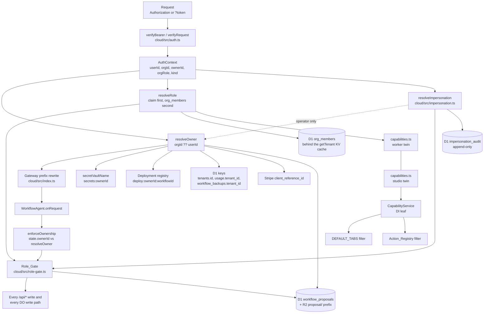

# Design Document

## Overview

Today the Clerk user id is simultaneously `tenants.id`, the Durable Object instance-name prefix in
`cloud/src/index.ts`, the `SecretVault` instance name (`secretVaultName`), the deploy registry owner
segment (`deploy:{ownerId}:{workflowId}`), the R2 backup path segment (`bodyKey`), the Stripe
`client_reference_id` and the quota bucket. Organisations arrive by splitting one question into two:

- **Who is asking** stays `AuthContext.userId`, and keeps its existing `kind` semantics so a desktop
  `phd_` token still cannot reach an operator surface.
- **Whose data is this** becomes an opaque `ownerId`, resolved once by `resolveOwner` and then used
  everywhere a `userId` is used as a data key today.

A third question, **what may this caller do**, is answered by `resolveRole` and enforced by one
server-side seam.

Two new seams, six existing consumers rewired, two new D1 tables plus one new column, one new R2
prefix inside the bucket that already exists, and one new studio service. Nothing in `engine/`
changes. Nothing in BYO mode changes.

---

## Architecture



Read the diagram as two fan-outs. `resolveOwner` feeds every consumer that answers "whose data";
`resolveRole` feeds exactly one consumer, the Role_Gate, and its studio mirror feeds only subtractive
UI. The two new stores hang off the seams rather than off the route handlers, so neither store is
reachable without passing a seam first.

### The structural constraints

The design holds five constraints from the requirements as structural facts rather than as policy:

| Constraint | How it is structural |
|---|---|
| Isolation, not policy | A foreign organisation's instance name is unreachable through the gateway prefix rewrite, and the instance refuses independently |
| Append-only wire | Capability levels, proposal statuses and refusal codes are named tokens, never ordinals |
| An editor's change is a proposal | Creating a proposal never calls the `WorkflowAgent`, so it cannot mutate a deployed spec |
| No customer credential on a build machine | Member surfaces are browser-only, so there is no keychain path to scope |
| Support reach is read-only and audited | The write refusal sits at two layers and the audit write is awaited, not `waitUntil`ed |

---

## Components and Interfaces

### 2. The owner seam

#### 2.1 `AuthContext`

`cloud/src/auth.ts` today returns `{ userId: string | null, kind: AuthKind }` and the Clerk branch
reads exactly one claim:

```ts
if (payload.sub) return { userId: payload.sub, kind: 'clerk' };
```

The new shape, additive in every field:

```ts
export interface AuthContext {
  /** Clerk userId (JWT sub). Null for shared-token / open-instance access. */
  userId: string | null;
  /**
   * Clerk organisation id (`org_...`) when the credential names one, else null.
   * NEVER inferred: absent claim means absent organisation, which is a
   * single-user install behaving exactly as it did before this existed.
   */
  orgId: string | null;
  /**
   * Whose data this request addresses: `orgId ?? userId`, or null for a shared
   * token. Cached result of {@link resolveOwner} so no consumer re-derives it.
   */
  ownerId: string | null;
  /**
   * The RAW organisation role claim, unmapped and unvalidated.
   *
   * Deliberately a string rather than a `CapabilityLevel`: `auth.ts` is about
   * verification and must not own the capability vocabulary. The mapping lives
   * in `capabilities.ts`, reached through `resolveRole`.
   */
  orgRole: string | null;
  kind: AuthKind;
}
```

`kind` keeps its exact present meaning (Requirement 16.5), so `refuseNonOperator`'s
`auth.kind !== 'clerk'` rule is untouched.

#### 2.2 The three functions

```ts
/**
 * Whose data a request addresses. TOTAL and SYNCHRONOUS: every AuthContext
 * resolves, and the only null is the shared-token/open-instance case that every
 * consumer already folds to the `default` literal through `deploymentOwner`.
 *
 * It reads `auth.orgId`, which is filled by `verifyBearer` for a `clerk`
 * credential from a VERIFIED claim. For a `device` credential there is no claim:
 * the organisation is named by a request header and confirmed against membership
 * one layer up, by `resolveRequestedOwner` (section 2.5), which needs a
 * `TenantEnv` and therefore cannot live here. Both paths write the same field, so
 * every consumer below them reads one value and never branches on credential
 * kind.
 */
export function resolveOwner(auth: AuthContext): string | null {
  return auth.orgId ?? auth.userId;
}

/** True for a value that may become an owner key. Accepts BOTH id shapes. */
export function isOwnerId(value: unknown): boolean;   // cloud/src/tenants.ts

/**
 * The caller's capability level for the owner they are addressing, or an
 * explicit unknown. One seam, two sources - see 2.4.
 */
export async function resolveRole(
  env: TenantEnv,
  auth: AuthContext,
): Promise<{ level: CapabilityLevel } | { unknown: true }>;
```

`resolveOwner` is a function AND a cached field because `verifyBearer` fills the field by calling the
function. Consumers read the field; anything holding a synthesised or impersonated context calls the
function. The expression `orgId ?? userId` is written once.

`isOwnerId` lives in `cloud/src/tenants.ts` beside `isClerkUserId` and accepts `user_[A-Za-z0-9_-]{1,120}`
or `org_[A-Za-z0-9_-]{1,120}` (Requirement 1.9). It inherits `isClerkUserId`'s documented asymmetry
verbatim: **apply it on WRITE paths only, never to an id read back out of a row** (Requirement 1.10).
Exactly ONE call site moves from `isClerkUserId` to `isOwnerId`: `/api/provision` in
`cloud/src/api.ts`, which is how an organisation tenant row comes into existence at all
(Requirement 19.5).

The three Stripe-supplied id paths in `cloud/src/stripe-webhook.ts` deliberately STAY on
`isClerkUserId` - the `client_reference_id` on a session and the `metadata.clerk_user_id` on a
customer inside `resolveTenant`, plus the delayed-payment branch that reads `client_reference_id`
alone. An earlier draft of this section moved all four, and that was wrong once organisation billing
became invoice-led: `/api/checkout` refuses an organisation owner outright (Requirement 19.4), so an
`org_` id can never legitimately reach Stripe, and widening the webhook's classifier would only
broaden what an inbound value is allowed to claim. Narrower is correct on a path whose input is
supplied by a third party. `isClerkUserId` therefore stays exported and stays the predicate for
anything that genuinely means a human.

The colon rule (Requirement 1.8) is a guard beside `resolveOwner`, not inside it, because a resolver
that can return a refusal is a resolver every caller has to discriminate:

```ts
/** False when an owner id cannot be used as a key segment. */
export function ownerIdIsAddressable(ownerId: string | null): boolean {
  return ownerId === null || !ownerId.includes(':');
}
```

The gateway and `routeApiRequest` both call it and answer `owner_invalid` on false. Nothing truncates,
escapes or rewrites the value. This is the FIRST of two independent colon refusals: the second is
`isRegistrySegment` in `cloud/src/portal-registry.ts`, which is module-private and reached through
`registerDeployment` returning `{ok: false, error}` (Requirement 2.7). Keeping both is deliberate -
the gateway guard protects addressing, the registry guard protects the prefix scan in
`listDeployments`, and the registry one already carries the comment explaining why
`deploy:a:b:wf` reads as two different owners.

#### 2.3 The Clerk claim layout MUST be verified before the reader is written

This is the one part of the design that cannot be settled from the repository, and getting it wrong is
a silent failure: an unread `org_id` claim means every member of every organisation resolves their
PERSONAL owner, sees an empty workspace, and nothing logs an error.

Clerk has shipped more than one session-token claim layout. The long-standing v1 default carries
organisation context as top-level claims (`org_id`, `org_role`, `org_slug`, `org_permissions`); newer
instances can be configured to emit a compacted organisation object instead. `@clerk/backend`'s
`verifyToken` hands back the payload and does not normalise either shape - `payload.sub` is the only
claim this worker reads today.

Two checks, and only these two are trustworthy:

1. `GET /v1/environment` on the Clerk Frontend API. Public, and the cheapest read of the instance's
   REAL configuration. Note the recorded trap: it answers 200 for any origin at all, so it proves
   configuration, never that a browser surface can sign in.
2. A REAL production session token against `/api/me`, returning 200 with the expected owner. This is
   the only end-to-end proof. `/status.json` CANNOT verify it - its Clerk probe returns 200 for any
   valid key regardless of instance, and it reads no claims at all.

And one configuration fact to check in the same sitting, because it can make the ABSENT claim
impossible rather than merely unread: per
[Clerk's session tasks documentation](https://clerk.com/docs/authentication/configuration/session-tasks),
enabling Organizations on a Clerk instance created after 22 August 2025 leaves the personal-account
option DISABLED by default, and with it disabled a user is required to choose an organisation after
authenticating. In that configuration there is no such thing as a token with no
organisation claim, so `resolveOwner`'s `?? auth.userId` branch, `resolveRole`'s `admin` default and
the whole "Phases 0 and 1 are inert" argument are all unreachable - and a user who downloads the
Studio to try it cannot get past sign-in without being put in an organisation. The second half of
check 2 is therefore a token from a BRAND NEW account, not only from a member (Requirements 1.13,
1.14).

The reader is therefore one function that accepts BOTH layouts and prefers whichever is present:

```ts
/** The organisation id and raw role claim, from whichever layout this instance emits. */
function readOrgClaim(payload: Record<string, unknown>): { orgId: string | null; orgRole: string | null };
```

Written against the verified layout, tolerant of the other, and returning nulls rather than throwing
for a token with neither. A token with an organisation id and no role claim is NOT an error here - it
becomes `role_unknown` at `resolveRole`, which is where fail-closed belongs (Requirement 5.9).

#### 2.4 The `org_members` fallback, and why `resolveRole` stays one seam

Four capability levels need four distinguishable role values. Clerk's built-in organisation roles are
`org:admin` and `org:member`; more than two requires custom roles, which is a plan-dependent feature.
Until that is confirmed available on our plan, the claim alone can express at most `admin` versus
"some member", which is not enough.

So `resolveRole` has two sources and one contract:

1. **Claim first.** `CLERK_ROLE_LEVELS` in `cloud/src/capabilities.ts` maps a raw claim value to a
   `CapabilityLevel`. An unmapped value is not an error yet - it falls through.
2. **`org_members` second.** One D1 row per `(org_id, user_id)` carrying the level, read behind the
   SAME KV cache shape `TenantStore.getTenant` uses: `env.TENANTS?.get('orgmember:{orgId}:{userId}', 'json')`,
   written back with `expirationTtl: TENANT_CACHE_TTL_S` (60, which is also Cloudflare KV's floor -
   anything lower is a 400). Cached because this read is on the request path for every organisation
   member; contrast `grantPool`, which is deliberately NOT cached because it is only reached once the
   allowance is gone.
3. **Neither.** `{ unknown: true }`, and the caller answers 403 `role_unknown`.

Callers see one function either way, so switching to claim-only later is a change inside
`resolveRole` and nowhere else. Two rules keep the fallback honest: a member-management write
invalidates the KV key immediately (a demotion that takes 60 seconds to bite is a demotion that did
not happen for 60 seconds), and a row read back out of `org_members` is never re-validated against
`isOwnerId`, for the same reason `tenants.id` is not.

`AuthEnv` needs NO new binding. The claim reader uses the Clerk secret already bound; the D1 fallback
takes a `TenantEnv` (the `DB` and `TENANTS` bindings that already exist), and every caller of
`resolveRole` already constructs a `TenantStore`. A BYO worker binds no `DB`, so the fallback is
unreachable there - and it never needs to be, because a credential with no organisation claim resolves
`admin` (Requirement 5.10) and a `shared` credential resolves `admin` over the `default` owner
(Requirements 1.4, 4.13, 16.6).

#### 2.5 The desktop token

The mechanics first, because an earlier draft named the wrong route. `cloud/src/device-auth.ts` mints
the `phd_` token, signed with `PHORMA_AUTH_SECRET`, and the payload is four single-letter fields
(`s`, `i`, `e`, `v`). `GET /auth/device` only SERVES the browser page; the Clerk session is read by
`POST /api/auth/device/claim` (`auth.kind !== 'clerk'` is a 403 there) and the token is minted by
`POST /api/auth/device/redeem`, which deletes the KV entry first so a code is single-use.

**The token payload does NOT gain an organisation id.** The obvious design - stamp the active
organisation into the signed payload at mint time - was rejected on two counts, and each is sufficient.
A desktop install could then only SWITCH by re-running the whole browser handoff (Requirement 20.4),
and a membership revoked the day after a mint would stay honoured for up to the token's 30-day TTL,
because lean v1 keeps no server-side record of a minted token and has nothing to revoke
(Requirement 20.11).

Instead the token names only the user, and a request NAMES the organisation it addresses:

```ts
/**
 * The organisation a request addresses, or null. Read from the `X-Phorma-Owner`
 * header, and MEANINGLESS on its own - it is a request, not a credential.
 */
function readRequestedOrg(request: Request): string | null;

/**
 * Whose data this request addresses, for a credential whose organisation is not
 * already carried by a verified claim.
 *
 * Returns the caller's own `userId` whenever the named organisation cannot be
 * confirmed, which covers an absent header, an unparseable value, and a real
 * organisation the caller is not a member of - all three INDISTINGUISHABLE from
 * outside, for the same reason the act-as header's three null cases are
 * (section 11.2).
 */
async function resolveRequestedOwner(env: TenantEnv, auth: AuthContext): Promise<string | null>;
```

The membership confirmation is not a new read. `resolveRole` already looks `(orgId, userId)` up in
`org_members` behind a 60s KV cache (`orgmember:{orgId}:{userId}`), and a member-management write
already invalidates that key immediately - so a named organisation costs the same read the level
resolution costs, and a revocation bites on the next request. A desktop install still cannot address an
organisation it does not belong to; the guarantee is a membership lookup rather than a signature, which
is the stronger of the two because it is evaluated at request time.

Three consequences to write down where they bite, rather than leave for the first caller to discover:

1. **`org_members` becomes AUTHORITATIVE, not a fallback.** A `device` credential carries no Clerk
   role claim at all, so the table is the only source for that credential kind - and since the
   Super_Admin route family is the only writer of membership (Requirement 13.7), one surface we control
   owns both the membership and the level. Section 2.4's claim-first ordering survives as an
   OPTIMISATION for a `clerk` credential, and the unresolved "are custom Clerk organisation roles
   available on our plan" question comes off the critical path entirely: if they are not, nothing
   degrades, because the table was going to answer anyway.
2. **`resolveOwner` stays synchronous, and stops being the whole story.** For a `clerk` credential the
   organisation arrives in a verified claim, so `verifyBearer` fills `ownerId` and `resolveOwner` is
   the pure `orgId ?? userId` of section 2.2. For a `device` credential `verifyBearer` fills `ownerId`
   with the subject's `userId` and the organisation is resolved one layer up, by `routeApiRequest` and
   the gateway, through `resolveRequestedOwner`. Both write the same field; only one of them can be
   reached without a `TenantEnv`. That asymmetry is documented on `resolveOwner` itself.
3. **A `shared` credential ignores the header outright.** BYO resolves the `default` owner and binds no
   `DB`, so there is nothing to check a membership against and nothing an organisation could mean
   (Requirements 1.4, 16.6).

The header is `X-Phorma-Owner`, deliberately a different header from `X-Phorma-Act-As`: one is a member
naming their own organisation and is checked against membership, the other is an operator naming
somebody else's and is checked against the allowlist. Folding them into one header would make the
difference between "my organisation" and "a customer's organisation" a property of who is asking rather
than of what was asked.

---

### 3. Two independent isolation layers

#### 3.1 Layer one: the gateway

`cloud/src/index.ts` already rewrites the instance name before any Durable Object is addressed:

```ts
const prefix = `${auth.userId}:`;
if (instance.includes(':') && !instance.startsWith(prefix)) { /* 403, no DO instantiated */ }
const scoped = instance.startsWith(prefix) ? instance : `${prefix}${instance}`;
```

Three lines change: the 401 becomes `if (!auth || !resolveOwner(auth))`, `prefix` becomes
`${resolveOwner(auth)}:`, and `ownerIdIsAddressable` gates both. The 403 branch keeps its exact shape,
including the property that matters most - it returns BEFORE `routeAgentRequest`, so a foreign
organisation's instance is never woken (Requirement 2.2). An unreachable object cannot leak through a
handler bug, because no handler runs.

#### 3.2 Layer two: the instance

`WorkflowAgent.enforceOwnership` compares `this.state.ownerId` against the caller. Two edits:

```ts
private enforceOwnership(auth: AuthContext): Response | null {
  if (!this.hosted) return null;
  const owner = this.state.ownerId;
  const caller = resolveOwner(auth);          // was auth.userId
  if (owner && owner !== caller) return json({ error: '...' }, 403);
  return null;
}
```

and the first-push stamp, currently `const ownerId = this.state.ownerId ?? auth.userId`, becomes
`?? resolveOwner(auth)` (Requirement 2.3). `purgeSelf` already preserves the stamp
(`setState({ ...this.initialState, ownerId: this.state.ownerId })`), which satisfies Requirement 2.6
with no code change - and is exactly why a test must pin it, since the line reads like housekeeping.

#### 3.3 Why the instance must be able to refuse alone

The gateway is one `if` over a string prefix. If a future route, a new SDK version, or an RPC entry
point reaches `WorkflowAgent` without passing through `AGENT_PATH_PREFIX`, the gateway check simply
does not run. That is not hypothetical in this codebase: `notificationsSince`, `purgeSelf` and
`startPortalTurn` are ALL reached by RPC, precisely because a worker-to-DO `stub.fetch()` carries no
bearer for `authorized()` to check. `notificationsSince` therefore already re-checks the owner and
already mirrors `enforceOwnership`, and the new `acceptSpecPush` RPC (section 9.5) does the same.

Requirement 2.5's test drives that directly: build a foreign-prefixed instance name, reach the
instance through the Miniflare harness without the gateway in the path, and assert the 403 comes from
`enforceOwnership`. If the assertion can only be made with the gateway present, it is asserting the
gateway.

#### 3.4 The WebSocket upgrade path

The gateway already branches on `Upgrade: websocket` and verifies `url.searchParams.get('token')`
through `verifyBearer` rather than `verifyRequest`, because a browser cannot set a header on a
WebSocket. The prefix rewrite runs on that branch too, so layer one covers it unchanged.

Layer two is `onConnect`, which calls `this.verifyToken(token)` then `this.enforceOwnership(auth)` and
closes with `4001` on either failure. Since `enforceOwnership` now compares the resolved owner, the
socket inherits organisation isolation with no new code (Requirement 2.9). Two properties of the
existing code that must not be disturbed: the 101 response is never re-wrapped (`new Response(body,
init)` drops the `webSocket` handle and workerd rejects a 101 without it), and a public portal visitor
never gets a socket at all, because the `agents` SDK broadcasts whole agent state - including
`ownerId` and the spec - to every connected client.

#### 3.5 Portal session instances

A published portal spawns one instance per visitor conversation, named
`{ownerId}:{workflowId}#s{sessionId}` by `portalSessionInstance`, with `#s` a separator the studio
never produces. `publishPortal` writes `ownerId: this.state.ownerId ?? null` into the `PublishRecord`,
so once the primary instance is stamped with an organisation, `portalOwnerInstance` and
`portalSessionInstance` both scope to the organisation with zero changes.

Session instances stay OUT of organisation ownership (Requirement 2.8), and four existing guards do
it: `syncDeployment`, `removeDeployment` and `backfillDeployment` all return early on
`this.state.portalSession`, and `notificationsSince` returns `{runs: [], pending: [], issues: []}` for
one. A visitor holds no credential, so there is nothing to resolve a role from and nothing to compare.

---

### 4. The ownership claim path

Route: `POST /api/deployments/{workflowId}/claim`, in a new `cloud/src/ownership-claim.ts` mounted
immediately after `handleDeploymentsRequest` in `routeApiRequest` and ABOVE the `store.enabled` gate.
It cannot sit below the gate: that branch answers 501 "hosted bindings missing", and Requirement 3.10
wants a flat 404 in BYO. So the module's first two lines are its own explicit refusals:

```ts
if (!isHosted(env)) return respond({ error: 'Not found.' }, 404);
if (!new TenantStore(env).enabled) return respond({ error: 'Not found.' }, 404);
```

`deployments.ts` stays a read. A claim is a write with a different gate, a different audit and a
different failure vocabulary, and folding it in would make one module answer both.

#### 4.1 Preconditions

1. `verifyRequest`, then `resolveOwner` -> the NEW owner.
2. Role_Gate at `builder` for that owner (Requirement 3.2). An `operator` or `editor` claiming a
   deployment into the organisation is `role_forbidden`.
3. RPC `claimOwnership(actingUserId, newOwnerId)` into the instance, which decides:
   - no stamp at all -> `claim_unowned` (Requirement 3.4), so a claim never adopts an instance the
     ordinary first-push stamp would have owned;
   - stamp !== `actingUserId` -> `claim_not_owner` (Requirement 3.3). Note the comparison is against
     the acting USER id, not the resolved owner: the whole point is moving a personally-owned
     deployment into an organisation;
   - stamp === `newOwnerId` -> `{ ok: true, alreadyOwned: true }`, the idempotent repeat
     (Requirement 3.8);
   - otherwise proceed.
4. Before the DO write, the worker pre-checks the one D1 collision that can half-apply a claim
   (Requirement 3.11): `workflow_backups` has PK `(tenant_id, workflow_id)`, so if the organisation
   ALREADY backs up a workflow with this id, the transfer update would violate it.
   `SELECT 1 FROM workflow_backups WHERE tenant_id = ? AND workflow_id = ?` first, and refuse
   `claim_conflict` rather than discover it mid-transfer.

#### 4.2 The atomic single-owner replace

Durable Object state is ONE row (`cf_agents_state`), and `setState` rewrites it. So:

```ts
this.setState({ ...this.state, ownerId: newOwnerId });
```

is the whole replace, and there is no observable moment with two stamped owners or none
(Requirement 3.5). Anything that read the old owner before this line and writes after it would break
that, which is why the registry move below happens AFTER and reads `this.state.ownerId` fresh rather
than from a captured variable.

#### 4.3 The registry move

```ts
await index.registerDeployment({ ...record, ownerId: newOwnerId });   // write first
await index.deregisterDeployment(previousOwnerId, workflowId);        // then remove
```

Write-then-remove, not the reverse. A failure between the two leaves a DUPLICATE record, which the
owner can see and a later `backfillDeployment` or push corrects; the reverse order leaves NO record,
which is invisible and is the exact defect the registry exists to close - a Durable Object namespace
cannot be enumerated, so an absent record means an unnameable deployment. Both calls are already
idempotent (`registerDeployment` preserves `deployedAt`, `deregisterDeployment` returns
`{removed: boolean}`), so a retry of the whole claim converges.

#### 4.4 The metadata transfer, and the `body_key` column

Requirement 4.7 is the reason R2 is never touched. `bodyKey(tenantId, workflowId, revision)` puts the
tenant FIRST (`backup/{tenantId}/{workflowId}/{revision}`), which is what makes a per-tenant prefix
scan possible - and also what would force copying every object on an ownership change.

So `workflow_backups` gains one nullable column, `body_key`, holding the object PREFIX in force for
that row (`backup/{owner}/{workflowId}/`). Revisions append to it, so one column covers every
revision. `BackupBodyStore` reads the stored prefix and falls back to the derived one:

```ts
const prefix = record.bodyKey ?? bodyPrefix(record.tenantId, record.workflowId);
```

A NULL therefore reads as the legacy derived value and NO backfill is needed - the same
absent-is-ordinary discipline `stripe_customer_id` follows. A claim then changes `tenant_id` and
leaves `body_key` alone, so every stored object stays exactly where it is and `revisions()` keeps
reading R2 as the authority on which bodies exist.

The two row transfers run as ONE `DB.batch([...])`, which D1 executes in a single implicit
transaction:

```sql
UPDATE workflow_backups SET tenant_id = ? WHERE tenant_id = ? AND workflow_id = ?;
UPDATE usage          SET tenant_id = ? WHERE tenant_id = ? AND workflow_id = ?;
```

`usage` carries the UNIQUE `idx_usage_tenant_run` added by `0003_billing.sql`, so a run id colliding
across the two owners would fail the batch rather than double-count; run ids are minted per instance
(`cloudrun-{base36}-{n}`) so this is unreachable in practice and the batch is what keeps it safe
anyway. `quotas` rows are deliberately NOT moved: they are a `(tenant_id, month)` rollup that resets
by acquiring a new row, and moving history would rewrite a billing period that has already been
charged.

#### 4.5 Idempotency and the audit

The repeat case (Requirement 3.8) is answered by the DO at step 3, so a repeat does no D1 work and
writes no second audit row. The accepted claim writes exactly one `ownership_claims` row
(Requirement 3.9) carrying `previous_owner_id`, `new_owner_id`, `acting_user_id`, `workflow_id` and
`at`. Unlike the impersonation audit, a failed write here does NOT refuse the request: the ownership
move has already happened in the DO and the registry, and refusing after the fact would report a
failure for a claim that succeeded. It logs, and the row is reconstructible from the registry.

---

### 5. The capability contract

#### 5.1 The twinned pair

`cloud/src/capabilities.ts` and `frontend/src/app/core/capabilities.ts`, structural twins in the sense
the `structure` steering already uses: two independent declarations, no shared import, named in the
steering file in the same change (Requirements 5.7, 16.3).

```ts
export type CapabilityLevel = 'operator' | 'editor' | 'builder' | 'admin';

/** Display order only. The ORDERING that matters is derived - see 5.3. */
export const CAPABILITY_LEVELS = ['operator', 'editor', 'builder', 'admin'] as const;

export type Capability =
  // operator
  | 'run.trigger' | 'run.monitor' | 'run.answer_gate'
  | 'read.runs' | 'read.traces' | 'read.usage' | 'read.notifications' | 'read.workflows'
  // editor
  | 'edit.prompt' | 'edit.cron' | 'edit.node_config' | 'edit.connection_secret'
  // builder
  | 'workflow.create' | 'graph.structure' | 'deploy.push' | 'deploy.delete'
  | 'connection.manage' | 'eval.manage' | 'portal.manage'
  // admin
  | 'member.manage' | 'billing.manage';

export const CAPABILITIES_BY_LEVEL: Record<CapabilityLevel, readonly Capability[]>;
```

The level sets are CUMULATIVE by construction: `editor` spreads `operator`'s array, `builder` spreads
`editor`'s, `admin` spreads `builder`'s. Requirement 5.6 is then a property of the table rather than a
claim about it, and a property test can falsify it by deleting one entry from a higher level's array.

#### 5.2 Named tokens, not a numeric ladder

A numeric ladder (`operator = 1 ... admin = 4`) is cheaper to compare and wrong for three reasons that
all bite later:

- Inserting a level between two existing ones renumbers every level above it. A `3` persisted in an
  `org_members` row, cached in KV, or held in an older studio's `localStorage` then MEANS something
  different, silently, with no type error anywhere.
- A number on the wire is unreadable in a log, a refusal body or an audit row. `role_forbidden` with
  `required: "builder"` is actionable; `required: 3` is a lookup.
- Requirement 5.11 forbids renaming or repurposing a released token. A number cannot be repurposed
  without repurposing every number above it.

The tokens are append-only. A studio three versions old that meets a fifth level renders the literal
and treats it as unknown, which is the same default branch it already needs for an unrecognised
refusal code (Requirement 15.5).

#### 5.3 The comparison

```ts
export function capabilitiesOf(level: CapabilityLevel): ReadonlySet<Capability>;
export function holds(level: CapabilityLevel, capability: Capability): boolean;

/** True when `level` holds EVERY capability of `required`. */
export function atLeast(level: CapabilityLevel, required: CapabilityLevel): boolean {
  for (const capability of capabilitiesOf(required)) {
    if (!holds(level, capability)) return false;
  }
  return true;
}
```

Set inclusion, not an index lookup. Two consequences worth stating: `atLeast` is automatically correct
for a level added later without touching the comparison, and a mistake in the table (a capability
missing from a higher level) becomes a FAILING comparison rather than a silently wrong one. The
display order in `CAPABILITY_LEVELS` is asserted to agree with the inclusion order by a property, so
the two cannot drift.

#### 5.4 Fail closed on an unknown role

An organisation claim with an absent or unrecognised role claim, and no `org_members` row, is
`{ unknown: true }` -> 403 with `code: 'role_unknown'` (Requirement 5.9). Not `operator`, which would
be the "safe minimum" instinct and is wrong: `operator` can TRIGGER A RUN, which spends the
organisation's credits. There is no safe minimum below that, so there is no default.

The same code answers an unrecognised level token on a member-management write (Requirement 13.9), so
one token covers both "we cannot read your role" and "you named a role we do not have".

#### 5.5 No organisation claim means full capability

A credential with no organisation claim resolves `admin` over its own personal owner
(Requirement 5.10), and a `shared` credential resolves `admin` over the `default` owner. This is the
single most important compatibility rule in the design: every existing install, hosted single-user and
BYO alike, takes the `admin` branch and behaves byte for byte as it did before. It also means the
Role_Gate can be added to every write route in one change without gating anything that works today.

---

### 6. The Role_Gate

#### 6.1 One function, one shape

`cloud/src/role-gate.ts`:

```ts
export interface AuthorizedCaller {
  userId: string;
  ownerId: string;
  orgId: string | null;
  level: CapabilityLevel;
  /** True when the owner came from an act-as header. Writes are refused. */
  impersonated: boolean;
}

export async function requireCapability(
  env: TenantEnv,
  auth: AuthContext,
  required: CapabilityLevel,
  respond: Respond,
): Promise<AuthorizedCaller | Response>;
```

Discriminated with `'level' in result`, the same idiom `resolveHostedInference` established with
`'status' in gate` - so the shape is familiar and no cast is needed. Three refusals, in this order:

1. `impersonated` and the route is a write -> 403 `impersonation_read_only` (section 12).
2. `resolveRole` unknown -> 403 `role_unknown`.
3. `atLeast(level, required)` false -> 403 `role_forbidden`, with `required` naming the level in the
   body (Requirement 6.8).

The impersonation refusal is FIRST on purpose: an operator who also holds a real membership in the
target organisation must not be able to write through the header. Their membership is how they write
(Requirement 14.14), and it does not travel with the act-as header.

#### 6.2 Where it sits in `WorkflowAgent.onRequest`

Third, and the ordering is the design:

```ts
override async onRequest(request: Request): Promise<Response> {
  const auth = await this.authorized(request);          // 1: who are you
  if (!auth) return json({ error: 'Unauthorized.' }, 401);
  const denied = this.enforceOwnership(auth);           // 2: whose instance is this
  if (denied) return denied;
  const caller = await this.resolveCaller(auth);        // 3: what may you do
  if (caller instanceof Response) return caller;
  // ... existing path dispatch, unchanged
}
```

`resolveCaller` resolves the level ONCE per request (so a route with two checks costs one KV read) and
returns the `role_unknown` refusal itself. Each write branch then opens with one line:

```ts
if (!atLeast(caller.level, 'builder')) return roleForbidden('builder');
```

Why not resolve the required level inside `resolveCaller` from the path? Because then the DO would
carry a second route table, and two route tables for one dispatch is how one of them starts admitting
what the other refuses. The required level for each route lives in ONE place, section 6.4.

#### 6.3 Reads stay open, and writes are enumerated

Every read route is allowed to every level, `operator` included (Requirement 6.3). That is a product
decision with a security consequence worth naming: an `operator` can read the organisation's prompts,
traces and usage. They are a member of the organisation; the boundary this feature defends is BETWEEN
organisations, not within one.

The writes, per Requirements 6.4 to 6.7:

| Write | Required level |
|---|---|
| `POST /trigger`, `POST /events`, `POST /approvals`, `POST /questions`, WS `approval`/`event`/`stop` | `operator` |
| Connection secret value write, prompt text, cron, node configuration (as a PROPOSAL) | `editor` |
| `POST /workflow`, `DELETE /workflow`, `DELETE /workflow/purge`, `POST /connections`, `POST /publish`, `POST /unpublish`, `POST /portal-tokens`, `DELETE /portal-tokens/{id}`, proposal publish and reject, the ownership claim | `builder` |
| `POST /api/checkout`, `POST /api/billing-portal` | `admin`, AND a personal Owner_Id - an organisation owner is refused `billing_managed` before the level is even compared (Requirement 19.4) |

#### 6.4 The route-enumeration test, and failing closed

The required level per route is DATA, exported from `role-gate.ts`:

```ts
export interface WriteRoute { method: 'POST' | 'DELETE' | 'PUT'; match: RegExp; required: CapabilityLevel; }
export const WRITE_ROUTES: readonly WriteRoute[];
export function requiredLevelFor(method: string, path: string): CapabilityLevel | undefined;
```

`requiredLevelFor` returning `undefined` for a MUTATING method is itself a failure, and the gate
refuses (`role_forbidden` naming `admin`) rather than passing. So an unguarded new write route is
broken-closed at runtime, not open.

`cloud/test/role-gate.test.mjs` has two halves, and both are needed:

1. **Runtime.** Drive every `WRITE_ROUTES` entry with a real `operator`-level token and assert 403
   `role_forbidden`, then with the declared level and assert it is NOT 403. Driving the table alone
   would pass for a table that has drifted from the routes.
2. **Static.** Scan `cloud/src/api.ts` and `cloud/src/workflow-agent.ts` for mutating method/path
   literals (`request.method === 'POST' && path.endsWith('/x')`, `url.pathname === '/api/x'`) and fail
   on any that `requiredLevelFor` does not answer. This is what makes Requirement 6.9 real: a new
   write route with no table entry fails the suite before anybody notices the runtime behaviour. The
   comment-and-template stripping and the "no matches found means the parser broke" vacuous-pass guard
   are copied from `scripts/check-telemetry-isolation.mjs`.

The Role_Gate is the security boundary (Requirement 6.11). Every studio-side gate in section 7 is a
usability feature, and section 7 says so in its own header so nobody later mistakes one for the other.

---

### 7. The studio capability seam

#### 7.1 `CapabilityService`, a DI leaf

`frontend/src/app/core/capability.service.ts`. The known NG0200 cycle is
`RunControllerService -> ModelTransportService -> PhormaCloudService -> CloudService -> RunControllerService`,
and this service will be injected by `PanelRegistryService` (read by the layout shell at startup) and
by the action services. So it must inject nothing that can reach that cycle: no `CloudService`, no
`PhormaCloudService`, no `WorkflowService` (Requirement 7.2).

```ts
@Injectable({ providedIn: 'root' })
export class CapabilityService {
  private readonly clerk = inject(ClerkService);   // ngx-clerk, the only injection
  private readonly levelState = signal<CapabilityLevel>('admin');
  readonly level = this.levelState.asReadonly();

  /** Pushed by whoever holds the verified server answer. See 7.2. */
  resolveFrom(level: CapabilityLevel): void { this.levelState.set(level); }

  can(capability: Capability): boolean;
  atLeastLevel(required: CapabilityLevel): boolean;
  /**
   * True when the caller satisfies an OPTIONAL declared minimum. An absent
   * minimum reads as `operator`, and that default is applied HERE rather than at
   * the call site, because `?? 'operator'` at a call site is a CapabilityLevel
   * literal outside this module - which Requirement 7.4 forbids and the
   * Capability_Guard fails on. Every subtractive filter in the studio goes
   * through this one method.
   */
  allows(minLevel?: CapabilityLevel): boolean { return this.atLeastLevel(minLevel ?? 'operator'); }
  /** True when this session has no local library: operator or editor. */
  readonly cloudLibraryOnly = computed(() => !this.atLeastLevel('builder'));
}
```

The initial value is `admin`, matching Requirement 5.10: an install with no organisation has every
capability it had before, and a surface never flickers into a restricted shape on startup.

#### 7.2 The desktop hole, named rather than discovered

`ClerkService` never loads a user on a desktop install - `PhormaCloudService.user` documents it:
"Always null on desktop, and that is not a bug: the webview cannot hold a Clerk session against a
production instance". A `CapabilityService` reading Clerk alone would therefore resolve nothing on
desktop, which is where builders work.

The answer is a PUSH, not another injection: `resolveFrom(level)` is called by whoever already holds
the verified `/api/me` answer (`PhormaCloudService`, which is on the cycle and must not be injected
here), with the level the worker resolved. Same settable-seam idiom the repo already uses for
`RunControllerService.remoteApprovalSender` and `NotificationCenterService.deepLinkHandler`, and it
makes Requirement 7.7 (recompute without a page reload) a single signal write that every `computed`
downstream already tracks.

`/api/me` therefore gains additive fields: `ownerId` and `level`, plus `owners` for the switcher
(section 17.1). Additive, so an older studio ignores them and an older worker omitting them leaves the
studio on its `admin` default, which is today's behaviour.

All three go on BOTH branches of that handler, the `provisioned: false` early return included. That
branch is the COMMON case for an organisation member: a member who never bought a personal subscription
has no `tenants` row of their own, so a level or an owner list supplied only by the provisioned branch
would be absent for exactly the people the feature exists for.

#### 7.3 Capability-filtered `DEFAULT_TABS`

`PanelTab` in `frontend/src/app/core/panel-registry.service.ts` gains one optional field:

```ts
export interface PanelTab { id: string; label: string; icon: string; side: 'left' | 'right'; order: number; visible: boolean; minLevel?: CapabilityLevel; }
```

`DEFAULT_TABS` declares `minLevel` where it applies: `evals`, `connections`, `portal` and `skills` at
`builder`, everything else absent (which reads as `operator`). The two computeds subtract:

```ts
readonly leftTabs = computed(() =>
  this._tabs().filter(t => t.side === 'left' && t.visible && this.capability.allows(t.minLevel)).sort(...));
```

`allows(t.minLevel)` and never `atLeastLevel(t.minLevel ?? 'operator')`: the absent-means-`operator`
default belongs inside the capability module (section 7.1), or this line carries a level literal that
Requirement 7.4 forbids and the guard in section 7.5 fails on.

Subtractive, never conditional (Requirement 7.3), and the filter is in the COMPUTED rather than in
`_tabs`. That distinction is load-bearing: `loadTabs()` merges saved side/order/visibility onto
`DEFAULT_TABS` and persists `_tabs` through an `effect`, so removing an entry from `_tabs` would drop
it from the saved layout - and a member promoted to builder would lose their arrangement. Filtering in
the computed means a promotion is a signal write and the tab returns where the user left it.

`PanelRegistryService` currently injects only `TelemetryService`, with a comment explaining why that
edge is safe. `CapabilityService` gets the same treatment and the same justification: it injects
`ClerkService` and nothing else, so it cannot pull a cycle member into the layout shell.

#### 7.4 Capability-filtered Action_Registry

`StudioAction` in `core/studio-actions/studio-action.model.ts` gains `minLevel?: CapabilityLevel`
(absent = `operator`), and `StudioActionRegistryService.available(access)` adds one clause:

```ts
return this.all().filter(action =>
  (access === 'all' || action.access === access) &&
  this.capability.allows(action.minLevel));
```

Same `allows(...)` seam as the panel filter, for the same reason: one idiom, and no level literal
outside the capability module.

Everything downstream is already derived, so nothing else changes: `toolDefinitions` (the Agent-mode
tool list), `summarizeActions` (the prompt catalogue) and `plan-op.ts`'s apply path all read
`available()`. That is the registry pattern working as documented - one field, and the Agent tool list,
the plan ops and the prompts all follow (Requirements 8.2, 8.3).

Three rules on top:

- `execute()` re-checks the level and returns `actionFail` with one sentence, so a model naming an id
  it was not offered is refused at dispatch as well as omitted from the list. Same defence-in-depth
  shape as the existing `options.readOnly` check for Ask mode.
- Plan apply is not offered for an action above the level (Requirement 8.4). `WorkflowBuilderService.canAutoApply`
  already gates on subscription; the capability check composes with it rather than replacing it.
- `risk` (`silent` | `confirm`) and `minLevel` are ORTHOGONAL fields. Confirmation tiers are unchanged
  (Requirement 8.6): a `builder` still confirms a deploy, and a capability refusal is not a
  confirmation.

The Worker re-gates every action that reaches a route (Requirement 8.5), so an omitted `minLevel` on a
new action entry is a UI defect, never a security one.

#### 7.5 `scripts/check-capability-isolation.mjs`

Modelled on `scripts/check-telemetry-isolation.mjs`, which is the precedent for "an import added here
does not fail the build; it fails at runtime, in a user's app, as a blank screen on startup". Two
checks:

1. **The import allowlist** of `frontend/src/app/core/capability.service.ts`: `@angular/core`,
   `ngx-clerk`, `./capabilities`. Same `ALLOWED` map with a reason per entry, same comment and
   template-literal stripping, same pruning rule (an allowlist entry the file no longer imports is
   also a failure), and the same vacuous-pass guard - zero specifiers found means the parser broke, not
   that the file is clean.
2. **The token scan**: a `CapabilityLevel` literal (`'operator'`, `'editor'`, `'builder'`, `'admin'`)
   in a COMPARISON POSITION - an `if`, a ternary, a `case` label, a `??` or `||` default, or an
   argument to `atLeastLevel` / `allows` - anywhere under `frontend/src/app/` except
   `core/capabilities.ts`, `core/capability.service.ts` and their specs (Requirement 7.5).
   A `minLevel:` DECLARATION is explicitly PERMITTED, and has to be: `DEFAULT_TABS` and every action
   entry declare one, and a declaration is data while a comparison is a decision. That asymmetry is
   also why the absent-means-`operator` default lives inside the service as `allows(...)`
   (section 7.1) rather than at each call site, where `?? 'operator'` WOULD be a decision and WOULD
   fail this scan. Scoped to comparison positions rather than any occurrence, because `'admin'`
   legitimately appears in unrelated strings; the allowlist of files is explicit and short, so widening
   it is a visible decision.

Added to `.github/workflows/ci.yml` beside the existing guard scripts in the same change
(Requirements 7.6, 18.1, 18.2).

#### 7.6 The bundle budget

`frontend/angular.json` sets `initial` at 2MB warning / 3MB error, and the current figure is 2.87MB -
so the warning is expected and only the 3MB error gates. There is 130kB of headroom, which is not much.

What lands in `initial`: `capabilities.ts` (a handful of frozen arrays, under 2kB) and
`CapabilityService` (a leaf service, under 2kB). The `minLevel` fields are data already in the bundle.

What must NOT: the Cloud_Library, the proposal review surface and the member-management surface are
each behind a lazy route or `@defer (on immediate)` (Requirements 9.7, 18.4), the same treatment
chart.js already gets. Two explicit rules for this feature:

- No new runtime dependency. The proposal diff renders through the existing `marked` + `DOMPurify`
  markdown component, and the deployment list reuses `DeploymentsService`.
- `npm run build` is the ONLY check. `ng serve` and `tsc` do not evaluate budgets, and CI has failed on
  a budget error that dev serve never surfaced. Run `cd frontend; npm run build` and read the reported
  `initial` figure before claiming this requirement.

---

### 8. Cloud library mode

#### 8.1 The list

`GET /api/deployments` already returns, per deployment, `workflowId`, `workflowName`, `deployedAt`,
`updatedAt`, `specHash`, `cronArmed`, `portalSlug`, `creditsSpent` and `runsThisMonth`, scoped by the
VERIFIED identity through `deploymentOwner(auth.userId)` - which becomes
`deploymentOwner(resolveOwner(auth))` (Requirement 4.4). The studio already has a reader:
`DeploymentsService`, which pins `DEPLOY_TARGETS.phorma` and goes through `dispatchCloudOperation`.
Cloud_Library REUSES it. No second transport, no second model, and `DeploymentSummary` stays the twin
of `cloud/src/deployments.ts` it already is.

Requirement 9.8 is already the module's discipline: `creditsSpent: null` means "cannot tell" and `0`
means "spent nothing", and the same rule extends to the list itself - a failed request renders the
failure, never an empty list presented as an organisation with no deployments.

#### 8.2 The open

`GET /workflow` on the instance returns `{ spec, savedAt }`. It needs no redaction, and the reason is
structural rather than a review: a `WorkflowSpec` references credentials by NAME, and the values live
in the `SecretVault` or worker env. Authentication and ownership are enforced at the top of
`onRequest`, two seams above the branch.

The studio opens it with a new `WorkflowService.openDeployedSpec(spec)`, shaped like
`openVersionSnapshot`:

```ts
const doc: OpenWorkflowDoc = {
  docId: `doc-${docCounter}`,
  workflowId: spec.id,        // PRESERVED - see 8.3
  name: spec.name,
  description: spec.description ?? '',
  graph: structuredClone(spec.graph),
  settings: spec.settings ? { ...spec.settings } : {},
  subWorkflows: spec.subWorkflows ? structuredClone(spec.subWorkflows) : undefined,
  dirty: false,
  readOnly: true,
};
```

`readOnly: true` is the existing immutability rail and needs no new enforcement: `mutateGraph`,
`renameActive`, `describeActive`, `updateSettings` and `saveActive` all already return early on it, and
`CloudService.pushWorkflow` already refuses a read-only active document with a warning toast.

#### 8.3 Why this is restore-shaped, not import-shaped

`importSpec` mints a fresh id when the library already holds one, because a file import is a COPY.
`restoreSpec` keeps the id EXACTLY, because a restore is the SAME workflow arriving from elsewhere -
and its doc comment names the consequence: restoring under a new id "stops addressing its own
deployment instance, run history, usage rows and backup revisions" and "would leave the original
deployment exactly as orphaned as before".

Opening a deployed spec is the restore case (Requirement 9.3). The document must address the
deployment it came from, because an editor's proposal is keyed on that workflow id and a builder's
publish pushes back to that instance. An import-shaped open would produce a proposal against a
workflow id that does not exist in the cloud.

It is restore-shaped in IDENTITY and snapshot-shaped in PERSISTENCE: same id, and no library write at
all. `openDeployedSpec` never calls `storage.saveWorkflow` and never touches `libraryState`
(Requirement 9.4).

#### 8.4 What Cloud_Library mode does not do

`CapabilityService.cloudLibraryOnly()` is the one predicate, and it gates three things:

- **No local library** (Requirement 9.4). No spec, prompt body or connection secret value reaches
  IndexedDB or `localStorage`. The stores are workflow-keyed by `workflowKey: workflowId ?? 'draft'`,
  so "do not write" is the whole mechanism - there is no scoping to get wrong.
- **No keychain** (Requirement 9.5). Connection secret values go to `POST /api/connection-secrets`,
  which encrypts with `KEY_ENC_SECRET` and stores in the organisation's `SecretVault`
  (`secrets:{ownerId}`). A browser member cannot reach the keychain anyway - it is behind
  `TauriService.isDesktop` - but the gate is explicit so a builder on desktop who is an editor in
  another organisation cannot write that organisation's credential into their own machine's keychain.
- **No Tauri** (Requirement 9.6). Browser parity is an existing product rule and the whole surface is
  built to it.

#### 8.5 Run, watch, approve

Nothing new. A member triggers through `POST /trigger`, which bills the organisation's quota bucket
because `trigger` resolves `this.state.ownerId` and passes it to `resolveHostedInference`
(Requirement 10.1). The monitor is the existing WebSocket. Gates settle through the existing
`POST /events`, `POST /approvals` and `POST /questions`. RunEvents stay the only visualisation
contract (Requirement 10.2), and the credits-not-dollars split on `phormaCloudCostUsd` is unchanged
(Requirement 10.7).

One addition: Requirement 10.5 wants the acting user id recorded beside a gate outcome. The gate maps
in `WorkflowAgent` hold a `PendingGateMeta` alongside each resolver, and `drainPendingGates()` is the
one place all three maps are settled - so the acting id is recorded where the gate is settled, from
`caller.userId`, and reaches run history through the recorder rather than through a new table.

---

### 9. The proposal store

Its two data-layer subsections, 9.2 the DDL and 9.3 the body store, are under Data Models.

#### 9.1 Placement and the BYO answer

`/api/proposals/*`, in a new `cloud/src/proposal-routes.ts` with the pure half in
`cloud/src/proposals.ts`. Mounted ABOVE the `store.enabled` gate with its own explicit refusals, for
the same reason the claim route is (section 4): the gate answers 501 "hosted bindings missing", and
Requirement 11.12 wants a flat 404 rather than an error naming a missing binding.

```ts
if (!isHosted(env)) return respond({ error: 'Not found.' }, 404);
if (!new TenantStore(env).enabled) return respond({ error: 'Not found.' }, 404);
```

Note the contrast with `/api/backups/*`, which sits BELOW the gate and answers 501 with a named
binding. That asymmetry is deliberate and now has three cases in the file: `/api/deployments` above
(the registry is a DO a BYO worker binds), `/api/backups` below (needs hosted D1 and R2), and
`/api/proposals` above-but-404 (needs hosted D1 and R2 too, but must be ABSENT rather than broken).

#### 9.4 The conditional-update single-winner claim

Every transition is a conditional `UPDATE ... WHERE ... AND revision = ?` whose `meta.changes` is the
single-winner signal - the same idiom `BackupStore.claimRevision` and `TenantStore.recordRun` use, and
for the same reason: a read-then-write lets both concurrent callers through.

Creation is a `DB.batch([...])`, which D1 runs in one implicit transaction:

```ts
const [superseded, inserted] = await DB.batch([
  DB.prepare(`UPDATE workflow_proposals
                 SET status = 'superseded', revision = revision + 1, updated_at = ?
               WHERE owner_id = ? AND workflow_id = ? AND status = 'pending'`).bind(now, ownerId, workflowId),
  DB.prepare(`INSERT INTO workflow_proposals
                (proposal_id, owner_id, workflow_id, author_user_id, status, revision,
                 spec_hash, live_spec_hash, body_key, created_at, updated_at)
              VALUES (?, ?, ?, ?, 'pending', 1, ?, ?, ?, ?, ?)`).bind(...),
]);
```

The supersede happens IN THE SAME UPDATE PASS as the accept (Requirement 12.5), and the partial unique
index is what makes it safe rather than merely ordered: if two creations race, one batch's supersede
finds nothing to supersede, its insert violates `idx_proposals_pending`, and the whole batch rolls
back. So "exactly one pending proposal per workflow at every observable moment" is a database
constraint, not a code path.

`inserted.meta.changes === 1` is the creation's single-winner signal. Zero changed rows on any
transition -> 409 with `code: 'proposal_conflict'` carrying the CURRENT revision (Requirement 11.7),
so the losing caller retries against a truth rather than guessing - exactly what a `backup_conflict`
does, and named as its own token because the studio branches on the code rather than on the status.

Body order: the row is claimed BEFORE the body is written, so a refused proposal stores nothing. A body
write that fails after the row lands is reported (502) and leaves a `pending` row whose body is
missing; the next proposal supersedes it, and a read of a missing body answers 404 rather than 500,
matching how `revisions()` reads R2 as the authority on which bodies exist.

#### 9.5 Lifecycle, and the only legal edges

```
(none) ──create──► pending ──supersede──► superseded  (terminal)
                      │
                      ├──publish, push accepted──► published  (terminal)
                      ├──publish, push refused──► pending     (no transition)
                      └──reject──► rejected                   (terminal)
```

Every edge is a conditional update guarded on `status = '<expected>' AND revision = ?`, so a terminal
row cannot be revived and a lost race is a 409. Four statuses, append-only (Requirement 11.2).

Creation never calls the `WorkflowAgent` (Requirement 11.10). That is the entire "an editor's change is
a proposal" principle expressed as a missing edge: there is no code path from the proposal route to a
deployed instance, so creating a proposal CANNOT mutate a deployed spec even if every check above it
were wrong.

Publish runs the ORDINARY push path (Requirement 12.7). The `POST /workflow` branch of
`WorkflowAgent.onRequest` already does the validation (`validateAgainstCapabilities(spec,
CLOUDFLARE_CAPABILITIES, connections)` against the SAME connection inventory the runtime resolves
against), the state write and the `syncDeployment` registry write. That branch body is extracted into
`private async acceptSpecPush(spec, ownerId)` and called from BOTH the HTTP branch and a new
`acceptSpecPush` RPC, so there is ONE push path with two entrances. RPC and not `stub.fetch()` for the
documented reason: a worker-to-DO fetch carries no bearer for `authorized()` to check, which is why
`notificationsSince`, `purgeSelf` and `startPortalTurn` are all RPC. The RPC re-checks the owner
against the stamp exactly as `notificationsSince` does.

Staleness (Requirement 12.9): before the push, compare `live_spec_hash` against the CURRENT
`DeploymentRecord.specHash` read from `PortalIndex.getDeployment(ownerId, workflowId)`. Different ->
`proposal_stale` with the current live hash in the body. The registry record is the right source
because it is written by `syncDeployment` on every accepted push, so it is the hash of what is actually
deployed and it costs one storage read rather than a spec download.

Scope (Requirement 12.2): `scopeViolations(live, proposed): string[]` in `cloud/src/proposals.ts`,
pure and property-tested. Structure is the node id set, the node kinds, the edge set with its port
wiring, and the sub-workflow id set; anything else is in scope for an editor. A non-empty result is
`proposal_scope` NAMING the disallowed change. The worker is the boundary here, not the studio: the
studio's own refusal is a usability feature.

Retention (Requirement 11.11): keep the ten most recent NON-PENDING rows per workflow, destroy older
bodies, and NEVER prune a pending row. One destroy path, named in `proposal-routes.ts` the way
`backup-routes.ts` names each of its three, so a second cannot appear by accident. `ORDER BY id`, never
`created_at`.

#### 9.6 Why `workflow_backups` is NOT reused

The two look similar (a spec body in R2, metadata in D1, a revision integer, a conditional update) and
are structurally opposite. Six reasons, and any one of them is sufficient:

1. **Cardinality.** `workflow_backups` has PK `(tenant_id, workflow_id)`: exactly ONE row per workflow,
   with `revision` counting up inside it. That shape is precisely what makes the backup concurrency
   check a single-row conditional update rather than a race. A proposal store is a QUEUE - many rows per
   workflow, one of them pending. The PK that makes backup correct makes proposals impossible.
2. **The destroy contract.** `backups.ts` documents exactly THREE paths that destroy backup data and
   `backup-routes.ts` names each one at its call site "so a fourth cannot appear by accident". A
   proposal prune over the same table IS that fourth path, and it would break the audit that comment
   exists to support.
3. **The access gate.** Backup writes need `active` or `past_due`; backup READS survive a cancellation
   for 90 days through `lapseReadAccess`, because "a backup outlives the thing that created it" is the
   whole premise. A proposal is a live-organisation write. A 90-day read window over proposals means
   nothing, and a lapsed tenant accumulating proposals is a bug.
4. **Retention arithmetic.** `REVISIONS_KEPT = 10` means ten REVISIONS of one workflow, and
   `BackupBodyStore.prune` always retains the newest regardless of `keep`. Proposals keep the ten most
   recent NON-PENDING rows and must never prune the pending one. One `keep` number cannot serve both.
5. **The wire twin.** `BackupSummary` in `backup-routes.ts` is a structural twin of
   `frontend/src/app/core/backup.model.ts`. Adding a four-state status and an author to it changes a
   shipped contract for a surface that has nothing to do with proposals.
6. **The decisive one.** A restore must never restore a proposal, and a proposal review must never
   show a backup. Two tables and two R2 prefixes make that a type error and an unreachable key rather
   than a filter somebody has to remember to write.

---

### 10. The Canonical_Spec_Hash soundness fix

#### 10.1 The defect, as the code already records it

`frontend/src/app/core/notifications.model.ts` documents why there is no `spec-drift` notification
kind:

> `DeploymentRecord.specHash` is `fnv1a(canonicalJson(spec))` over the spec AFTER
> `CloudService.materializeDefaults()` has baked in the app-level defaults, and that method is private
> to `CloudService` - which every service on this path must not inject, because it closes the NG0200
> cycle. Reproducing the transform here would be a second copy of it, and comparing against the
> un-materialized spec would report drift on every deployment that is perfectly current.

That is exactly the hazard a proposal comparison walks into (Requirement 12.3): if one side hashes the
raw spec and the other hashes the materialized spec, every comparison is wrong, and wrong in the
direction that looks like a real difference.

#### 10.2 The extraction

A new leaf module, `frontend/src/app/core/spec-defaults.ts`, with NO Angular dependency beyond types
and no service import at all:

```ts
export interface SpecDefaults { provider: ModelProviderId; model: string; temperature: number; }

/** Bakes app-level defaults into every agent node that inherits them. PURE. */
export function materializeSpecDefaults(spec: WorkflowSpec, defaults: SpecDefaults): WorkflowSpec;

/** The ONE definition of a Canonical_Spec_Hash. */
export function canonicalSpecHash(spec: WorkflowSpec, defaults: SpecDefaults): string {
  return fnv1a(canonicalJson(materializeSpecDefaults(spec, defaults)));
}
```

`CloudService.materializeDefaults` becomes a thin wrapper that keeps its name, its visibility and its
single call site in `pushWorkflow` (`const spec = this.materializeDefaults(rawSpec)`):

```ts
private materializeDefaults(spec: WorkflowSpec): WorkflowSpec {
  const resolved = materializeSpecDefaults(spec, {
    provider: this.settings.defaultProvider(),
    model: this.settings.defaultModel(),
    temperature: this.settings.defaultTemperature(),
  });
  for (const graph of graphsOf(resolved)) this.skillsLibrary.syncAttachedSkills(graph);
  return resolved;
}
```

So the push path is byte-identical in behaviour, and the transform is now reachable from any service
that can read three settings values - none of which requires `CloudService`.

#### 10.3 The skills refresh stays OUTSIDE the hash transform

`materializeDefaults` currently also calls `this.skillsLibrary.syncAttachedSkills(graph)` on every
graph in the embedded closure. That is a LIBRARY READ, not a default: it refreshes attached skill
bodies from the local skills store.

It must not be part of `canonicalSpecHash`, because a member has no local skills library, so including
it would make the hash depend on machine state and would reintroduce the exact unsoundness in a new
place. The honest consequence, stated rather than discovered: the hash compares workflow
CONFIGURATION, not attached skill CONTENT. A spec whose attached skill body changed locally hashes the
same. That is the correct trade for a value two machines have to agree on.

#### 10.4 Why both sides then agree

The worker NEVER materializes - it has no access to the studio's settings, which is the stated reason
`materializeDefaults` exists at all. It does not need to:

- The studio materializes at push time, so the spec the DO stores and the hash `syncDeployment` writes
  (`fnv1a(canonicalJson(spec))`) are both over the MATERIALIZED spec.
- A proposal body is created from a materialized spec by the proposing studio, and `spec_hash` is its
  `canonicalSpecHash`.
- `live_spec_hash` is copied from `DeploymentRecord.specHash`, which is already post-materialization.

So the transform runs exactly ONCE, on a studio, and every hash any side compares is a hash of a
materialized spec. Requirement 12.3 holds because there is only one transform and only one place it
runs, not because two implementations were kept in step.

One follow-up this unblocks and deliberately does not ship: the `spec-drift` notification kind is now
computable from a leaf module. The comment in `notifications.model.ts` must be UPDATED in the same
change so it stops naming a blocker that no longer exists; adding the kind is a separate feature.

---

### 11. Impersonation

#### 11.1 `resolveOperator`, separate from the gate

`refuseNonOperator` in `cloud/src/admin-auth.ts` returns `null` for "proceed" and hands back NO
identity, and its doc comment says why: no admin route needs to know which operator is asking, and
"handing back an identity nobody uses would invite a route to start scoping by it, which is a different
feature with different requirements."

Impersonation IS that different feature, so it gets its own function rather than changing the gate's
contract (Requirement 14.1):

```ts
/** The operator's identity, or null when the caller is not one. */
export async function resolveOperator(request: Request, env: AdminAuthEnv): Promise<{ userId: string } | null>;
```

It reuses `readBearerToken`, `verifyRequest` and `isOperator`, and keeps the gate's non-negotiable
rules: an absent bearer is not an operator, a non-`clerk` credential kind is not an operator (so a
long-lived `phd_` desktop token in a laptop keychain can never impersonate), and a missing
`TELEMETRY_ADMIN_USER_IDS` means NO access rather than open access (Requirements 13.2, 14.3).

#### 11.2 The header, and silence when it is ignored

`X-Phorma-Act-As: {ownerId}`, read in ONE place:

```ts
// cloud/src/impersonation.ts
export async function resolveImpersonation(
  request: Request,
  env: AdminAuthEnv & TenantEnv,
): Promise<{ ownerId: string; actingUserId: string } | null>;
```

Null covers three cases that must be INDISTINGUISHABLE from outside: no header, a header from a
non-operator, and a header carrying a value `isOwnerId` rejects. In all three the request is served as
the caller's own resolved owner with no refusal and no distinguishing response (Requirement 14.4), so
probing the header reveals nothing about who is an operator.

The worker holds no impersonation session state (Requirement 14.13): every impersonated request carries
the header, and there is nothing to expire, revoke or leak.

#### 11.3 Enforcement at both layers

Neither layer alone is the boundary (Requirement 14.7):

- **Gateway** (`cloud/src/index.ts`). When impersonation resolves, the prefix becomes the impersonated
  owner AND the method must be GET. Anything else is 403 `impersonation_read_only` before
  `routeAgentRequest` runs. The WebSocket upgrade path is refused outright rather than treated as a
  read: a monitor socket accepts `approval`, `event` and `stop` control frames, so it is a write
  channel wearing a read's clothes.
- **Instance / Role_Gate.** `AuthorizedCaller.impersonated` is checked FIRST in `requireCapability`,
  before the level comparison (section 6.1), so an operator who also holds a real membership in that
  organisation still cannot write through the header. Their membership is the write path
  (Requirement 14.14).
- **Entitlement gate.** `resolveHostedInference` refuses with `impersonation_read_only` so an
  impersonated request spends no credits (Requirement 14.6). This is a SIXTH token appended to the
  five existing `HostedInferenceRefusalCode` values, never a rename: the set is an append-only wire
  contract the studio branches on.

#### 11.4 The audit write refuses the request when it fails

One row per ACCEPTED impersonated request (Requirement 14.8), none when the header was ignored or
refused (Requirement 14.9), and the write is AWAITED before the response is produced:

```ts
const audited = await writeImpersonationAudit(env, { actingUserId, ownerId, method, path });
if (!audited) return respond({ error: '...', code: 'impersonation_unaudited' }, 403);
```

Not `ctx.waitUntil`. A `waitUntil` failure cannot refuse the request, and Requirement 14.10 is
explicit that an unaudited impersonated read never happens. The cost is one D1 write on the request
path, which is acceptable precisely because impersonation is a support action measured in dozens per
day - the opposite trade from `getTenant`'s KV cache, and worth stating so nobody later "optimises" it
into a background write.

The audit is append-only and exposed to an operator as a read-only list at
`GET /api/admin/impersonation`, behind `refuseNonOperator` beside the existing
`/api/admin/telemetry/*` and `/api/admin/billing/*` families (Requirement 14.11). It is a third
operator prefix rather than a sixth telemetry aggregate, for the reason billing is: this body names
identified people on purpose, while telemetry bodies carry no install id by construction.

#### 11.5 The studio offers nothing

Impersonation is reachable from `admin/` only (Requirement 14.12). `AdminRequestService` is the ONE
place a request is built there, and it already funnels through the branded `SessionToken` so a request
with a blank bearer does not typecheck. The act-as header is added by a sibling method
(`sendActingAs`) that goes through the same funnel and the same `AdminResult` union, so the
no-session guarantee and the 401-versus-403 split are inherited rather than reimplemented. The 401
`session-rejected` distinction matters more here, not less: an operator impersonating against a
misconfigured deployment must not be told to sign in again.

---

### 12. Pricing preparation

Two changes, both inert in this release.

**The signature.** One optional options bag, so every existing call site keeps compiling
(Requirement 15.1):

```ts
export async function resolveHostedInference(
  store: TenantStore,
  tenantId: string,
  options?: { workflowId?: string; impersonated?: boolean },
): Promise<{ key: string; tenant: TenantRecord } | HostedInferenceRefusal>;
```

`/api/infer` passes the workflow id when the request carries one - which means adding an additive
optional `workflowId` to the `POST /api/infer` body, ignored by an older worker and omitted by an older
studio (Requirement 15.2). `WorkflowAgent.trigger` passes `this.state.spec.id`, which it already holds
(Requirement 15.3). The gate stays the ONLY hosted inference entitlement check, called from exactly
those two places (Requirement 15.7) - it used to be two copies of the checks, and that is how a top-up
raised the ceiling for a local run and not a deployed one.

**The reserved code.** `workflow_not_entitled` is appended to `HostedInferenceRefusalCode` and is NEVER
returned in this release (Requirement 15.4). A test asserts it: the token appears in the type
declaration and its doc comment, and nowhere else in `cloud/src/`. That is a grep, and it is enough -
it fails the moment somebody wires it up without also wiring up the policy.

No catalogue, no meter, no entitlement table (Requirement 15.6). The `options` bag and the token are the
entire preparation, and both exist so that per-workflow pricing later is a policy change inside one
function rather than a signature change across two call sites and a wire contract.

The studio side already holds up its half: refusal copy lives in one place
(`frontend/src/app/core/billing-refusal.ts`) and falls back to the served PROSE for a code it does not
recognise, which is why an older studio meeting a new code renders a sentence rather than an empty
surface (Requirement 15.5). The five existing codes also keep their load-bearing prose (`credits
exhausted`, `subscription`) because an older studio falls back to a regex when the code is absent.

---

## Data Models

The D1 schema, the R2 object layout and the twinned wire contracts. Each subsection keeps the number
it carries elsewhere in this document, so every cross-reference to it still resolves.

### 9.2 The DDL

One migration, `cloud/migrations/0006_organisations.sql`, carrying the WHOLE concern - following
`0003_billing.sql`'s discipline that a migration holds one complete concern and its
END-OF-SCHEMA warning: wrangler records a migration as applied by FILENAME, so anything appended after
it has been applied remotely silently never runs.

```sql
-- Phorma Cloud (hosted mode) - organisations, capability levels, proposals,
-- impersonation audit and the backup body-key column.
--
-- Applied with:  npx wrangler d1 migrations apply phorma-cloud --env hosted --remote
-- BYO deployments never bind D1 and never run these.
--
-- Additive only: four new tables, two indexes each at most, and ONE new column
-- that existing rows read as NULL. Nothing rewrites and nothing drops, so the
-- currently deployed worker keeps working after this is applied and the deploy
-- can follow the migration rather than having to land with it.
--
-- 0006, not 0005. 0005 is the workflow backup schema and is applied remotely;
-- a number already taken would be recorded as done and silently never run.
--
-- Like 0003 and unlike 0001/0002 this file is NOT self-healing: SQLite has no
-- `ADD COLUMN IF NOT EXISTS`, so re-running the ALTER below errors rather than
-- no-opping, and wrangler's `d1_migrations` bookkeeping is the only thing that
-- stops a second application. Never hand-run this file through `d1 execute`.
--
-- Feature: multi-organisation-phorma, Requirements 4, 5, 11, 13, 14.

-- ── Capability level per member, per organisation ───────────────────────────
--
-- The FALLBACK source for `resolveRole`, read only when the Clerk role claim
-- cannot express four levels (design section 2.4). Read behind the same 60s KV
-- cache `TenantStore.getTenant` uses, so it is not a per-request D1 hit.
--
-- `level` is a TEXT token and not an integer: an ordinal persisted here means
-- something different the day a level is inserted between two existing ones,
-- silently, with no type error. Append-only vocabulary (Requirement 5.11).
--
-- No CHECK constraint on the vocabulary, for 0003's reason: SQLite would enforce
-- it, but adding a fifth level later would then need a table rebuild in a file
-- whose whole premise is that it is additive, and the only writer is one
-- server-side handler.
CREATE TABLE IF NOT EXISTS org_members (
  org_id     TEXT NOT NULL,              -- `org_...`, an Owner_Id
  user_id    TEXT NOT NULL,              -- `user_...`, a Clerk user id
  level      TEXT NOT NULL,              -- operator|editor|builder|admin
  invited_by TEXT,                       -- acting user id, audit only
  created_at TEXT NOT NULL,              -- ISO 8601 UTC
  updated_at TEXT NOT NULL,
  PRIMARY KEY (org_id, user_id)
);

-- One member's level across every organisation they belong to. The PK serves the
-- hot read (`org_id` + `user_id`); this serves "which organisations am I in",
-- which the studio needs to offer an organisation switcher.
CREATE INDEX IF NOT EXISTS idx_org_members_user ON org_members(user_id);

-- ── Proposals ───────────────────────────────────────────────────────────────
--
-- METADATA ONLY. The body is a gzipped, encrypted object in R2 under
-- `proposal/{owner_id}/{workflow_id}/{proposal_id}` (Requirement 11.3), for the
-- same reason a backup body is: a workflow graph is the wrong shape for a D1
-- row, and D1 is shared with the billing tables that gate every hosted run.
--
-- `id INTEGER PRIMARY KEY AUTOINCREMENT` plus a separate TEXT `proposal_id` is
-- the `credit_grants` shape, and it is deliberate. `id` is an alias for the
-- rowid, so it is monotonic per insert, never reused after a delete
-- (AUTOINCREMENT keeps a high-water mark in `sqlite_sequence`), and `ORDER BY id`
-- is stable FIFO. The retention prune MUST order by it and NEVER by `created_at`:
-- `created_at` is a TEXT ISO string and 0003 already recorded that two rows
-- written by one pass tie to the millisecond, which makes the draw order
-- arbitrary. `proposal_id` is what travels on the wire, so a client never sees a
-- rowid and a rowid is never part of a URL.
--
-- `live_spec_hash` is the Canonical_Spec_Hash of the DEPLOYED spec at creation
-- time, frozen in a column for the same reason `credit_grants.cost_usd` is
-- frozen: it records the fact that was true when the row was written, and
-- recomputing it at read time would silently re-answer the staleness question
-- against a spec that has since changed.
--
-- `body_key` is stored rather than derived, so an ownership transfer changes
-- `owner_id` without rewriting or re-uploading an R2 object - the same reason
-- `workflow_backups.body_key` exists below.
CREATE TABLE IF NOT EXISTS workflow_proposals (
  id             INTEGER PRIMARY KEY AUTOINCREMENT,
  proposal_id    TEXT NOT NULL UNIQUE,   -- wire id, `prop-...`
  owner_id       TEXT NOT NULL,          -- `org_...` or `user_...`
  workflow_id    TEXT NOT NULL,
  author_user_id TEXT NOT NULL,
  status         TEXT NOT NULL,          -- pending|published|rejected|superseded
  revision       INTEGER NOT NULL DEFAULT 1,  -- the conditional-update guard
  spec_hash      TEXT NOT NULL,          -- fnv1a(canonicalJson(proposed spec))
  live_spec_hash TEXT NOT NULL,          -- the deployed hash when this was made
  body_key       TEXT NOT NULL,          -- full R2 object key
  reason         TEXT,                   -- optional rejection reason
  created_at     TEXT NOT NULL,
  updated_at     TEXT NOT NULL
);

-- THE SINGLE-PENDING INVARIANT, enforced by the database rather than by the
-- order of two statements (Requirement 12.5).
--
-- PARTIAL, so it constrains only `pending` rows and leaves any number of
-- terminal ones. A second pending proposal for the same workflow is a
-- constraint violation, which is what makes the supersede-and-insert batch below
-- atomic-or-nothing: if the supersede does not land, the insert cannot.
--
-- Note the contrast with 0003's `idx_tenants_stripe_customer`, where the WHERE
-- clause was documentation because SQLite already treats NULLs as distinct. Here
-- `status` is NOT NULL, so the WHERE clause is the enforcement.
CREATE UNIQUE INDEX IF NOT EXISTS idx_proposals_pending
  ON workflow_proposals(owner_id, workflow_id)
  WHERE status = 'pending';

-- The list read ("this workflow's proposals, newest first") and the prune read
-- ("non-pending rows past the tenth"). Both are per (owner, workflow), both run
-- on a route a human is waiting on, and both need the `id` ordering. `id` is the
-- rowid, and every SQLite index appends the rowid to its key, so this index
-- physically IS `(owner_id, workflow_id, status, id)` and supplies the ordering
-- with no temp B-tree. Verify with EXPLAIN QUERY PLAN before assuming it still
-- does: the control that proves the planner is not skipping a cheap sort is that
-- `ORDER BY created_at` over the same rows adds `USE TEMP B-TREE FOR ORDER BY`.
CREATE INDEX IF NOT EXISTS idx_proposals_workflow
  ON workflow_proposals(owner_id, workflow_id, status);

-- ── Ownership claims (Requirement 3.9) ──────────────────────────────────────
--
-- Append-only. No UPDATE and no DELETE statement exists for this table anywhere
-- in the worker, and there is no retention sweep: it grows by one row per claim,
-- and a claim happens once per pre-pivot deployment, ever.
CREATE TABLE IF NOT EXISTS ownership_claims (
  id                INTEGER PRIMARY KEY AUTOINCREMENT,
  workflow_id       TEXT NOT NULL,
  previous_owner_id TEXT NOT NULL,
  new_owner_id      TEXT NOT NULL,
  acting_user_id    TEXT NOT NULL,
  at                TEXT NOT NULL        -- ISO 8601 UTC
);

CREATE INDEX IF NOT EXISTS idx_claims_new_owner ON ownership_claims(new_owner_id, id);

-- ── Impersonation audit (Requirement 14.8) ──────────────────────────────────
--
-- Append-only, same rules, and one more: `path` is stored WITHOUT the query
-- string. A query string carries cursors and, on some routes, values that have no
-- business being copied into a second table - the same reasoning that kept a raw
-- payload column out of `stripe_events`.
--
-- No retention sweep, deliberately: an audit you prune is an audit with a hole,
-- and impersonation is a support action measured in dozens per day.
CREATE TABLE IF NOT EXISTS impersonation_audit (
  id             INTEGER PRIMARY KEY AUTOINCREMENT,
  acting_user_id TEXT NOT NULL,          -- the operator
  owner_id       TEXT NOT NULL,          -- who they read as
  method         TEXT NOT NULL,
  path           TEXT NOT NULL,          -- no query string
  at             TEXT NOT NULL           -- ISO 8601 UTC
);

CREATE INDEX IF NOT EXISTS idx_impersonation_owner ON impersonation_audit(owner_id, id);

-- ── The backup body key (Requirement 4.7) ───────────────────────────────────
--
-- `bodyKey()` puts the tenant FIRST (`backup/{tenant}/{workflow}/{revision}`),
-- which is what makes a per-tenant prefix scan possible and also what would force
-- copying every object on an ownership change. Storing the prefix in force for
-- this row means a transfer changes `tenant_id` and leaves the objects exactly
-- where they are.
--
-- NULLABLE, and a NULL reads as the derived legacy value, so no backfill is
-- needed and every row written before this column existed keeps resolving.
ALTER TABLE workflow_backups ADD COLUMN body_key TEXT;

-- END OF THE ORGANISATION SCHEMA.
--
-- Per the header: wrangler records a migration as applied by FILENAME, so
-- anything appended below this line after 0006 has been applied to the remote
-- database would silently never run. Every further schema change belongs in 0007.
```

### 9.3 The body store

`cloud/src/proposal-store.ts`, a near-copy of `BackupBodyStore` and deliberately a copy rather than a
generalisation, because the two have different keys, different retention and different destroy paths:

- `JSON -> gzip -> AES-GCM -> R2`, in that order (Requirement 11.4). Compression FIRST because
  ciphertext does not compress; reversing the two stores every proposal at full size forever.
  `encryptBytes` / `decryptBytes` from `cloud/src/tenants.ts` (bytes in, bytes out, 12-byte IV
  prefixed) - not the string pair, which costs 1.78x in base64.
- No `KEY_ENC_SECRET` -> refuse `proposal_unencrypted` and store NOTHING (Requirement 11.5). Mirrors
  `BackupBodyStore.unavailable()`'s two-refusal shape so an operator is sent to the right place.
- The bucket is the existing `BACKUPS` binding. NO new bucket and no new binding, and the prefix is
  what keeps the two apart: `proposal/{owner}/{workflow}/{proposalId}` versus
  `backup/{tenant}/{workflow}/{revision}`. That is not tidiness. `BackupBodyStore.deleteTenant` is a
  prefix scan over `backup/{tenantId}/` and `prune` / `deleteWorkflow` enumerate
  `bodyPrefix(tenant, workflow)`, so a `proposal/` object is out of reach of every backup destroy path
  BY CONSTRUCTION, and a proposal body can never be served by a backup read.
- `parseProposalBody` mirrors `parseBody` in `backup-routes.ts`: the spec is shape-checked
  (`version === 1`, string `id` and `name`, array `graph.nodes`) and `connections` is REBUILT to
  `{id, name}` only, so the one field a secret could ride in is narrowed rather than trusted
  (Requirement 11.9).

### 16. Structural twins

Two pairs added to the list in `.kiro/steering/structure.md`, in the same change that creates each pair
(Requirements 5.7, 16.3):

| Worker | Studio | What must stay in step |
|---|---|---|
| `cloud/src/capabilities.ts` | `frontend/src/app/core/capabilities.ts` | `CapabilityLevel` tokens, `CAPABILITIES_BY_LEVEL`, `Capability` tokens, `atLeast` |
| `cloud/src/proposals.ts` | `frontend/src/app/core/proposals.model.ts` | `ProposalStatus`, `ProposalSummary`, the four proposal refusal codes |

Both are twins in the established sense: two independent declarations, no shared import (`cloud/`
cannot import from `frontend/`), and a change to one is a change to both in the same commit
(Requirement 16.4).

Two things that are deliberately NOT twins, so nobody adds them:

- `AuthContext`. The studio never sees it; the studio sees `/api/me`'s `ownerId` and `level`.
- The `org_members` row shape. It is a worker-side source (a fallback under section 2.5 Option A, the
  authoritative one under Option B), not a wire contract. The studio learns a level from `/api/me` and
  never from a table shape.

---

### 17. Owner switching and billing separation

Requirements 19 and 20 were added after this document's first draft. Both decisions they hung on are
settled: the device credential names its owner per request and the Worker confirms membership
(section 2.5), and the local stores gain an owner column (17.3 below). What is fixed:

- A personal Owner_Id and an organisation Owner_Id are two independent `tenants` rows and nothing is
  ever transferred between them (Requirement 19.1, 19.2). The ownership claim of section 4 moves
  `workflow_backups` and `usage` rows only, and section 4.4's exclusion of `quotas` extends to
  `tenants`, `credit_grants` and `stripe_customer_id` for the same reason: those record a billing
  period that has already been charged to somebody.
- Self-serve billing is a personal-account capability. `POST /api/checkout` and
  `POST /api/billing-portal` refuse an organisation owner with `billing_managed` BEFORE the level
  comparison, so the `admin` level an organisation admin holds is not what admits them
  (Requirement 19.4). An organisation reaches an entitled state through the Super_Admin provisioning
  path with no Stripe object, which is what `/api/provision` already does for the sales-led enterprise
  tier today - the only change there is `isOwnerId` in place of `isClerkUserId` (section 2.2).
- The studio's existing hosted-versus-BYO absence rule is the model for Requirement 19.7: billing
  surfaces are ABSENT for an organisation owner, not refused. Note that today only the Settings > Cloud
  panel gates on the deploy target (`settings.cloudProvider() === 'phorma'`); the other four Subscribe
  CTAs gate on the model provider or on `subscribed()` alone, so an owner-aware predicate has to reach
  all five rather than one.
- Switching is a studio concern plus one server-side membership check. It must not become a second
  identity: the active owner travels with the credential or with a verified request field
  (section 2.5), never as studio state the worker trusts.

#### 17.1 The switch is one signal plus one header

`frontend/src/app/core/active-owner.service.ts`, and it has to be a DI leaf for the same reason
`CapabilityService` is: the value is read on the transport path, and `PhormaCloudService` is on the
known NG0200 cycle. So the service holds a signal and a settable list, and nothing injects
`CloudService`, `PhormaCloudService` or `WorkflowService`.

```ts
/** One of the caller's owners. `orgId: null` IS the personal account. */
export interface OwnerChoice { orgId: string | null; label: string; }

@Injectable({ providedIn: 'root' })
export class ActiveOwnerService {
  /** null means the personal account, which is also the startup value. */
  readonly activeOrgId = signal<string | null>(null);
  /** Pushed by whoever holds the verified `/api/me` answer. Empty for a solo account. */
  readonly owners = signal<readonly OwnerChoice[]>([]);
  /** The request header value, or null. Read by every transport. */
  requestedOrg(): string | null { return this.activeOrgId(); }
}

/** True when there is anything to switch BETWEEN. Requirement 20.3. */
readonly canSwitch = computed(() => this.owners().length > 1);
```

The header reaches the worker through the seams that already exist: `PhormaCloudService.sessionToken()`
is the one place a bearer is attached for `/api/me` and `/api/infer`, `dispatchCloudOperation` is the
one place a cloud operation is dispatched, and `BillingService` has its own three-line equivalent. Each
adds `X-Phorma-Owner` beside the `Authorization` header it already sets. A browser build does NOT need
it - Clerk's own `setActive` puts the organisation in the session claim, which `verifyBearer` reads - but
sending it in both shapes keeps one code path, and the worker prefers the verified claim when both are
present.

`/api/me` grows one more ADDITIVE field beyond section 7.2's `ownerId` and `level`: `owners`, the list
the switcher renders. Resolved from `org_members` by `user_id` - which is exactly what
`idx_org_members_user` exists for - so a desktop install with no Clerk session gets the same list a
browser does from `user.organizationMemberships`, and one source answers both.

Two studio consequences that are not optional. The switch must go through the existing
`ConfirmDialogService` when the active document is dirty (Requirement 20.8), and it must reset the
owner-scoped session state: `DeployedNotificationsService`'s poll cursor and accumulated list,
`NotificationsService`'s store, `NotificationCenterService`'s merge and `DeploymentsService`'s list
(Requirement 20.6). The notification centre is the sharp one - the read marker IS the poll cursor, so a
cursor carried across a switch would silently suppress the new owner's settled runs up to the previous
owner's last-read time.

#### 17.2 Where the billing surfaces disappear

`PhormaCloudService` gains one computed the five CTAs and the plan cards read:

```ts
/** True when self-serve billing applies to the ACTIVE owner. Requirement 19.7. */
readonly selfServeBilling = computed(() => this.activeOwner.activeOrgId() === null);
```

Today only Settings > Cloud gates on the deploy target (`settings.cloudProvider() === 'phorma'`); the
other four Subscribe CTAs gate on the chosen MODEL provider or on `subscribed()` alone. So this predicate
has to reach all five, and `settings-dialog.billing.spec.ts` already enumerates exactly those five
surfaces and five actions for the BYO case - the organisation case is a second parameterisation of that
same spec rather than a new one.

The worker half is one refusal at the top of each billing route, before the catalogue lookup and before
any Stripe call:

```ts
if (auth.orgId) return respond({ error: '...', code: 'billing_managed' }, 403);
```

Placed there rather than in the Role_Gate for a reason worth stating: an organisation admin resolves
`admin`, so the LEVEL check passes, and a gate that only compared levels would admit them. The refusal
is about which owner is paying, not about what the caller may do.

#### 17.3 The local stores get an owner column, at IndexedDB v12

Requirement 20.13. The stores are workflow-keyed by `workflowKey: workflowId ?? 'draft'` with no owner
segment, so a builder who switches between their personal account and an organisation would otherwise
see one merged library, one merged run history and one merged usage panel. The usage panel is the
decisive case: credits are the unit it renders, so a panel mixing two payers reports a number that
belongs to neither.

- Bump to v12 and add `ownerId` to the workflow-scoped stores (`runs`, `usage`, `workflow-versions`,
  `workflow-state`, `workflow-backup-state`, plus the library itself). The migration stamps every
  existing row with the personal Owner_Id in force before the upgrade, and a row that somehow carries
  none READS as personal (Requirements 20.14, 20.15), which is the same absent-is-ordinary discipline
  `workflow_backups.body_key` and `stripe_customer_id` follow.
- Filter by the active owner at the READ, never by deleting on switch. A switch is a change of view, and
  a switch that pruned rows would make Requirement 20.9's "switching back presents that owner's surfaces
  as they were" impossible to satisfy.
- The KEYCHAIN stays un-scoped, and the rejected-alternatives entry above still holds for it: operator
  and editor members are browser-only, so no customer credential reaches a build machine, and scoping
  would CREATE the artefact the principle forbids. An owner column on a local run record is the opposite
  case - the rows are already on that machine and the only question is which of the user's own owners
  they belong to.

---

## Error Handling

Every failure this feature introduces is a REFUSAL carrying a machine-readable Refusal_Code, drawn from
an append-only set the studio branches on (Requirements 1.11, 3.12, 6.10, 12.12, 14.15, 16.2). No
released token is ever renamed or repurposed, which is what lets an older studio meet a newer worker and
render the served prose for a code it does not recognise rather than breaking the surface
(Requirement 15.5).

### The refusal inventory

Fourteen codes, and the last one is reserved rather than reachable.

| Refusal_Code | Raised where | Behaviour |
|---|---|---|
| `owner_invalid` | the gateway and `routeApiRequest`, when `ownerIdIsAddressable` is false (section 2.2) | Refuses before any key is addressed. The value is neither truncated, escaped nor rewritten, and no key is written under it at the gateway, the vault, the registry or R2 |
| `claim_not_owner` | the `claimOwnership` RPC, when the stamped owner differs from the acting `userId` (section 4.1) | Refuses, and leaves the stamp, the registry and every D1 row unchanged |
| `claim_unowned` | the `claimOwnership` RPC, when the instance holds no stamp at all | Refuses, so a claim never adopts an instance the ordinary first-push stamp would have owned |
| `claim_conflict` | the `workflow_backups` pre-check, before the Durable Object write (section 4.1) | Refuses before any ownership state changes, so a claim cannot half-apply |
| `billing_managed` | `POST /api/checkout` and `POST /api/billing-portal`, when the resolved Owner_Id is an organisation | 403, and no Stripe object of any kind is created. An organisation is invoiced by Phorma Labs, so the studio renders the surface ABSENT rather than showing a refused button (Requirement 19.7) |
| `role_unknown` | `requireCapability` when `resolveRole` answers `{ unknown: true }`, and a member-management write naming an unrecognised level token | 403. Fails closed: no lower level is substituted, not even `operator`, which can spend the organisation's credits, and nothing is written |
| `role_forbidden` | `requireCapability` when `atLeast(level, required)` is false, and any mutating method `requiredLevelFor` does not answer | 403 naming `required` in the body. An unguarded new write route is broken-closed at runtime rather than open, and the static half of the route-enumeration test fails it first (section 6.4) |
| `proposal_scope` | proposal creation, when `scopeViolations(live, proposed)` is non-empty | Refuses and NAMES the disallowed change. The worker is the boundary here; the studio's own refusal is a usability feature |
| `proposal_stale` | proposal publish, when `live_spec_hash` differs from the deployment registry record's current `specHash` | Refuses with the current live hash in the body, and the row stays `pending` |
| `proposal_conflict` | any proposal transition whose conditional update reports zero changed rows | 409 carrying the CURRENT revision, so the losing caller retries against a truth rather than guessing |
| `proposal_unencrypted` | the proposal body store, when no `KEY_ENC_SECRET` is bound | Refuses and stores NOTHING, mirroring `BackupBodyStore.unavailable()`'s two-refusal shape |
| `impersonation_read_only` | three independent places: the gateway for any non-GET and for the WebSocket upgrade outright, `requireCapability` as the FIRST of its three checks, and `resolveHostedInference` | 403, and no credits are spent. Neither layer alone is the boundary (Requirement 14.7), and the gate's ordering is what stops an operator who also holds a real membership from writing through the header |
| `impersonation_unaudited` | the impersonation audit write, when it fails | 403, and no response body is served. See below |
| `workflow_not_entitled` | nowhere. RESERVED | Appended to `HostedInferenceRefusalCode` and NEVER returned in this release (Requirement 15.4). A test asserts the token appears in the type declaration and its doc comment and nowhere else in `cloud/src/` |

The three `requireCapability` refusals fire in a fixed order, impersonation then unknown role then
insufficient level (section 6.1), and that order is load-bearing rather than incidental.

`owner_invalid` is the FIRST of two independent colon refusals. The second is `isRegistrySegment` in
`cloud/src/portal-registry.ts`, module-private and reached through `registerDeployment` returning
`{ok: false, error}`. Both stay: the gateway guard protects addressing and the registry guard protects
the prefix scan in `listDeployments` (Requirement 2.7).

### Silence is a behaviour, not a missing refusal

- **An ignored act-as header.** No header, a header from a non-operator, and a header carrying a value
  `isOwnerId` rejects are three cases that must be INDISTINGUISHABLE from outside. All three serve the
  request as the caller's own resolved owner, with no refusal, no distinguishing response and no audit
  row (Requirements 14.4, 14.9), so probing the header reveals nothing about who is an operator.
- **BYO absence.** The ownership claim route and `/api/proposals/*` answer a flat 404 and never the 501
  "hosted bindings missing" the `store.enabled` gate produces, so no refusal names a binding a BYO
  worker would have to add (Requirements 3.10, 11.12, 16.6).
- **An unrecognised code.** The studio renders the served PROSE, because refusal copy lives in one place
  (`frontend/src/app/core/billing-refusal.ts`) and falls back to it.

### Which failures refuse the request, and which only log

Two audit writes, two opposite policies, and the difference is whether the state change has already
happened:

- **The impersonation audit REFUSES.** The write is awaited before the response is produced, never
  `ctx.waitUntil`ed, because a `waitUntil` failure cannot refuse the request and Requirement 14.10 is
  explicit that an unaudited impersonated read never happens. The cost is one D1 write on the request
  path, acceptable precisely because impersonation is a support action measured in dozens per day.
- **The ownership claim audit LOGS.** By the time that row is written the ownership move has already
  landed in the Durable Object and in the registry, so refusing after the fact would report a failure
  for a claim that succeeded. It logs, and the row is reconstructible from the registry
  (Requirement 3.9).

One more asymmetry, for the same reason: a proposal row is claimed BEFORE its body is written, so a
REFUSED proposal stores nothing, while a body write that fails after the row has landed is reported as
a 502 and leaves a `pending` row whose body is missing. The next proposal supersedes it, and a read of
a missing body answers 404 rather than 500, matching how `revisions()` treats R2 as the authority on
which bodies exist.

---

## Testing Strategy

### 14.1 Cloud worker

Five new suites, all D1-backed, in `cloud/test/`: `organisation-isolation.test.mjs`,
`ownership-claim.test.mjs`, `role-gate.test.mjs`, `proposals.test.mjs`, `impersonation.test.mjs`.
Constraints, every one of which is a cost already paid in this repo:

- **Placed LAST in `test:unit`**, after `backup-routes.test.mjs`, behind a
  `node test/await-port-drain.mjs` barrier (this is the third such barrier). A Miniflare
  `dispatchFetch` costs one loopback socket per request and `getD1Database` costs one PER STATEMENT;
  Windows parks each closed socket in TIME_WAIT for two minutes against a 16,384-port range, and the
  chain already spends ~12,800 in the billing suites. The failure lands as `connect EADDRINUSE` in a
  LATER, innocent suite (Requirement 18.6).
- **Every new worker handle through `withLoopbackRetry`, every D1 handle through
  `withLoopbackRetryD1`** (`cloud/test/miniflare-loopback.mjs`). Both retry connect-time port
  exhaustion only; every other error propagates on the first attempt.
- **`DB.batch([...])` for per-iteration setup**, never a loop of `run()` calls - each statement is a
  socket, and `withLoopbackRetryD1` wraps `batch` and unwraps each statement's `__inner` so batching
  keeps the retry protection.
- **A locally minted RS256 JWT verified against `CLERK_JWT_KEY`**, following
  `cloud/test/billing-routes.test.mjs`: `generateKeyPairSync('rsa', { modulusLength: 2048,
  publicKeyEncoding: { type: 'spki', format: 'pem' } })`, sign each case's token with `createSign`,
  hand the public half to the worker. `@clerk/backend`'s offline path runs in Node with no JWKS fetch,
  so **authorization is never stubbed** - which is the only way to test the org claim reader honestly,
  because the claim has to survive real verification.
- **`registerHooks` redirecting `cloudflare:workers`** to `test/stubs/cloudflare-workers.mjs` before
  the module graph loads, so `api.ts` arrives via a dynamic `await import`.
- The in-instance-alone refusal (Requirement 2.5) needs a real Durable Object, so it runs under the
  wrangler `--dry-run` bundle plus the Miniflare harness-module pattern
  `cloud/test/telemetry-ingest.test.mjs` uses (`modulesRoot` plus an ESModule harness re-exporting
  `WorkflowAgent`, `PortalIndex` and `SecretVault` so the DO bindings still resolve), reaching the
  instance by a foreign-prefixed name with the gateway out of the path.
- `role-gate.test.mjs` carries both halves of the route enumeration (section 6.4): the runtime drive
  over `WRITE_ROUTES` and the static scan of `api.ts` and `workflow-agent.ts`.

Each suite is added to `.github/workflows/ci.yml` in the same change (Requirement 18.1), and to
`cloud/package.json`'s `test:unit` chain in the position described above.

### 14.2 Pure logic and property tests

`cloud/` already carries `fast-check` 4.9.0, so the capability contract, `scopeViolations` and the
proposal transition table are property-tested there under `tsx` with no D1 and no Miniflare - the
cheapest level that proves the behaviour. The studio twin gets the equivalent properties in karma.

Property discipline, which this repo has paid to learn:

- **Pin CONTENTS, not only shape.** `capabilitiesOf('builder').size >= capabilitiesOf('editor').size`
  holds for an empty table, and so does every "deduped / ordered / capped" property. Assert the SET
  INCLUSION and assert the NAMED capability that distinguishes two levels (`graph.structure` present
  in `builder` and absent from `editor`). The `egress.spec.ts` defect was six shape-only properties
  that all held for an empty list.
- **Never mirror `CAPABILITIES_BY_LEVEL` into a spec as an oracle.** That is a shared-bug tautology:
  `egress.spec.ts` copied `PROVIDER_HOSTS`, and changing a host in BOTH copies passed. Where a count
  is needed, derive it by calling the function under test with a narrowed input.
- **Mutation-check the new suites.** The procedure that works here: read the file with
  `[IO.File]::ReadAllText($absolutePath)` (it resolves against the PROCESS cwd, so pass an absolute
  path), `.Replace()` one realistic bug, run the targeted suite, restore the exact original text.
  Never `git checkout` to revert while in-flight work is uncommitted. A property that survives deleting
  one capability from a higher level's array is not testing Requirement 5.6.

### 14.3 Engine

No engine change is required by this feature. If a scenario script is added, `engine/test/run-all.mjs`
DISCOVERS `*.e2e.mts` by directory scan and treats a non-zero exit as a failure, so dropping a file in
is enough and CI runs it - no runner edit. `engine/` has no local TypeScript, so a type-only check
there is `../frontend/node_modules/.bin/tsc --noEmit -p tsconfig.json`; `npx tsc` inside `engine/`
tries to fetch a bogus package and prompts interactively.

### 14.4 Frontend

`cd frontend; npx ng test --watch=false --browsers=ChromeHeadless`. Never the
`npm test -- --watch=false` form: npm 11 warns `Unknown cli config` and npm 10 drops the flags
silently, and `@angular/build`'s karma builder then defaults to watch mode and never exits.

New specs (Requirement 18.7): `capability.service.spec.ts` (resolution, the `admin` default, the
`resolveFrom` push), the panel filter in `panel-registry.service.spec.ts` (including that a filtered
tab is still in `_tabs` and still persisted, so a promotion restores the arrangement), the action
filter over `available()` / `toolDefinitions()` / `summarizeActions()`, and `spec-defaults.spec.ts` for
the pure hash transform - with a property asserting that `canonicalSpecHash` of a spec whose agents all
carry explicit providers is INVARIANT under the defaults passed, which is the claim the proposal
comparison rests on.

### 14.5 Browser

Only where the thing under test is the UI: the Cloud_Library list and open, and the capability-filtered
sidebars. Build state programmatically through `window.__phormaTest` and spend pixel interactions only
on the behaviour under test. Recipes that apply here:

- Both sidebars render duplicate pane instances, so filter every DOM query by
  `getBoundingClientRect().width > 0` or a query can hit the hidden twin with stale computed styles.
- A profile alone does not render the gated surfaces: stub `phormaCloud.refresh = async () => {}`
  FIRST, push a fake user (`pc.clerk.user$.next({ id: 'user_probe' })`), then pin the gates
  (`pc.signedIn = () => true`) because real Clerk finishes loading a second later, emits null, and
  tears the panel down mid-probe. Drive the capability level through
  `capability.resolveFrom('operator')` rather than through Clerk, which is exactly why that seam
  exists.
- Duplicate ids: `document.querySelectorAll('[id]')` total must equal the unique count.

---

## Rejected alternatives

Recorded so they are not re-litigated.

**A membership table with a per-request lookup on the hot path.** The run path already costs a
`getTenant` (KV-cached 60s) plus a quota read per run, and `grantPool` is deliberately NOT cached
precisely because it sits off the hot path. Adding an uncached per-request D1 read for membership puts
a new socket and a new failure mode on the one path that must acquire neither. The membership answer
travels with the CREDENTIAL instead, and the D1 fallback sits behind the same KV cache `getTenant`
uses. Rejected on cost and on failure surface, not on tidiness.

**One worker per customer as the default.** It would make isolation trivially structural, and it
multiplies the release surface by the customer count: a `wrangler deploy` each, a D1 each, an R2 each,
a `CLERK_AUTHORIZED_PARTIES` and `ALLOWED_ORIGINS` set each, and every hosted fix becomes N deploys
against N `d1 migrations apply --remote` runs. The updater manifest in `cloud/src/releases.ts` and the
status badge would each need a fleet story. It also already EXISTS as the BYO shape for a customer who
demands it, which is what "bring your own everything" buys - so paying for it as the default buys
nothing that is not already available on request.

**A sibling Angular app for members.** Rejected by Requirement 7.8 and by the `admin/` precedent.
`admin/` is a separate project because it has a different privacy contract, a different audience and a
2MB budget of its own. A member surface has the SAME contract and the same audience as the studio, and
would have to duplicate the Canvas2D renderer, the RunEvents visualisation, the markdown pipeline, the
theme, the field design language and the confirm-dialog rail. It would also make "sell the studio
later" two code paths, which is the thing this whole pivot is shaped to avoid.

**Extending the portal for members.** `/p/{slug}` is deliberately UNAUTHENTICATED, carries its own
redaction (`toPortalEvent`, `redactPublishRecord`), never gets a WebSocket (the `agents` SDK
broadcasts whole agent state to any connected client, which for a portal would publish the owner's
prompts), and runs in per-visitor session instances that are not in the deployment registry and return
empty from `notificationsSince`. A member needs authenticated, un-redacted, owner-scoped reads plus a
monitor socket. Every one of the portal's defining properties is the opposite of what a member needs.

**Org-scoping the desktop KEYCHAIN.** Rejected on principle, not on effort. A customer credential never
reaches the build machine, and operator and editor members work in the browser, so there is nothing to
scope. Scoping would CREATE the artefact the principle forbids - an organisation's secret at rest on an
individual's laptop, outside our reach and outside the vault's disclosure - and would cost a keychain
scope rename (`mcp:{nodeId}:{envKey}` and `mcp:preset:{presetId}:{envKey}` are the existing scopes) for
zero reachable benefit.

Note the deliberate asymmetry with section 17.3, which DOES add an owner column to the local IndexedDB
stores. The two are different questions. A keychain entry would be an organisation's SECRET arriving on
a machine it should never reach; a local run record is already on that machine and the only question is
which of the USER'S OWN owners it belongs to. Requirement 20.13 needs the second and Requirement 9.5
forbids the first, and nothing about adding the column weakens the keychain rule: a browser member still
has no keychain path at all.

---

## Migration and rollout order

Ordered, and the operator steps this code cannot perform itself are marked **OPERATOR**.

1. **Land the inert half.** The `capabilities.ts` twins, `resolveOwner`, `isOwnerId`,
   `ownerIdIsAddressable`, `resolveRole` with the claim reader, the Role_Gate on every write route, and
   the SINGLE `isClerkUserId` -> `isOwnerId` move at `/api/provision` (section 2.2 - the three
   Stripe-supplied id paths deliberately stay narrow). With no organisation configured yet, every
   credential carries no org claim, so every request resolves the personal owner and the `admin` level,
   and behaviour is byte-identical to today (Requirement 5.10). This is what makes the whole
   enforcement layer shippable before any organisation exists.
2. **OPERATOR: confirm the Clerk claim layout.** `GET /v1/environment` for the instance's real
   configuration, and a REAL production session token against `/api/me` returning 200 for the
   end-to-end proof. `/status.json` cannot verify it - its Clerk probe returns 200 for any valid key
   regardless of instance. Do this BEFORE `readOrgClaim` is written (section 2.3). Two tokens, not
   one: a token from an account IN an organisation must resolve the organisation, and a token from a
   BRAND NEW account must carry no organisation claim and resolve that account's own owner
   (Requirement 1.14).
3. **OPERATOR: Clerk configuration.** Enable Organizations, and in the SAME sitting confirm that
   **personal accounts stay ENABLED** (Requirement 1.13). This is the one setting that can silently
   invalidate the whole compatibility story: per
   [Clerk's session tasks documentation](https://clerk.com/docs/authentication/configuration/session-tasks),
   an instance created after 22 August 2025 leaves the personal-account option disabled by default when
   Organizations is enabled, and a user is then required to choose an organisation after
   authenticating. Every session token would then carry an
   `org_id`, the no-org-claim branch that Requirements 1.3 and 5.10 rest on would never be taken, and
   a solo user who downloaded the app would be pushed into an organisation to get past sign-in.
   Nothing logs an error when this happens - it just stops being true that a personal account exists.
   Then establish whether custom organisation roles are available on our plan; if not, `org_members`
   is the primary role source and `CLERK_ROLE_LEVELS` maps only `org:admin`. If the session token
   template is customised, add the organisation claims to it.
4. **OPERATOR: apply the migration.** `npx wrangler d1 migrations apply phorma-cloud --env hosted
   --remote`, then verify with `npx wrangler d1 migrations list phorma-cloud --env hosted --remote`
   answering "No migrations to apply!". That command is the only trustworthy answer to "is it applied" -
   run it rather than believing a line of prose. The migration is additive, which is what makes it safe
   to apply BEFORE the deploy: the currently deployed worker keeps working against the migrated schema.
5. **R2: no new bucket.** Proposal bodies live in the existing `BACKUPS` bucket under the `proposal/`
   prefix, so `npx wrangler r2 bucket create` is deliberately NOT a step here (section 9.3). If that
   decision is ever reversed, it becomes one: a new bucket plus a new binding in `wrangler.jsonc` top
   level AND `env.hosted` AND `DeployConfigService`'s generated override, which REPLACES the committed
   config on every BYO deploy. Confirm `BACKUPS` is bound before deploying - `/status.json` probes R2.
6. **OPERATOR: secrets and vars.** No new secret is required. `KEY_ENC_SECRET` must already be set, or
   proposals refuse with `proposal_unencrypted` and store nothing. `TELEMETRY_ADMIN_USER_IDS` stays a
   BARE comma-separated list, not JSON: a JSON-shaped value splits into entries that match no user id,
   fails closed, and every operator reads 403 with nothing in the log to say why.
   `CLERK_AUTHORIZED_PARTIES` and `ALLOWED_ORIGINS` must hold the SAME origin set - both dev servers
   (7322 and 7323), the desktop webview origins (`tauri://localhost` on macOS and Linux,
   `http://tauri.localhost` on Windows and Android plus the `https://` form), and the deployed
   dashboard. `@clerk/backend` matches `azp` by exact string and skips the check entirely when the var
   is unset, so a missing origin is a hard 401 on every request from it. **A `var` change takes effect
   only on the next `wrangler deploy --env hosted`.**
7. **Deploy the worker.** `npx wrangler deploy --env hosted`.
8. **Land the org-aware half.** `readOrgClaim` active, the `org_members` fallback, the ownership claim
   route, the proposal surface, impersonation. Deploy.
9. **Ship the studio.** `CapabilityService`, the filtered `DEFAULT_TABS` and Action_Registry, the
   Cloud_Library behind a deferred block, `spec-defaults.ts` and the `materializeDefaults` rewrite,
   `selfServeBilling` across all FIVE billing CTAs (section 17.2), and `ActiveOwnerService` with the
   IndexedDB v12 upgrade behind it (section 17.3). Verify with `cd frontend; npm run build` and read the
   reported `initial` figure against the 3MB error threshold (section 7.6). The v12 upgrade runs on the
   user's machine on first launch of the new build, so it is the one part of this feature with no
   server-side rollback: verify the migration against a store populated by the PREVIOUS build before
   shipping, not against an empty one.
10. **OPERATOR: claim pre-pivot deployments.** An organisation admin runs
    `POST /api/deployments/{workflowId}/claim` once per deployment that was deployed under a personal
    account. Idempotent, so a repeat is safe.
11. **Version bump and release.** All six packages share ONE version number and
    `cloud-aws/scripts/check-versions.mjs` enforces it, so the bump goes through
    `scripts/release.mjs`. Read the `release-playbook` skill BEFORE bumping: it is a gate, not a
    reference.

Rollback shape, worth stating because the migration is one-way: every step before 8 is behaviourally
inert, so a revert is a worker deploy of the previous bundle. The migration itself is additive and
needs no down-migration - the previous worker ignores four tables and one nullable column.

---

## Correctness Properties

*A property is a characteristic or behavior that should hold true across all valid executions of a
system - essentially, a formal statement about what the system should do. Properties serve as the
bridge between human-readable specifications and machine-verifiable correctness guarantees.*

Each property below is named so a test can be tagged with it. Two standing rules from the repository's
testing memory apply to every one: assert CONTENTS rather than only shape (a size or ordering
assertion holds for an empty table), and never mirror a production constant table into the test as an
oracle (a shared bug passes).

### Property 1: Owner resolution is total, and never yields a colon-bearing segment

For any verified `AuthContext`, `resolveOwner` returns `orgId` when an organisation claim is present,
`userId` when it is not, and `null` only for a `shared` credential - and for any resolved owner
containing a colon, the request is refused with `owner_invalid`, no key is written under it at the
gateway, the vault, the registry or R2, and the value is neither truncated, escaped nor rewritten.

**Validates: Requirements 1.1, 1.2, 1.3, 1.4, 1.8, 2.7**

### Property 2: A credential with no organisation claim resolves full capability over its own owner

For any verified credential carrying no organisation claim, `resolveRole` resolves `admin` and
`resolveOwner` resolves the credential's own `userId` (or the `default` literal for a `shared`
credential), so every observable outcome equals the pre-feature outcome for the same request.

**Validates: Requirements 1.3, 1.4, 4.13, 5.10, 16.6**

### Property 3: Owner id validation is a classifier applied only on writes

For any string, `isOwnerId` accepts it exactly when it matches the `user_` or `org_` shape, a rejected
value never becomes a row key, a registry segment or an R2 key, and for any stored row whose id
`isOwnerId` would reject, every read path still resolves that row.

**Validates: Requirements 1.9, 1.10**

### Property 4: A foreign organisation's instance is unreachable, and the instance refuses alone

For any two distinct owners and any route in the instance's route table, a request naming the other
owner's instance is refused with 403, the Durable Object records no wake when the refusal came from the
gateway, and the same request reaching the instance with the gateway out of the path is still refused
by `enforceOwnership` - on HTTP paths and on the WebSocket upgrade path alike.

**Validates: Requirements 2.1, 2.2, 2.4, 2.5, 2.9**

### Property 5: The stamped owner is exactly one value, from the first push until purge

For any sequence of pushes and purges against one instance, the stamped owner equals the resolved owner
of the FIRST accepted push at every observable moment, is never null after that push, and survives a
purge - so no purged instance can be adopted by a different owner.

**Validates: Requirements 2.3, 2.6**

### Property 6: A portal session instance holds no organisation ownership

For any portal session instance, no deployment registry record is written for it by any path, and
`notificationsSince` returns an empty payload regardless of the owner passed.

**Validates: Requirements 2.8, 4.5**

### Property 7: An ownership claim is accepted exactly on the conjunction of its two preconditions

For any capability level and any stamped owner, the claim is accepted exactly when the level satisfies
`atLeast(level, 'builder')` AND the acting `userId` equals the stamped owner; a differing stamp answers
`claim_not_owner`, an absent stamp answers `claim_unowned`, a workflow id the new owner already backs
up answers `claim_conflict`, and every refusal leaves the stamp, the registry and every D1 row
unchanged.

**Validates: Requirements 3.2, 3.3, 3.4, 3.11**

### Property 8: A claim replaces exactly one owner, atomically, and repeats are free

For any set of concurrent claims against one instance, exactly one succeeds and every observed read of
the stamp returns exactly one owner - never two and never none; and for any accepted claim repeated k
times, the entire observable state after k applications equals the state after one, with exactly one
audit row whose previous owner, new owner, acting user and time equal the claim's inputs.

**Validates: Requirements 3.1, 3.5, 3.8, 3.9**

### Property 9: A claim moves every row and rewrites no object

For any set of usage rows and backup metadata rows belonging to a workflow, an accepted claim leaves
the row count unchanged, moves every one of those rows to the new owner and none to any other owner,
and leaves the R2 key set byte-identical - with every body still readable at its original key.

**Validates: Requirements 3.6, 3.7, 4.6, 4.7**

### Property 10: Every owner-scoped read returns exactly the caller's owner's set

For any registry, vault, backup and usage state spanning many owners, the response set of
`GET /api/deployments`, `GET /api/notifications`, `GET /api/backups` and the vault entry list equals
exactly the caller's owner's subset - no extra entry and no omitted entry - and `notificationsSince`
returns empty for any owner other than the stamped one.

**Validates: Requirements 4.1, 4.3, 4.4, 4.5, 10.6**

### Property 11: An organisation is one billing and quota bucket regardless of which member acted

For any interleaving of runs by any members of one organisation, the usage rows, the quota rollup and
the grant draw all resolve to the organisation's owner id, and the rollup equals the sum over the runs
independently of which member performed each one. The Stripe client reference is NOT part of this
property: an organisation never reaches Stripe at all, so Requirement 4.12's rule that the reference
carries the personal User_Id belongs to Property 39.

**Validates: Requirements 4.8, 4.9, 4.10, 10.1**

### Property 12: The level comparison is monotone over capability sets

For any two capability levels a and b, `atLeast(a, b)` holds exactly when every capability of b is a
capability of a; the display order in `CAPABILITY_LEVELS` agrees with that inclusion order; and for
every adjacent pair the higher level's set is a STRICT superset that contains the one named capability
absent from the lower one.

**Validates: Requirements 5.1, 5.2, 5.3, 5.4, 5.5, 5.6**

### Property 13: An unresolvable role fails closed and writes nothing

For any credential carrying an organisation claim whose role claim is absent or outside the mapping,
with no `org_members` row, the request is refused with `role_unknown`, no state is written, and no
lower level is substituted - including `operator`, which can spend the organisation's credits.

**Validates: Requirements 5.9, 13.9**

### Property 14: Every write route refuses below its declared level and names it

For every entry in `WRITE_ROUTES`, a caller is accepted exactly when `atLeast(level, entry.required)`
holds; every refusal is 403 with `code: 'role_forbidden'` and a body naming `entry.required`; a
mutating method for which `requiredLevelFor` answers nothing is refused rather than served; and every
read route is accepted at every level including `operator`.

**Validates: Requirements 6.2, 6.3, 6.4, 6.5, 6.6, 6.7, 6.8, 6.9, 6.11, 8.5, 13.1, 13.2**

Requirement 13.7 is no longer a property: it now asserts that an organisation-facing member
management route does NOT exist, which the static half of the route enumeration answers as an
inventory assertion rather than a computation over inputs.

### Property 15: Every capability-derived studio surface equals the allowed subset, both ways

For any capability level, the visible tab set, the Agent-mode tool list, the plan-op set and the prompt
action catalogue each equal EXACTLY the set of entries whose declared minimum level the caller
satisfies - no extra entry and no omitted entry - while the underlying `tabs()` and the registry index
still contain every entry, so a promotion restores the user's arrangement.

**Validates: Requirements 7.3, 8.1, 8.2, 8.3, 8.4**

### Property 16: A level change is idempotent and needs no reload

For any sequence of level changes, the derived surfaces after the sequence equal those of a freshly
initialised service at the final level, and applying the same level twice changes nothing.

**Validates: Requirements 7.7**

### Property 17: Capability gating and confirmation tiers are independent

For any action and any level, the confirm dialog is presented exactly when the action's `risk` is
`confirm`, and the capability refusal occurs exactly when the level is below the action's minimum -
neither field changes the other's behaviour.

**Validates: Requirements 8.6**

### Property 18: Opening a deployed spec preserves its id and persists nothing

For any deployed spec, including one whose id the local library already holds, the opened document
carries that exact id, is read-only, and no write reaches IndexedDB, `localStorage` or any keychain
path for any interaction performed at `operator` or `editor` level.

**Validates: Requirements 9.2, 9.3, 9.4, 9.5**

### Property 19: A failed list is a failure, never an empty organisation

For any transport failure - refusal, server error or network loss - the Cloud_Library renders the
failure state, and it never renders the empty state that means "this organisation has no deployments".

**Validates: Requirements 9.8**

### Property 20: A gate outcome records the member who settled it

For any member and any pending gate, settling it records that member's `userId` alongside the outcome,
and the run's history carries it.

**Validates: Requirements 10.5**

### Property 21: Exactly one pending proposal exists per workflow at every observable moment

For any interleaving of proposal creations against one workflow, at most one row is `pending` at every
observable read, every displaced row is `superseded`, exactly one creation wins each contended round,
and a losing creation answers 409 `proposal_conflict` carrying the true current revision.

**Validates: Requirements 11.6, 11.7, 12.5**

### Property 22: Creating a proposal never changes a deployed spec or its hash

For any proposal creation, accepted or refused, the deployed spec held by the instance and the
`specHash` in its deployment registry record are both unchanged, and no request reaches the
`WorkflowAgent`.

**Validates: Requirements 11.10**

### Property 23: A proposal body round-trips and carries nothing it was not given

For any proposal body, the stored object decrypts and decompresses to the body that was stored; the
stored representation is unreadable without `KEY_ENC_SECRET` and is smaller than the plaintext for a
repetitive spec; every field is rebuilt from validated input, so a connection entry carrying extra keys
is stored as `{id, name}` alone; and with no encryption key bound, the request is refused
`proposal_unencrypted` and no object exists.

**Validates: Requirements 11.1, 11.4, 11.5, 11.9**

### Property 24: A proposal body is unreachable from every backup destroy path

For any mix of proposals and backups belonging to one owner, running the revision prune, the tombstone
purge, the delete-all and the retention sweep destroys no proposal object, and no proposal key ever
begins with the backup prefix.

**Validates: Requirements 11.3**

### Property 25: Proposal status follows the transition table and nothing else

For any sequence of proposal operations, every status is one of the four declared tokens, no terminal
row ever transitions again, a publish whose push was refused leaves the row `pending`, a publish whose
push was accepted leaves it `published`, and a rejection stores the supplied reason and retains the
body.

**Validates: Requirements 11.2, 12.8, 12.10**

### Property 26: Proposal retention keeps ten non-pending rows and never a pending one

For any transition history of length n, the retained non-pending row count is `min(n, 10)`, the pending
row is never pruned, and every surviving row has a readable body while every pruned row has none.

**Validates: Requirements 11.11**

### Property 27: An editor's save is a proposal, and structure is out of scope

For any edit an editor makes, a proposal is created and the push transport is never called; and for any
structural mutation - a node added or removed, an edge rewired, a sub-workflow added - the proposal is
refused `proposal_scope` with a body naming that change.

**Validates: Requirements 12.1, 12.2**

### Property 28: The Canonical_Spec_Hash is independent of which side computed it

For any spec and any set of application defaults, `canonicalSpecHash` computed in the studio equals the
hash the push path stored for the same spec; the hash is invariant to the defaults passed whenever
every agent already carries an explicit provider and model; and a publish is refused `proposal_stale`
exactly when the live hash differs from the recorded one, with the current live hash in the body.

**Validates: Requirements 12.3, 12.9**

### Property 29: Publishing a proposal is indistinguishable from pushing the same spec

For any spec, publishing it as a proposal produces the same validation findings, the same deployed
state and the same deployment registry record as pushing the same spec directly.

**Validates: Requirements 12.7**

### Property 30: A new organisation is never implicitly paid, and a member holds exactly one level

For any created organisation, the provisioned tenant row carries no paid tier and no `active` status;
and for any sequence of invites and level changes, exactly one `org_members` row exists per
`(organisation, user)` and its level equals the last accepted write.

**Validates: Requirements 13.4, 13.5**

### Property 31: Impersonation never reaches a write, and spends nothing

For every write route, at the gateway and inside the instance, an impersonated request is refused with
`impersonation_read_only`; the entitlement gate refuses hosted inference for any tenant state that
would otherwise be entitled; and no usage row, ledger entry or grant draw is produced by an
impersonated request.

**Validates: Requirements 14.5, 14.6, 14.7**

### Property 32: Impersonation is honoured only for an operator, and being ignored is indistinguishable

For any caller and any read route, the act-as header is honoured exactly when the caller is an operator
AND the credential kind is `clerk`; when it is not honoured the response equals the response to the
identical request without the header, and no audit row is written; and a header-free request
immediately after an impersonated one resolves the caller's own owner, because no session state exists.

**Validates: Requirements 14.3, 14.4, 14.9, 14.13**

### Property 33: An accepted impersonated request is audited exactly once, or refused

For any accepted impersonated request, exactly one audit row exists whose acting user, owner, method,
path and time equal the request's own values, with the path carrying no query string; and for any
injected audit-write failure, the request is refused `impersonation_unaudited` and no response body is
served.

**Validates: Requirements 14.8, 14.10**

### Property 34: An unrecognised refusal code renders rather than breaking a surface

For any refusal code string the studio does not recognise, the surface renders the served prose and
reports no error.

**Validates: Requirements 15.5**

### Property 35: Credential kind semantics are unchanged

For every credential shape, the resolved `kind` equals the pre-feature mapping, and a `device`
credential is still refused at every operator surface regardless of its owner or level.

**Validates: Requirements 16.5**

### Property 36: The twinned contracts declare identical token sets

For the capability pair and the proposal pair, the worker copy and the studio copy declare the same
level tokens, the same capability tokens, the same status tokens and the same refusal codes, so a
one-sided change fails.

**Validates: Requirements 5.7, 16.3, 16.4**

### Property 37: Every new route is absent or unchanged in BYO mode

For every route this feature adds, a BYO worker answers 404 or its exact pre-feature behaviour, and no
response names a binding a BYO worker would have to add.

**Validates: Requirements 3.10, 4.13, 11.12, 16.6**

### Property 38: The credits split holds for every member surface

For any cost split, the Phorma Cloud share renders as plan credits and only the BYO share renders in
United States dollars, for a member exactly as for a builder.

**Validates: Requirements 10.7, 17.4**

### Property 39: A personal owner and an organisation owner never share a billing fact

For any pair of a personal Owner_Id and an organisation Owner_Id, no sequence of provisioning writes,
Stripe events, credit grants, runs or ownership claims makes a tier, a status, a credit grant, a quota
rollup, a runtime key or a Stripe customer of one observable as the other's; a self-serve billing
request resolving an organisation owner is refused `billing_managed` with no Stripe object created;
and the entitlement decision for any member's run is a function of the ORGANISATION's tier, status and
quota alone.

**Validates: Requirements 4.12, 19.1, 19.2, 19.3, 19.4, 19.5, 19.6, 19.9, 19.10**

### Property 40: An owner switch is a complete, reversible change of scope

For any sequence of switches across the caller's available owners, every capability-derived surface,
the profile, the deployment list, the notification cursor and the accumulated notifications equal
those of a session that started at the final owner; no document tab from a previous owner survives a
switch; no local library entry, prompt, skill or keychain item of any other owner is read, written or
deleted; switching back to an owner reproduces that owner's surfaces exactly; a request naming an
organisation the caller is not a member of resolves as though it were unnamed; and a caller with no
organisation membership is offered no switching surface at all.

**Validates: Requirements 20.1, 20.3, 20.5, 20.6, 20.7, 20.9, 20.10, 20.11**

### Property 41: A local row belongs to exactly one owner, and the upgrade loses none

For any set of locally stored workflows, run records and usage rows written across any sequence of
active owners, each surface presents exactly the active owner's subset - no extra row and no omitted
row - the total row count is invariant under any number of switches, a row carrying no owner reads as
the personal owner's, and upgrading a store written at the previous schema version leaves every
pre-existing row readable under the personal owner.

**Validates: Requirements 20.13, 20.14, 20.15**

### Testing configuration

Every property test runs a minimum of 100 iterations and carries the tag
`Feature: multi-organisation-phorma, Property {number}: {property text}` so a failure names the claim
it falsified. Properties 1 to 14, 21 to 33 and 39 run in `cloud/` with `fast-check` 4.9.0 under `tsx`;
properties 15 to 20, 34, 38, 40 and 41 run in `frontend/` with karma, jasmine and `fast-check`;
properties 36 and 37 run as guard scripts in CI. The criteria classified SMOKE or EXAMPLE in the prework are
covered by the suites named in section 14 rather than by a property, and Requirements 1.5, 1.11, 1.13,
1.14, 3.12, 5.11, 6.1, 6.10, 7.2, 7.4, 7.5, 7.6, 7.8, 12.4, 12.12, 13.7, 14.1, 14.11, 14.12, 14.15,
15.1, 15.4, 15.6, 15.7, 16.1, 16.2, 17.1 to 17.7, 18.1 to 18.7, 19.11, 19.12, 20.2, 20.4, 20.8 and
20.12 are guard scripts, build checks, operator verification steps or inventory assertions by design -
each one is a statement about the repository, or about the Clerk instance, rather than about a
computation over inputs.

The six append-only Refusal_Code declarations (Requirements 1.11, 3.12, 6.10, 12.12, 14.15, 19.12) are
one such inventory assertion, and they are checked together rather than one at a time: the full set
this feature introduces is `owner_invalid`, `claim_not_owner`, `claim_unowned`, `claim_conflict`,
`billing_managed`, `role_unknown`, `role_forbidden`, `proposal_scope`, `proposal_stale`,
`proposal_conflict`, `proposal_unencrypted`, `impersonation_read_only`, `impersonation_unaudited` and
the reserved `workflow_not_entitled`. A released token is never renamed or repurposed, so the assertion is that
every one of those literals still appears in the worker and that nothing was removed.
