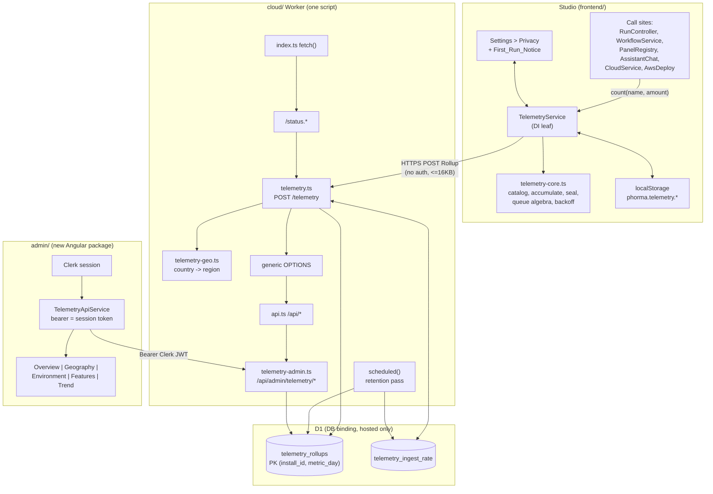

# Design Document

## Overview

Phone Home is three cooperating pieces plus a store:

1. **`TelemetryService`** in `frontend/src/app/core/` accumulates a closed set of named counters in
   memory, persists them to `localStorage` under `phorma.telemetry.*`, seals them into a daily
   Rollup, and uploads Rollups to the Worker on a slow timer. It is a DI leaf, it never speaks to
   the user, and it never blocks startup.
2. **`POST /telemetry`** on the existing `cloud/` Worker validates and sanitizes Rollups, derives
   coarse geography from Cloudflare request properties, and upserts one D1 row per
   `(install_id, metric_day)`. It is unauthenticated, carries its own CORS set, and answers 200 with
   an empty body when the `DB` binding is absent.
3. **`/api/admin/telemetry/*`** on the same Worker serves five read-only aggregates behind Clerk
   verification plus an owner allowlist held in a Worker secret, with a k-anonymity floor of 5 and
   `Cache-Control: no-store`.
4. **`admin/`** is a new top-level Angular package, deployed independently, Clerk-authenticated,
   that renders those five aggregates.

Everything is counters. There is no event stream, no payload capture, no read of the credit or usage
accounting stores, and no field anywhere in the pipeline that can carry a network address, an
account identifier, or user content.

The design keeps every rule that has to hold for all inputs in a pure module: the Counter_Catalog,
the accumulation and queue algebra, the Rollup schema, the geo map, the date-range parser and the
k-anonymity fold are all plain functions over plain data, so they are property-testable without a
browser, a Worker or a database.

## Architecture



Route order in `index.ts` is load bearing and is the same reasoning `status.ts` already documents:
`/telemetry` answers its own preflight with a CORS set that has nothing to do with
`ALLOWED_ORIGINS`, so it must be matched before the generic `OPTIONS` branch. It is unauthenticated,
so it must be matched before `/api/*`. The insertion point is immediately after
`handleStatusRequest` and immediately before the `request.method === 'OPTIONS'` branch.

## Locked decisions this design implements

These come from the requirements and are not revisited here: opt-out consent with disclosure
versioning; a client UUID v4 Install_Id in `localStorage`; a closed Counter_Catalog accumulating per
UTC Metric_Day; cumulative-to-date Rollups with server-side replace on `(install_id, metric_day)`;
an unauthenticated `POST /telemetry` on the existing Worker with its own CORS; server-side coarse
geo with no address stored or logged; D1 storage with an idempotent migration and a 400-day
retention pass; an admin API inside the existing control-plane branch gated on `verifyRequest` plus
a `TELEMETRY_ADMIN_USER_IDS` allowlist with a 401/403 split and fail-closed behaviour; and a
separate Angular admin package sharing the repo-wide version number.

---

## Components and Interfaces

Six components, four of them pure modules with no I/O. The pure ones are where every property test
points; the impure ones own a clock, a storage adapter, `fetch` or a `D1Database`, and delegate every
decision outward.

| Component | Location | Pure | Public interface |
|---|---|---|---|
| Counter catalog | `frontend/src/app/core/telemetry-catalog.ts` and its twin `cloud/src/telemetry-catalog.ts` | yes | `COUNTER_CATALOG: ReadonlySet<string>`, `counterName(family, dimension?): string`, `ERROR_CATEGORIES`, `TELEMETRY_SCHEMA_VERSION`, `CURRENT_DISCLOSURE_VERSION` |
| Telemetry core | `frontend/src/app/core/telemetry-core.ts` | yes | `metricDayUtc(now)`, `readConsent(raw)`, `shouldShowNotice(stored, current)`, `applyIncrement(acc, name, amount)`, `sealRollup(acc, installId, env)`, `appendToQueue(queue, entry, cap?)`, `classifyIngestStatus(status)`, `backoffMs(failures)`, `resolveIngestUrl(baseUrl)` |
| Telemetry service | `frontend/src/app/core/telemetry.service.ts` | no | signals `active`, `enabled`, `noticePending`, `installId`, `pendingRollup`, `queueLength`; methods `bootstrap()`, `count(name, amount?)`, `recordError(category)`, `setEnabled(next)`, `resetInstallId()`, `dismissNotice()` |
| Ingest handler | `cloud/src/telemetry.ts` | partly | `handleTelemetryRequest(request, env, ctx): Promise<Response \| null>`, `normalizeRollup(body, nowMs): Rollup \| null`, `TELEMETRY_SCHEMA_STATEMENTS`, `ensureTelemetrySchema(db)`, `runTelemetryRetention(env)` |
| Geo resolver | `cloud/src/telemetry-geo.ts` | yes | `resolveCoarseGeo(request): CoarseGeo`, `COUNTRY_REGION`, `TELEMETRY_REGIONS` |
| Admin API | `cloud/src/telemetry-admin.ts` | partly | `handleTelemetryAdminRequest(request, env, url, respond)`, `isTelemetryAdmin(allowlist, userId): boolean`, `parseDateRange(params, today): RangeResult`, `applyKAnonymity(rows, floor?): GroupRow[]` |
| Dashboard | `admin/src/app/` | no | `TelemetryApiService` (five typed calls), `DateRangeService` (one range signal), `ViewState<T>` |

`handleTelemetryRequest` and `handleTelemetryAdminRequest` follow the `handleStatusRequest` and
`handleApiRequest` convention already in the Worker: return `null` when the path is not theirs, so
`index.ts` stays a readable ordered chain.

---

## Frontend

### Module layout

| File | Contents |
|---|---|
| `core/telemetry-catalog.ts` | `TELEMETRY_SCHEMA_VERSION`, counter families, dimension lists, `COUNTER_CATALOG` (a `ReadonlySet<string>`), `counterName()`, `ERROR_CATEGORIES`. Structural twin of `cloud/src/telemetry-catalog.ts`. |
| `core/telemetry-core.ts` | Pure state algebra: `readConsent`, `shouldShowNotice`, `applyIncrement`, `sealRollup`, `appendToQueue`, `classifyIngestStatus`, `backoffMs`, `metricDayUtc`, `resolveIngestUrl`. No Angular, no DOM beyond types. |
| `core/telemetry-storage.ts` | `loadTelemetry` / `saveTelemetry` / `removeTelemetry` over the `phorma.telemetry.` prefix, try/catch wrapped, exactly like `core/layout-storage.ts`. |
| `core/telemetry.service.ts` | The Angular service: signals, timer, fetch, and the public `count()` / `recordError()` API. |
| `workspace/settings/privacy/*` | The Privacy section body (`customTemplate: 'privacy'`). |
| `workspace/settings/privacy/telemetry-notice.ts` | The First_Run_Notice card. |

`telemetry-core.ts` is where every property test points. The service is a thin shell that owns the
clock, the storage adapter and `fetch`, and delegates every decision to the core.

### DI safety

`TelemetryService` injects **`TauriService` only**. It reads the ingest base URL through
`loadPhormaCloudUrl()` from `core/phorma-cloud-url.ts`, which is a leaf module, not a service.

This matters because the known cycle is
`RunControllerService -> ModelTransportService -> PhormaCloudService -> CloudService -> RunControllerService`,
and the counter call sites include `RunControllerService`, `ModelTransportService` and
`CloudService`. Any of those may inject `TelemetryService`; `TelemetryService` may inject none of
them. It does not inject `ToastService`, `ConsoleService`, `StorageService`, `SettingsService`,
`WorkflowService` or anything on the usage path. That last exclusion is also how Requirement 3.5 is
enforced structurally rather than by convention: the service has no reference through which it could
read `usage_ledger` or the local `usage` IndexedDB store.

A static guard (`scripts/check-telemetry-isolation.mjs`, run in CI) asserts the import list of
`telemetry.service.ts` stays within `{telemetry-catalog, telemetry-core, telemetry-storage,
app-version, phorma-cloud-url, tauri.service, @angular/core}`.

### Storage keys

All under the `phorma.telemetry.` prefix, all JSON, all best-effort.

| Key | Shape |
|---|---|
| `installId` | `string` (UUID v4) |
| `consent` | `{ enabled: boolean; disclosureVersion: number; decidedAt: string }` |
| `accumulator` | `{ metricDay: string; counters: Record<string, number>; lastSealAt: number }` |
| `queue` | `Array<{ sealedAt: number; rollup: Rollup }>` |
| `upload` | `{ nextAttemptAt: number; failureCount: number; rejectedCount: number }` |

The queue entry is an envelope. `sealedAt` is the ordering key for the cap and the dedupe, and it is
deliberately outside the `Rollup` so the Rollup's field set stays exactly the five things
Requirement 4.5 permits.

### The Rollup

```ts
/** The only object this feature ever sends off the machine. */
export interface Rollup {
  /** Client UUID v4. No relationship to any account, machine or address. */
  installId: string;
  /** UTC calendar day, `YYYY-MM-DD`. */
  metricDay: string;
  env: ClientEnvironment;
  /** Counter_Catalog names only, cumulative-to-date for `metricDay`. */
  counters: Record<string, number>;
  schemaVersion: number;
}

export interface ClientEnvironment {
  locale: string;      // navigator.language
  timezone: string;    // Intl.DateTimeFormat().resolvedOptions().timeZone
  platform: string;    // 'windows' | 'macos' | 'linux' | 'other'
  osVersion: string;   // TauriService on desktop, UA platform in a browser
  appVersion: string;  // APP_VERSION
  runtimeMode: 'desktop' | 'browser';
}

export const ROLLUP_KEYS = ['installId', 'metricDay', 'env', 'counters', 'schemaVersion'] as const;
export const ENV_KEYS = ['locale', 'timezone', 'platform', 'osVersion', 'appVersion', 'runtimeMode'] as const;
export const TELEMETRY_SCHEMA_VERSION = 1;
```

`ROLLUP_KEYS` and `ENV_KEYS` exist so the closure claim is checkable rather than aspirational: the
seal function builds the object from those lists and a property asserts key-set equality.

`osVersion` on desktop comes from `TauriService.osVersion()`, a new method that invokes a Rust
command and caches the result. In a browser, and whenever the native lookup rejects, it falls back
to the user agent platform string. The fallback is a static `'unknown'` when even that is
unavailable, so the field is always a string and the seal never throws.

### Counter_Catalog

Closed by construction: a family list crossed with a dimension list, expanded once at module load
into a `ReadonlySet<string>`. 56 names.

| Family | Name shape | Dimension source | Count |
|---|---|---|---|
| Sessions started | `session.started` | none | 1 |
| Runs | `run.started`, `run.completed`, `run.error` | none | 3 |
| Node kinds instantiated | `node.created:{kind}` | `WorkflowNodeKind` (25 kinds) | 25 |
| Panels opened | `panel.opened:{panelId}` | `DEFAULT_TABS` ids (11) | 11 |
| Assistant invocations | `assistant.invoked:{mode}` | `AssistantMode` (`ask`, `plan`, `agent`) | 3 |
| Deploys started | `deploy.started:{target}` | `DeployTargetId` (`phorma`, `cloudflare`, `aws`) | 3 |
| Error events | `error:{category}` | `ERROR_CATEGORIES` (10) | 10 |

```ts
export const ERROR_CATEGORIES = [
  'model-call', 'tool-call', 'mcp', 'network', 'storage',
  'deploy', 'auth', 'validation', 'engine', 'unknown',
] as const;
```

The dimension lists are declared in `telemetry-catalog.ts` with `satisfies readonly
WorkflowNodeKind[]` (and equivalents), so adding a node kind, a panel or a deploy target without
adding its counter is a compile error in the frontend and a guard failure in CI. Connector steps and
MCP presets instantiate ordinary nodes whose `kind` is already in the union, so they need no extra
dimension.

`counterName(family, dimension?)` is the only way to build a name. It joins with `:` and returns the
string; membership is then checked against `COUNTER_CATALOG`.

### Where each counter is incremented

One call each, at the seam that already knows the fact. Every call site is a service that may
legally depend on a DI leaf.

| Counter | Call site |
|---|---|
| `session.started` | `TelemetryService.bootstrap()`, once per app start |
| `run.started` / `run.completed` / `run.error` | `RunControllerService.apply()` on the `run-started` / `run-completed` / `run-failed` RunEvents. RunEvents are already the single visualization contract, so this adds no new state. |
| `node.created:{kind}` | `WorkflowService`'s add-node path, after the node is instantiated from the catalog entry |
| `panel.opened:{id}` | `PanelRegistryService`, where a tab becomes active on a side |
| `assistant.invoked:{mode}` | `AssistantChatService.send()` and the Ctrl+P builder entry point, both of which already receive the mode |
| `deploy.started:{target}` | `CloudService`'s deploy start (`phorma`, `cloudflare`) and `AwsDeployConfigService`'s deploy start (`aws`) |
| `error:{category}` | `TelemetryService.recordError(category)` from: `ModelTransportService` (`model-call`), the tool host bridge (`tool-call`), the MCP connect path (`mcp`), `FetchModelClient` and the data fetcher (`network`), `StorageService` (`storage`), the deploy services (`deploy`), `PhormaCloudService` on a 401 (`auth`), spec and connector validation surfaces (`validation`), `RunControllerService` on `run-failed` (`engine`), and `unknown` for an unclassified throw |

`recordError` takes a category from the closed set and nothing else. There is no overload that
accepts an `Error`, a message or a stack, which is how Requirement 11.3 is enforced: the excluded
data has no parameter to travel in.

### Service shape

```ts
@Injectable({ providedIn: 'root' })
export class TelemetryService {
  private readonly tauri = inject(TauriService);

  /** False until bootstrap succeeds, and false forever if it throws. */
  readonly active = signal(false);
  /** Consent_State. Writing it through `setEnabled` is the only way to change it. */
  readonly enabled = signal(true);
  /** Session-only: true when the First_Run_Notice should be shown. */
  readonly noticePending = signal(false);
  readonly installId = signal('');
  /** The Rollup that would be uploaded right now, for the Privacy preview. */
  readonly pendingRollup = computed<Rollup | null>(() => ...);
  readonly queueLength = computed(() => ...);

  /** Non-blocking. Returns before any awaited work. */
  bootstrap(): void;

  /** The only increment API. Silently ignores anything outside the catalog. */
  count(name: string, amount = 1): void;
  recordError(category: ErrorCategory): void;

  setEnabled(next: boolean): void;
  resetInstallId(): void;
  dismissNotice(): void;
}
```

`count()` is total and silent. A name outside `COUNTER_CATALOG`, an amount that is not a positive
integer, disabled consent, or an inactive service all take the same path: return, write nothing.
Two positional parameters is the whole signature, which satisfies "reject any additional payload"
at the type level.

### Bootstrap and scheduling

`bootstrap()` is called from the app shell and returns synchronously. It schedules the real work on
`requestIdleCallback` (falling back to `setTimeout(..., 0)`), so nothing telemetry does is on the
first-paint path (Requirement 4.9). The whole body is wrapped so that any throw leaves
`active() === false` and startup continues (Requirement 5.7).

Initialization order inside the idle callback:

1. Read `consent`. Compute `noticePending = stored === null || stored.disclosureVersion < CURRENT_DISCLOSURE_VERSION`, **before** writing. Then persist
   `{ enabled: stored?.enabled ?? true, disclosureVersion: CURRENT_DISCLOSURE_VERSION }`, preserving
   an existing consent value. This single field covers all four disclosure criteria: a fresh install
   gets enabled consent plus the notice (1.1, 1.2), a dismissal is remembered because the persisted
   version already equals the current one (1.3), and a version bump re-shows the notice while
   preserving consent (1.8).
2. Read or mint `installId` via `crypto.randomUUID()`.
3. Resolve `ClientEnvironment` (the only awaited step, and it is guarded).
4. Load `accumulator`, `queue`, `upload`, repairing any malformed value to its default.
5. Roll the day if `accumulator.metricDay !== metricDayUtc(now)`.
6. `count('session.started')`.
7. `active.set(true)` and start the tick.

The tick is a self-rescheduling `setTimeout` at 60 seconds. Each tick is cheap and does no network
work unless it is due:

```
tick(now):
  if (!enabled) return
  rollDayIfNeeded(now)        // 4.1
  interimSealIfDue(now)       // 4.7  (>= 6h since last seal AND some counter > 0)
  if (queue.length > 0 && now >= upload.nextAttemptAt) attemptUpload(now)
```

`upload.nextAttemptAt` is the single rate gate. It is set to `now + backoffMs(failureCount)` after
every attempt, and `backoffMs(0)` is 15 minutes, so "at most one request per 15 minute interval"
(4.3) and "wait `min(15min * 2^(failures-1), 24h)`" (5.4) are the same mechanism rather than two
competing timers.

A start with no persisted `upload` record arms the gate at `now`, not `now + 15min`. The interval
spaces REQUESTS apart, and such a client has made none. Arming it one interval out turned the gate
into a cold-start delay that every restart re-armed - and because `upload` is written only once an
attempt has produced an outcome, an install used in sessions shorter than 15 minutes never uploaded
at all.

```ts
export const UPLOAD_INTERVAL_MS = 15 * 60_000;
export const MAX_BACKOFF_MS = 24 * 60 * 60_000;

export function backoffMs(failureCount: number): number {
  const failures = Number.isFinite(failureCount) ? Math.max(0, Math.floor(failureCount)) : 0;
  if (failures === 0) return UPLOAD_INTERVAL_MS;
  return Math.min(UPLOAD_INTERVAL_MS * 2 ** (failures - 1), MAX_BACKOFF_MS);
}
```

### Seal, queue and supersede

Sealing builds a Rollup from the accumulator's **cumulative** totals, never a delta. That is what
makes the server's blind replace correct: whichever Rollup for a given `(installId, metricDay)`
arrives last is the most complete one, so a lost upload costs nothing but freshness.

```ts
export function appendToQueue(
  queue: readonly QueueEntry[],
  entry: QueueEntry,
  cap = QUEUE_CAP,        // 30
): QueueEntry[] {
  const deduped = queue.filter(
    e => e.rollup.installId !== entry.rollup.installId || e.rollup.metricDay !== entry.rollup.metricDay,
  );
  const next = [...deduped, entry];
  return next.length <= cap ? next : next.slice(next.length - cap);
}
```

Dedupe first, then cap, then drop from the front. Dedupe before cap matters: dedupe can only shrink
the queue, so doing it first means a repeated interim seal for today never evicts a genuinely
distinct older day (4.8, 5.5).

The day roll seals for the **old** day and resets the accumulator to zeros on the new day (4.1).
The interim seal at 6 hours queues a Rollup and leaves the accumulator alone (4.7); because the seal
is cumulative, the next interim seal for the same day simply replaces the queued entry.

### Upload

One `POST` per attempt, head of queue only.

```
fetch(resolveIngestUrl(loadPhormaCloudUrl()), {
  method: 'POST',
  headers: { 'Content-Type': 'application/json' },
  body: JSON.stringify(entry.rollup),
  signal: AbortSignal.timeout(10_000),
})
```

`resolveIngestUrl` appends `/telemetry` and enforces HTTPS (Requirement 11.5). A configured base
URL on `http:` is refused and the upload is skipped, except for `localhost` and `127.0.0.1`, which
are the documented local development exception.

Outcome handling is a pure classifier so the whole status space is testable:

```ts
export type IngestOutcome = 'accepted' | 'retry' | 'rejected';

export function classifyIngestStatus(status: number): IngestOutcome {
  if (status === 200) return 'accepted';
  if (status === 429 || status >= 500) return 'retry';
  if (status >= 400) return 'rejected';
  return 'retry';   // 1xx/2xx-other/3xx are not answers we asked for
}
```

| Outcome | Queue | `upload` record |
|---|---|---|
| `accepted` | remove head | `failureCount = 0`, `nextAttemptAt = now + 15min` |
| `retry` | keep head | `failureCount += 1`, `nextAttemptAt = now + backoffMs(failureCount)` |
| `rejected` | remove head | `rejectedCount += 1`, `failureCount = 0`, `nextAttemptAt = now + 15min` |
| network error / abort | keep head | same as `retry` |

A rejected Rollup is dropped rather than retried because a 4xx means the payload will never be
accepted; retrying it would block the queue forever behind a permanently invalid entry. The
rejection count is local diagnostic state surfaced in the Privacy section and never uploaded.

**Nothing in any branch calls `ToastService` or the console service.** There is no code path from
this service to either, because it does not inject them (Requirement 5.8).

### Consent transitions

| Action | Effect |
|---|---|
| `setEnabled(false)` | Clear the accumulator, clear the queue, persist consent disabled. All within the same synchronous call, so the user interaction that flipped the toggle has already discarded the data by the time it returns (1.5). |
| `setEnabled(true)` | Persist consent enabled, reset the accumulator to zeros on today's Metric_Day. Never restores a previous accumulation (1.7). |
| `resetInstallId()` | Mint a new UUID v4, clear the accumulator, clear the queue (2.4). |

All three converge on one internal `resetDerivedState(day)` helper, which is why one property can
cover all three.

### Settings Privacy section

A new page in `SettingsRegistryService.pages`, placed after `Updates`:

```ts
{
  id: 'privacy',
  label: 'Privacy',
  icon: 'ti ti-shield-lock',
  description: 'Anonymous usage counters and what leaves this machine.',
  sections: [
    {
      id: 'telemetry',
      settings: [],
      customTemplate: 'privacy',
      keywords: ['privacy', 'telemetry', 'analytics', 'usage', 'anonymous',
                 'opt out', 'data', 'install id', 'policy'],
    },
  ],
}
```

`SettingsCustomTemplate` gains `'privacy'`, and the dialog maps it to a new `PrivacySettings`
component (standalone, OnPush, its own `scope` input is unnecessary because the settings dialog
renders once). Contents, top to bottom:

1. **One toggle**, `p-toggleswitch` bound to `telemetry.enabled()`, label "Share anonymous usage
   counters", with a one-line description. This is the only control that changes Consent_State (1.4).
2. **Install ID** rendered as a monospace read-only value with a copy button and a
   `ti ti-refresh` reset button. Reset goes through `ConfirmDialogService` because it discards
   pending data.
3. **What is collected**: a plain-language list derived from the catalog families and `ENV_KEYS`, so
   the copy cannot drift from the code. Rendered as two short definition lists, not a table.
4. **Pending upload preview**: a `<pre>` showing `JSON.stringify(pendingRollup(), null, 2)`, with a
   queue-length line and the local rejection count. This is the exact object the uploader would send
   (11.6).
5. **Privacy policy** link, opened through the existing external-link helper.

UI conventions: Tabler icons only, explicit `size="small"` on the toggle and every button,
`.phorma-btn-content` on any solid button, no `p-dialog`, rem values against a 14px root.

### First_Run_Notice

A bespoke non-modal card anchored above the status bar, hosted in `app.html` inside
`@if (telemetry.noticePending())`. Not a dialog: it does not trap focus, does not carry
`role="dialog"`, and never blocks the workspace. It states the categories collected, carries a
"Privacy settings" button that opens the Settings dialog on the `privacy` page, a privacy policy
link, and a `ti ti-x` dismiss button calling `telemetry.dismissNotice()`.

`CURRENT_DISCLOSURE_VERSION` is a single integer in `telemetry-catalog.ts`. Bumping it re-shows the
notice on the next start for every install, without touching anyone's consent value.

---

## Worker

### Route placement

In `cloud/src/index.ts`, between the status branch and the generic `OPTIONS` branch:

```ts
const statusResponse = await handleStatusRequest(request, env as StatusEnv, ctx);
if (statusResponse) return statusResponse;

// Anonymous telemetry ingest. Matched HERE for the same two reasons `/status.*`
// is matched first: it answers its own preflight with a CORS set that is
// independent of ALLOWED_ORIGINS (widening that var would widen the
// authenticated `/api/*` surface too), and it is deliberately unauthenticated,
// so it must not fall into the `/api/*` branch.
const telemetryResponse = await handleTelemetryRequest(request, env as TelemetryEnv, ctx);
if (telemetryResponse) return telemetryResponse;

if (request.method === 'OPTIONS') { ... }
```

`handleTelemetryRequest` returns `null` for any path other than `/telemetry`, so everything else
falls through untouched. A non-`POST`, non-`OPTIONS` method on `/telemetry` answers 405 with the
telemetry CORS set.

```ts
const TELEMETRY_CORS: Record<string, string> = {
  'Access-Control-Allow-Origin': '*',
  'Access-Control-Allow-Methods': 'POST, OPTIONS',
  'Access-Control-Allow-Headers': 'Content-Type',
  'Access-Control-Max-Age': '86400',
};
```

Open origin is correct here and carries no risk: the route is write-only, accepts no credentials,
reads no cookie, and returns a constant body. There is nothing for a hostile origin to read.

### Ingest pipeline

Every step below has exactly one exit, and every failure exit produces a fixed literal body.

1. **DB check.** No `env.DB` -> `200 {}`, nothing read, nothing written. A BYO Worker accepts and
   drops telemetry rather than reporting an error (6.12).
2. **Size check.** `Content-Length` above 16384, or a read body above 16384 bytes -> `413
   {"error":"Payload too large."}`. The body is read through a capped reader so an oversized or
   lying `Content-Length` cannot force an unbounded allocation (6.5).
3. **Parse.** Non-JSON -> `400 {"error":"Invalid telemetry payload."}` (6.6).
4. **Normalize and validate** through `normalizeRollup(body, now)`, described below. Failure ->
   the same static 400.
5. **Rate limit.** Read `telemetry_ingest_rate` for the install id. More than 20 accepted requests
   inside the rolling hour -> `429 {"error":"Too many requests."}`, nothing written (6.11).
6. **Geo.** `resolveCoarseGeo(request)`.
7. **Write.** One upsert into `telemetry_rollups`, one upsert into `telemetry_ingest_rate`, in a
   single `env.DB.batch([...])`.
8. **Answer** `200 {}`.

Any throw inside the handler is caught locally and answered `200 {}`. Telemetry is not worth a 500,
and a 500 body is one more place an exception message could escape.

### Validation and sanitization

`normalizeRollup` is pure: `(unknown, nowMs) => Rollup | null`. It builds a fresh object from the
declared key list, so unrecognized fields are discarded by construction rather than by a deny list
(7.6).

| Field | Rule |
|---|---|
| `installId` | Must match `/^[0-9a-f]{8}-[0-9a-f]{4}-4[0-9a-f]{3}-[89ab][0-9a-f]{3}-[0-9a-f]{12}$/i`. Anything else rejects the request (6.7). |
| `metricDay` | Must match `YYYY-MM-DD`, must be a real calendar date, and must fall in `[today - 30 days, today + 1 day]` (6.7). |
| `schemaVersion` | Must equal a member of `KNOWN_SCHEMA_VERSIONS` (currently `[1]`) (6.7). |
| `env.*` | Each of the six fields coerced to a string, trimmed, truncated to 64 code units. `runtimeMode` outside `{desktop, browser}` becomes `browser`. Missing fields become `''` (6.9). |
| `counters` | Entries whose key is absent from `COUNTER_CATALOG` are dropped. Values that are not integers, or are outside `[0, 1000000]`, are dropped. The survivors are stored (6.8). |

Dropping a bad counter does not reject the request. That is deliberate: an older client sending one
counter this Worker does not know about should still have the rest of its day recorded. A bad
`installId`, `metricDay` or `schemaVersion` does reject, because without those three the row cannot
be keyed or interpreted at all.

### Geo resolver

```ts
export type TelemetryRegion =
  | 'africa' | 'antarctica' | 'asia' | 'europe'
  | 'north-america' | 'oceania' | 'south-america' | 'unknown';

export interface CoarseGeo { countryCode: string; region: TelemetryRegion }

export function resolveCoarseGeo(request: Request): CoarseGeo {
  const raw = (request as { cf?: { country?: unknown } }).cf?.country;
  const code = typeof raw === 'string' ? raw.trim().toUpperCase() : '';
  if (!/^[A-Z]{2}$/.test(code) || code === 'XX' || code === 'T1') {
    return { countryCode: 'XX', region: 'unknown' };
  }
  return { countryCode: code, region: COUNTRY_REGION[code] ?? 'unknown' };
}
```

`COUNTRY_REGION` is a hand-written `Readonly<Record<string, TelemetryRegion>>` covering the ISO
3166-1 alpha-2 set, one region per code. It is a module constant, not a lookup, so the function is
total, synchronous, allocation-light and testable without a request. `T1` is Cloudflare's Tor
pseudo-country and is treated as unknown rather than invented into a region. An unmapped code
degrades to `region: 'unknown'` while keeping the country, so a new ISO assignment loses the region
grouping and nothing else.

Only `countryCode` and `region` are read from the request. The handler never touches
`cf.city`, `cf.postalCode`, `cf.latitude`, `cf.longitude`, `cf.asn`, `CF-Connecting-IP` or
`X-Forwarded-For`, and there is no column for any of them (7.4, 7.5). The handler logs nothing on
the success path; the single failure log is a fixed string with no request data (7.7).

### D1 schema

`cloud/migrations/0002_telemetry.sql`, applied with the existing
`npx wrangler d1 migrations apply phorma-cloud --env hosted`:

```sql
-- Anonymous product telemetry. One row per install per UTC calendar day.
-- No column here may ever carry user content, a network address, or an
-- account identifier.
CREATE TABLE IF NOT EXISTS telemetry_rollups (
  install_id     TEXT    NOT NULL,
  metric_day     TEXT    NOT NULL,
  country_code   TEXT    NOT NULL DEFAULT 'XX',
  region         TEXT    NOT NULL DEFAULT 'unknown',
  locale         TEXT    NOT NULL DEFAULT '',
  timezone       TEXT    NOT NULL DEFAULT '',
  platform       TEXT    NOT NULL DEFAULT '',
  os_version     TEXT    NOT NULL DEFAULT '',
  app_version    TEXT    NOT NULL DEFAULT '',
  runtime_mode   TEXT    NOT NULL DEFAULT 'browser',
  counters       TEXT    NOT NULL DEFAULT '{}',
  schema_version INTEGER NOT NULL,
  first_seen_at  INTEGER NOT NULL,
  last_seen_at   INTEGER NOT NULL,
  PRIMARY KEY (install_id, metric_day)
);

CREATE INDEX IF NOT EXISTS idx_telemetry_metric_day
  ON telemetry_rollups(metric_day);
CREATE INDEX IF NOT EXISTS idx_telemetry_day_country
  ON telemetry_rollups(metric_day, country_code);

-- Per-install ingest rate window. Pruned by the retention pass.
CREATE TABLE IF NOT EXISTS telemetry_ingest_rate (
  install_id      TEXT    PRIMARY KEY,
  window_start_ms INTEGER NOT NULL,
  request_count   INTEGER NOT NULL
);
```

Every statement is `IF NOT EXISTS`, so re-applying the migration leaves the schema unchanged (8.4).

Requirement 8.4 says the *Worker* creates the schema, so the migration file is not the only path:
`ensureTelemetrySchema(db)` runs the same statements as a `db.batch()` once per isolate, guarded by
a module-level promise, on the first ingest or admin request. That covers a deployment where
migrations were not applied and makes the tables self-healing. The statements live in one exported
array shared by the ensure function and asserted against the migration file by a guard, so the two
cannot drift.

The upsert:

```sql
INSERT INTO telemetry_rollups (
  install_id, metric_day, country_code, region, locale, timezone, platform,
  os_version, app_version, runtime_mode, counters, schema_version,
  first_seen_at, last_seen_at
) VALUES (?1, ?2, ?3, ?4, ?5, ?6, ?7, ?8, ?9, ?10, ?11, ?12, ?13, ?13)
ON CONFLICT(install_id, metric_day) DO UPDATE SET
  country_code = excluded.country_code,
  region       = excluded.region,
  locale       = excluded.locale,
  timezone     = excluded.timezone,
  platform     = excluded.platform,
  os_version   = excluded.os_version,
  app_version  = excluded.app_version,
  runtime_mode = excluded.runtime_mode,
  counters     = excluded.counters,
  schema_version = excluded.schema_version,
  last_seen_at = excluded.last_seen_at;
```

`first_seen_at` is absent from the `SET` list, so it survives every replace. Counters and
environment are replaced wholesale, not merged, which is exactly the supersede semantics the
cumulative client seal produces (6.10).

### Scheduled retention pass

The Worker has no `scheduled` handler today. This adds one:

```ts
export default {
  async fetch(...) { ... },
  async scheduled(_event: ScheduledController, env: Env, ctx: ExecutionContext): Promise<void> {
    ctx.waitUntil(runTelemetryRetention(env).catch(() => undefined));
  },
};
```

`runTelemetryRetention` returns immediately when `DB` is absent, then:

```sql
DELETE FROM telemetry_rollups WHERE metric_day < ?1;      -- today - 400 days
DELETE FROM telemetry_ingest_rate WHERE window_start_ms < ?2;  -- now - 24h
```

Both are cheap, both are index-supported, and the whole thing is wrapped so a failure leaves rows
in place and the ingest route unaffected (8.7). The trailing `.catch()` is the containment: a
rejected retention promise must not surface as a Worker error.

Cron lives under `env.hosted` only, since a BYO deployment has no `DB` and nothing to prune:

```jsonc
"env": {
  "hosted": {
    "triggers": { "crons": ["17 3 * * *"] },
    ...
  }
}
```

Daily at 03:17 UTC, which is at least once per 24 hours (8.6). The odd minute keeps it off the
top-of-hour crowd.

### Status component

`status.ts` gains a ninth component so the store is observable:

```ts
describe('telemetry', 'Usage telemetry', 'Anonymous product usage counters.', false, null, telemetry),
```

The probe is `absent('This deployment does not collect telemetry.')` when `DB` is unbound, which
makes it `unknown` and therefore excluded from the rollup, so a BYO Worker does not read as degraded
(12.7). With `DB` bound it runs `SELECT 1 FROM telemetry_rollups LIMIT 1` after
`ensureTelemetrySchema`. `critical: false`: telemetry being down must never turn the public badge
red.

`status.test.mjs` asserts the component list, so it is updated in the same change.

---

## Admin API

Placed inside `routeApiRequest` in `cloud/src/api.ts`, immediately after the
`/api/connection-secrets` branch and **before** the `TenantStore` availability gate, so a hosted
deployment answers these routes independently of tenant-store health:

```ts
if (url.pathname.startsWith('/api/admin/telemetry/')) {
  return handleTelemetryAdminRequest(request, env, url, respond);
}
```

`respond` already attaches the shared CORS headers, and the handler adds `Cache-Control: no-store`
to every response it produces, including 401, 403 and 400 (9.16).

### Authorization

```ts
export function isTelemetryAdmin(allowlist: string | undefined, userId: string | null): boolean {
  if (!allowlist) return false;
  const ids = allowlist.split(',').map(entry => entry.trim()).filter(Boolean);
  if (ids.length === 0) return false;        // fail closed (9.5)
  return userId !== null && ids.includes(userId);
}
```

Exact membership after trimming, never a substring or prefix test. The gate then splits the two
failure modes, which are genuinely different facts about the caller:

| Condition | Status | Body |
|---|---|---|
| No bearer token, or `verifyRequest` returns null | 401 | `{"error":"Unauthorized."}` |
| `verifyRequest` resolves, but the id is null or not in the allowlist | 403 | `{"error":"Forbidden."}` |
| `TELEMETRY_ADMIN_USER_IDS` absent, empty or whitespace | 403 | `{"error":"Forbidden."}` |
| Allowlisted | 200 | the aggregate |

Both bodies are fixed literals. No route returns the allowlist, and no response body contains an
allowlist entry (9.6).

`TELEMETRY_ADMIN_USER_IDS` is set with `npx wrangler secret put TELEMETRY_ADMIN_USER_IDS --env hosted`.
It appears nowhere under `frontend/src` or `admin/src` (11.4), which a CI guard asserts.

### Date range

```ts
export interface DateRange { from: string; to: string }
export type RangeResult = { ok: true; range: DateRange } | { ok: false; error: string };

export function parseDateRange(params: URLSearchParams, today: string): RangeResult;
```

Rules, all in one pure function so one property covers the whole grammar:

- Absent `from` or `to` defaults to the trailing 30 days ending today, inclusive (9.12).
- A present value must match `YYYY-MM-DD` **and** be a real calendar date. `2026-02-30` and
  `2026-1-1` both fail (9.12).
- `from > to` fails (9.12).
- Inclusive length above 400 days fails (9.13).
- Every failure answers `400 {"error":"Invalid date range."}`.

### k-anonymity floor

```ts
export const K_ANONYMITY_FLOOR = 5;

export interface GroupRow { label: string; installs: number; [metric: string]: string | number }

/** Folds every group below the floor into a single `other` row, conserving metrics. */
export function applyKAnonymity(rows: readonly GroupRow[], floor = K_ANONYMITY_FLOOR): GroupRow[];
```

Every grouped route runs its SQL result through this before serializing. Each aggregate row carries
`COUNT(DISTINCT install_id) AS installs`, which is the distinct-install count the floor tests. Rows
below the floor are summed into one row labelled `other`; the `other` row is omitted entirely when
nothing folds, so a healthy data set has no mystery bucket. Numeric metrics are added; `installs`
on the `other` row is the sum of the folded rows' install counts, which is an upper bound on the
distinct installs it represents and never under-reports the bucket's size.

Two routes need a note:

- **Summary** returns global totals with no group labels, so 9.15 does not apply to it. It is the
  one route that can report a number below 5, and that is correct: a global install count is not a
  group.
- **Trend** groups by `metric_day`, so applying the floor literally folds low-traffic days into a
  single `other` row. That is what the rule says and the implementation does it through the same
  helper rather than carving out an exception. The dashboard excludes the `other` row from the plot
  and renders it as a footnote ("N days below the reporting threshold"), which keeps the chart a
  time series while the API stays honest.

### Route table

All five are `GET`, all accept `from` and `to`, all answer `Cache-Control: no-store`, and none
returns an install id (9.14).

| Route | Response |
|---|---|
| `/api/admin/telemetry/summary` | `{ range: {from,to}, activeInstalls: { d1, d7, d30 }, totals: { installs, sessions, runs, runsCompleted, runErrors } }` |
| `/api/admin/telemetry/geography` | `{ range, countries: GroupRow[], regions: GroupRow[] }` where each row is `{ label, installs, runs }` |
| `/api/admin/telemetry/environment` | `{ range, appVersion: GroupRow[], platform: GroupRow[], runtimeMode: GroupRow[], locale: GroupRow[] }` where each row is `{ label, installs }` |
| `/api/admin/telemetry/features` | `{ range, counters: Array<{ label, total, installs }> }`, one row per Counter_Catalog name present in range |
| `/api/admin/telemetry/trend` | `{ range, days: Array<{ label, installs, sessions, runs }>, foldedDays: number }` where `label` is the Metric_Day |

Aggregation SQL, all keyed on the `metric_day` index:

```sql
-- activeInstalls.dN
SELECT COUNT(DISTINCT install_id) AS installs
  FROM telemetry_rollups WHERE metric_day >= ?1 AND metric_day <= ?2;

-- totals: counters are JSON, extracted by name
SELECT COUNT(DISTINCT install_id)                                   AS installs,
       COALESCE(SUM(json_extract(counters, '$."session.started"')), 0) AS sessions,
       COALESCE(SUM(json_extract(counters, '$."run.started"')), 0)     AS runs,
       COALESCE(SUM(json_extract(counters, '$."run.completed"')), 0)   AS runs_completed,
       COALESCE(SUM(json_extract(counters, '$."run.error"')), 0)       AS run_errors
  FROM telemetry_rollups WHERE metric_day BETWEEN ?1 AND ?2;

-- geography (country; region is the same shape on `region`)
SELECT country_code AS label,
       COUNT(DISTINCT install_id) AS installs,
       COALESCE(SUM(json_extract(counters, '$."run.started"')), 0) AS runs
  FROM telemetry_rollups WHERE metric_day BETWEEN ?1 AND ?2
 GROUP BY country_code;

-- features: json_each expands the counter map
SELECT json_each.key AS label,
       SUM(json_each.value) AS total,
       COUNT(DISTINCT install_id) AS installs
  FROM telemetry_rollups, json_each(telemetry_rollups.counters)
 WHERE metric_day BETWEEN ?1 AND ?2
 GROUP BY json_each.key;

-- trend
SELECT metric_day AS label,
       COUNT(DISTINCT install_id) AS installs,
       COALESCE(SUM(json_extract(counters, '$."session.started"')), 0) AS sessions,
       COALESCE(SUM(json_extract(counters, '$."run.started"')), 0)     AS runs
  FROM telemetry_rollups WHERE metric_day BETWEEN ?1 AND ?2
 GROUP BY metric_day ORDER BY metric_day;
```

The `features` route filters `label` against `COUNTER_CATALOG` before serializing. The catalog is
already enforced at write time, so this is belt and braces for rows written by an older Worker.

`ALLOWED_ORIGINS` under `env.hosted` gains the dashboard origin, since the browser requests come
from a real origin and must pass the existing CORS check (9.17).

---

## Admin dashboard package

A new top-level `admin/` package. Angular 20 standalone + signals + OnPush, PrimeNG 20 with the same
`@primeuix/themes` Aura preset, Tailwind v4, Tabler icons webfont, `ngx-clerk`. It shares the
repo-wide version number and nothing else: no dependency on `frontend`, `engine`, `cloud` or
`cloud-aws`, and no import across package boundaries.

```
admin/
├─ package.json          # @phorma/admin, version matches the other five packages
├─ angular.json          # build target dist/admin/browser
├─ tsconfig.json
├─ wrangler.jsonc        # name: phorma-admin, assets: { directory: ./dist/admin/browser }
├─ tailwind.config / postcss config
└─ src/
   ├─ main.ts, styles.scss
   ├─ environments/environment.ts, environment.prod.ts   # apiBaseUrl, clerkPublishableKey
   └─ app/
      ├─ app.config.ts                 # Aura preset, ngx-clerk, router
      ├─ app.ts / app.html / app.scss   # shell: header, view nav, date-range control
      ├─ core/
      │  ├─ telemetry-api.service.ts    # five typed calls, bearer on every request
      │  ├─ date-range.service.ts       # the shared range signal
      │  ├─ view-state.ts               # ViewState<T> = Loading | Loaded | Empty | Failed
      │  └─ models.ts                   # response interfaces, twins of the API shapes
      ├─ auth/
      │  ├─ signed-out.ts               # sign-in surface
      │  └─ not-authorized.ts           # 403 state, sign-out control, no allowlist detail
      └─ views/
         ├─ overview/                   # active installs 1/7/30, totals
         ├─ geography/                  # installs and runs by country and region
         ├─ environment/                # installs by app version, platform, runtime mode, locale
         ├─ features/                   # summed counters by name
         └─ trend/                      # per-day installs, sessions, runs
```

Behaviour:

- **Auth.** `ngx-clerk` provides the session. While no session exists, the shell renders
  `signed-out` and the API service is never called, which is enforced by the API service returning
  early when the token resolver yields null rather than by discipline in each view (10.3). Every
  request carries `Authorization: Bearer <session token>` (10.2).
- **403.** A 403 from any route switches the shell to `not-authorized`, which names no allowlist
  detail and offers sign out (10.4).
- **Date range.** One `DateRangeService` signal, edited by a small `from`/`to` control in the header
  with preset buttons (7, 30, 90 days). Each view's data is an Angular `resource()` keyed on that
  signal, so a range change refetches every bound view with no manual wiring (10.10).
- **View states.** Each view renders exactly one of loading, loaded, empty or failed. The failed
  state carries a retry control that re-runs its own resource (10.11, 10.12, 10.13).
- **Charts.** The trend view uses PrimeNG `UIChart` behind `@defer (on immediate)`, the same way the
  studio keeps chart.js out of the initial bundle. Chart options are a `computed()`, never a static
  field, because the axis bounds depend on loaded data.
- **Conventions.** Tabler icons only, explicit `size="small"` on every PrimeNG control, no
  `p-dialog`, no em dashes (10.14). `scripts/check-admin-conventions.mjs` enforces the first three
  by scanning the package templates.
- **Secrets.** `apiBaseUrl` and `clerkPublishableKey` come from the environment files. The bundle
  contains no Clerk secret key and no Worker secret (10.15), which a guard asserts against the built
  output.

Deployment is independent: `npm run build` then `npx wrangler deploy` from `admin/`, publishing a
static asset Worker at its own hostname. It is not bundled into the installer and is not a Tauri
resource.

---

## Data Models

Four model layers. Only the wire model crosses the machine boundary, and it is the narrowest of the
four by design.

### Local persisted models (`localStorage`, `phorma.telemetry.*`)

```ts
export interface ConsentState {
  enabled: boolean;
  /** The disclosure version this install has been shown. */
  disclosureVersion: number;
  decidedAt: string;          // ISO timestamp, never formatted for display
}

export interface Accumulator {
  metricDay: string;                      // UTC `YYYY-MM-DD`
  counters: Record<string, number>;       // Counter_Catalog names only
  lastSealAt: number;                     // epoch ms, drives the 6 hour interim seal
}

/** Queue envelope. `sealedAt` is outside the Rollup so the wire shape stays closed. */
export interface QueueEntry {
  sealedAt: number;
  rollup: Rollup;
}

export interface UploadState {
  nextAttemptAt: number;      // the single rate gate
  failureCount: number;       // drives backoffMs
  rejectedCount: number;      // local diagnostic only, never uploaded
}
```

Keys: `installId`, `consent`, `accumulator`, `queue`, `upload`, each JSON, each read through a
try/catch helper that returns a default rather than throwing.

### Wire model (the only thing that leaves the machine)

`Rollup` and `ClientEnvironment` as declared in the Frontend section, with `ROLLUP_KEYS` and
`ENV_KEYS` as the executable statement of their closure. The request body is one `Rollup`, nothing
else. There is no envelope, no batch, no metadata, and no field that can carry a network address, an
account identifier or user content. The Worker rebuilds the object from `ROLLUP_KEYS` rather than
trusting the parsed body, so an unrecognized field cannot survive into storage.

### Server row model

```ts
/** One D1 `telemetry_rollups` row. Mirrors the migration column list exactly. */
export interface TelemetryRollupRow {
  install_id: string;
  metric_day: string;
  country_code: string;       // ISO 3166-1 alpha-2, or 'XX'
  region: TelemetryRegion;    // continent-level grouping, or 'unknown'
  locale: string;             // <= 64 chars
  timezone: string;           // <= 64 chars
  platform: string;           // <= 64 chars
  os_version: string;         // <= 64 chars
  app_version: string;        // <= 64 chars
  runtime_mode: 'desktop' | 'browser';
  counters: string;           // JSON object, Counter_Catalog names only
  schema_version: number;
  first_seen_at: number;      // epoch ms, preserved across every replace
  last_seen_at: number;       // epoch ms, updated on every replace
}

/** Rolling one hour ingest window, per install. Pruned by the retention pass. */
export interface TelemetryRateRow {
  install_id: string;
  window_start_ms: number;
  request_count: number;
}
```

The row carries exactly the Install_Id, the Metric_Day, the two Coarse_Geo fields, the six
Client_Environment fields, the counter map as JSON, the schema version, and the two timestamps
(Requirement 8.2). There is no city, postal code, latitude, longitude, ASN, address or account
column, and adding one would fail the column-set assertion in the `cloud` suite.

### Admin response models

```ts
export interface DateRange { from: string; to: string }

/** Every grouped route returns rows of this shape. `label` is the group key. */
export interface GroupRow {
  label: string;              // 'other' when folded by the k-anonymity floor
  installs: number;           // COUNT(DISTINCT install_id)
  [metric: string]: string | number;
}

export interface SummaryResponse {
  range: DateRange;
  activeInstalls: { d1: number; d7: number; d30: number };
  totals: { installs: number; sessions: number; runs: number; runsCompleted: number; runErrors: number };
}

export interface GeographyResponse { range: DateRange; countries: GroupRow[]; regions: GroupRow[] }
export interface EnvironmentResponse {
  range: DateRange;
  appVersion: GroupRow[]; platform: GroupRow[]; runtimeMode: GroupRow[]; locale: GroupRow[];
}
export interface FeaturesResponse {
  range: DateRange;
  counters: Array<{ label: string; total: number; installs: number }>;
}
export interface TrendResponse {
  range: DateRange;
  days: Array<{ label: string; installs: number; sessions: number; runs: number }>;
  foldedDays: number;
}
```

`admin/src/app/core/models.ts` is a structural twin of these declarations, in the same sense that
`engine/src/types.ts` and `core/workflow.model.ts` are twins: two independent declarations of one
contract, kept aligned by review and by the response-shape assertions in the `cloud` suite. The
dashboard package deliberately imports nothing from `cloud/`.

---

## Error handling

The governing rule is that telemetry is invisible. Every failure has a defined, silent outcome.

| Failure | Handling |
|---|---|
| `localStorage` unavailable or corrupt | The storage helpers return the fallback. A corrupt value is repaired to its default on the next write. |
| `crypto.randomUUID` unavailable | Bootstrap throws, is caught, `active()` stays false, the Studio starts normally (5.7). |
| Native `osVersion` lookup rejects | Falls back to the UA platform string, then to `'unknown'`. |
| Ingest network error, DNS failure, abort at 10s | Head of queue retained, `failureCount` incremented, backoff applied. No toast, no console entry (5.1, 5.6, 5.8). |
| Ingest 429 or 5xx | Same as above (5.2). |
| Ingest 4xx other than 429 | Head dropped, local `rejectedCount` incremented (5.3). |
| Queue growth while offline | Capped at 30 entries, oldest discarded, deduped per `(installId, metricDay)` (4.8, 5.5). |
| Worker: oversized body | 413, static reason, nothing read further, nothing written. |
| Worker: unparseable or invalid body | 400, static reason, nothing written. |
| Worker: unexpected throw in the handler | Caught, `200 {}`. No exception message, no binding name, no request content in the response (6.13). |
| Worker: `DB` absent | `200 {}`, no write. Status reports the component as `unknown` (6.12, 12.7). |
| Worker: D1 write failure | Caught, `200 {}`. The client's next cumulative Rollup resends the same day, so a transient write failure costs nothing. |
| Retention pass failure | Caught in `waitUntil`, rows left in place, ingest unaffected (8.7). |
| Admin API: any unhandled throw | The existing `handleApiRequest` try/catch answers 500 with CORS attached. Telemetry admin handlers catch their own D1 failures and answer 500 with a static reason. |
| Dashboard: any request failure | Per-view failed state with retry. No global crash. |

---

## Correctness Properties

*A property is a characteristic or behavior that should hold true across all valid executions of a
system, essentially a formal statement about what the system should do. Properties serve as the
bridge between human-readable specifications and machine-verifiable correctness guarantees.*

### Property 1: Disclosure gate decision

For any persisted consent record (absent, malformed, or well formed with any disclosure version) and
any current disclosure version, bootstrap shows the First_Run_Notice exactly when no record was
persisted or the persisted version is lower than the current one, persists the current version,
preserves any previously persisted consent value, defaults an absent record to enabled, and never
throws.

**Validates: Requirements 1.1, 1.2, 1.3, 1.8**

### Property 2: Consent and reset transitions clear derived state

For any accumulated counter map, any upload queue and any Metric_Day, disabling consent, re-enabling
consent, or resetting the Install_Id all leave the accumulator empty for the current Metric_Day and
the upload queue empty, and re-enabling never restores a previously accumulated value.

**Validates: Requirements 1.5, 1.7, 2.4**

### Property 3: Disabled consent silences the service completely

For any sequence of increment calls and any sequence of scheduler ticks performed while
Consent_State is disabled, no value is written to telemetry storage and no request is issued to the
Ingest_Endpoint.

**Validates: Requirements 1.6, 3.7**

### Property 4: Install identity is a stable UUID v4 that travels only to the ingest endpoint

For any number of repeated initializations against fresh storage, the generated Install_Id matches
the UUID v4 shape and is persisted under a `phorma.telemetry.` key; for any subsequent sequence of
seals, every Rollup carries that same Install_Id; and for any sequence of scheduler ticks, every
request the service issues targets the Ingest_Endpoint URL.

**Validates: Requirements 2.1, 2.2, 2.5**

### Property 5: The Counter_Catalog is closed and complete

The Counter_Catalog equals the expansion of its declared families over their declared dimension
lists, contains an entry for every `WorkflowNodeKind`, every default panel id, every assistant mode
and every deploy target id, contains nothing outside that expansion, and is identical between the
frontend catalog module and the Worker catalog module.

**Validates: Requirements 3.1**

### Property 6: Counter accumulation is exact and monotone

For any sequence of increment reports, each counter drawn from the Counter_Catalog equals the sum of
the positive integer amounts reported for it, no counter ever decreases, and any report whose name
is outside the Counter_Catalog or whose amount is not a positive integer leaves the stored counter
map unchanged.

**Validates: Requirements 3.2, 3.3, 3.4**

### Property 7: Accumulated counters round-trip through storage

For any accumulation state, persisting it and reading it back with a fresh reader produces an equal
state, so counters survive a restart within the same Metric_Day.

**Validates: Requirements 3.6**

### Property 8: The Rollup field set is closed (client side)

For any accumulation state and any Client_Environment, the sealed Rollup's key set equals exactly
`{installId, metricDay, env, counters, schemaVersion}`, its `env` key set equals exactly the six
declared Client_Environment fields, and every counter key is a member of the Counter_Catalog.

**Validates: Requirements 4.5, 11.2**

### Property 9: A Metric_Day change seals the old day and zeroes the new one

For any accumulated Metric_Day, any current Metric_Day differing from it, and any counter map, the
day roll appends one Rollup carrying the pre-roll totals for the old Metric_Day and leaves the
accumulator at zero on the new Metric_Day; and for any non-empty queue, an HTTP 200 answer removes
exactly the uploaded Rollup and leaves the remaining entries unchanged.

**Validates: Requirements 4.1, 4.4**

### Property 10: Rollups are cumulative-to-date, so the latest supersedes every earlier one

For any interleaving of increments and interim seals within one Metric_Day, the most recently sealed
Rollup for that Install_Id and Metric_Day carries the full-day totals of every increment reported so
far, and an interim seal leaves the accumulator available for further accumulation.

**Validates: Requirements 4.6, 4.7**

### Property 11: Upload queue invariants

For any sequence of appends, the queue length never exceeds 30, no two entries share an Install_Id
and Metric_Day pair, the surviving entry for any such pair is the most recently sealed one, and when
the cap evicts an entry it is the oldest by seal time.

**Validates: Requirements 4.8, 5.5**

### Property 12: Ingest status classification partitions the status space

For any HTTP status code, the classifier returns `accepted` exactly for 200, `retry` exactly for 429
and codes at or above 500, and `rejected` exactly for the 400 to 499 range excluding 429; a `retry`
outcome retains the Rollup and a `rejected` outcome removes it and increases the local rejection
count by exactly one.

**Validates: Requirements 5.2, 5.3**

### Property 13: Retry backoff is bounded and monotone

For any failure count, including zero, non-integer and non-finite input, the computed wait equals
`min(15 minutes * 2^(failureCount - 1), 24 hours)` for positive counts, is never below 15 minutes,
never above 24 hours, and is monotone non-decreasing in the failure count.

**Validates: Requirements 5.4**

### Property 14: Telemetry never addresses the user and never breaks startup

For any sequence of upload outcomes, any malformed persisted state, and a failure injected at any
initialization step, the service raises no toast, writes no console entry, resolves bootstrap without
rejecting, and reports itself inactive when initialization failed.

**Validates: Requirements 5.1, 5.7, 5.8**

### Property 15: A Rollup carries no workflow content

For any workflow state carrying unique marker strings in prompt text, workflow names, node names,
node configuration, connection names and file paths, and for any errors carrying arbitrary messages
and stack traces, the serialized Rollup contains no marker and no fragment of any error message, the
derived error-category counter name is a member of the closed category set, and the Privacy section
preview parses back to the exact object the uploader would send.

**Validates: Requirements 11.1, 11.3, 11.6**

### Property 16: Rollups leave the machine over HTTPS only

For any configured Phorma Cloud base URL, the resolved ingest URL either uses the `https` scheme or
the upload is refused, with `localhost` and `127.0.0.1` as the only exceptions.

**Validates: Requirements 11.5**

### Property 17: The telemetry preflight is independent of ALLOWED_ORIGINS

For any request `Origin` and any value of `ALLOWED_ORIGINS`, the `OPTIONS /telemetry` response is
identical, permits the `POST` method and the `Content-Type` header, and never varies with the
configured origin list.

**Validates: Requirements 6.3**

### Property 18: Ingest rejection is exact

For any request body, the Ingest_Endpoint answers 413 exactly when the body exceeds 16 kilobytes,
400 exactly when the body fails JSON parsing, or the Install_Id is not a UUID v4 string, or the
Metric_Day is not a `YYYY-MM-DD` calendar date within 30 days before the request date through 1 day
after it, or the schema version is unknown; and in every rejecting case nothing is written to the
Telemetry_Store.

**Validates: Requirements 6.5, 6.6, 6.7**

### Property 19: Ingest sanitization is exact

For any request body, the normalized Rollup's key set equals exactly the declared set with every
unrecognized field discarded, every Client_Environment string field is at most 64 characters and is a
prefix of the submitted value, and the stored counter map contains exactly those submitted entries
whose name is in the Counter_Catalog and whose value is an integer in the range 0 to 1000000.

**Validates: Requirements 6.8, 6.9, 7.6**

### Property 20: A valid Rollup writes exactly one row and answers an empty object

For any valid Rollup, the Ingest_Endpoint performs exactly one Telemetry_Store row write and answers
HTTP 200 with a body that parses to an empty JSON object.

**Validates: Requirements 6.4**

### Property 21: A repeat Install_Id and Metric_Day replaces rather than accumulates

For any two valid Rollups sharing an Install_Id and Metric_Day, after both are ingested the
Telemetry_Store holds exactly one row for that pair, its counters and Client_Environment equal the
later Rollup's values, and its first-seen timestamp equals the earlier ingest time.

**Validates: Requirements 6.10, 8.1**

### Property 22: Per-install ingest rate limiting

For any sequence of request timestamps carrying one Install_Id, every request beyond the twentieth
inside a rolling one hour window answers HTTP 429 and writes nothing, and the first request after
the window elapses is accepted again.

**Validates: Requirements 6.11**

### Property 23: The ingest path leaks nothing

For any request body containing arbitrary marker strings, and any values placed in the
`CF-Connecting-IP` header, the `X-Forwarded-For` header, and the city, postal code, latitude,
longitude and autonomous system number request properties, no response body contains a marker or an
exception message, no value bound into a Telemetry_Store write contains a marker, and no emitted log
line contains a marker.

**Validates: Requirements 6.13, 7.4, 7.5, 7.7, 12.5, 12.6**

### Property 24: Geo resolution is total

For any request, including one with absent, empty, non-string or unrecognized Cloudflare country
properties, the Geo_Resolver returns a `countryCode` matching two uppercase letters and a `region`
drawn from the closed region set, returns `XX` and `unknown` exactly when no usable country code is
available, is deterministic for a given input, and maps each country code to exactly one region.

**Validates: Requirements 7.1, 7.2, 7.3**

### Property 25: Schema creation is idempotent

For any number of repeated applications of the Telemetry_Store schema statements, the resulting
schema snapshot equals the snapshot after one application and no application throws.

**Validates: Requirements 8.4**

### Property 26: Retention deletes exactly the expired rows

For any set of Telemetry_Store rows with Metric_Days spanning ages either side of the 400 day
Retention_Window, the retention pass leaves exactly the rows within the window; and for a failure
injected at any delete step, every row remains and a subsequent Ingest_Endpoint request still
answers HTTP 200 and writes its row.

**Validates: Requirements 8.5, 8.7**

### Property 27: Admin authorization decides on exactly four outcomes

For any Owner_Allowlist string, including absent, empty, whitespace-only and entries with
surrounding whitespace, and any verification outcome, the Admin_API answers 401 exactly when no
bearer token is present or verification fails, 403 exactly when verification succeeds but the
resolved user id is null or not an exact trimmed member of the allowlist, 403 for every request when
the allowlist is absent or empty, and otherwise serves the aggregate; and a user id that is merely a
substring of an allowlist entry is never authorized.

**Validates: Requirements 9.2, 9.3, 9.4, 9.5**

### Property 28: Date range parsing and capping are exact

For any `from` and `to` query values, the Admin_API accepts exactly those pairs where both are real
`YYYY-MM-DD` calendar dates with `from` no later than `to` and an inclusive length of at most 400
days, defaults to the trailing 30 days when either parameter is absent, and otherwise answers HTTP
400.

**Validates: Requirements 9.12, 9.13**

### Property 29: Aggregates conserve the underlying rows

For any set of Telemetry_Store rows and any valid date range, each of the five Admin_API routes
returns the same aggregate as a naive reference aggregation over the rows in that range, its response
key set equals the declared shape for that route, and rows outside the range contribute nothing.

**Validates: Requirements 9.7, 9.8, 9.9, 9.10, 9.11**

### Property 30: The k-anonymity floor holds and conserves metrics

For any set of aggregate group rows, every group in the response other than `other` represents at
least 5 distinct Install_Id values, the `other` label is absent when no group falls below the floor,
and the sum of each numeric metric across the response equals its sum across the input rows.

**Validates: Requirements 9.15**

### Property 31: Admin responses expose no identity

For any set of Telemetry_Store rows carrying marker Install_Ids and any populated Owner_Allowlist,
no Admin_API response body contains an Install_Id or an allowlist entry, on any route, for any
authorization outcome.

**Validates: Requirements 9.6, 9.14**

### Property 32: Every admin response is uncacheable

For any Admin_API route and any authorization outcome, including 400, 401 and 403 answers, the
response carries `Cache-Control: no-store`.

**Validates: Requirements 9.16**

### Property 33: The dashboard sends a bearer token, or sends nothing at all

For any sequence of Admin_API calls, every issued request carries the current Clerk session token as
a bearer token; and for any sequence of view mounts and range changes performed while no Clerk
session exists, no request is issued.

**Validates: Requirements 10.2, 10.3**

### Property 34: Each view is in exactly one state

For any sequence of request outcomes per view, the view is in exactly one of loading, loaded, empty
or failed at all times, is loading exactly between issuing a request and its settlement, renders
empty exactly when the response carries no rows, renders failed exactly when the request failed, and
a retry from the failed state issues exactly one further request.

**Validates: Requirements 10.11, 10.12, 10.13**

### Property 35: A range change refetches every bound view

For any sequence of date-range changes, each view bound to the range issues exactly one request per
change plus one for its initial load, and every issued request carries the range in effect at the
time it was issued.

**Validates: Requirements 10.10**

---

## Testing Strategy

Property tests run a **minimum of 100 iterations** and carry the tag
`// Feature: telemetry-phone-home, Property N: <property text>` so the link back to this document
survives. Unit tests cover the specific examples and edge cases; property tests cover the input
space. Both are required.

### `frontend/`

karma + jasmine, the existing runner. `fast-check` 4 is added as a devDependency and used inside
jasmine specs, which works because `fc.assert` is a plain synchronous call. The versions match what
`engine/` and `cloud-aws/` already pin.

| File | Covers |
|---|---|
| `core/telemetry-catalog.spec.ts` | Property 5 |
| `core/telemetry-core.spec.ts` | Properties 1, 2, 6, 7, 8, 9, 10, 11, 12, 13, 16 |
| `core/telemetry.service.spec.ts` | Properties 3, 4, 14, 15, plus examples for the 10 second abort (5.6), the non-blocking bootstrap (4.9) and the desktop/browser `osVersion` branch (3.8) |
| `workspace/settings/privacy/privacy-settings.spec.ts` | Examples for the Privacy section contents (1.4) and the notice contents (1.2) |

The service specs inject a fake clock, a fake storage adapter, a recording `fetch`, and spies on the
toast and console services, so no test touches real `localStorage` or the network. `telemetry-core`
needs none of that: it is pure functions over plain data.

### `cloud/`

`tsx` and `node` test scripts, matching the existing 12 suites. `fast-check` 4 is added as a
devDependency. Three new suites, all added to the `test:unit` script and therefore to CI:

| Suite | Runner | Covers |
|---|---|---|
| `test/telemetry.test.mjs` | `tsx` | Pure logic: Properties 5, 18, 19, 24, 27, 28, 30 |
| `test/telemetry-ingest.test.mjs` | `node` + miniflare (with a `d1Databases` binding) | Properties 17, 20, 21, 22, 23, 25, 26, plus examples for route order (6.1), no Authorization header (6.2), and the absent `DB` binding (6.12) |
| `test/telemetry-admin.test.mjs` | `node` + miniflare | Properties 29, 31, 32, plus route-resolution examples (9.1) |

Property 29 is model based: the reference aggregation is a small in-memory reduce over the same
generated rows, written independently of the SQL. It is a genuine second implementation, not a copy
of the query, which is the trap the `engine` steering warns about.

`status.test.mjs` is extended for the new component (12.7).

### `admin/`

karma + jasmine (the Angular default) plus `fast-check` 4.

| File | Covers |
|---|---|
| `core/telemetry-api.service.spec.ts` | Property 33 |
| `core/view-state.spec.ts` | Property 34 |
| `app.spec.ts` | Property 35, plus the 403 not-authorized example (10.4) |
| `views/*.spec.ts` | One rendering example per view (10.5 to 10.9) and a property that every group label in a generated response reaches the DOM |

### Static guards

Four node scripts, all run in CI, each with the failure mode it exists to catch:

| Script | Asserts |
|---|---|
| `scripts/check-telemetry-catalog.mjs` | The frontend and Worker catalog modules declare identical counter-name sets and the same schema version. Structural twins drift silently otherwise, and a name only one side knows is a counter that is collected and then discarded. |
| `scripts/check-telemetry-isolation.mjs` | `telemetry.service.ts` imports nothing outside its allowed list, so the DI cycle stays open and Requirement 3.5 holds structurally. |
| `scripts/check-telemetry-secrets.mjs` | `TELEMETRY_ADMIN_USER_IDS` appears nowhere under `frontend/src` or `admin/src`, and the built dashboard bundle contains no `sk_`-prefixed or `CLERK_SECRET` string (10.15, 11.4). |
| `scripts/check-admin-conventions.mjs` | The dashboard templates use no `pi pi-` icon class, no `p-dialog`, and no PrimeNG control without an explicit size (10.14). |

`scripts/check-telemetry-catalog.mjs` also asserts the migration file and the exported
`ensureTelemetrySchema` statement list are the same SQL, so the deploy path and the runtime path
cannot diverge.

### Not property-tested, and why

Route ordering, the absent `DB` binding, the schema column and index inventory, the cron period, the
`ALLOWED_ORIGINS` entry, the version alignment, the CI steps and the dashboard packaging are all
one-shot configuration facts. Their behaviour does not vary with input, so 100 iterations find
nothing that 1 does not. They are examples, smoke assertions or static guards. Likewise the
"does not block startup rendering" and "aborts at 10 seconds" claims are single scheduling
assertions with a fake clock, and the Privacy section layout is a rendering example.

---

## CI and versioning wiring

### `cloud-aws/scripts/check-versions.mjs`

The `packages` array gains `admin/package.json`, making six. The log line is derived from
`packages.length` in the same change so it does not keep claiming five (12.1, 12.2).

### `.github/workflows/ci.yml`

In the existing `checks` job:

- An `Install dependencies (admin)` step, `npm install --legacy-peer-deps` in `admin`.
- `Admin dashboard unit tests`: `npx ng test --watch=false --browsers=ChromeHeadless` in `admin`.
  The explicit `npx ng` form is deliberate: `npm test -- --watch=false` does not forward those flags
  through this npm version and silently runs in watch mode, which hangs a runner.
- `Admin dashboard production build`: `npm run build` in `admin`.
- The four guard scripts, run from the repo root alongside the existing
  `check-deploy-bundle.mjs` step.

The three new `cloud/` suites need no new step: they are in `test:unit`, which CI already runs. The
new `frontend/` specs are picked up by karma automatically. That satisfies 12.3 and 12.4.

### `cloud/wrangler.jsonc`

Under `env.hosted` only: a `triggers.crons` entry for the retention pass. Nothing at the top level,
because a BYO deployment has no `DB` binding and nothing to prune. The generated
`wrangler.byo.jsonc` override that `DeployConfigService` writes on every BYO deploy is unaffected.

`ALLOWED_ORIGINS` under `env.hosted` gains the dashboard origin.

### New Worker secret

`npx wrangler secret put TELEMETRY_ADMIN_USER_IDS --env hosted`, a comma-separated list of Clerk
user ids. Absent or empty means the Admin_API answers 403 for everyone, which is the intended
default for a fresh deploy.

### Release

`admin/package.json` joins the set `scripts/release.mjs` bumps, so all six packages stay on one
version number. The dashboard is deployed separately from the installer and from the Worker, so it
is not part of the signed release artefacts and adds nothing to the release pipeline beyond the
version bump.
