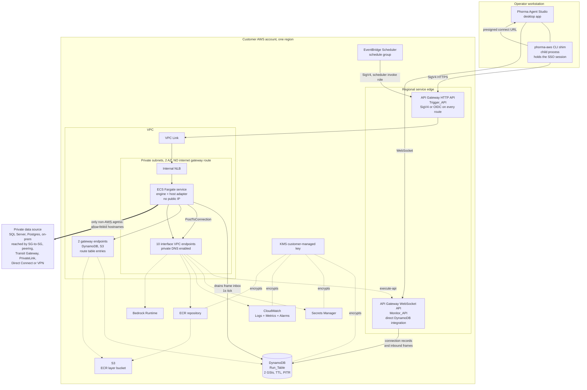

# AWS Deployment Target: Architecture Approval Request

> **Status:** Awaiting review
> **Requested from:** Head of Cloud Engineering
> **Requested by:** Phorma Agent Studio engineering
> **Date raised:** 2026-08-13
> **Decision needed by:** before implementation starts
> **Source of record:** `.kiro/specs/aws-deployment-target/{requirements,design,tasks}.md`

## Purpose of this document

We are asking for architectural sign-off on a second deployment target for Phorma Agent Studio that
runs in a customer's own AWS account. Implementation has not started. Nothing in this design has been
deployed to any account.

This document states what would be created, the security and identity posture, the standing cost
shape, the decisions we have already closed, and the specific items we need a decision on. It is
deliberately explicit about what we have not yet verified.

Section 11 is the sign-off block.

---

## 1. Why this is being built

The studio can already deploy a workflow to a Cloudflare Worker. That host cannot reach SQL Server,
a VPC-private database, or an on-premises system, and it declares no private network egress. A
workflow whose data source sits behind a corporate network therefore has exactly two hosts today: an
operator's laptop, or nothing.

Scheduled, unattended execution needs a real host. That is the whole reason for this work.

The workflow engine itself is portable by construction and gains no new subsystem here. What is being
added is a second host adapter, the infrastructure that runs it, and the identity and network model
around it.

---

## 2. What would be created

One CloudFormation stack, from an AWS CDK application written in TypeScript, created in a single
`cdk deploy`, in one configured region.

| Component | Service | Configuration of note |
|---|---|---|
| Workflow runtime | ECS Fargate service | One container image: the workflow engine plus the AWS adapter |
| Persistence | DynamoDB, single table, on-demand | Two global secondary indexes, point-in-time recovery on, TTL attribute, no table scan on any code path |
| Trigger ingress | API Gateway HTTP API | Private integration through a VPC Link to an internal Network Load Balancer in the task subnets |
| Live monitor | API Gateway WebSocket API | Direct AWS service integration to DynamoDB. No Lambda function |
| Scheduling | EventBridge Scheduler schedule group | One schedule per cron node, capped at 50 per workflow, UTC time zone |
| Secrets | AWS Secrets Manager | Connection credentials and model provider keys, under one owned name prefix |
| Container images | ECR repository | |
| Telemetry | CloudWatch Logs and Metrics | Six metrics, two alarms |
| Encryption | KMS customer-managed key | Encrypts the table, secrets, log groups and image repository |

### Explicitly not created

No Lambda function, no RDS instance, no Step Functions state machine, no SQS queue, no App Runner
service, and no SNS topic of our own (the alarm notification target is an ARN the operator supplies).

Each omission is load bearing rather than incidental. Every one of those services would widen the
deployment role's action list that your team has to approve.

---

## 3. Network posture

- Fargate tasks run in private subnets whose route tables carry **no internet gateway route**, with
  public IP assignment disabled.
- Service access is through VPC endpoints: a gateway endpoint for DynamoDB, and interface endpoints
  with private DNS for Secrets Manager, ECR API, ECR DKR, CloudWatch Logs, STS and EventBridge
  Scheduler.
- Outbound egress is an explicit allow-list derived from the workflow definition and the configured
  model providers, printed to the operator for review before any deploy runs.
- The task security group permits egress only to those endpoints, to a nominated data-source security
  group on its port, and to the ports the allow-list requires. **There is no all-destinations egress
  rule**, and synthesis fails if one appears in the template.
- The stack accepts an existing VPC and subnet set as configuration. It creates its own only when
  given neither.
- Neither ingress path reaches a task directly. Both terminate at API Gateway.

The deployment guide documents each private-source connectivity pattern as a separate option, with the
resources each side owns: security group to security group inside the VPC, VPC peering, Transit
Gateway, PrivateLink, and Direct Connect or site-to-site VPN. We are not assuming which one your
estate uses.

---

## 4. Identity model

Four roles, deliberately disjoint. Every role the application creates carries your organisation's
permissions boundary, and **synthesis fails if a role is declared without it, or if no boundary is
configured at all**. All policies are managed policies with names derived from a configured prefix, so
your team can review each one by name. No role carries an inline policy. The application creates no
IAM user and no long-lived access key, and synthesis fails if the template declares either.

| Role | Holds | Notably does not hold |
|---|---|---|
| **Deployment** | CloudFormation, asset staging, role creation under a path prefix with the boundary condition, ECS, table creation, secret creation, Scheduler, API Gateway, `kms:CreateGrant` and `kms:DescribeKey`, `ec2:Describe*`. `iam:PassRole` limited to the two roles it creates | `secretsmanager:GetSecretValue`, any table read action, `kms:Decrypt` |
| **Runtime** (the one that runs continuously) | Table item actions, `secretsmanager:GetSecretValue` on one name prefix, `kms:Decrypt` on the key with a `ViaService` condition naming only DynamoDB, Secrets Manager and CloudWatch Logs, WebSocket connection management on one stage, log and metric writes, schedule create/delete/read on our group, and exactly one `iam:PassRole` (see below) | every other `iam` action, all `ecs`, all `ecr`, all `s3`, table scan, every `secretsmanager` action but `GetSecretValue` |
| **Task execution** | Image pull on our repository, log stream creation, the key permissions the pull path needs | any table action, any `secretsmanager` action |
| **Scheduler invoke** | Exactly one action: `execute-api:Invoke` on the single scheduled-run route | everything else |

### The one IAM exception, stated openly

The runtime role creates EventBridge Scheduler schedules when a workflow is pushed, and
`scheduler:CreateSchedule` requires `iam:PassRole` on the schedule's target role. We therefore grant
**exactly one** `iam:PassRole` statement, whose only resource is the scheduler invoke role ARN, and
whose condition requires `iam:PassedToService` to equal `scheduler.amazonaws.com`. The scheduler
invoke role is in turn trusted only by `scheduler.amazonaws.com` under a `SourceArn` condition scoped
to our schedule group.

Our build asserts that statement's exact shape against the synthesized template: exactly one
statement, exactly that action, exactly that resource, that condition present. A later change that
adds a second statement, a second resource, or drops the condition fails our pipeline rather than
arriving in a review.

We considered moving schedule creation into the infrastructure layer so the runtime role would hold no
`iam` action whatsoever. It works, but it would make every workflow push require a `cdk deploy`, which
defeats the purpose of pushing a workflow. We are open to being overruled on this trade.

### Deployment role trust

Supports an IAM Identity Center permission set, a GitHub OIDC provider with conditions on repository,
branch and environment, or both together, so one estate can allow human and CI deploys through the
same role. An empty trust configuration fails synthesis.

### Guardrails enforced at synthesis, not at review time

Six checks fail the build rather than producing a review finding:

1. A role without the configured permissions boundary, or no boundary configured.
2. The table, a secret, a log group or the image repository without the customer-managed key.
3. A route with no authorizer and no explicit unauthenticated opt-in.
4. An IAM user or a long-lived access key in the template.
5. An alarm with no notification target.
6. A missing cost-allocation tag set, or any tag with an empty value.

---

## 5. Authentication

- Every trigger and monitor route carries an authorizer. AWS SigV4 is the default, enforced by API
  Gateway rather than by our code, including the 300 second signing skew. Per-route OIDC is available.
- Unauthenticated public routes are opt-in only, disabled by default, rate limited, and structurally
  ineligible for workflow push, secret write, purge, and run history. That ineligibility is enforced at
  synthesis.
- A 403 response discloses neither the route's configured authentication mode nor the configured
  issuer or audience.
- Workflow-existence checks run only after authentication succeeds, so an unauthenticated caller
  cannot enumerate workflow identifiers.

---

## 6. Credential handling

The Studio desktop application holds **no AWS access key, secret access key or session token**: not in
its settings, the OS keychain, `localStorage`, IndexedDB, or any request body.

Every AWS call is made by a small command-line shim invoked as a child process, which inherits the
operator's ambient profile or SSO session in the same way the existing Cloudflare path uses `wrangler`
today. The studio sets no AWS environment variable on that process. A connection secret travels to the
child process on standard input, never in a command argument and never into the console.

We considered a loopback signing proxy that the application UI would call over plain HTTP. It is
cleaner to consume, and we rejected it: it would put an HTTP listener holding live AWS credentials on
the operator's machine for the lifetime of their session.

Deploys are plan-then-confirm. The plan step runs a CDK diff plus an existence preflight of the
configured VPC, subnets and key. A plan that exits non-zero offers no confirmation, so a failing plan
cannot be deployed past.

---

## 7. Data handling, retention and residency

- Single estate, single tenant. This runs in the customer's own account. Hosted multi-tenant AWS is out
  of scope, though the table key design keeps a per-tenant key prefix possible with no data migration.
- Every resource is created in one configured region, and synthesis fails before creating anything if
  the region is absent or malformed.
- Run records, run events and usage entries are retained for a configurable 1 to 366 days, defaulting
  to 30, expired by DynamoDB TTL and excluded from reads before physical deletion.
- Log groups carry a retention period matching the configured run-event retention.
- Purging a workflow deletes its definition, journal, run records, run events, usage entries, state and
  lease, and its schedules, and answers with per-category counts. It deliberately **preserves secrets**,
  because a credential is shared across workflows.
- Secret values of 8 characters or more are registered with a redactor before any of them can reach a
  run event, a log line, a metric dimension, or an API response body. This is verified by a test that
  searches every one of those sinks for every value, both whole and as a substring.

---

## 8. The one hard correctness problem

On Cloudflare, a Durable Object is single-flight per workflow by platform guarantee. AWS has no free
equivalent, so we build it.

A DynamoDB item acts as an execution lease carrying a strictly increasing fencing token. Acquisition is
a single conditional write that establishes both exclusivity and the token in one round trip. The token
is heartbeated every 10 seconds with a 60 second expiry, and is applied as a condition on every table
write the running task makes.

The failure this prevents is concrete and expensive: a cron firing while a previous run is still
executing, or two tasks alive during a rolling deploy, means the same HTTP POST or SQL write applied
twice to a customer's system of record. A task that loses its lease stops executing within one
heartbeat, and every write it attempts afterwards is refused by the condition and changes nothing.

A lease takeover publishes a metric and raises an alarm, because it usually means a task died
mid-run.

This is the part of the design most deserving of your scrutiny. It is covered by property-based tests
against an in-memory model that reproduces DynamoDB's conditional-write semantics, exercised with 2 to
100 concurrent contenders.

---

## 9. Cost shape, stated plainly

This is not a scale-to-zero design, and we would rather you hear that from us than discover it on a
bill.

**Standing costs**

- The Fargate service runs continuously.
- One internal Network Load Balancer, charged hourly.
- Seven interface VPC endpoints, charged hourly per availability zone.

**Variable costs**

- DynamoDB on-demand reads and writes.
- While a run is live, the task polls a control-frame inbox on a one second tick. That is a steady
  small read cost, accepted in exchange for not adding a Lambda function and a fifth IAM role to the
  surface your team reviews.
- A run suspended on a human approval holds a task and a lease for as long as the approval takes, by
  design, with no timeout.

**Why Fargate and not Lambda:** a run is one long-lived in-process graph walk that can suspend
indefinitely on an approval and may hold a database connection pool. Lambda's 15 minute ceiling fights
both. A Lambda execution mode is out of scope rather than deferred.

Every taggable resource carries the operator-configured cost-allocation tag set, and synthesis fails if
that set is missing or if any tag value is empty.

---

## 10. Decisions already closed

Recorded so you can reopen any of them deliberately rather than discover them later.

| Decision | Resolution | Rejected alternative and why |
|---|---|---|
| Infrastructure as code | AWS CDK in TypeScript | Terraform. Matches the codebase and the existing deploy rail; retrofitting later means maintaining two IaC surfaces |
| Persistence | DynamoDB single table | RDS. Adds idle cost, a VPC dependency, and a migration surface for reporting nobody has asked for |
| Compute | Fargate only | Lambda. 15 minute ceiling against indefinitely suspendable runs |
| Monitor transport | API Gateway WebSocket API | Server-sent events. Would forfeit the existing bidirectional control protocol and require a client redesign |
| WebSocket route backing | Direct DynamoDB service integration | A Lambda function. Would add a function, a fifth role, `lambda:*` on the deployment role, and a second compute surface to review. Cost: about one second of control-frame latency |
| Tenancy | Single estate, bring your own account | Hosted multi-tenant AWS |
| Workflow orchestration | Our engine remains the state machine | Step Functions. Decomposing the graph walk into states would forfeit the local-to-deployed parity that makes the canvas debugger work against a deployed run |

---

## 11. What we are asking you to approve

Please mark each item. Any single objection is worth raising before implementation starts; several of
these are cheap to change now and expensive to change later.

| # | Item | Decision |
|---|---|---|
| 1 | The resource inventory in section 2, and the exclusions | ☐ Approve ☐ Approve with changes ☐ Reject |
| 2 | The network posture in section 3: private subnets, no IGW route, VPC endpoints, no all-destinations egress rule | ☐ Approve ☐ Approve with changes ☐ Reject |
| 3 | The four-role split in section 4 | ☐ Approve ☐ Approve with changes ☐ Reject |
| 4 | **The single conditioned `iam:PassRole` on the runtime role**, or a directive to move schedule creation into the IaC layer instead | ☐ Approve ☐ Approve with changes ☐ Reject |
| 5 | The deployment role trust model: Identity Center, GitHub OIDC, or both | ☐ Approve ☐ Approve with changes ☐ Reject |
| 6 | The authentication model in section 5, including opt-in unauthenticated routes being available at all | ☐ Approve ☐ Approve with changes ☐ Reject |
| 7 | The credential handling in section 6, and the rejection of a loopback signing proxy | ☐ Approve ☐ Approve with changes ☐ Reject |
| 8 | Retention defaults and the decision to preserve secrets on purge | ☐ Approve ☐ Approve with changes ☐ Reject |
| 9 | The standing cost shape in section 9, including a task held open by a pending approval | ☐ Approve ☐ Approve with changes ☐ Reject |
| 10 | The closed decisions in section 10 | ☐ Approve ☐ Approve with changes ☐ Reject |

### And to supply

These are inputs to the deployment rather than approvals. The deployment guide ships them as a
copy-pasteable request with each item separately labelled so they can be answered individually.

| # | Input | Value |
|---|---|---|
| 1 | Deployment role ARN and its trust configuration | |
| 2 | Permissions boundary policy ARN | |
| 3 | CDK bootstrap approval and the qualifier to use | |
| 4 | Region | |
| 5 | VPC id and subnet ids, or approval for us to create them | |
| 6 | Customer-managed key ARN and its key-policy grants, or approval for us to create one | |
| 7 | Data-source security group id and port | |
| 8 | Approved egress hostname allow-list | |
| 9 | Required cost-allocation tag set | |
| 10 | Alarm notification target ARN | |
| 11 | Resource name prefix | |

---

## 12. What we have not verified

Stated plainly, because a design review is worth less if it overstates its own confidence.

**Verified credential-free, in our pipeline.** A `cloud-aws` check command that you or CI can run with
no AWS credentials present: TypeScript compile, CDK synthesis, template assertions over the resource
inventory and encryption and authorizers and alarms, IAM deny-list assertions asserting the runtime
role grants nothing its exclusion list names, a no-table-scan check, and an engine-purity check. Plus
34 correctness properties covering the lease, journal replay, event sequencing, redaction, retention,
purge, state store semantics, schedule derivation and retry budgets.

**Not verified, and requires a real account.** Five claims cannot honestly be asserted in CI:

1. SigV4 signing-skew enforcement.
2. OIDC token validation by the API Gateway authorizer.
3. The WebSocket handshake refusal for an unauthenticated connection.
4. Per-route request throttling.
5. The existence preflight against real `ec2:Describe*` and `kms:DescribeKey` responses.

Until a deployed-account pass runs, **every IAM action list we publish is labelled `indicative,
pending account validation`** rather than presented as verified, alongside the CDK version and region
any verification used.

**Planned narrowing.** We name IAM Access Analyzer policy generation from CloudTrail as the method for
trimming the runtime role's policy once the adapter is feature complete. The lists in section 4 are a
starting position we expect to reduce, not a ceiling we intend to keep.

---

## 13. Sign-off

| | Name | Role | Date | Outcome |
|---|---|---|---|---|
| Requested by | | Engineering, Phorma Agent Studio | | |
| Reviewed by | | Head of Cloud Engineering | | ☐ Approved ☐ Approved with conditions ☐ Rejected |

**Conditions or objections:**

<br>
<br>
<br>

---

## Appendix: where the detail lives

| Question | Document |
|---|---|
| Every acceptance criterion, in EARS form | `.kiro/specs/aws-deployment-target/requirements.md` |
| Architecture, interfaces, data model, correctness properties, testing strategy | `.kiro/specs/aws-deployment-target/design.md` |
| Implementation plan and sequencing | `.kiro/specs/aws-deployment-target/tasks.md` |
| Original research and the two-phase scope | `docs/integrations-and-aws-deployment.md` |
| Operator-facing deployment guide and platform request template | `docs/deploy-aws.md` (produced during implementation) |

---

# Addendum A: Network topology

Added 2026-08-13 in response to review questions.

## Diagram



## Plain-text version

For Confluence instances without a Mermaid macro.

```
OPERATOR WORKSTATION
  Studio desktop app
    |
    +-- phorma-aws CLI shim (child process, holds the ambient SSO session)
          |
          | SigV4 HTTPS                    presigned WebSocket URL
          v                                          |
=========================================================================
AWS ACCOUNT, ONE REGION                              |
                                                     v
  EventBridge Scheduler ---SigV4---> [ Trigger_API ]  [ Monitor_API ]
  (schedule group)                    HTTP API         WebSocket API
                                          |                 |
                                     VPC Link          direct DynamoDB
                                          |             integration
  +---- VPC ------------------------------|-----------------|----------+
  |                                       v                 |          |
  |  PRIVATE SUBNETS (2 AZ, no IGW route) |                 |          |
  |    Internal NLB <---------------------+                 |          |
  |         |                                               |          |
  |         v                                               |          |
  |    Fargate task (engine + adapter, no public IP)        |          |
  |         |                                               |          |
  |         +--> 10 interface endpoints --> Secrets Manager |          |
  |         |                               CloudWatch      |          |
  |         |                               ECR api + dkr   |          |
  |         |                               STS             |          |
  |         |                               Scheduler       |          |
  |         |                               Bedrock Runtime |          |
  |         |                               execute-api ----+          |
  |         |                                                          |
  |         +--> 2 gateway endpoints -----> DynamoDB (Run_Table)       |
  |         |                               S3 (ECR layer bucket)      |
  |         |                                                          |
  |         +==> ONLY non-AWS egress: allow-listed hostnames           |
  +---------|----------------------------------------------------------+
            v
   Private data source (SQL Server, Postgres, on-prem)
   reached by SG-to-SG, peering, Transit Gateway, PrivateLink, DX or VPN

  KMS customer-managed key encrypts: Run_Table, secrets, log groups, ECR
```

## Trust boundaries in the diagram

| Boundary | Crossed by | Control |
|---|---|---|
| Operator workstation to AWS | The CLI shim only. The app UI never signs a request | Ambient SSO session, never a stored key |
| Internet to the workload | API Gateway only. Nothing reaches a task directly | SigV4 or OIDC on every route, enforced by API Gateway |
| VPC to AWS services | VPC endpoints only | No internet gateway route exists on the task subnets |
| VPC to customer data | One nominated security group on one port, plus the allow-list | No all-destinations egress rule; synthesis fails if one appears |

---

# Addendum B: Cost allocation tags

**Short answer: the tags are applied automatically and enforced at build time, but activating them for billing is a one-time manual step in your management account that no IaC tool can perform.**

## What the deployment does automatically

- Applies the tag set you configure to **every resource it creates that accepts tags**.
- **Fails synthesis** if the tag set is absent, or if any tag in it carries an empty value. No resource is created in that case. This is enforced by a build-time aspect, not by convention.
- Applies your configured name prefix to the stack and every resource name, so resources of one deployment are distinguishable from another in the same account.

## What you have to do once, manually

AWS cost allocation tags do not appear in Cost Explorer or the Cost and Usage Report until they are **activated as cost allocation tags in the Billing console of the payer account**. Activation:

- can only be done in the management account of the organisation,
- cannot be performed by CloudFormation, CDK, or any IaC tool,
- is **not retroactive**. Costs incurred before activation are not tagged in the CUR.

So the sequence matters: activate the tag keys **before** the first deploy, or accept a gap in the first billing period.

## Recommendation

Tell us the tag keys during configuration, activate those keys in Billing first, then deploy. If your organisation already mandates a tag set via an SCP or Tag Policy, give us that list verbatim and the build will enforce it on our side as well.

| Item | Owner |
|---|---|
| Nominate the required tag keys and values | Your team |
| Activate those keys as cost allocation tags in the payer account | Your team, one time, before first deploy |
| Apply them to every taggable resource | Automatic |
| Fail the build if any are missing or empty | Automatic |

---

# Addendum C: Egress networking requirements

## C.1 A correction to section 3, found while answering this question

The endpoint list in the original design was **incomplete**. Four endpoints are missing, one of which prevents the service from starting at all. We are folding these into the spec. Flagging them here rather than discovering them during your review.

| Endpoint | Why it is required | Consequence if absent |
|---|---|---|
| `com.amazonaws.<region>.s3` (**gateway**) | ECR stores image layers in S3. AWS documents that Fargate platform 1.4.0 or later requires both the ECR interface endpoints **and** the S3 gateway endpoint ([Amazon ECR interface VPC endpoints](https://docs.aws.amazon.com/AmazonECR/latest/userguide/vpc-endpoints.html)) | **Blocker.** Tasks cannot pull the container image. The service never starts |
| `com.amazonaws.<region>.monitoring` | The runtime publishes CloudWatch metrics to `monitoring.<region>.amazonaws.com` | The six metrics and both alarms never receive data. Failures go unnoticed, which is the exact outcome the observability requirement exists to prevent |
| `com.amazonaws.<region>.execute-api` | The runtime pushes run events to open WebSocket connections via `PostToConnection` against the API Gateway management endpoint | Live monitoring of a deployed run silently fails |
| `com.amazonaws.<region>.bedrock-runtime` | Bedrock model invocation. Confirmed service name in [Amazon Bedrock VPC endpoints](https://docs.aws.amazon.com/bedrock/latest/userguide/vpc-interface-endpoints.html) | Bedrock inference fails from a subnet with no internet route. Required for the cost scenario in Addendum D |

Adding the Bedrock endpoint has a useful consequence: **with Bedrock as the inference provider, the workload needs no internet egress at all.** Every dependency is reachable over PrivateLink. A NAT gateway becomes unnecessary rather than merely discouraged.

## C.2 Corrected endpoint list

Twelve endpoints. Two are gateway endpoints, which are free and are route table entries rather than ENIs. Ten are interface endpoints, billed hourly per AZ, and all need private DNS enabled.

| # | Service name | Type | Purpose |
|---|---|---|---|
| 1 | `com.amazonaws.<region>.dynamodb` | Gateway | Run_Table: all state, journal, events, usage, lease |
| 2 | `com.amazonaws.<region>.s3` | Gateway | ECR image layers |
| 3 | `com.amazonaws.<region>.secretsmanager` | Interface | Connection credentials, provider keys |
| 4 | `com.amazonaws.<region>.ecr.api` | Interface | Image manifest |
| 5 | `com.amazonaws.<region>.ecr.dkr` | Interface | Image pull |
| 6 | `com.amazonaws.<region>.logs` | Interface | Structured run logs |
| 7 | `com.amazonaws.<region>.monitoring` | Interface | Metric publication |
| 8 | `com.amazonaws.<region>.sts` | Interface | Role credential resolution |
| 9 | `com.amazonaws.<region>.scheduler` | Interface | Schedule create and delete on workflow push |
| 10 | `com.amazonaws.<region>.execute-api` | Interface | WebSocket push to the monitor |
| 11 | `com.amazonaws.<region>.bedrock-runtime` | Interface | Model inference, where Bedrock is the provider |
| 12 | `com.amazonaws.<region>.kms` | Interface | **Not required.** Listed to record the decision: DynamoDB, Secrets Manager and CloudWatch call KMS on the workload's behalf under the `ViaService` condition, so the task itself makes no KMS call |

Every interface endpoint is created in the same subnets the tasks run in, with a security group permitting inbound 443 from those subnets only.

## C.3 Non-AWS egress

This is the only traffic that leaves the AWS network, and it is the part your team is being asked to approve.

| Destination class | Reached how | Determined how |
|---|---|---|
| Customer data sources (SQL Server, Postgres, MySQL, on-prem) | Task security group to a **nominated** security group on a **nominated** port, or via peering, Transit Gateway, PrivateLink, Direct Connect or site-to-site VPN | You nominate the security group and port. We create no other rule |
| Third-party HTTP APIs the workflow calls | Allow-listed hostnames only | Derived from the workflow definition before deploy, printed for operator review |
| Non-Bedrock model providers (Anthropic, OpenAI and similar) | Allow-listed hostnames only | Derived from the configured providers. **Not needed at all if Bedrock is the only provider** |

Properties of the allow-list:

- One entry per distinct hostname, case-insensitive, alphabetically ordered, capped at 200.
- Printed to the operator console with a leading count, before the deploy command runs, so it is reviewed rather than assumed.
- A hostname that is interpolated at run time and therefore not statically knowable is **omitted from the list and named on its own console line**. The deploy proceeds; that node will fail at run time with a message naming the hostname and stating it may not be allow-listed. We chose a legible run-time failure over a silently over-broad allow-list.
- **No rule permitting every destination address is created, and synthesis fails if one appears in the template.**

## C.4 Ingress

| Path | Source | Reaches | Authentication |
|---|---|---|---|
| Trigger_API | Operator workstation, EventBridge Scheduler, optional webhooks | Internal NLB via VPC Link, then the task | SigV4 by default, or OIDC per route |
| Monitor_API | Operator workstation only | DynamoDB directly, never the task | SigV4 presigned connect URL |

No path reaches a task directly. Tasks have no public IP and their subnets have no internet gateway route, so they are not addressable from outside the VPC by any route.

---

# Addendum D: Expected cost scenario

## D.1 Basis and caveats

- Rates are **us-east-1 list price, August 2026**, exclusive of tax, with no Savings Plan or committed-use discount applied.
- Fargate and PrivateLink rates were taken from the AWS pricing pages during preparation. The remaining rates are standard list prices that **should be reconfirmed in the AWS Pricing Calculator for your region** before anyone commits to a number.
- Assumes **2 availability zones**. A third AZ adds 50% to the interface endpoint line and nothing else.
- Inference is **Amazon Bedrock, Claude Sonnet class, on-demand**, at $2.00 per million input tokens and $10.00 per million output tokens. Regional Bedrock pricing carries a premium in some regions (roughly 10% in EU and JP), so confirm against your region.
- The model matters more than the rates. Substitute your own volumes into the same build-up.

## D.2 Rate card used

| Line | Rate |
|---|---|
| Fargate vCPU, Linux/x86 | $0.04048 per vCPU-hour |
| Fargate memory, Linux/x86 | $0.004446 per GB-hour |
| Fargate on Graviton (ARM) | About 20% less: $0.03238 per vCPU-hour, $0.00356 per GB-hour |
| Network Load Balancer | $0.0225 per hour, plus $0.006 per NLCU-hour |
| Interface VPC endpoint | $0.01 per endpoint per AZ per hour, plus $0.01 per GB processed |
| Gateway VPC endpoint | Free |
| DynamoDB on-demand | $1.25 per million write request units, $0.25 per million read request units, $0.25 per GB-month |
| API Gateway HTTP API | $1.00 per million requests |
| API Gateway WebSocket | $1.00 per million messages, $0.25 per million connection-minutes |
| EventBridge Scheduler | $1.00 per million invocations |
| Secrets Manager | $0.40 per secret-month, $0.05 per 10,000 API calls |
| KMS | $1.00 per key-month, $0.03 per 10,000 requests |
| CloudWatch Logs | $0.50 per GB ingested, $0.03 per GB-month stored |
| CloudWatch custom metrics | $0.30 per metric-month |
| CloudWatch alarms | $0.10 per alarm-month |
| ECR storage | $0.10 per GB-month |
| Bedrock, Claude Sonnet class | $2.00 per million input tokens, $10.00 per million output tokens |

Note: inter-AZ data transfer through a PrivateLink interface endpoint is no longer charged, which removes a line that used to appear in designs of this shape.

## D.3 Scenario 1: the floor

The number that matters most. **One workflow, running once a day, 30 runs a month.** This is what the account is billed before the platform is doing meaningful work, and it is almost entirely fixed cost.

| Line | Basis | Monthly |
|---|---|---|
| Fargate | 1 task, 1 vCPU, 2 GB, 730 hr | $36.04 |
| Network Load Balancer | 730 hr plus minimal NLCU | $20.81 |
| Interface VPC endpoints | **10 endpoints x 2 AZ x 730 hr** | **$146.00** |
| Secrets Manager | 3 secrets | $1.20 |
| KMS | 1 key | $1.00 |
| CloudWatch custom metrics | 6 metrics x 1 workflow | $1.80 |
| CloudWatch alarms | 2 alarms | $0.20 |
| CloudWatch Logs | Under 1 GB | $0.50 |
| DynamoDB | Negligible volume | $0.10 |
| ECR | About 5 GB of image versions | $0.50 |
| API Gateway, Scheduler | Negligible volume | $0.01 |
| **Infrastructure subtotal** | | **$208.16** |
| Bedrock | 30 runs x 2 calls x (8k in, 1.5k out) | $1.86 |
| **Total** | | **about $210** |

**The floor is roughly $208 a month, of which $146 is interface VPC endpoints and $57 is Fargate plus the NLB.** Three quarters of the floor is the private networking posture. That is the direct price of "no internet gateway route", and it is worth deciding deliberately rather than absorbing.

With 3 AZs the floor is about $281.

## D.4 Scenario 2: medium, all-AWS with Bedrock

**20 deployed workflows, each on an hourly schedule: 14,400 runs a month.** Each run walks about 12 nodes, emits about 60 run events, and makes 2 Bedrock calls averaging 8,000 input and 1,500 output tokens.

| Line | Basis | Monthly |
|---|---|---|
| Fargate | 2 tasks, 1 vCPU, 2 GB each, 730 hr | $72.08 |
| Network Load Balancer | 730 hr plus 1 NLCU average | $20.81 |
| Interface VPC endpoints | 10 x 2 AZ x 730 hr | $146.00 |
| Endpoint data processing | About 3 GB | $0.03 |
| DynamoDB | About 3.6M write units, 2M read units, 1.7 GB stored with PITR | $6.00 |
| **CloudWatch custom metrics** | **6 metrics x 20 workflows = 120 metrics** | **$36.00** |
| Secrets Manager | 25 secrets plus API calls | $10.14 |
| CloudWatch Logs | About 1 GB ingested | $5.00 |
| KMS | 1 key plus request volume | $1.30 |
| ECR | Image versions | $0.50 |
| API Gateway, both APIs | Triggers, reads, monitoring sessions | $0.20 |
| CloudWatch alarms | 2 alarms | $0.20 |
| EventBridge Scheduler | 14,400 invocations | $0.01 |
| **Infrastructure subtotal** | | **$298.27** |
| Bedrock input | 230.4M tokens at $2.00/M | $460.80 |
| Bedrock output | 43.2M tokens at $10.00/M | $432.00 |
| **Bedrock subtotal** | | **$892.80** |
| **Total** | | **about $1,191** |

**Bedrock is 75% of the bill. Infrastructure grew by $90 while workload grew 480-fold.** Cost per run: about $0.083, of which $0.062 is inference.

## D.5 Scenario 3: heavy

**100 workflows every 15 minutes: 288,000 runs a month.** Illustrative, to show how the curve behaves.

| Line | Monthly |
|---|---|
| Fargate, about 16 concurrent tasks | $577 |
| Interface VPC endpoints, unchanged | $146 |
| CloudWatch custom metrics, 6 x 100 workflows = 600 | $180 |
| DynamoDB | $120 |
| CloudWatch Logs | $100 |
| Secrets Manager, 105 secrets | $42 |
| Network Load Balancer, KMS, ECR, API Gateway | $31 |
| **Infrastructure subtotal** | **about $1,196** |
| Bedrock, 4.6B input and 864M output tokens | $17,856 |
| **Total** | **about $19,052** |

Bedrock reaches 94% of the bill. Cost per run falls to about $0.066 as the fixed lines amortise.

## D.6 What the three scenarios say

| | Floor | Medium | Heavy |
|---|---|---|---|
| Runs per month | 30 | 14,400 | 288,000 |
| Infrastructure | $208 | $298 | $1,196 |
| Bedrock | $2 | $893 | $17,856 |
| **Total** | **$210** | **$1,191** | **$19,052** |
| Inference share | 1% | 75% | 94% |
| Cost per run | $7.00 | $0.083 | $0.066 |

Three conclusions worth carrying into the decision:

1. **Infrastructure is close to flat.** It rises about 4x while workload rises 9,600x. Fargate task count is the only line that tracks load meaningfully.
2. **Inference dominates as soon as the platform is used at all.** Cost control belongs in prompt and model selection, not in infrastructure tuning. Anything spent optimising the AWS footprint is spent on the smaller number.
3. **The floor is high relative to light usage.** At 30 runs a month the effective cost is $7 per run. This design suits a team with real scheduled workload, not a pilot with two workflows. If a low-volume pilot is the near-term plan, say so and we will discuss whether the pilot should run on the existing Cloudflare target first.

## D.7 Two cost decisions we would like a view on

### D.7.1 Metric dimension cardinality

The observability requirement puts the workflow id on every metric as a dimension. That makes each workflow-and-metric pair a distinct CloudWatch custom metric: 6 metrics x N workflows x $0.30. At 20 workflows that is $36 a month; at 100 workflows, $180; at 500 workflows, $900. It becomes the largest infrastructure line before the workload is large.

Per-workflow metrics are genuinely useful, since "which workflow is failing" is the first question during an incident. But the cost is superlinear in a way people do not expect from a metrics bill.

**Options:** keep as designed; drop the workflow id from the high-frequency metrics and keep it only on failure and lease-takeover; or move per-workflow analysis to log queries and keep metrics aggregate. **We would take your recommendation on this.**

### D.7.2 Graviton

Running the container on ARM cuts the Fargate line by about 20%: $29 instead of $36 per task-month. Our runtime is Node.js with no native dependencies that would block it. Worth roughly $115 a month in the heavy scenario, negligible at the floor. **We propose ARM unless your image pipeline or base image standards make x86 mandatory.**

## D.8 Levers, if the floor needs to come down

Listed with what each costs in posture, since none is free.

| Lever | Saving | What it costs |
|---|---|---|
| Single AZ instead of two | About $73 a month | Loss of AZ redundancy. Not recommended for scheduled production workload |
| Drop the `bedrock-runtime`, `monitoring` or `execute-api` endpoints and use a NAT gateway | Roughly break-even at $0.045 per NAT-hour plus $0.045 per GB | Reintroduces an internet egress path, which is the posture this design exists to avoid. Not recommended |
| Fargate on Graviton | About 20% of the Fargate line | Requires an ARM image. Recommended |
| Compute Savings Plan on Fargate | Up to 50% of the Fargate line | A one or three year commitment |
| Scale the service to zero tasks outside a schedule window | Most of the Fargate line | Webhook and manual triggers stop working while scaled down. Only viable for purely scheduled estates |
| Shorter run-event retention | Small, DynamoDB is already cheap here | Shorter audit trail. Not worth it |
