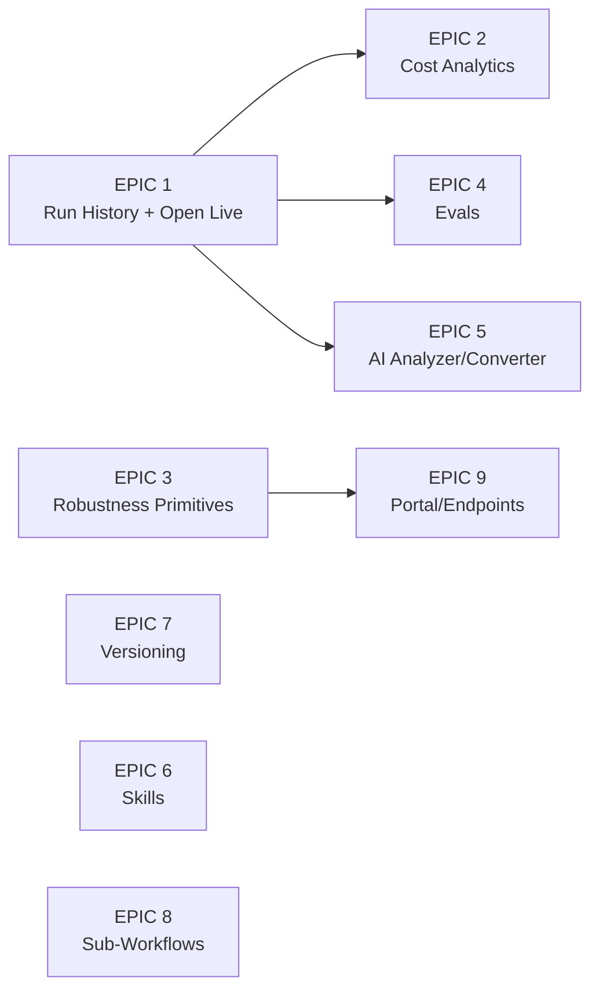

# Heym Research: Competitive Analysis & EPIC Breakdown

> Research date: 2026-07-19. Source: [heymrun/heym](https://github.com/heymrun/heym) (v0.0.71, ~755 stars, MIT + Commons Clause).
> Heym stack: Vue 3 + Vue Flow + FastAPI + Postgres, Docker self-hosted only.
>
> Status tracking: update the checkbox and add a link to the epic's plan/PR as each one starts.

## Where We're Strong (Heym Can't Match)

Things worth protecting - heym has none of these:

- **True debugger discipline** - `engine/src/gate.ts` gives us pause/resume/step/breakpoints. Heym only lets you *watch* a run; it can't step one.
- **Local-to-cloud single engine** - our exact-same-engine Durable Object story. Heym is Docker-self-host only; no serverless deploy, no BYO cloud.
- **Desktop app + zero-setup Ollama** - heym needs Docker + Postgres just to boot.
- **Canvas2D performance** - heym uses Vue Flow (DOM node soup), the thing our vision doc explicitly calls out as janky at scale.

## What We're Missing - High-Level Summary

Heym's biggest structural advantage is **the run doesn't die when it ends**. They persist executions, traces, token costs, and versions, and build an entire observability + quality layer on top (history, analytics, evals, cost tracking). Our `RunControllerService` trace is in-memory per run - close the app and it's gone.

Their second advantage is **workflow robustness primitives** (retry, error branches, timeouts, LLM fallback, context compression) - table stakes for production workflows we don't have yet.

Third: **AI-assisted building depth** - we have a workflow builder prompt (`frontend/src/app/core/workflow-builder-prompt.ts`), but they've pushed it further (expression generation, workflow analyzer, skill builder, migration converter).

---

## EPICs (priority-ordered)

### [x] EPIC 1: Persistent Run History & "Open Live Run" (highest impact) — shipped 2026-07-19

Every run (local + cloud) persisted with inputs, per-node outputs, trace, status, and trigger source. Browse past runs, load one back onto the canvas ("Bring to Canvas"), and **attach to an in-flight cloud run** - a webhook/cron-triggered run in the Durable Object should be openable live on the canvas mid-execution, restoring completed nodes and pulsing the current one.

- *Fits us well:* we already have IndexedDB storage (`indexed-db-storage.service.ts`), a WebSocket monitor (`cloud.service.ts`), and DO checkpoint state to restore from.
- *Pillar:* directly extends "execution theatre" and debugger discipline to production runs. This is our wedge.

### [x] EPIC 2: Cost & Usage Observability — shipped 2026-07-19

We already emit `node-usage` events with `costUsd` (`run-controller.service.ts` sums them per run). Missing: persistence + analytics - per-workflow/per-model cost over time, token charts, a synced pricing table so *all* providers get USD cost (not just OpenRouter/phorma-cloud), and per-node cost in the trace panel.

- *Pillar:* powerful + simpler. Ops owners deciding whether to deploy a workflow need "this costs $0.04/run".
- *Depends on:* EPIC 1 (persisted runs).
- *Shipped:* `engine/src/pricing.ts` (OpenRouter-synced price table + estimation, `costSource` reported/estimated), per-node + per-model rollups in `RunRecordSummary.usage`, a prune-proof usage ledger (IndexedDB v3 `usage` store + DO `usage_ledger` table + `GET /usage`), the Usage sidebar panel (chart.js, deferred) and Settings → Usage page, per-node usage in the trace. Display rule enforced end to end: Phorma Cloud-billed usage renders as plan credits (never USD, `phormaCloudCostUsd` split), BYO renders USD marked "(est.)" when estimated. Plus plan removed (starter/pro/team + custom enterprise later).

### [x] EPIC 3: Workflow Robustness Primitives — shipped 2026-07-19

Node-level **retry with backoff**, an **error output branch** (route failure instead of failing the run), **workflow-level error handler** node, **workflow timeout**, and **LLM fallback** (secondary model when primary errors). Also heym's **automatic context compression** (summarize middle messages at ~80% of context window) - very relevant for our long agent loops in `engine/src/engine.ts`.

- *Fits us well:* registry-driven node kinds mean error-branch ports are catalog entries; retry/fallback are engine-level and provider-agnostic.
- *Pillar:* powerful. Without these, deployed workflows are fragile in ways users only discover in production.
- *No dependencies* - engine-only work, can run in parallel with EPIC 1.
- *Shipped:* all six primitives. Retry is ON BY DEFAULT for transient failures (429/5xx/network, `ModelRequestError` + `isTransientModelError`), tunable/disable-able per node; fallback model retries the round on a secondary provider/model; agents get an optional "On error" out-port (red dot) that routes a JSON error payload instead of failing the run; a new Error Handler flow node runs its subtree when the run fails (run still settles failed); per-node `timeoutSec` + workflow `settings.timeoutMinutes` (pause-aware locally, durable wake alarm in the DO); context compression summarizes middle tool rounds at 80% of the model's context window (OpenRouter-synced `contextTokens` in the pricing table). New RunEvents: `node-retrying`, `node-fallback`, `node-error-routed`, `context-compressed`. Reliability section in the Prompt panel; workflow timeout in the Properties panel's no-selection state. Test: `engine/test/robustness.e2e.mts` (52 checks).

### [ ] EPIC 4: Evals

Test suites against a workflow: input cases + expected outputs, scoring by exact match / contains / LLM-as-judge, run the suite with one click, compare across models.

- *Pillar:* simpler + powerful - "trust what you built" is literally pillar 2, and evals are the mechanism.
- *Depends on:* EPIC 1 (run persistence for eval run history).

### [ ] EPIC 5: Deeper AI-Assisted Building

We have natural-language workflow generation. Heym adds: **Workflow Analyzer** (AI reviews a workflow + its run history and produces an improvement report), **AI expression/field generation**, and a **migration converter** (paste an n8n/Flowise/Dify workflow, get ours). The converter is a cheap, high-leverage acquisition tool.

- *Pillar:* faster - shortest path from intent to working workflow.
- *Depends on:* EPIC 1 (analyzer wants run history).

### [ ] EPIC 6: Agent Skills

Portable capability bundles (a `SKILL.md` + optional scripts) attachable to agent nodes, shareable across workflows, with an AI builder to draft them. For us, a **sandbox-free variant** fits better: markdown-only skills (prompt fragments + tool-usage instructions) are pure-engine-safe; script execution would need the Tauri sandbox on desktop and is a non-goal in the DO.

- *Pillar:* powerful; rides the same ecosystem wave as MCP.

### [ ] EPIC 7: Workflow Versioning (Edit History)

Every save = a version; diff any version against current; one-click revert. Distinct from undo/redo (`history.service.ts`) - this survives sessions. Cheap to build on portable JSON specs.

- *Pillar:* simpler - trust and safety for non-technical operators editing production workflows.

### [ ] EPIC 8: Sub-Workflows

An "Execute Workflow" node calling another workflow, plus "extract selection to sub-workflow". Enables reuse and keeps big canvases legible.

- *Consideration:* needs engine support for nested specs and depth limits (heym caps at 5); works in both local and DO contexts since it's pure spec interpretation.

### [ ] EPIC 9: Published Endpoints / Portal

Heym turns any workflow into a public chat UI (`/chat/{slug}`), scoped execution tokens for external callers, and SSE streaming endpoints. We have webhook triggers in the DO already - the gap is the **user-facing surface**: a shareable chat/form page served by the user's own worker, plus scoped per-workflow tokens.

- *Pillar:* powerful; natural fit for our BYO-Cloudflare model (the portal deploys to *their* worker, no Phorma fleet).
- *Depends on:* EPIC 3 (robustness before exposing public endpoints).

## Deliberately Skip (doesn't fit our vision)

- **RAG/vector stores, data tables, Redis/RabbitMQ/20+ native integrations** - heym hand-maintains connectors; our answer is MCP (any of these exist as MCP servers). Building them natively contradicts the "MCP as integration flywheel" strategy.
- **Kanban board, dashboards-from-workflows, Drive, teams/JWT self-host auth** - product surface area that dilutes the canvas-first identity; our multi-tenancy runs through Clerk + phorma-cloud already.
- **Codex/OpenCode coding nodes, Playwright auto-heal** - "not a coding tool" per `agent.md`.

## Suggested Sequencing

EPIC 1 first - it's the foundation EPICs 2, 4, and 5 build on, and it converts our biggest existing strength (live execution theatre) from a demo feature into a production-operations feature. EPIC 3 can run in parallel since it's engine-only work with no UI dependency on history.
