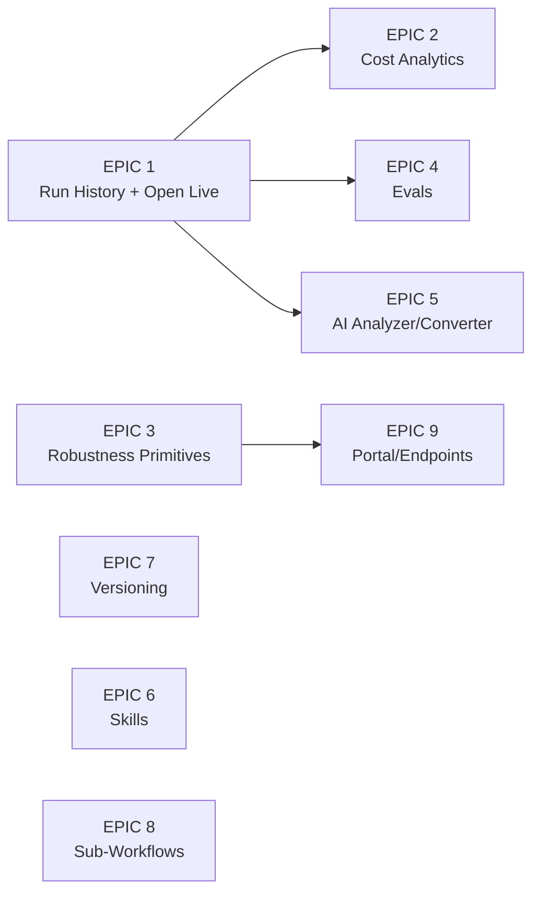

# Heym Research: Competitive Analysis & EPIC Breakdown

> Research date: 2026-07-19. Source: [heymrun/heym](https://github.com/heymrun/heym) (v0.0.71, ~755 stars, MIT + Commons Clause).
> Heym stack: Vue 3 + Vue Flow + FastAPI + Postgres, Docker self-hosted only.
>
> Status tracking: update the checkbox and add a link to the epic's plan/PR as each one starts.

## Where We're Strong (Heym Can't Match)

Things worth protecting - heym has none of these:

- **True debugger discipline** - `engine/src/gate.ts` gives us pause/resume/step/breakpoints. Heym only lets you *watch* a run; it can't step one.
- **Local-to-cloud single engine** - our exact-same-engine Durable Object story. Heym is Docker-self-host only; no serverless deploy, no BYO cloud.
- **Desktop app + zero-setup Ollama** - heym needs Docker + Postgres just to boot.
- **Canvas2D performance** - heym uses Vue Flow (DOM node soup), the thing our vision doc explicitly calls out as janky at scale.

## What We're Missing - High-Level Summary

Heym's biggest structural advantage is **the run doesn't die when it ends**. They persist executions, traces, token costs, and versions, and build an entire observability + quality layer on top (history, analytics, evals, cost tracking). Our `RunControllerService` trace is in-memory per run - close the app and it's gone.

Their second advantage is **workflow robustness primitives** (retry, error branches, timeouts, LLM fallback, context compression) - table stakes for production workflows we don't have yet.

Third: **AI-assisted building depth** - we have a workflow builder prompt (`frontend/src/app/core/workflow-builder-prompt.ts`), but they've pushed it further (expression generation, workflow analyzer, skill builder, migration converter).

---

## EPICs (priority-ordered)

### [x] EPIC 1: Persistent Run History & "Open Live Run" (highest impact) - shipped 2026-07-19

Every run (local + cloud) persisted with inputs, per-node outputs, trace, status, and trigger source. Browse past runs, load one back onto the canvas ("Bring to Canvas"), and **attach to an in-flight cloud run** - a webhook/cron-triggered run in the Durable Object should be openable live on the canvas mid-execution, restoring completed nodes and pulsing the current one.

- *Fits us well:* we already have IndexedDB storage (`indexed-db-storage.service.ts`), a WebSocket monitor (`cloud.service.ts`), and DO checkpoint state to restore from.
- *Pillar:* directly extends "execution theatre" and debugger discipline to production runs. This is our wedge.

### [x] EPIC 2: Cost & Usage Observability - shipped 2026-07-19

We already emit `node-usage` events with `costUsd` (`run-controller.service.ts` sums them per run). Missing: persistence + analytics - per-workflow/per-model cost over time, token charts, a synced pricing table so *all* providers get USD cost (not just OpenRouter/phorma-cloud), and per-node cost in the trace panel.

- *Pillar:* powerful + simpler. Ops owners deciding whether to deploy a workflow need "this costs $0.04/run".
- *Depends on:* EPIC 1 (persisted runs).
- *Shipped:* `engine/src/pricing.ts` (OpenRouter-synced price table + estimation, `costSource` reported/estimated), per-node + per-model rollups in `RunRecordSummary.usage`, a prune-proof usage ledger (IndexedDB v3 `usage` store + DO `usage_ledger` table + `GET /usage`), the Usage sidebar panel (chart.js, deferred) and Settings → Usage page, per-node usage in the trace. Display rule enforced end to end: Phorma Cloud-billed usage renders as plan credits (never USD, `phormaCloudCostUsd` split), BYO renders USD marked "(est.)" when estimated. Plus plan removed (starter/pro/team + custom enterprise later).

### [x] EPIC 3: Workflow Robustness Primitives - shipped 2026-07-19

Node-level **retry with backoff**, an **error output branch** (route failure instead of failing the run), **workflow-level error handler** node, **workflow timeout**, and **LLM fallback** (secondary model when primary errors). Also heym's **automatic context compression** (summarize middle messages at ~80% of context window) - very relevant for our long agent loops in `engine/src/engine.ts`.

- *Fits us well:* registry-driven node kinds mean error-branch ports are catalog entries; retry/fallback are engine-level and provider-agnostic.
- *Pillar:* powerful. Without these, deployed workflows are fragile in ways users only discover in production.
- *No dependencies* - engine-only work, can run in parallel with EPIC 1.
- *Shipped:* all six primitives. Retry is ON BY DEFAULT for transient failures (429/5xx/network, `ModelRequestError` + `isTransientModelError`), tunable/disable-able per node; fallback model retries the round on a secondary provider/model; agents get an optional "On error" out-port (red dot) that routes a JSON error payload instead of failing the run; a new Error Handler flow node runs its subtree when the run fails (run still settles failed); per-node `timeoutSec` + workflow `settings.timeoutMinutes` (pause-aware locally, durable wake alarm in the DO); context compression summarizes middle tool rounds at 80% of the model's context window (OpenRouter-synced `contextTokens` in the pricing table). New RunEvents: `node-retrying`, `node-fallback`, `node-error-routed`, `context-compressed`. Reliability section in the Prompt panel; workflow timeout in the Properties panel's no-selection state. Test: `engine/test/robustness.e2e.mts` (52 checks).

### [x] EPIC 4: Evals - shipped 2026-07-19

Test suites against a workflow: input cases + expected outputs, scoring by exact match / contains / LLM-as-judge, run the suite with one click, compare across models.

- *Pillar:* simpler + powerful - "trust what you built" is literally pillar 2, and evals are the mechanism.
- *Depends on:* EPIC 1 (run persistence for eval run history).
- *Shipped:* `engine/src/evals.ts` (suite/case/result types + pure `scoreOutput` with tolerant judge-verdict parsing), `RunSource` extended with `'eval'`. Every case execution is a REAL engine run persisted as a normal RunRecord (flask badge in the Runs panel, full trace, Bring to Canvas). Local suites run in a 3-wide pool via `EvalRunnerService` (bypasses the single-run `RunControllerService`); cloud suites run sequentially against the deployed DO (`POST /trigger` now accepts `source: 'eval'`, new `CloudService.triggerHttp` + poll). Model comparison re-runs the suite per model via `defaultModel` override (local only - cloud specs are materialized at push). IndexedDB v4 adds `eval-suites` + `eval-runs` stores. Evals sidebar panel: suite list → case editor (matcher select, judge model, comparison models) → scored results with judge reasoning and per-case run links. Test: `engine/test/evals.e2e.mts` (30 checks).

### [x] EPIC 5: Deeper AI-Assisted Building - shipped 2026-07-21

We have natural-language workflow generation. Heym adds: **Workflow Analyzer** (AI reviews a workflow + its run history and produces an improvement report), **AI expression/field generation**, and a **migration converter** (paste an n8n/Flowise/Dify workflow, get ours). The converter is a cheap, high-leverage acquisition tool.

- *Pillar:* faster - shortest path from intent to working workflow.
- *Depends on:* EPIC 1 (analyzer wants run history).
- *Shipped:* the **Assistant** - a persistent per-workflow chat (sidebar panel tab + expand button → large two-pane dialog) with **Ask / Plan / Agent** modes. Ask streams grounded answers about the canvas (never edits); Plan returns a proposal card (op list + explicit "Apply to canvas" → animated playback + Revert/Keep); Agent is the live tool loop, gated behind a Phorma Cloud subscription (UI + `/api/infer` server-side). Unsubscribed users run Ask/Plan on their default model; a footer model picker overrides the automatic route. Threads persist in IndexedDB v5 (`chat-threads`, 50/workflow retention, reopen/delete). The Ctrl+P palette records each exchange as a thread with a "Continue in chat" CTA. Plus: **Workflow Analyzer** (graph + last 15 run summaries → markdown improvement report as a chat turn), **migration converter** (paste/clipboard n8n·Flowise·Dify JSON → shape-detected in `core/migration/foreign-workflow.ts` → plan proposal, unmapped nodes listed), and **AI field generation** (sparkle button on the Prompt panel generates/improves agent prompts). Key files: `core/assistant-chat.{model,service}.ts`, `core/workflow-analyzer.service.ts`, `core/field-generation.service.ts`, `core/migration/`, `workspace/assistant/`.

### [x] EPIC 6: Agent Skills - shipped 2026-07-21

Portable capability bundles (a `SKILL.md` + optional scripts) attachable to agent nodes, shareable across workflows, with an AI builder to draft them. For us, a **sandbox-free variant** fits better: markdown-only skills (prompt fragments + tool-usage instructions) are pure-engine-safe; script execution would need the Tauri sandbox on desktop and is a non-goal in the DO.

- *Pillar:* powerful; rides the same ecosystem wave as MCP.
- *Shipped:* markdown-only skills. `AgentSkill {id, name, description?, content}` embedded BY VALUE in `AgentNodeData.skills` (both type twins) so specs stay portable and the cloud DO needs no library access; the engine's `renderPrompt` appends `# Skill: {name}` sections (verbatim, no interpolation) before the capabilities/hand-off sections - zero cloud/ or Rust changes. Global library in IndexedDB v6 (`skills` store) via `SkillsService`, with `syncAttachedSkills` refreshing embedded copies at run start, cloud push, and export (library wins; deleted skills keep their snapshot). UI: Skills left-sidebar panel (list, used-by count, import/export/duplicate/delete), bespoke skill editor dialog (markdown + sanitized preview, AI one-shot drafting via `FieldGenerationService.generateSkill`, SKILL.md import/export with Anthropic-style frontmatter), attach chips + picker in the Prompt panel, and a book+count header badge on agent nodes on the canvas. `summarizeGraph` mentions attached skills for Ask/Plan/Analyzer. Test: `engine/test/skills.e2e.mts` (17 checks).

### [x] EPIC 7: Workflow Versioning (Edit History) - shipped 2026-07-23

Every save = a version; diff any version against current; one-click revert. Distinct from undo/redo (`history.service.ts`) - this survives sessions. Cheap to build on portable JSON specs.

- *Pillar:* simpler - trust and safety for non-technical operators editing production workflows.
- *Shipped:* full-spec snapshots in IndexedDB v7 (`workflow-versions`, 100 non-deployed versions/workflow with deployed snapshots pinned), manual-save boundaries plus 30-minute autosave coalescing and no-op suppression, and successful cloud pushes tagged as deployed. A bespoke Version History dialog (Workflows row action + File menu) provides semantic structural diffs against current (nodes, prompts/models/config, connections, workflow settings, collapsed position changes), read-only canvas previews, and confirmed one-click restore that preserves the pre-restore state as a safety version. Undo/redo remains a separate in-session stack. Key files: `core/workflow-versions.{model,service}.ts`, `core/workflow-diff.ts`, `workspace/workflows/version-history-dialog/`. Test: `core/workflow-diff.spec.ts` plus browser E2E for save/history/diff/preview/restore/autosave coalescing.

### [x] EPIC 8: Sub-Workflows - shipped 2026-07-23

An "Execute Workflow" node calling another workflow, plus "extract selection to sub-workflow". Enables reuse and keeps big canvases legible.

- *Shipped:* the **Execute Workflow** flow node runs saved workflows as nested frames inside the same parent run, with scoped/collapsible trace activity, shared debugger controls, replay-safe journals, distinct approval identities, parent usage rollups, error-branch support, local eval support, and portable historical run snapshots. Referenced workflows are embedded as a flat cycle-safe transitive registry in exported/deployed specs while local runs take an immutable library-first snapshot, preserving local-to-cloud parity and allowing bounded self/mutual recursion. Depth limits are Free/BYO 2, Starter 5, Pro 8, Teams 10, with a hard engine ceiling of 25 for custom enterprise limits. The canvas context menu can **Extract to Sub-Workflow**: it validates a single flow boundary, carries tool links (cloning shared tools), saves the child, atomically replaces the selection with an Execute Workflow node, and remains one undo step. Tests: `engine/test/subworkflows.e2e.mts` plus `core/subworkflow-extract.spec.ts`.

### [x] EPIC 9: Published Endpoints / Portal - shipped 2026-07-27

Heym turns any workflow into a public chat UI (`/chat/{slug}`), scoped execution tokens for external callers, and SSE streaming endpoints. We have webhook triggers in the DO already - the gap was the **user-facing surface**: a shareable chat/form page served by the user's own worker, plus scoped per-workflow tokens.

- *Pillar:* powerful; natural fit for our BYO-Cloudflare model (the portal deploys to *their* worker, no Phorma fleet).
- *Depends on:* EPIC 3 (robustness before exposing public endpoints).
- *Shipped:* a new canvas-visible **Portal trigger** (`portal-trigger`) turns a workflow into a public **chat page**, a typed **form page**, or a **scoped-token JSON/SSE API** at `/p/{slug}` on the user's own worker (hosted mode too). Concurrency's hard blocker - one `WorkflowAgent` refuses simultaneous runs - is solved with **per-visitor session instances** (`{workflowId}#s{sessionId}`), which also give multi-turn chat for free: the transcript lives in the session DO and reaches prompts as `{{message}}` / `{{history}}` / `{{fields.x}}` / `{{sessionId}}` with **zero engine changes**. Visitors receive a **redacted SSE projection** (`cloud/src/portal-events.ts`) that is an allow-list, not a filter: only `started`/`token`/`question`/`review`/`review-resolved`/`done`/`error`/`stopped` survive, tokens stream ONLY from the designated responder node, sub-workflow interiors are withheld wholesale, and every failure collapses to one fixed sentence - so prompts, node names, tool payloads, usage, costs and raw errors can never reach the public. A public WebSocket was rejected outright (the `agents` SDK broadcasts the full spec on connect and lets any client overwrite state). Scoped access keys are `pk_{slug}_{…}` with the slug bound in, SHA-256 hashes only at rest, shown once, timing-safe compare, revocable, and surviving re-publish. A new plain-`DurableObject` **`PortalIndex`** owns slug resolution (strongly consistent, no KV/D1 setup for BYO users) plus a per-visitor + per-slug token-bucket rate limiter and hit counters; hosted plans cap published portals per tier. Settled session runs mirror back to the owner instance so Runs and Usage stay whole. The page itself is one **self-contained HTML document** (`cloud/src/portal-page.ts`) - inline CSS/JS, inline Tabler SVG, zero external requests, strict CSP, studio design tokens, single `--gutter` alignment, bottom-anchored transcript, a11y (`aria-live`, focus management, reduced motion), verified pixel-aligned at 360/768/1440 in light and dark. Studio surfaces: **Portal panel** (right sidebar) with checklist/URL/keys/traffic, a toolbar action that appears only when a Portal trigger exists, and the Portal trigger's Properties as the single configuration home. Also fixed two latent bugs found on the way: `rescheduleCron` was cancelling in-flight `waitTimedOut`/`workflowTimedOut` alarms, and the `webhook-trigger`'s dead "Path hint" now shows the real invoke URL. Net bundle impact: **zero** (lazy-loaded `cronstrue` paid for the whole feature). Tests: `engine/test/portal.e2e.mts` (111 checks), `cloud/test/portal-projection.test.mjs` (deterministic redaction proof across every `RunEvent` variant), `cloud/test/portal.e2e.mjs` (89 checks against a real local DO + Ollama: concurrency, streaming, tokens, rate limits, form mode, unpublish, cron regression). Docs: `docs/portal.md`.

## Deliberately Skip (doesn't fit our vision)

- **RAG/vector stores, data tables, Redis/RabbitMQ/20+ native integrations** - heym hand-maintains connectors; our answer is MCP (any of these exist as MCP servers). Building them natively contradicts the "MCP as integration flywheel" strategy.
- **Kanban board, dashboards-from-workflows, Drive, teams/JWT self-host auth** - product surface area that dilutes the canvas-first identity; our multi-tenancy runs through Clerk + phorma-cloud already.
- **Codex/OpenCode coding nodes, Playwright auto-heal** - "not a coding tool" per `agent.md`.

## Suggested Sequencing

EPIC 1 first - it's the foundation EPICs 2, 4, and 5 build on, and it converts our biggest existing strength (live execution theatre) from a demo feature into a production-operations feature. EPIC 3 can run in parallel since it's engine-only work with no UI dependency on history.

**All nine EPICs shipped as of 2026-07-27.** Heym parity is closed on every gap we chose to close, and the deliberate skips (RAG/vector stores, hand-maintained connectors, kanban/dashboards, coding nodes) remain out of scope by design - MCP and the canvas-first identity are the answers there.

## Follow-ups to EPIC 9

### Shipped 2026-07-27

The deployment and distribution follow-ups are done. The organising principle: **Phorma Cloud users get white-glove treatment** (they pay us, so account IDs, worker names and deploy config never appear), while **BYO users get the knobs** plus the guidance to use them.

- **`wrangler.jsonc` no longer carries Phorma's `account_id`.** This turned out to be a P0, not a wart: the committed config also bound Phorma's `phorma-releases` R2 bucket, so a BYO `wrangler deploy` targeted our account and failed on a bucket the user cannot see. Both moved to `env.hosted`; the default env is now generic. Settings → Cloud collects Account ID / worker name / portal domain and generates a gitignored `wrangler.byo.jsonc` passed via `--config`, so a BYO user never hand-edits a committed file and never hits a merge conflict on `git pull`. Guarded by `cloud/test/deploy-config.test.mjs`, which fails if the generated config drifts from the committed one (notably the DO `migrations` list).
- **Custom portal domains.** A BYO user sets a domain in Settings; the generated config emits a `custom_domain` route and `portalUrl()` renders `https://{domain}/p/{slug}`. The control-plane `instanceUrl()` deliberately still uses the worker URL - only visitor-facing links move. DNS automation via the Cloudflare API is still manual.
- **Embeddable widget.** `GET /portal-embed.js` serves a slug-agnostic, cached loader that injects a launcher button and a lazily-loaded `<iframe>`. It is strict-mode, IIFE-wrapped, and uses no `eval` or `document.write` so it survives a strict host CSP - verified in a browser against a host page whose CSP blocks inline script. Publishing enables it per-portal with an origin allow-list; the studio shows a copyable snippet. The page reports its height to the parent via `postMessage` and in-run questions render inline instead of calling `window.prompt()`.
  - **`frame-ancestors` is now set explicitly and defaults to `'none'`.** Previously absent, which browsers read as "anyone may frame me" - a key-protected portal was clickjackable. This is an intentional hardening change: a portal must opt in to being framed.
  - **The widget defaults to a light theme, not `auto`.** `auto` follows the *visitor's* OS, which renders a dark panel on a light host site. Caught only by looking at a real screenshot. `data-theme="auto"` opts back in.
- **Staleness notice.** `cloud/src/build-info.ts` and `frontend/src/app/core/app-version.ts` are stamped by `scripts/release.mjs`; `GET /portal` returns the worker build and the studio warns when the deployed worker is older. **BYO only** - Phorma Cloud runtimes are deployed by us, so they are always current and the warning would be noise.

### Still open

- **Visitor authentication.** Scoped keys authenticate *callers*, not *people*. Clerk/OIDC sign-in on the portal (so a visitor sees only their own history) is unbuilt, and is the largest remaining gap for logged-in customer portals.
- **File uploads.** Form fields are text/number/boolean/select only. The cheap first slice is text-extractable types (`.txt/.md/.csv/.json`) landing in R2 and exposed as `{{files.0.text}}` - that needs no engine change. Binary/vision input is a separate cross-cutting project.
- **Full white-label.** Theme + accent + label + logo exist; arbitrary CSS override and removing "Powered by Phorma" do not.
- **DNS automation.** Setting a custom domain still requires the user to add the record in Cloudflare themselves.
- **Deploy cancellation.** A running `wrangler deploy` streams output but cannot be aborted from the studio.
- **Self-updating BYO workers.** The staleness notice tells a BYO user to redeploy; it cannot do it for them.
