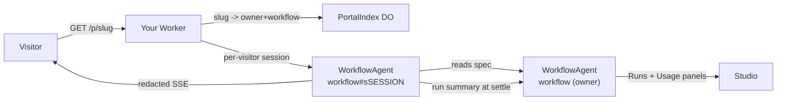

# Published Endpoints / Portal (EPIC 9)

How a workflow becomes a public surface: a shareable chat page, a typed form, or
a JSON API guarded by scoped access keys - all served by **your own** worker.

---

## The shape of it



Four things to internalise:

1. **The canvas declares the surface.** A `portal-trigger` node makes a workflow
   publishable, and its Properties are the whole configuration. Nothing is
   hidden in a dialog.
2. **Every visitor gets their own Durable Object.** A `WorkflowAgent` refuses
   concurrent runs, so a shared page would serialise to one visitor at a time.
   Portal runs execute in `{workflowId}#s{sessionId}` instances instead.
3. **The visitor stream is an allow-list, not a filter.** `toPortalEvent`
   projects a handful of event shapes and copies named fields only; everything
   else is dropped. Adding a `RunEvent` variant therefore fails *closed*.
4. **It ships with your worker.** `cloud/` **is** your worker's source, so the
   portal arrives with your next `wrangler deploy` - and only updates when you
   pull and deploy again.

---

## Publishing

1. Drag **Portal** from the Triggers palette and connect it to the agent that
   should answer.
2. Configure it in Properties: chat or form, address, heading, opening message,
   who answers, who may reach it, rate limit, appearance.
3. Open the **Portal** panel (right sidebar) and press **Publish portal**.

Publishing pushes the current workflow first, then publishes what the worker
holds - so the live portal always matches the canvas you just published.

The address is optional. Leave it blank and it is derived from the workflow name
(`Customer Intake` → `customer-intake`), falling back to a random
`portal-xxxxxxxx` when the name yields nothing usable.

---

## What your prompts receive

A visitor turn arrives as a JSON envelope, so ordinary `{{…}}` interpolation
reaches every part of it:

| Token | Contents |
|---|---|
| `{{message}}` | The visitor's latest message (chat), or a readable summary of the submitted fields (form). |
| `{{history}}` | Prior turns as `You: …` / `Assistant: …` lines. Empty on the first turn. |
| `{{fields.KEY}}` | One submitted form value. |
| `{{sessionId}}` | Opaque per-conversation id. Useful for correlating with your own systems. |
| `{{input}}` | The raw envelope. Prefer the tokens above. |

Transcript retention is 20 turns or 12,000 characters, whichever bites first,
oldest turns dropped.

> **Tip:** write prompts against `{{message}}` and `{{history}}` rather than
> `{{input}}`. A prompt that interpolates the whole envelope shows the model raw
> JSON, and small models will comment on it.

---

## Who answers

Only ONE node's output reaches the visitor: the **responder**. Everything else -
intermediate agents, routers, tool calls, reasoning - stays private.

- **Auto** (default) picks the graph's single terminal leaf.
- If the graph ends in several places, pick one explicitly. Otherwise nothing
  streams and the visitor only sees the combined result at the end.
- The responder must be a terminal leaf. A mid-graph choice is refused, because
  the visitor would see an answer while the run kept going.

---

## Access

| Mode | Behaviour |
|---|---|
| `public` | Anyone with the link. |
| `token` | Callers must present a scoped access key. |

Access keys look like `pk_{slug}_{40 chars}`:

- The slug is baked in, so a leaked key cannot be replayed against a different
  portal.
- Only a SHA-256 hash is stored. The plaintext is shown **once**, at mint time.
- Revoking deletes the hash and takes effect immediately.
- Keys survive re-publishing, so tweaking a greeting never breaks an
  integration.

Present a key as `Authorization: Bearer pk_…`, `X-Portal-Key: pk_…`, or
`?key=pk_…` in the link (the page strips it from the visible URL).

---

## Your own domain

By default a portal lives at `your-worker.workers.dev/p/{slug}`. To serve it from
`chat.your-company.com/p/{slug}` instead, set **Settings → Cloud → Portal
domain** and Deploy again.

Two things worth knowing:

- The domain's zone must already be in the same Cloudflare account. Wrangler
  attaches the DNS record itself via a `custom_domain` route.
- This changes the **public** address only. The studio keeps talking to your
  Worker URL for pushes, monitoring and run history, so owner traffic never
  rides your public marketing domain.

Phorma Cloud portals are served from our own host; there is nothing to configure.

---

## Embedding on your website

Turn on **Embed on a website** on the Portal trigger, list the sites you trust,
then copy the snippet from the Portal panel:

```html
<script src="https://your-worker.dev/portal-embed.js" data-slug="support" defer></script>
```

That injects a launcher bubble which opens the portal in an iframe. Attributes:

| Attribute | Purpose |
|---|---|
| `data-slug` | **Required.** Which portal to open. |
| `data-label` | Button text. Defaults to the Portal node's label. |
| `data-accent` | Button/header colour. Defaults to the Phorma violet. |
| `data-side` | `right` (default) or `left`. |
| `data-theme` | `light` (default), `dark`, or `auto`. See below. |
| `data-key` | A scoped access key for a token-gated portal. See the warning below. |

Details that matter:

- **Framing is refused unless you opt in.** The page sends
  `frame-ancestors 'none'` by default. Enabling embedding without listing any
  site sends `frame-ancestors *`, which the studio warns about - anyone could
  then frame your portal and wrap it in their own UI.
- **The widget defaults to light, even if the portal itself is set to `auto`.**
  A widget is a guest on your page, and `auto` follows the *visitor's* OS - so a
  visitor in dark mode would see a dark panel on your light site. Set
  `data-theme` to match your own design, or `auto` to follow the visitor.
- **Don't embed a token-gated portal on a public page.** `data-key` is readable
  by anyone viewing source. Publish embeds as `public` and rely on rate limits.
- The iframe loads on **first open**, so an unopened widget costs the host page
  nothing but the loader.
- The loader needs no inline script, so it works under a strict host CSP. It
  adds two elements, no globals, and no external requests.
- Escape closes the panel; the launcher shows a dot when an answer arrives while
  it is closed.

---

## Routes

All under `/p/{slug}` on your worker, except the loader.

| Method | Path | Purpose |
|---|---|---|
| `GET` | `/p/{slug}` | The page (self-contained HTML). |
| `GET` | `/p/{slug}/config` | Visitor-safe config. No graph, prompts or owner. |
| `POST` | `/p/{slug}/session` | Mint a conversation id. |
| `POST` | `/p/{slug}/message` | One visitor turn → `{ runId }` (202). |
| `GET` | `/p/{slug}/stream?sessionId=` | Redacted SSE for the current turn. |
| `POST` | `/p/{slug}/answer` | Reply to an Ask User question. |
| `POST` | `/p/{slug}/run` | JSON API. `?wait=1` blocks for the answer; `Accept: text/event-stream` streams. |

A one-shot call:

```bash
curl -X POST 'https://your-worker.workers.dev/p/support/run?wait=1' \
  -H 'Content-Type: application/json' \
  -H 'X-Portal-Key: pk_support_…' \
  -d '{"message":"Where is order ORD-42?"}'
# → { "runId": "cloudrun-…", "sessionId": "…", "ok": true, "output": "…" }
```

Pass the returned `sessionId` back on the next call to continue the conversation.

### Public event shapes

`started`, `token`, `question`, `review`, `review-resolved`, `done`, `error`,
`stopped`. That is the complete list.

---

## What is deliberately withheld

Never sent to a visitor, at any point:

- Prompts, system messages, skills, model ids, provider names
- Node names and node ids, graph topology, handoffs
- Tool names, tool arguments, tool results
- Token counts, costs, credits, quota state
- Raw error text (every failure becomes one fixed sentence)
- Thinking/reasoning tokens, even from the responder
- Everything inside a sub-workflow frame

Two tests pin this down:

- `cloud/test/portal-projection.test.mjs` drives **every** `RunEvent` variant
  through the projection and asserts owner-only material never survives. Pure,
  fast, deterministic - this is the authoritative proof.
- `cloud/test/portal.e2e.mjs` audits the live wire against a real Durable
  Object, asserting structural absence (no `nodeId`, no usage, no tool events)
  plus streaming provenance.

> A model may still choose to recite its own prompt in its answer. That is a
> prompt-engineering concern, not a transport leak - keep secrets out of prompts
> that a responder can reach.

---

## Human-in-the-loop

| Node | Visitor experience |
|---|---|
| **Ask User** | The question appears inline; their reply resumes the same run. |
| **Approval Gate** | "Waiting for a human to review this." You approve from the studio's Runs panel. |
| **Wait for Event** | The visitor waits with no feedback. Publishing warns about this. |

Warnings never block publishing - they describe runtime surprises, and you may
know something the validator does not.

---

## Abuse controls

- Per-visitor rate limit (default 10/min, configurable 1–120), keyed on
  connecting IP **and** conversation id, with `Retry-After` on 429.
- A hard per-slug ceiling of 60/min regardless of visitor count.
- Hosted plans cap simultaneously published portals (Starter 1, Pro 5, Teams 25).
- Quota and billing rejections are rewritten as "This assistant is temporarily
  unavailable" - a visitor never learns your billing state.

Visitors spend your model budget. Portal runs appear in Runs and Usage with a
`ti ti-world-share` badge.

---

## Local development

```bash
# Terminal 1 - a real Durable Object
npx wrangler dev --config cloud/wrangler.jsonc --port 8799

# Terminal 2 - the studio
cd frontend && npx ng serve --port 7322
```

Set Settings → Cloud → *Your own Cloudflare* with worker URL
`http://127.0.0.1:8799`, then publish. Tests:

```bash
cd cloud && npm test        # unit suites, then the live worker suite
cd cloud && npm run test:unit    # pure, no worker needed
cd cloud && npm run test:portal  # live worker + Ollama (114 checks)
npx -y tsx engine/test/portal.e2e.mts  # pure engine rails
```

`test:unit` covers redaction (`portal-projection`), the embed loader and
`frame-ancestors` (`portal-embed`), and BYO deploy-config drift
(`deploy-config`). `test:portal` needs the worker on `:8799` and a local model;
it picks the first installed Ollama model, overridable with `PORTAL_E2E_MODEL`.

### Checking the widget by hand

`cloud/test/embed-host.html` is a pretend customer site whose CSP blocks inline
script, which is the condition that breaks naive loaders. Serve it from a
*different* origin than the worker so the test is genuinely cross-origin:

```bash
npx -y http-server cloud/test --port 8123 -c-1
# then open http://127.0.0.1:8123/embed-host.html
```

Publish a portal with slug `acme-support` and `http://127.0.0.1:8123` in the
allowed origins first. Check the launcher appears, the panel matches the host
page's light theme, and a reply streams in.

> The loader is cached for 5 minutes, so after a worker change a stale launcher
> can make a fix look like it did not work. Hard-reload, or confirm with
> `curl http://127.0.0.1:8799/portal-embed.js`.

---

## Gotchas

- **`portal-page.ts` is a template literal.** A stray backtick in the CSS or JS
  strings breaks the worker build with a confusing error, and `wrangler dev`
  then hangs on every request instead of reporting it. There are no backticks in
  those blocks on purpose.
- **Durable Object routes must drain their request body.** Responding without
  reading it throws `Can't read from request stream after response has been
  sent` and wedges the caller's *next* request on that connection.
- **`this.name` throws on an RPC-reached DO.** `partyserver` only assigns it for
  requests routed through `routePartykitRequest`, so session instances carry
  their workflow id and owner instance name in state instead.
- **Session instances never arm cron.** A hundred visitors must not create a
  hundred cron jobs.
- **A deployed portal is only as new as your last deploy.** BYO workers pick up
  portal improvements when the operator updates the app, re-runs Settings > Cloud
  > Deploy runtime > **Set up runtime files** (which refreshes the bundled worker
  source in the app data workspace), and deploys again. The studio compares
  `cloud/src/build-info.ts` against the running worker and warns you. Phorma Cloud
  users never see this: we deploy their runtime.
- **Never put `account_id` or a Phorma-owned binding in the default env of
  `cloud/wrangler.jsonc`.** It is the file BYO users deploy. Anything
  Phorma-specific belongs in `env.hosted`, and `cloud/test/deploy-config.test.mjs`
  fails if that slips. The corollary: a new Durable Object needs its migration
  added to **both** `wrangler.jsonc` and `DeployConfigService`, or BYO deploys
  break while ours keep working.
- **An embedded widget must not use `theme: auto`.** `auto` follows the
  visitor's OS, so a dark-mode visitor sees a dark panel on a light host site.
  The loader sends `?theme=light` unless told otherwise.
